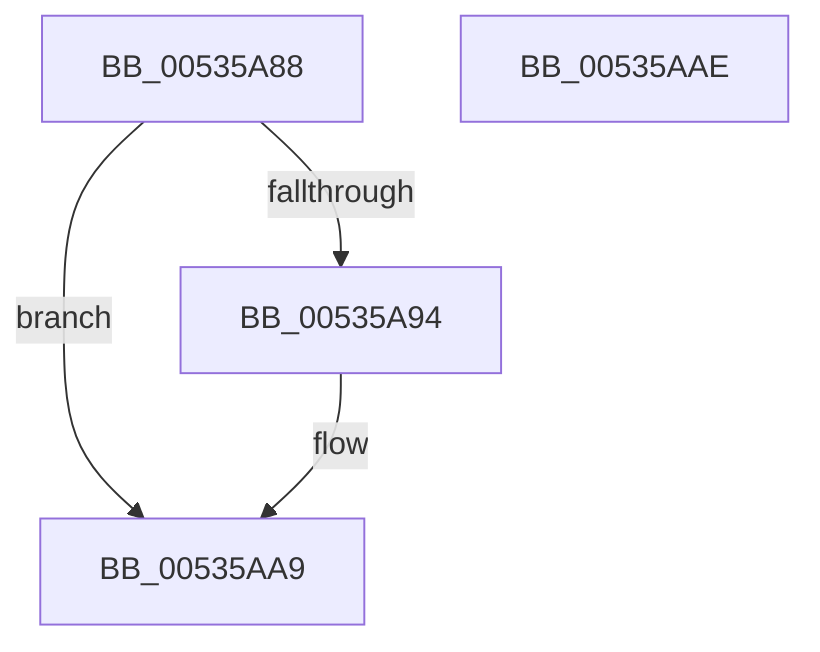

# SymCryptFdefIntCopy

- RVA: `0x00535A88`–`0x00535AAF` (길이 `39` bytes)
- VA: `0x0000000140535A88`
- 실행 섹션: `.text`
- PDB 이름 있음: `예`; PDB Function 태그: `아니요`
- unwind 정보 RVA: `0x0005C788`
- 디코드: `12`개 명령, `39/39` bytes 표시
- 미해석 바이트: `0` (있으면 어셈블리에 `.byte`로 보존)

> 이 문서는 커널 이미지의 기계어와 PDB 기호를 분석해 생성했습니다. 4번과 5번은 함수 원형과 자료형을 바이너리 사용 방식에서 추정한 C 해석이며 원본 소스 복구 결과는 아닙니다.

## 1. Dependencies

- 직접 호출 지점: **1**; 고유 호출 대상: **1**
- 직접 호출자로 확인된 함수: **2**
- RIP 상대 이미지 참조: **0**

### Outgoing calls
- `0x00535AA4` → [memcpy](../6C/memcpy_function_006C6840.md) (function, `0x006C6840`)

### Direct callers
- [SymCryptIntCopy](../52/SymCryptIntCopy_function_0052553C.md) at `0x00525540`
- [SymCryptFdefIntToDivisor](../52/SymCryptFdefIntToDivisor_function_0052DB04.md) at `0x0052DB3F`

### Static image references
- 디코드된 RIP-relative 메모리 참조가 없습니다.

## 2. Other-region calls and transfers

- 다른 실행 섹션으로 향하는 call: **0**
- 별도 외부 분기/꼬리 이동을 확인하지 못했습니다.

## 3. Assembly (complete function range)

```asm
00535A88  48 83 EC 28                     sub rsp, 0x28
00535A8C  4C 8B CA                        mov r9, rdx
00535A8F  48 3B CA                        cmp rcx, rdx
00535A92  74 15                           je 0x140535aa9
00535A94  44 8B 42 04                     mov r8d, dword ptr [rdx + 4]
00535A98  48 8D 51 20                     lea rdx, [rcx + 0x20]
00535A9C  41 C1 E0 06                     shl r8d, 6
00535AA0  49 8D 49 20                     lea rcx, [r9 + 0x20]
00535AA4  E8 97 0D 19 00                  call 0x1406c6840
00535AA9  48 83 C4 28                     add rsp, 0x28
00535AAD  C3                              ret
00535AAE  CC                              int3
```

## 4. C-style interpretation (structured pseudocode)

```c
__int64 __fastcall SymCryptFdefIntCopy(__int64 a1, __int64 a2)
{
    __int64 result;
    __int64 v_rsp;

    v_rsp = (v_rsp) - (40);
    if (a1 != a2) {
        a3 = *(unsigned int *)(a2 + 4);
        a2 = a1 + 32;
        a3 = (unsigned int)((a3) << (6));
        a1 = a2 + 32;
        result = memcpy(a1, a2, a3, a2);
    }
    v_rsp = (v_rsp) + (40);
    return result;
}
```

## 5. (Beta) C Style

```c
int64_t SymCryptFdefIntCopy(int64_t Arg1, void *Arg2)
{
    uint8_t *arg2 = (uint8_t *)Arg2;

    int64_t result;
    int64_t local_rsp;

    local_rsp = (local_rsp) - (40);
    if (Arg1 != Arg2) {
        a3 = *(uint32_t *)(arg2 + 0x4);
        Arg2 = Arg1 + 32;
        a3 = (uint32_t)((a3) << (6));
        Arg1 = Arg2 + 32;
        result = memcpy(Arg1, Arg2, a3, Arg2);
    }
    local_rsp = (local_rsp) + (40);
    return result;
}
```

### 관측된 메모리 오프셋

구조체 형식이 확인되지 않은 접근은 인자 기준의 오프셋으로만 기록했습니다.

| 기준 인자 | 오프셋 표현 | 폭 (bit) | 접근 |
|---|---:|---:|---|
| `Arg2` | `+ 0x4` | `32` | `R` |
| `Arg2` | `+ 0x20` | `64` | `R` |

## 6. Execution-region graph

[열기: 2D/3D 그래프와 함수 탐색 컨트롤 패널](../../../control-panel.html?section=text&rva=0x00535A88&view=graph)

- 2D 그래프는 위에서 아래로 흐르고, 3D 그래프는 빈 공간을 드래그해 회전합니다. Shift+드래그는 이동, 휠은 확대·축소, 함수 노드 선택은 대상 보고서 이동입니다.

### Static fallback


