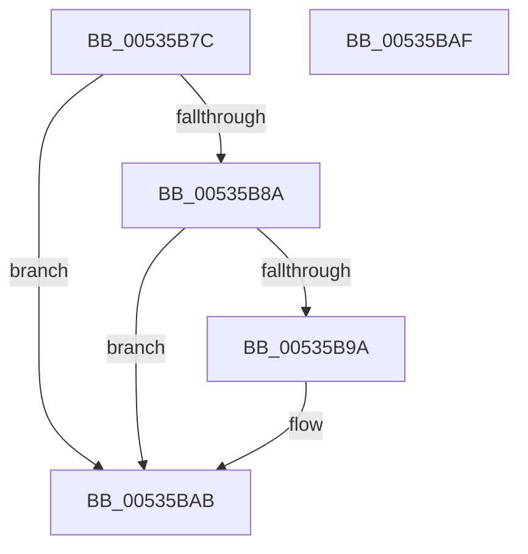

# SymCryptFdefIntCreate

- RVA: `0x00535B7C`–`0x00535BB0` (길이 `52` bytes)
- VA: `0x0000000140535B7C`
- 실행 섹션: `.text`
- PDB 이름 있음: `예`; PDB Function 태그: `아니요`
- unwind 정보 RVA: `0x000DB714`
- 디코드: `16`개 명령, `52/52` bytes 표시
- 미해석 바이트: `0` (있으면 어셈블리에 `.byte`로 보존)

> 이 문서는 커널 이미지의 기계어와 PDB 기호를 분석해 생성했습니다. 4번과 5번은 함수 원형과 자료형을 바이너리 사용 방식에서 추정한 C 해석이며 원본 소스 복구 결과는 아닙니다.

## 1. Dependencies

- 직접 호출 지점: **0**; 고유 호출 대상: **0**
- 직접 호출자로 확인된 함수: **1**
- RIP 상대 이미지 참조: **0**

### Outgoing calls
- 직접 디코드된 call 명령이 없습니다.

### Direct callers
- [SymCryptIntCreate](../52/SymCryptIntCreate_function_0052556C.md) at `0x00525570`

### Static image references
- 디코드된 RIP-relative 메모리 참조가 없습니다.

## 2. Other-region calls and transfers

- 다른 실행 섹션으로 향하는 call: **0**
- 별도 외부 분기/꼬리 이동을 확인하지 못했습니다.

## 3. Assembly (complete function range)

```asm
00535B7C  45 33 C9                        xor r9d, r9d
00535B7F  41 8D 40 FF                     lea eax, [r8 - 1]
00535B83  3D FF 07 00 00                  cmp eax, 0x7ff
00535B88  77 21                           ja 0x140535bab
00535B8A  45 8B D0                        mov r10d, r8d
00535B8D  41 C1 E2 06                     shl r10d, 6
00535B91  41 83 C2 20                     add r10d, 0x20
00535B95  49 3B D2                        cmp rdx, r10
00535B98  72 11                           jb 0x140535bab
00535B9A  4C 8B C9                        mov r9, rcx
00535B9D  C7 01 00 00 49 67               mov dword ptr [rcx], 0x67490000
00535BA3  44 89 41 04                     mov dword ptr [rcx + 4], r8d
00535BA7  44 89 51 08                     mov dword ptr [rcx + 8], r10d
00535BAB  49 8B C1                        mov rax, r9
00535BAE  C3                              ret
00535BAF  CC                              int3
```

## 4. C-style interpretation (structured pseudocode)

```c
__int64 __fastcall SymCryptFdefIntCreate(__int64 a1, __int64 a2, __int64 a3, int a4)
{
    __int64 v_r10;

    a4 = 0;
    if (((unsigned int)(a3 - 1)) > 0x7FFULL) goto loc_00535BAB;
    v_r10 = (unsigned int)(((unsigned int)((unsigned int)(a3))) << (6));
    v_r10 = (unsigned int)((v_r10) + (32));
    if (a2 >= v_r10) {
        a4 = a1;
        *(unsigned int *)(a1) = 0x67490000ULL;
        *(unsigned int *)(a1 + 4) = (unsigned int)(a3);
        *(unsigned int *)(a1 + 8) = (unsigned int)(v_r10);
    }
    return a4;
}
```

## 5. (Beta) C Style

```c
int64_t SymCryptFdefIntCreate(void *Arg1, int64_t Arg2, void *Arg3, int32_t Arg4)
{
    uint8_t *arg1 = (uint8_t *)Arg1;
    uint8_t *arg3 = (uint8_t *)Arg3;

    int64_t local_r10;

    Arg4 = 0;
    if (((uint32_t)(Arg3 - 1)) > 0x7FFULL) goto loc_00535BAB;
    local_r10 = (uint32_t)(((uint32_t)((uint32_t)(Arg3))) << (6));
    local_r10 = (uint32_t)((local_r10) + (32));
    if (Arg2 >= local_r10) {
        Arg4 = Arg1;
        *(uint32_t *)(arg1) = 0x67490000ULL;
        *(uint32_t *)(arg1 + 0x4) = (uint32_t)(Arg3);
        *(uint32_t *)(arg1 + 0x8) = (uint32_t)(local_r10);
    }
    return Arg4;
}
```

### 관측된 메모리 오프셋

구조체 형식이 확인되지 않은 접근은 인자 기준의 오프셋으로만 기록했습니다.

| 기준 인자 | 오프셋 표현 | 폭 (bit) | 접근 |
|---|---:|---:|---|
| `Arg1` | `+ 0x0` | `32` | `W` |
| `Arg1` | `+ 0x4` | `32` | `W` |
| `Arg1` | `+ 0x8` | `32` | `W` |
| `Arg3` | `- 0x1` | `32` | `R` |

## 6. Execution-region graph

[열기: 2D/3D 그래프와 함수 탐색 컨트롤 패널](../../../control-panel.html?section=text&rva=0x00535B7C&view=graph)

- 2D 그래프는 위에서 아래로 흐르고, 3D 그래프는 빈 공간을 드래그해 회전합니다. Shift+드래그는 이동, 휠은 확대·축소, 함수 노드 선택은 대상 보고서 이동입니다.

### Static fallback


