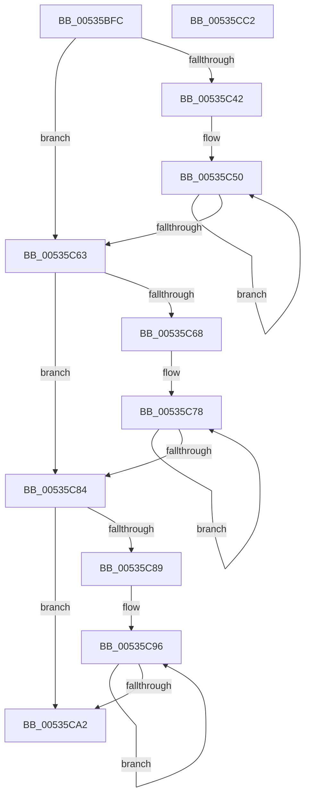

# SymCryptFdefIntIsEqual

- RVA: `0x00535BFC`–`0x00535CC3` (길이 `199` bytes)
- VA: `0x0000000140535BFC`
- 실행 섹션: `.text`
- PDB 이름 있음: `예`; PDB Function 태그: `아니요`
- unwind 정보 RVA: `0x0007AE6C`
- 디코드: `62`개 명령, `199/199` bytes 표시
- 미해석 바이트: `0` (있으면 어셈블리에 `.byte`로 보존)

> 이 문서는 커널 이미지의 기계어와 PDB 기호를 분석해 생성했습니다. 4번과 5번은 함수 원형과 자료형을 바이너리 사용 방식에서 추정한 C 해석이며 원본 소스 복구 결과는 아닙니다.

## 1. Dependencies

- 직접 호출 지점: **0**; 고유 호출 대상: **0**
- 직접 호출자로 확인된 함수: **1**
- RIP 상대 이미지 참조: **0**

### Outgoing calls
- 직접 디코드된 call 명령이 없습니다.

### Direct callers
- [SymCryptIntIsEqual](../52/SymCryptIntIsEqual_function_00525698.md) at `0x0052569C`

### Static image references
- 디코드된 RIP-relative 메모리 참조가 없습니다.

## 2. Other-region calls and transfers

- 다른 실행 섹션으로 향하는 call: **0**
- 별도 외부 분기/꼬리 이동을 확인하지 못했습니다.

## 3. Assembly (complete function range)

```asm
00535BFC  48 8B C4                        mov rax, rsp
00535BFF  48 89 58 08                     mov qword ptr [rax + 8], rbx
00535C03  48 89 70 10                     mov qword ptr [rax + 0x10], rsi
00535C07  48 89 78 18                     mov qword ptr [rax + 0x18], rdi
00535C0B  4C 89 70 20                     mov qword ptr [rax + 0x20], r14
00535C0F  44 8B 4A 04                     mov r9d, dword ptr [rdx + 4]
00535C13  4C 8D 72 20                     lea r14, [rdx + 0x20]
00535C17  44 8B 51 04                     mov r10d, dword ptr [rcx + 4]
00535C1B  48 8D 71 20                     lea rsi, [rcx + 0x20]
00535C1F  41 C1 E2 06                     shl r10d, 6
00535C23  41 C1 E1 06                     shl r9d, 6
00535C27  41 C1 EA 02                     shr r10d, 2
00535C2B  41 C1 E9 02                     shr r9d, 2
00535C2F  45 3B D1                        cmp r10d, r9d
00535C32  41 8B C1                        mov eax, r9d
00535C35  41 0F 42 C2                     cmovb eax, r10d
00535C39  33 D2                           xor edx, edx
00535C3B  44 8B C2                        mov r8d, edx
00535C3E  85 C0                           test eax, eax
00535C40  74 21                           je 0x140535c63
00535C42  49 8B DE                        mov rbx, r14
00535C45  8B F8                           mov edi, eax
00535C47  48 2B DE                        sub rbx, rsi
00535C4A  4C 8B DE                        mov r11, rsi
00535C4D  44 8B C0                        mov r8d, eax
00535C50  42 8B 0C 1B                     mov ecx, dword ptr [rbx + r11]
00535C54  41 33 0B                        xor ecx, dword ptr [r11]
00535C57  4D 8D 5B 04                     lea r11, [r11 + 4]
00535C5B  0B D1                           or edx, ecx
00535C5D  48 83 EF 01                     sub rdi, 1
00535C61  75 ED                           jne 0x140535c50
00535C63  45 3B C2                        cmp r8d, r10d
00535C66  73 1C                           jae 0x140535c84
00535C68  41 8B C0                        mov eax, r8d
00535C6B  45 8B DA                        mov r11d, r10d
00535C6E  45 2B D8                        sub r11d, r8d
00535C71  45 8B C2                        mov r8d, r10d
00535C74  48 8D 0C 86                     lea rcx, [rsi + rax*4]
00535C78  0B 11                           or edx, dword ptr [rcx]
00535C7A  48 8D 49 04                     lea rcx, [rcx + 4]
00535C7E  49 83 EB 01                     sub r11, 1
00535C82  75 F4                           jne 0x140535c78
00535C84  45 3B C1                        cmp r8d, r9d
00535C87  73 19                           jae 0x140535ca2
00535C89  41 8B C0                        mov eax, r8d
00535C8C  45 2B C8                        sub r9d, r8d
00535C8F  49 8D 0C 86                     lea rcx, [r14 + rax*4]
00535C93  41 8B C1                        mov eax, r9d
00535C96  0B 11                           or edx, dword ptr [rcx]
00535C98  48 8D 49 04                     lea rcx, [rcx + 4]
00535C9C  48 83 E8 01                     sub rax, 1
00535CA0  75 F4                           jne 0x140535c96
00535CA2  48 8B 5C 24 08                  mov rbx, qword ptr [rsp + 8]
00535CA7  48 8B 74 24 10                  mov rsi, qword ptr [rsp + 0x10]
00535CAC  48 8B 7C 24 18                  mov rdi, qword ptr [rsp + 0x18]
00535CB1  4C 8B 74 24 20                  mov r14, qword ptr [rsp + 0x20]
00535CB6  8B C2                           mov eax, edx
00535CB8  48 F7 D8                        neg rax
00535CBB  48 C1 E8 20                     shr rax, 0x20
00535CBF  F7 D0                           not eax
00535CC1  C3                              ret
00535CC2  CC                              int3
```

## 4. C-style interpretation (structured pseudocode)

```c
__int64 __fastcall SymCryptFdefIntIsEqual(__int64 a1, __int64 a2)
{
    __int64 result;
    __int64 v_r10;
    __int64 v_r11;
    __int64 v_rbx;
    __int64 v_rdi;
    unsigned __int64 v_stack_p10;
    unsigned __int64 v_stack_p18;
    unsigned __int64 v_stack_p20;
    unsigned __int64 v_stack_p8;

    *(unsigned __int64 *)(v_rsp + 8) = v_rbx;
    *(unsigned __int64 *)(v_rsp + 16) = v_rsi;
    *(unsigned __int64 *)(v_rsp + 24) = v_rdi;
    *(unsigned __int64 *)(v_rsp + 32) = v_r14;
    v_r10 = (unsigned int)(((unsigned int)(*(unsigned int *)(a1 + 4))) << (6));
    a4 = (unsigned int)(((unsigned int)(*(unsigned int *)(a2 + 4))) << (6));
    v_r10 = (unsigned int)((v_r10) >> (2));
    a4 = (unsigned int)((a4) >> (2));
    result = (unsigned int)((unsigned int)(a4));
    if (((unsigned int)(v_r10)) < ((unsigned int)(a4))) { result = (unsigned int)(v_r10); }
    a2 = 0;
    if ((unsigned int)(result) == 0) goto loc_00535C63;
    v_rbx = (a2 + 32) - (a1 + 32);
loc_00535C50:
    a1 = (unsigned int)(((unsigned int)(*(unsigned int *)(v_rbx + a1 + 32 * 1))) ^ (*(unsigned int *)(a1 + 32)));
    a2 = (unsigned int)((a2) | ((unsigned int)(a1)));
    v_rdi = ((unsigned int)((unsigned int)(result))) - (1);
    if (condition_is_not_equal) goto loc_00535C50;
loc_00535C63:
    if (((unsigned int)((unsigned int)((unsigned int)(result)))) >= ((unsigned int)(v_r10))) goto loc_00535C84;
    v_r11 = (unsigned int)(((unsigned int)((unsigned int)(v_r10))) - ((unsigned int)((unsigned int)((unsigned int)(result)))));
loc_00535C78:
    a2 = (unsigned int)((a2) | (*(unsigned int *)(a1 + 32 + (unsigned int)((unsigned int)((unsigned int)((unsigned int)(result)))) * 4)));
    v_r11 = (v_r11) - (1);
    if (condition_is_not_equal) goto loc_00535C78;
loc_00535C84:
    if (((unsigned int)((unsigned int)((unsigned int)(v_r10)))) >= ((unsigned int)(a4))) goto loc_00535CA2;
    a4 = (unsigned int)((a4) - ((unsigned int)((unsigned int)((unsigned int)(v_r10)))));
loc_00535C96:
    a2 = (unsigned int)((a2) | (*(unsigned int *)(a2 + 32 + (unsigned int)((unsigned int)((unsigned int)((unsigned int)(v_r10)))) * 4)));
    result = ((unsigned int)((unsigned int)(a4))) - (1);
    if (condition_is_not_equal) goto loc_00535C96;
loc_00535CA2:
    result = -((unsigned int)((unsigned int)(a2)));
    result = (result) >> (32);
    result = (unsigned int)(~(result));
    return result;
}
```

## 5. (Beta) C Style

```c
int64_t SymCryptFdefIntIsEqual(void *Arg1, void *Arg2)
{
    uint8_t *arg1 = (uint8_t *)Arg1;
    uint8_t *arg2 = (uint8_t *)Arg2;

    int64_t result;
    int64_t local_r10;
    int64_t local_r11;
    int64_t local_rbx;
    int64_t local_rdi;
    uint64_t v_stack_p10;
    uint64_t v_stack_p18;
    uint64_t v_stack_p20;
    uint64_t v_stack_p8;

    *(uint64_t *)(local_rsp + 0x8) = local_rbx;
    *(uint64_t *)(local_rsp + 0x10) = local_rsi;
    *(uint64_t *)(local_rsp + 0x18) = local_rdi;
    *(uint64_t *)(local_rsp + 0x20) = local_r14;
    local_r10 = (uint32_t)(((uint32_t)(*(uint32_t *)(arg1 + 0x4))) << (6));
    a4 = (uint32_t)(((uint32_t)(*(uint32_t *)(arg2 + 0x4))) << (6));
    local_r10 = (uint32_t)((local_r10) >> (2));
    a4 = (uint32_t)((a4) >> (2));
    result = (uint32_t)((uint32_t)(a4));
    if (((uint32_t)(local_r10)) < ((uint32_t)(a4))) { result = (uint32_t)(local_r10); }
    Arg2 = 0;
    if ((uint32_t)(result) == 0) goto loc_00535C63;
    local_rbx = (Arg2 + 32) - (Arg1 + 32);
loc_00535C50:
    Arg1 = (uint32_t)(((uint32_t)(*(uint32_t *)(local_rbx + arg1 + 0x20 * 1))) ^ (*(uint32_t *)(arg1 + 0x20)));
    Arg2 = (uint32_t)((Arg2) | ((uint32_t)(Arg1)));
    local_rdi = ((uint32_t)((uint32_t)(result))) - (1);
    if (condition_is_not_equal) goto loc_00535C50;
loc_00535C63:
    if (((uint32_t)((uint32_t)((uint32_t)(result)))) >= ((uint32_t)(local_r10))) goto loc_00535C84;
    local_r11 = (uint32_t)(((uint32_t)((uint32_t)(local_r10))) - ((uint32_t)((uint32_t)((uint32_t)(result)))));
loc_00535C78:
    Arg2 = (uint32_t)((Arg2) | (*(uint32_t *)(arg1 + 0x20 + (uint32_t)((uint32_t)((uint32_t)((uint32_t)(result)))) * 4)));
    local_r11 = (local_r11) - (1);
    if (condition_is_not_equal) goto loc_00535C78;
loc_00535C84:
    if (((uint32_t)((uint32_t)((uint32_t)(local_r10)))) >= ((uint32_t)(a4))) goto loc_00535CA2;
    a4 = (uint32_t)((a4) - ((uint32_t)((uint32_t)((uint32_t)(local_r10)))));
loc_00535C96:
    Arg2 = (uint32_t)((Arg2) | (*(uint32_t *)(arg2 + 0x20 + (uint32_t)((uint32_t)((uint32_t)((uint32_t)(local_r10)))) * 4)));
    result = ((uint32_t)((uint32_t)(a4))) - (1);
    if (condition_is_not_equal) goto loc_00535C96;
loc_00535CA2:
    result = -((uint32_t)((uint32_t)(Arg2)));
    result = (result) >> (32);
    result = (uint32_t)(~(result));
    return result;
}
```

### 관측된 메모리 오프셋

구조체 형식이 확인되지 않은 접근은 인자 기준의 오프셋으로만 기록했습니다.

| 기준 인자 | 오프셋 표현 | 폭 (bit) | 접근 |
|---|---:|---:|---|
| `Arg1` | `+ 0x0` | `32` | `R` |
| `Arg1` | `+ 0x0 + rax*4` | `64` | `R` |
| `Arg1` | `+ 0x4` | `32` | `R` |
| `Arg1` | `+ 0x4` | `64` | `R` |
| `Arg1` | `+ 0x20` | `64` | `R` |
| `Arg2` | `+ 0x0` | `32` | `R` |
| `Arg2` | `+ 0x0 + r11*1` | `32` | `R` |
| `Arg2` | `+ 0x0 + rax*4` | `64` | `R` |
| `Arg2` | `+ 0x4` | `32` | `R` |
| `Arg2` | `+ 0x4` | `64` | `R` |
| `Arg2` | `+ 0x20` | `64` | `R` |

## 6. Execution-region graph

[열기: 2D/3D 그래프와 함수 탐색 컨트롤 패널](../../../control-panel.html?section=text&rva=0x00535BFC&view=graph)

- 2D 그래프는 위에서 아래로 흐르고, 3D 그래프는 빈 공간을 드래그해 회전합니다. Shift+드래그는 이동, 휠은 확대·축소, 함수 노드 선택은 대상 보고서 이동입니다.

### Static fallback


