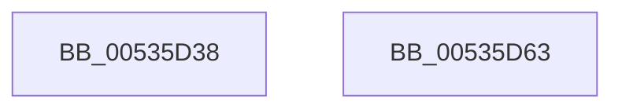

# SymCryptFdefIntSetValueUint32

- RVA: `0x00535D38`–`0x00535D64` (길이 `44` bytes)
- VA: `0x0000000140535D38`
- 실행 섹션: `.text`
- PDB 이름 있음: `예`; PDB Function 태그: `아니요`
- unwind 정보 RVA: `0x0005CAAC`
- 디코드: `15`개 명령, `44/44` bytes 표시
- 미해석 바이트: `0` (있으면 어셈블리에 `.byte`로 보존)

> 이 문서는 커널 이미지의 기계어와 PDB 기호를 분석해 생성했습니다. 4번과 5번은 함수 원형과 자료형을 바이너리 사용 방식에서 추정한 C 해석이며 원본 소스 복구 결과는 아닙니다.

## 1. Dependencies

- 직접 호출 지점: **1**; 고유 호출 대상: **1**
- 직접 호출자로 확인된 함수: **1**
- RIP 상대 이미지 참조: **0**

### Outgoing calls
- `0x00535D51` → [SymCryptWipe](../51/SymCryptWipe_function_0051F914.md) (function, `0x0051F914`)

### Direct callers
- [SymCryptIntSetValueUint32](../52/SymCryptIntSetValueUint32_function_00525748.md) at `0x0052574C`

### Static image references
- 디코드된 RIP-relative 메모리 참조가 없습니다.

## 2. Other-region calls and transfers

- 다른 실행 섹션으로 향하는 call: **0**
- 별도 외부 분기/꼬리 이동을 확인하지 못했습니다.

## 3. Assembly (complete function range)

```asm
00535D38  48 89 5C 24 08                  mov qword ptr [rsp + 8], rbx
00535D3D  57                              push rdi
00535D3E  48 83 EC 20                     sub rsp, 0x20
00535D42  48 8D 5A 20                     lea rbx, [rdx + 0x20]
00535D46  8B F9                           mov edi, ecx
00535D48  8B 52 04                        mov edx, dword ptr [rdx + 4]
00535D4B  48 8B CB                        mov rcx, rbx
00535D4E  C1 E2 06                        shl edx, 6
00535D51  E8 BE 9B FE FF                  call 0x14051f914
00535D56  89 3B                           mov dword ptr [rbx], edi
00535D58  48 8B 5C 24 30                  mov rbx, qword ptr [rsp + 0x30]
00535D5D  48 83 C4 20                     add rsp, 0x20
00535D61  5F                              pop rdi
00535D62  C3                              ret
00535D63  CC                              int3
```

## 4. C-style interpretation (structured pseudocode)

```c
__int64 __fastcall SymCryptFdefIntSetValueUint32(int a1, __int64 a2)
{
    __int64 result;
    __int64 v_rsp;
    unsigned __int64 v_stack_p8;

    v_stack_p8 = v_rbx;
    v_rsp = (v_rsp) - (32);
    a2 = (unsigned int)(((unsigned int)(*(unsigned int *)(a2 + 4))) << (6));
    result = SymCryptWipe(a2 + 32, a2, a3, a4);
    *(unsigned int *)(a2 + 32) = (unsigned int)((unsigned int)(a1));
    v_rsp = (v_rsp) + (32);
    return result;
}
```

## 5. (Beta) C Style

```c
int64_t SymCryptFdefIntSetValueUint32(int32_t Arg1, void *Arg2)
{
    uint8_t *arg2 = (uint8_t *)Arg2;

    int64_t result;
    int64_t local_rsp;
    uint64_t v_stack_p8;

    v_stack_p8 = local_rbx;
    local_rsp = (local_rsp) - (32);
    Arg2 = (uint32_t)(((uint32_t)(*(uint32_t *)(arg2 + 0x4))) << (6));
    result = SymCryptWipe(Arg2 + 32, Arg2, a3, a4);
    *(uint32_t *)(arg2 + 0x20) = (uint32_t)((uint32_t)(Arg1));
    local_rsp = (local_rsp) + (32);
    return result;
}
```

### 관측된 메모리 오프셋

구조체 형식이 확인되지 않은 접근은 인자 기준의 오프셋으로만 기록했습니다.

| 기준 인자 | 오프셋 표현 | 폭 (bit) | 접근 |
|---|---:|---:|---|
| `Arg2` | `+ 0x0` | `32` | `W` |
| `Arg2` | `+ 0x4` | `32` | `R` |
| `Arg2` | `+ 0x20` | `64` | `R` |

## 6. Execution-region graph

[열기: 2D/3D 그래프와 함수 탐색 컨트롤 패널](../../../control-panel.html?section=text&rva=0x00535D38&view=graph)

- 2D 그래프는 위에서 아래로 흐르고, 3D 그래프는 빈 공간을 드래그해 회전합니다. Shift+드래그는 이동, 휠은 확대·축소, 함수 노드 선택은 대상 보고서 이동입니다.

### Static fallback


