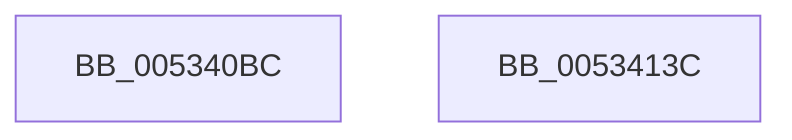

# SymCryptFdefIntToModElement

- RVA: `0x005340BC`–`0x0053413D` (길이 `129` bytes)
- VA: `0x00000001405340BC`
- 실행 섹션: `.text`
- PDB 이름 있음: `예`; PDB Function 태그: `아니요`
- unwind 정보 RVA: `0x000BCAF8`
- 디코드: `35`개 명령, `129/129` bytes 표시
- 미해석 바이트: `0` (있으면 어셈블리에 `.byte`로 보존)

> 이 문서는 커널 이미지의 기계어와 PDB 기호를 분석해 생성했습니다. 4번과 5번은 함수 원형과 자료형을 바이너리 사용 방식에서 추정한 C 해석이며 원본 소스 복구 결과는 아닙니다.

## 1. Dependencies

- 직접 호출 지점: **2**; 고유 호출 대상: **2**
- 직접 호출자로 확인된 함수: **1**
- RIP 상대 이미지 참조: **2**

### Outgoing calls
- `0x005340F9` → [SymCryptFdefRawDivMod](../52/SymCryptFdefRawDivMod_function_0052DC30.md) (function, `0x0052DC30`)
- `0x00534121` → [guard_dispatch_icall](../6B/guard_dispatch_icall_function_006BAAD0.md) (function, `0x006BAAD0`)

### Direct callers
- [SymCryptIntToModElement](../52/SymCryptIntToModElement_function_00525804.md) at `0x00525812`

### Static image references
- `0x00534104` → RVA `0x0001FC90` (`.rdata`; read)
- `0x00534113` → RVA `0x00006800` (`.rdata`; read)

## 2. Other-region calls and transfers

- 다른 실행 섹션으로 향하는 call: **0**
- 별도 외부 분기/꼬리 이동을 확인하지 못했습니다.

## 3. Assembly (complete function range)

```asm
005340BC  48 8B C4                        mov rax, rsp
005340BF  48 89 58 08                     mov qword ptr [rax + 8], rbx
005340C3  48 89 70 10                     mov qword ptr [rax + 0x10], rsi
005340C7  48 89 78 18                     mov qword ptr [rax + 0x18], rdi
005340CB  41 56                           push r14
005340CD  48 83 EC 40                     sub rsp, 0x40
005340D1  48 8B 5C 24 70                  mov rbx, qword ptr [rsp + 0x70]
005340D6  4C 8B F2                        mov r14, rdx
005340D9  8B 51 04                        mov edx, dword ptr [rcx + 4]
005340DC  49 8B F0                        mov rsi, r8
005340DF  48 89 58 E8                     mov qword ptr [rax - 0x18], rbx
005340E3  49 8B F9                        mov rdi, r9
005340E6  4C 89 48 E0                     mov qword ptr [rax - 0x20], r9
005340EA  48 83 C1 20                     add rcx, 0x20
005340EE  4D 8D 46 40                     lea r8, [r14 + 0x40]
005340F2  48 89 70 D8                     mov qword ptr [rax - 0x28], rsi
005340F6  45 33 C9                        xor r9d, r9d
005340F9  E8 32 9B FF FF                  call 0x14052dc30
005340FE  41 8B 0E                        mov ecx, dword ptr [r14]
00534101  4C 8B CB                        mov r9, rbx
00534104  8B 05 86 BB AE FF               mov eax, dword ptr [rip - 0x51447a]
0053410A  4C 8B C7                        mov r8, rdi
0053410D  48 23 C1                        and rax, rcx
00534110  48 8B D6                        mov rdx, rsi
00534113  48 8D 0D E6 26 AD FF            lea rcx, [rip - 0x52d91a]
0053411A  48 8B 04 08                     mov rax, qword ptr [rax + rcx]
0053411E  49 8B CE                        mov rcx, r14
00534121  E8 AA 69 18 00                  call 0x1406baad0
00534126  48 8B 5C 24 50                  mov rbx, qword ptr [rsp + 0x50]
0053412B  48 8B 74 24 58                  mov rsi, qword ptr [rsp + 0x58]
00534130  48 8B 7C 24 60                  mov rdi, qword ptr [rsp + 0x60]
00534135  48 83 C4 40                     add rsp, 0x40
00534139  41 5E                           pop r14
0053413B  C3                              ret
0053413C  CC                              int3
```

## 4. C-style interpretation (structured pseudocode)

```c
__int64 __fastcall SymCryptFdefIntToModElement(__int64 a1, __int64 a2, __int64 a3, __int64 a4, __int64 a5)
{
    __int64 result;
    __int64 v_rsp;
    unsigned __int64 v_stack_p10;
    unsigned __int64 v_stack_p18;
    unsigned __int64 v_stack_p8;

    *(unsigned __int64 *)(v_rsp + 8) = v_rbx;
    *(unsigned __int64 *)(v_rsp + 16) = v_rsi;
    *(unsigned __int64 *)(v_rsp + 24) = v_rdi;
    v_rsp = (v_rsp) - (64);
    *(unsigned __int64 *)(v_rsp - 24) = a5;
    *(unsigned __int64 *)(v_rsp - 32) = a4;
    a1 = (a1) + (32);
    *(unsigned __int64 *)(v_rsp - 40) = a3;
    a4 = 0;
    result = SymCryptFdefRawDivMod(a1, (unsigned int)(*(unsigned int *)(a1 + 4)), a2 + 64, a4);
    result = ((unsigned int)(*(unsigned int *)(v_rip - 5325946))) & ((unsigned int)(*(unsigned int *)(a2)));
    result = guard_dispatch_icall(a2, a3, 0, a5);
    v_rsp = (v_rsp) + (64);
    return result;
}
```

## 5. (Beta) C Style

```c
int64_t SymCryptFdefIntToModElement(void *Arg1, void *Arg2, int64_t Arg3, int64_t Arg4, int64_t Arg5)
{
    uint8_t *arg1 = (uint8_t *)Arg1;
    uint8_t *arg2 = (uint8_t *)Arg2;

    int64_t result;
    int64_t local_rsp;
    uint64_t v_stack_p10;
    uint64_t v_stack_p18;
    uint64_t v_stack_p8;

    *(uint64_t *)(local_rsp + 0x8) = local_rbx;
    *(uint64_t *)(local_rsp + 0x10) = local_rsi;
    *(uint64_t *)(local_rsp + 0x18) = local_rdi;
    local_rsp = (local_rsp) - (64);
    *(uint64_t *)(local_rsp - 0x18) = Arg5;
    *(uint64_t *)(local_rsp - 0x20) = Arg4;
    Arg1 = (Arg1) + (32);
    *(uint64_t *)(local_rsp - 0x28) = Arg3;
    Arg4 = 0;
    result = SymCryptFdefRawDivMod(Arg1, (uint32_t)(*(uint32_t *)(arg1 + 0x4)), Arg2 + 64, Arg4);
    result = ((uint32_t)(*(uint32_t *)(v_rip - 0x51447A))) & ((uint32_t)(*(uint32_t *)(arg2)));
    result = guard_dispatch_icall(Arg2, Arg3, 0, Arg5);
    local_rsp = (local_rsp) + (64);
    return result;
}
```

### 관측된 메모리 오프셋

구조체 형식이 확인되지 않은 접근은 인자 기준의 오프셋으로만 기록했습니다.

| 기준 인자 | 오프셋 표현 | 폭 (bit) | 접근 |
|---|---:|---:|---|
| `Arg1` | `+ 0x4` | `32` | `R` |
| `Arg2` | `+ 0x0` | `32` | `R` |
| `Arg2` | `+ 0x40` | `64` | `R` |

## 6. Execution-region graph

[열기: 2D/3D 그래프와 함수 탐색 컨트롤 패널](../../../control-panel.html?section=text&rva=0x005340BC&view=graph)

- 2D 그래프는 위에서 아래로 흐르고, 3D 그래프는 빈 공간을 드래그해 회전합니다. Shift+드래그는 이동, 휠은 확대·축소, 함수 노드 선택은 대상 보고서 이동입니다.

### Static fallback


