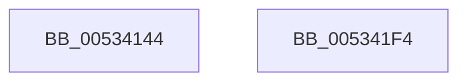

# SymCryptFdefIntToModulus

- RVA: `0x00534144`–`0x005341F5` (길이 `177` bytes)
- VA: `0x0000000140534144`
- 실행 섹션: `.text`
- PDB 이름 있음: `예`; PDB Function 태그: `아니요`
- unwind 정보 RVA: `0x00084C9C`
- 디코드: `50`개 명령, `177/177` bytes 표시
- 미해석 바이트: `0` (있으면 어셈블리에 `.byte`로 보존)

> 이 문서는 커널 이미지의 기계어와 PDB 기호를 분석해 생성했습니다. 4번과 5번은 함수 원형과 자료형을 바이너리 사용 방식에서 추정한 C 해석이며 원본 소스 복구 결과는 아닙니다.

## 1. Dependencies

- 직접 호출 지점: **5**; 고유 호출 대상: **5**
- 직접 호출자로 확인된 함수: **1**
- RIP 상대 이미지 참조: **2**

### Outgoing calls
- `0x00534185` → [SymCryptIntToDivisor](../52/SymCryptIntToDivisor_function_005257D8.md) (function, `0x005257D8`)
- `0x00534197` → [SymCryptFdefDecideModulusType](SymCryptFdefDecideModulusType_function_00533F78.md) (function, `0x00533F78`)
- `0x005341A2` → [SymCryptIntGetValueLsbits64](../52/SymCryptIntGetValueLsbits64_function_00525680.md) (function, `0x00525680`)
- `0x005341AA` → [SymCryptInverseMod2e64](SymCryptInverseMod2e64_function_00535F90.md) (function, `0x00535F90`)
- `0x005341D6` → [guard_dispatch_icall](../6B/guard_dispatch_icall_function_006BAAD0.md) (function, `0x006BAAD0`)

### Direct callers
- [SymCryptIntToModulus](../52/SymCryptIntToModulus_function_00525824.md) at `0x0052583C`

### Static image references
- `0x005341BC` → RVA `0x0001FC90` (`.rdata`; read)
- `0x005341C8` → RVA `0x00006818` (`.rdata`; read)

## 2. Other-region calls and transfers

- 다른 실행 섹션으로 향하는 call: **0**
- 별도 외부 분기/꼬리 이동을 확인하지 못했습니다.

## 3. Assembly (complete function range)

```asm
00534144  48 8B C4                        mov rax, rsp
00534147  48 89 58 08                     mov qword ptr [rax + 8], rbx
0053414B  48 89 68 10                     mov qword ptr [rax + 0x10], rbp
0053414F  48 89 70 18                     mov qword ptr [rax + 0x18], rsi
00534153  57                              push rdi
00534154  41 56                           push r14
00534156  41 57                           push r15
00534158  48 83 EC 30                     sub rsp, 0x30
0053415C  4C 8B 74 24 78                  mov r14, qword ptr [rsp + 0x78]
00534161  41 8B D9                        mov ebx, r9d
00534164  48 8B 6C 24 70                  mov rbp, qword ptr [rsp + 0x70]
00534169  4C 8B FA                        mov r15, rdx
0053416C  89 5A 0C                        mov dword ptr [rdx + 0xc], ebx
0053416F  41 83 E1 01                     and r9d, 1
00534173  4C 89 70 E0                     mov qword ptr [rax - 0x20], r14
00534177  48 83 C2 40                     add rdx, 0x40
0053417B  41 8B F8                        mov edi, r8d
0053417E  48 89 68 D8                     mov qword ptr [rax - 0x28], rbp
00534182  48 8B F1                        mov rsi, rcx
00534185  E8 4E 16 FF FF                  call 0x1405257d8
0053418A  41 8B 57 04                     mov edx, dword ptr [r15 + 4]
0053418E  44 8B CB                        mov r9d, ebx
00534191  44 8B C7                        mov r8d, edi
00534194  48 8B CE                        mov rcx, rsi
00534197  E8 DC FD FF FF                  call 0x140533f78
0053419C  48 8B CE                        mov rcx, rsi
0053419F  41 89 07                        mov dword ptr [r15], eax
005341A2  E8 D9 14 FF FF                  call 0x140525680
005341A7  48 8B C8                        mov rcx, rax
005341AA  E8 E1 1D 00 00                  call 0x140535f90
005341AF  41 8B 0F                        mov ecx, dword ptr [r15]
005341B2  48 F7 D8                        neg rax
005341B5  49 89 47 18                     mov qword ptr [r15 + 0x18], rax
005341B9  4D 8B C6                        mov r8, r14
005341BC  8B 05 CE BA AE FF               mov eax, dword ptr [rip - 0x514532]
005341C2  48 8B D5                        mov rdx, rbp
005341C5  48 23 C1                        and rax, rcx
005341C8  48 8D 0D 49 26 AD FF            lea rcx, [rip - 0x52d9b7]
005341CF  48 8B 04 08                     mov rax, qword ptr [rax + rcx]
005341D3  49 8B CF                        mov rcx, r15
005341D6  E8 F5 68 18 00                  call 0x1406baad0
005341DB  48 8B 5C 24 50                  mov rbx, qword ptr [rsp + 0x50]
005341E0  48 8B 6C 24 58                  mov rbp, qword ptr [rsp + 0x58]
005341E5  48 8B 74 24 60                  mov rsi, qword ptr [rsp + 0x60]
005341EA  48 83 C4 30                     add rsp, 0x30
005341EE  41 5F                           pop r15
005341F0  41 5E                           pop r14
005341F2  5F                              pop rdi
005341F3  C3                              ret
005341F4  CC                              int3
```

## 4. C-style interpretation (structured pseudocode)

```c
__int64 __fastcall SymCryptFdefIntToModulus(__int64 a1, __int64 a2, int a3, int a4, __int64 a5, __int64 a6)
{
    __int64 result;
    __int64 v_rsp;
    unsigned __int64 v_stack_p10;
    unsigned __int64 v_stack_p18;
    unsigned __int64 v_stack_p8;

    *(unsigned __int64 *)(v_rsp + 8) = v_rbx;
    *(unsigned __int64 *)(v_rsp + 16) = v_rbp;
    *(unsigned __int64 *)(v_rsp + 24) = v_rsi;
    v_rsp = (v_rsp) - (48);
    *(unsigned int *)(a2 + 12) = (unsigned int)((unsigned int)(a4));
    a4 = (unsigned int)((a4) & (1));
    *(unsigned __int64 *)(v_rsp - 32) = a6;
    a2 = (a2) + (64);
    *(unsigned __int64 *)(v_rsp - 40) = a5;
    result = SymCryptIntToDivisor(a1, a2, a3, a4);
    result = SymCryptFdefDecideModulusType(a1, (unsigned int)(*(unsigned int *)(a2 + 4)), (unsigned int)((unsigned int)((unsigned int)(a3))), (unsigned int)((unsigned int)((unsigned int)(a4))));
    *(unsigned int *)(a2) = (unsigned int)(result);
    result = SymCryptIntGetValueLsbits64(a1, (unsigned int)(*(unsigned int *)(a2 + 4)), (unsigned int)((unsigned int)((unsigned int)(a3))), (unsigned int)((unsigned int)((unsigned int)(a4))));
    result = SymCryptInverseMod2e64(result, (unsigned int)(*(unsigned int *)(a2 + 4)), (unsigned int)((unsigned int)((unsigned int)(a3))), (unsigned int)((unsigned int)((unsigned int)(a4))));
    result = -(result);
    *(unsigned __int64 *)(a2 + 24) = result;
    result = ((unsigned int)(*(unsigned int *)(v_rip - 5326130))) & ((unsigned int)(*(unsigned int *)(a2)));
    result = guard_dispatch_icall(a2, a5, a6, (unsigned int)((unsigned int)((unsigned int)(a4))));
    v_rsp = (v_rsp) + (48);
    return result;
}
```

## 5. (Beta) C Style

```c
int64_t SymCryptFdefIntToModulus(int64_t Arg1, void *Arg2, int32_t Arg3, int32_t Arg4, int64_t Arg5, int64_t Arg6)
{
    uint8_t *arg2 = (uint8_t *)Arg2;

    int64_t result;
    int64_t local_rsp;
    uint64_t v_stack_p10;
    uint64_t v_stack_p18;
    uint64_t v_stack_p8;

    *(uint64_t *)(local_rsp + 0x8) = local_rbx;
    *(uint64_t *)(local_rsp + 0x10) = local_rbp;
    *(uint64_t *)(local_rsp + 0x18) = local_rsi;
    local_rsp = (local_rsp) - (48);
    *(uint32_t *)(arg2 + 0xC) = (uint32_t)((uint32_t)(Arg4));
    Arg4 = (uint32_t)((Arg4) & (1));
    *(uint64_t *)(local_rsp - 0x20) = Arg6;
    Arg2 = (Arg2) + (64);
    *(uint64_t *)(local_rsp - 0x28) = Arg5;
    result = SymCryptIntToDivisor(Arg1, Arg2, Arg3, Arg4);
    result = SymCryptFdefDecideModulusType(Arg1, (uint32_t)(*(uint32_t *)(arg2 + 0x4)), (uint32_t)((uint32_t)((uint32_t)(Arg3))), (uint32_t)((uint32_t)((uint32_t)(Arg4))));
    *(uint32_t *)(arg2) = (uint32_t)(result);
    result = SymCryptIntGetValueLsbits64(Arg1, (uint32_t)(*(uint32_t *)(arg2 + 0x4)), (uint32_t)((uint32_t)((uint32_t)(Arg3))), (uint32_t)((uint32_t)((uint32_t)(Arg4))));
    result = SymCryptInverseMod2e64(result, (uint32_t)(*(uint32_t *)(arg2 + 0x4)), (uint32_t)((uint32_t)((uint32_t)(Arg3))), (uint32_t)((uint32_t)((uint32_t)(Arg4))));
    result = -(result);
    *(uint64_t *)(arg2 + 0x18) = result;
    result = ((uint32_t)(*(uint32_t *)(v_rip - 0x514532))) & ((uint32_t)(*(uint32_t *)(arg2)));
    result = guard_dispatch_icall(Arg2, Arg5, Arg6, (uint32_t)((uint32_t)((uint32_t)(Arg4))));
    local_rsp = (local_rsp) + (48);
    return result;
}
```

### 관측된 메모리 오프셋

구조체 형식이 확인되지 않은 접근은 인자 기준의 오프셋으로만 기록했습니다.

| 기준 인자 | 오프셋 표현 | 폭 (bit) | 접근 |
|---|---:|---:|---|
| `Arg2` | `+ 0x0` | `32` | `R` |
| `Arg2` | `+ 0x0` | `32` | `W` |
| `Arg2` | `+ 0x4` | `32` | `R` |
| `Arg2` | `+ 0xC` | `32` | `W` |
| `Arg2` | `+ 0x18` | `64` | `W` |

## 6. Execution-region graph

[열기: 2D/3D 그래프와 함수 탐색 컨트롤 패널](../../../control-panel.html?section=text&rva=0x00534144&view=graph)

- 2D 그래프는 위에서 아래로 흐르고, 3D 그래프는 빈 공간을 드래그해 회전합니다. Shift+드래그는 이동, 휠은 확대·축소, 함수 노드 선택은 대상 보고서 이동입니다.

### Static fallback


