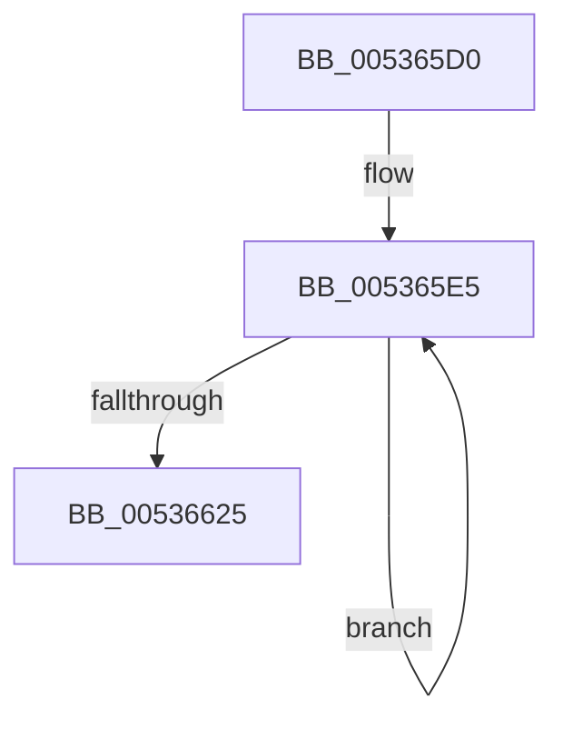

# SymCryptFdefMaskedCopyAsm

- RVA: `0x005365D0`–`0x00536626` (길이 `86` bytes)
- VA: `0x00000001405365D0`
- 실행 섹션: `.text`
- PDB 이름 있음: `예`; PDB Function 태그: `아니요`
- unwind 정보 RVA: `0x000C3108`
- 디코드: `22`개 명령, `86/86` bytes 표시
- 미해석 바이트: `0` (있으면 어셈블리에 `.byte`로 보존)

> 이 문서는 커널 이미지의 기계어와 PDB 기호를 분석해 생성했습니다. 4번과 5번은 함수 원형과 자료형을 바이너리 사용 방식에서 추정한 C 해석이며 원본 소스 복구 결과는 아닙니다.

## 1. Dependencies

- 직접 호출 지점: **0**; 고유 호출 대상: **0**
- 직접 호출자로 확인된 함수: **3**
- RIP 상대 이미지 참조: **0**

### Outgoing calls
- 직접 디코드된 call 명령이 없습니다.

### Direct callers
- [SymCryptFdefIntConditionalCopy](SymCryptFdefIntConditionalCopy_function_00535A34.md) at `0x00535A51`
- [SymCryptFdefIntMaskedCopy](SymCryptFdefIntMaskedCopy_function_00535CF0.md) at `0x00535D03`
- [SymCryptFdefMaskedCopy](SymCryptFdefMaskedCopy_function_00535DB4.md) at `0x00535DB8`

### Static image references
- 디코드된 RIP-relative 메모리 참조가 없습니다.

## 2. Other-region calls and transfers

- 다른 실행 섹션으로 향하는 call: **0**
- 별도 외부 분기/꼬리 이동을 확인하지 못했습니다.

## 3. Assembly (complete function range)

```asm
005365D0  45 03 C0                        add r8d, r8d
005365D3  66 41 0F 6E C1                  movd xmm0, r9d
005365D8  66 0F 76 C9                     pcmpeqd xmm1, xmm1
005365DC  66 0F 70 C0 00                  pshufd xmm0, xmm0, 0
005365E1  66 0F EF C8                     pxor xmm1, xmm0
005365E5  66 0F 6F 11                     movdqa xmm2, xmmword ptr [rcx]
005365E9  66 0F 6F 1A                     movdqa xmm3, xmmword ptr [rdx]
005365ED  66 0F DB D0                     pand xmm2, xmm0
005365F1  66 0F DB D9                     pand xmm3, xmm1
005365F5  66 0F EB D3                     por xmm2, xmm3
005365F9  66 0F 7F 12                     movdqa xmmword ptr [rdx], xmm2
005365FD  66 0F 6F 51 10                  movdqa xmm2, xmmword ptr [rcx + 0x10]
00536602  66 0F 6F 5A 10                  movdqa xmm3, xmmword ptr [rdx + 0x10]
00536607  66 0F DB D0                     pand xmm2, xmm0
0053660B  66 0F DB D9                     pand xmm3, xmm1
0053660F  66 0F EB D3                     por xmm2, xmm3
00536613  66 0F 7F 52 10                  movdqa xmmword ptr [rdx + 0x10], xmm2
00536618  48 83 C1 20                     add rcx, 0x20
0053661C  48 83 C2 20                     add rdx, 0x20
00536620  41 FF C8                        dec r8d
00536623  75 C0                           jne 0x1405365e5
00536625  C3                              ret
```

## 4. C-style interpretation (structured pseudocode)

```c
void __fastcall SymCryptFdefMaskedCopyAsm(__int64 a1, __int64 a2, int a3, int a4)
{
    a3 = (unsigned int)((a3) + (a3));
loc_005365E5:
    *(unsigned __int64 *)(a2) = v_xmm2;
    *(unsigned __int64 *)(a2 + 16) = v_xmm2;
    a1 = (a1) + (32);
    a2 = (a2) + (32);
    a3 = (unsigned int)((a3) - 1);
    if (condition_is_not_equal) goto loc_005365E5;
    return;
}
```

## 5. (Beta) C Style

```c
void SymCryptFdefMaskedCopyAsm(void *Arg1, void *Arg2, int32_t Arg3, int32_t Arg4)
{
    uint8_t *arg1 = (uint8_t *)Arg1;
    uint8_t *arg2 = (uint8_t *)Arg2;

    Arg3 = (uint32_t)((Arg3) + (Arg3));
loc_005365E5:
    *(uint64_t *)(arg2) = v_xmm2;
    *(uint64_t *)(arg2 + 0x10) = v_xmm2;
    Arg1 = (Arg1) + (32);
    Arg2 = (Arg2) + (32);
    Arg3 = (uint32_t)((Arg3) - 1);
    if (condition_is_not_equal) goto loc_005365E5;
    return;
}
```

### 관측된 메모리 오프셋

구조체 형식이 확인되지 않은 접근은 인자 기준의 오프셋으로만 기록했습니다.

| 기준 인자 | 오프셋 표현 | 폭 (bit) | 접근 |
|---|---:|---:|---|
| `Arg1` | `+ 0x0` | `128` | `R` |
| `Arg1` | `+ 0x10` | `128` | `R` |
| `Arg2` | `+ 0x0` | `128` | `R` |
| `Arg2` | `+ 0x0` | `128` | `W` |
| `Arg2` | `+ 0x10` | `128` | `R` |
| `Arg2` | `+ 0x10` | `128` | `W` |

## 6. Execution-region graph

[열기: 2D/3D 그래프와 함수 탐색 컨트롤 패널](../../../control-panel.html?section=text&rva=0x005365D0&view=graph)

- 2D 그래프는 위에서 아래로 흐르고, 3D 그래프는 빈 공간을 드래그해 회전합니다. Shift+드래그는 이동, 휠은 확대·축소, 함수 노드 선택은 대상 보고서 이동입니다.

### Static fallback


