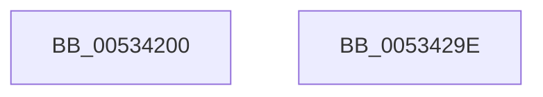

# SymCryptFdefModAddGeneric

- RVA: `0x00534200`–`0x0053429F` (길이 `159` bytes)
- VA: `0x0000000140534200`
- 실행 섹션: `.text`
- PDB 이름 있음: `예`; PDB Function 태그: `아니요`
- unwind 정보 RVA: `0x0007F3F8`
- 디코드: `43`개 명령, `159/159` bytes 표시
- 미해석 바이트: `0` (있으면 어셈블리에 `.byte`로 보존)

> 이 문서는 커널 이미지의 기계어와 PDB 기호를 분석해 생성했습니다. 4번과 5번은 함수 원형과 자료형을 바이너리 사용 방식에서 추정한 C 해석이며 원본 소스 복구 결과는 아닙니다.

## 1. Dependencies

- 직접 호출 지점: **4**; 고유 호출 대상: **4**
- 직접 호출자로 확인된 함수: **0**
- RIP 상대 이미지 참조: **0**

### Outgoing calls
- `0x0053423E` → [EmpCheckErrataList](../49/EmpCheckErrataList_function_0049E550.md) (function, `0x0049E550`)
- `0x0053424F` → [SymCryptFdefRawAdd](../52/SymCryptFdefRawAdd_function_0052DBE4.md) (function, `0x0052DBE4`)
- `0x00534268` → [SymCryptFdefRawSub](../52/SymCryptFdefRawSub_function_0052E0BC.md) (function, `0x0052E0BC`)
- `0x0053427E` → [SymCryptFdefMaskedCopy](SymCryptFdefMaskedCopy_function_00535DB4.md) (function, `0x00535DB4`)

### Direct callers
- 이 함수 시작 RVA로 연결되는 직접 call은 확인되지 않았습니다. 간접 호출은 완전히 역산할 수 없습니다.

### Static image references
- 디코드된 RIP-relative 메모리 참조가 없습니다.

## 2. Other-region calls and transfers

- 다른 실행 섹션으로 향하는 call: **0**
- 별도 외부 분기/꼬리 이동을 확인하지 못했습니다.

## 3. Assembly (complete function range)

```asm
00534200  48 8B C4                        mov rax, rsp
00534203  48 89 58 08                     mov qword ptr [rax + 8], rbx
00534207  48 89 70 10                     mov qword ptr [rax + 0x10], rsi
0053420B  48 89 78 18                     mov qword ptr [rax + 0x18], rdi
0053420F  4C 89 70 20                     mov qword ptr [rax + 0x20], r14
00534213  41 57                           push r15
00534215  48 83 EC 20                     sub rsp, 0x20
00534219  44 8B 71 04                     mov r14d, dword ptr [rcx + 4]
0053421D  49 8B D8                        mov rbx, r8
00534220  45 8B C6                        mov r8d, r14d
00534223  48 8B FA                        mov rdi, rdx
00534226  48 8B 54 24 58                  mov rdx, qword ptr [rsp + 0x58]
0053422B  48 8B F1                        mov rsi, rcx
0053422E  48 8B 4C 24 50                  mov rcx, qword ptr [rsp + 0x50]
00534233  4D 8B F9                        mov r15, r9
00534236  41 C1 E0 08                     shl r8d, 8
0053423A  41 83 C0 40                     add r8d, 0x40
0053423E  E8 0D A3 F6 FF                  call 0x14049e550
00534243  45 8B CE                        mov r9d, r14d
00534246  4D 8B C7                        mov r8, r15
00534249  48 8B D3                        mov rdx, rbx
0053424C  48 8B CF                        mov rcx, rdi
0053424F  E8 90 99 FF FF                  call 0x14052dbe4
00534254  4C 8B 44 24 50                  mov r8, qword ptr [rsp + 0x50]
00534259  48 8D 96 80 00 00 00            lea rdx, [rsi + 0x80]
00534260  45 8B CE                        mov r9d, r14d
00534263  49 8B CF                        mov rcx, r15
00534266  8B D8                           mov ebx, eax
00534268  E8 4F 9E FF FF                  call 0x14052e0bc
0053426D  48 8B 4C 24 50                  mov rcx, qword ptr [rsp + 0x50]
00534272  33 C3                           xor eax, ebx
00534274  45 8B C6                        mov r8d, r14d
00534277  49 8B D7                        mov rdx, r15
0053427A  44 8D 48 FF                     lea r9d, [rax - 1]
0053427E  E8 31 1B 00 00                  call 0x140535db4
00534283  48 8B 5C 24 30                  mov rbx, qword ptr [rsp + 0x30]
00534288  48 8B 74 24 38                  mov rsi, qword ptr [rsp + 0x38]
0053428D  48 8B 7C 24 40                  mov rdi, qword ptr [rsp + 0x40]
00534292  4C 8B 74 24 48                  mov r14, qword ptr [rsp + 0x48]
00534297  48 83 C4 20                     add rsp, 0x20
0053429B  41 5F                           pop r15
0053429D  C3                              ret
0053429E  CC                              int3
```

## 4. C-style interpretation (structured pseudocode)

```c
__int64 __fastcall SymCryptFdefModAddGeneric(__int64 a1, __int64 a2, __int64 a3, __int64 a4, __int64 a5, __int64 a6)
{
    __int64 result;
    __int64 v_rsp;
    unsigned __int64 v_stack_p10;
    unsigned __int64 v_stack_p18;
    unsigned __int64 v_stack_p20;
    unsigned __int64 v_stack_p8;

    *(unsigned __int64 *)(v_rsp + 8) = v_rbx;
    *(unsigned __int64 *)(v_rsp + 16) = v_rsi;
    *(unsigned __int64 *)(v_rsp + 24) = v_rdi;
    *(unsigned __int64 *)(v_rsp + 32) = v_r14;
    v_rsp = (v_rsp) - (32);
    a3 = (unsigned int)(((unsigned int)((unsigned int)((unsigned int)(*(unsigned int *)(a1 + 4))))) << (8));
    a3 = (unsigned int)((a3) + (64));
    result = EmpCheckErrataList(a5, a6, a3, a4);
    result = SymCryptFdefRawAdd(a2, a3, a4, (unsigned int)((unsigned int)((unsigned int)(*(unsigned int *)(a1 + 4)))));
    result = SymCryptFdefRawSub(a4, a1 + 128, a5, (unsigned int)((unsigned int)((unsigned int)(*(unsigned int *)(a1 + 4)))));
    result = (unsigned int)((result) ^ ((unsigned int)((unsigned int)((unsigned int)(result)))));
    result = SymCryptFdefMaskedCopy(a5, a4, (unsigned int)((unsigned int)((unsigned int)(*(unsigned int *)(a1 + 4)))), result - 1);
    v_rsp = (v_rsp) + (32);
    return result;
}
```

## 5. (Beta) C Style

```c
int64_t SymCryptFdefModAddGeneric(void *Arg1, int64_t Arg2, int64_t Arg3, int64_t Arg4, int64_t Arg5, int64_t Arg6)
{
    uint8_t *arg1 = (uint8_t *)Arg1;

    int64_t result;
    int64_t local_rsp;
    uint64_t v_stack_p10;
    uint64_t v_stack_p18;
    uint64_t v_stack_p20;
    uint64_t v_stack_p8;

    *(uint64_t *)(local_rsp + 0x8) = local_rbx;
    *(uint64_t *)(local_rsp + 0x10) = local_rsi;
    *(uint64_t *)(local_rsp + 0x18) = local_rdi;
    *(uint64_t *)(local_rsp + 0x20) = local_r14;
    local_rsp = (local_rsp) - (32);
    Arg3 = (uint32_t)(((uint32_t)((uint32_t)((uint32_t)(*(uint32_t *)(arg1 + 0x4))))) << (8));
    Arg3 = (uint32_t)((Arg3) + (64));
    result = EmpCheckErrataList(Arg5, Arg6, Arg3, Arg4);
    result = SymCryptFdefRawAdd(Arg2, Arg3, Arg4, (uint32_t)((uint32_t)((uint32_t)(*(uint32_t *)(arg1 + 0x4)))));
    result = SymCryptFdefRawSub(Arg4, Arg1 + 128, Arg5, (uint32_t)((uint32_t)((uint32_t)(*(uint32_t *)(arg1 + 0x4)))));
    result = (uint32_t)((result) ^ ((uint32_t)((uint32_t)((uint32_t)(result)))));
    result = SymCryptFdefMaskedCopy(Arg5, Arg4, (uint32_t)((uint32_t)((uint32_t)(*(uint32_t *)(arg1 + 0x4)))), result - 1);
    local_rsp = (local_rsp) + (32);
    return result;
}
```

### 관측된 메모리 오프셋

구조체 형식이 확인되지 않은 접근은 인자 기준의 오프셋으로만 기록했습니다.

| 기준 인자 | 오프셋 표현 | 폭 (bit) | 접근 |
|---|---:|---:|---|
| `Arg1` | `+ 0x4` | `32` | `R` |
| `Arg1` | `+ 0x80` | `64` | `R` |

## 6. Execution-region graph

[열기: 2D/3D 그래프와 함수 탐색 컨트롤 패널](../../../control-panel.html?section=text&rva=0x00534200&view=graph)

- 2D 그래프는 위에서 아래로 흐르고, 3D 그래프는 빈 공간을 드래그해 회전합니다. Shift+드래그는 이동, 휠은 확대·축소, 함수 노드 선택은 대상 보고서 이동입니다.

### Static fallback


