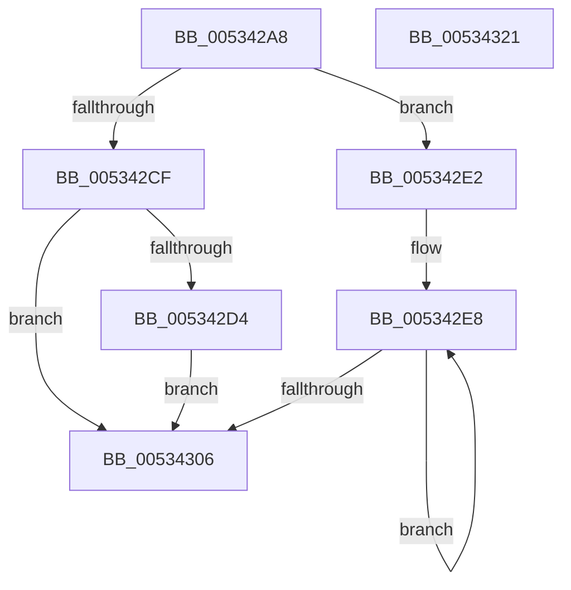

# SymCryptFdefModDivPow2

- RVA: `0x005342A8`–`0x00534322` (길이 `122` bytes)
- VA: `0x00000001405342A8`
- 실행 섹션: `.text`
- PDB 이름 있음: `예`; PDB Function 태그: `아니요`
- unwind 정보 RVA: `0x0005E6B4`
- 디코드: `37`개 명령, `122/122` bytes 표시
- 미해석 바이트: `0` (있으면 어셈블리에 `.byte`로 보존)

> 이 문서는 커널 이미지의 기계어와 PDB 기호를 분석해 생성했습니다. 4번과 5번은 함수 원형과 자료형을 바이너리 사용 방식에서 추정한 C 해석이며 원본 소스 복구 결과는 아닙니다.

## 1. Dependencies

- 직접 호출 지점: **2**; 고유 호출 대상: **2**
- 직접 호출자로 확인된 함수: **1**
- RIP 상대 이미지 참조: **0**

### Outgoing calls
- `0x005342DB` → [memcpy](../6C/memcpy_function_006C6840.md) (function, `0x006C6840`)
- `0x005342FA` → [SymCryptFdefModDivSmallPow2](SymCryptFdefModDivSmallPow2_function_00534328.md) (function, `0x00534328`)

### Direct callers
- [SymCryptModDivPow2](../52/SymCryptModDivPow2_function_005258A4.md) at `0x005258BC`

### Static image references
- 디코드된 RIP-relative 메모리 참조가 없습니다.

## 2. Other-region calls and transfers

- 다른 실행 섹션으로 향하는 call: **0**
- 별도 외부 분기/꼬리 이동을 확인하지 못했습니다.

## 3. Assembly (complete function range)

```asm
005342A8  48 8B C4                        mov rax, rsp
005342AB  48 89 58 08                     mov qword ptr [rax + 8], rbx
005342AF  48 89 68 10                     mov qword ptr [rax + 0x10], rbp
005342B3  48 89 70 18                     mov qword ptr [rax + 0x18], rsi
005342B7  48 89 78 20                     mov qword ptr [rax + 0x20], rdi
005342BB  41 56                           push r14
005342BD  48 83 EC 20                     sub rsp, 0x20
005342C1  49 8B F9                        mov rdi, r9
005342C4  41 8B F0                        mov esi, r8d
005342C7  48 8B E9                        mov rbp, rcx
005342CA  45 85 C0                        test r8d, r8d
005342CD  75 13                           jne 0x1405342e2
005342CF  49 3B D1                        cmp rdx, r9
005342D2  74 32                           je 0x140534306
005342D4  44 8B 41 10                     mov r8d, dword ptr [rcx + 0x10]
005342D8  49 8B C9                        mov rcx, r9
005342DB  E8 60 25 19 00                  call 0x1406c6840
005342E0  EB 24                           jmp 0x140534306
005342E2  41 BE 40 00 00 00               mov r14d, 0x40
005342E8  41 3B F6                        cmp esi, r14d
005342EB  8B DE                           mov ebx, esi
005342ED  4C 8B CF                        mov r9, rdi
005342F0  48 8B CD                        mov rcx, rbp
005342F3  41 0F 47 DE                     cmova ebx, r14d
005342F7  44 8B C3                        mov r8d, ebx
005342FA  E8 29 00 00 00                  call 0x140534328
005342FF  48 8B D7                        mov rdx, rdi
00534302  2B F3                           sub esi, ebx
00534304  75 E2                           jne 0x1405342e8
00534306  48 8B 5C 24 30                  mov rbx, qword ptr [rsp + 0x30]
0053430B  48 8B 6C 24 38                  mov rbp, qword ptr [rsp + 0x38]
00534310  48 8B 74 24 40                  mov rsi, qword ptr [rsp + 0x40]
00534315  48 8B 7C 24 48                  mov rdi, qword ptr [rsp + 0x48]
0053431A  48 83 C4 20                     add rsp, 0x20
0053431E  41 5E                           pop r14
00534320  C3                              ret
00534321  CC                              int3
```

## 4. C-style interpretation (structured pseudocode)

```c
__int64 __fastcall SymCryptFdefModDivPow2(__int64 a1, __int64 a2, int a3, __int64 a4)
{
    __int64 result;
    __int64 v_rbx;
    __int64 v_rsi;
    __int64 v_rsp;
    unsigned __int64 v_stack_p10;
    unsigned __int64 v_stack_p18;
    unsigned __int64 v_stack_p20;
    unsigned __int64 v_stack_p8;

    *(unsigned __int64 *)(v_rsp + 8) = v_rbx;
    *(unsigned __int64 *)(v_rsp + 16) = v_rbp;
    *(unsigned __int64 *)(v_rsp + 24) = v_rsi;
    *(unsigned __int64 *)(v_rsp + 32) = v_rdi;
    v_rsp = (v_rsp) - (32);
    if (a3 != 0) goto loc_005342E2;
    if (a2 == a4) goto loc_00534306;
    result = memcpy(a4, a2, (unsigned int)(*(unsigned int *)(a1 + 16)), a4);
    goto loc_00534306;
loc_005342E2:
loc_005342E8:
    v_rbx = (unsigned int)((unsigned int)((unsigned int)(a3)));
    if (((unsigned int)((unsigned int)(a3))) > 64) { v_rbx = 64; }
    result = SymCryptFdefModDivSmallPow2(a1, a2, (unsigned int)((unsigned int)(v_rbx)), a4);
    v_rsi = (unsigned int)(((unsigned int)(a3)) - ((unsigned int)(v_rbx)));
    if (condition_is_not_equal) goto loc_005342E8;
loc_00534306:
    v_rsp = (v_rsp) + (32);
    return result;
}
```

## 5. (Beta) C Style

```c
int64_t SymCryptFdefModDivPow2(void *Arg1, int64_t Arg2, int32_t Arg3, int64_t Arg4)
{
    uint8_t *arg1 = (uint8_t *)Arg1;

    int64_t result;
    int64_t local_rbx;
    int64_t local_rsi;
    int64_t local_rsp;
    uint64_t v_stack_p10;
    uint64_t v_stack_p18;
    uint64_t v_stack_p20;
    uint64_t v_stack_p8;

    *(uint64_t *)(local_rsp + 0x8) = local_rbx;
    *(uint64_t *)(local_rsp + 0x10) = local_rbp;
    *(uint64_t *)(local_rsp + 0x18) = local_rsi;
    *(uint64_t *)(local_rsp + 0x20) = local_rdi;
    local_rsp = (local_rsp) - (32);
    if (Arg3 != 0) goto loc_005342E2;
    if (Arg2 == Arg4) goto loc_00534306;
    result = memcpy(Arg4, Arg2, (uint32_t)(*(uint32_t *)(arg1 + 0x10)), Arg4);
    goto loc_00534306;
loc_005342E2:
loc_005342E8:
    local_rbx = (uint32_t)((uint32_t)((uint32_t)(Arg3)));
    if (((uint32_t)((uint32_t)(Arg3))) > 64) { local_rbx = 64; }
    result = SymCryptFdefModDivSmallPow2(Arg1, Arg2, (uint32_t)((uint32_t)(local_rbx)), Arg4);
    local_rsi = (uint32_t)(((uint32_t)(Arg3)) - ((uint32_t)(local_rbx)));
    if (condition_is_not_equal) goto loc_005342E8;
loc_00534306:
    local_rsp = (local_rsp) + (32);
    return result;
}
```

### 관측된 메모리 오프셋

구조체 형식이 확인되지 않은 접근은 인자 기준의 오프셋으로만 기록했습니다.

| 기준 인자 | 오프셋 표현 | 폭 (bit) | 접근 |
|---|---:|---:|---|
| `Arg1` | `+ 0x10` | `32` | `R` |

## 6. Execution-region graph

[열기: 2D/3D 그래프와 함수 탐색 컨트롤 패널](../../../control-panel.html?section=text&rva=0x005342A8&view=graph)

- 2D 그래프는 위에서 아래로 흐르고, 3D 그래프는 빈 공간을 드래그해 회전합니다. Shift+드래그는 이동, 휠은 확대·축소, 함수 노드 선택은 대상 보고서 이동입니다.

### Static fallback


