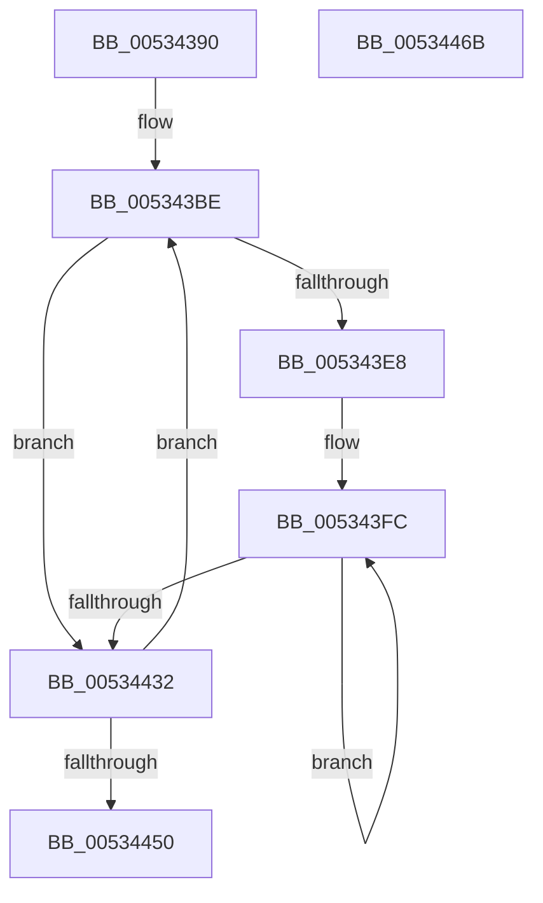

# SymCryptFdefModDivSmallPow2Generic

- RVA: `0x00534390`–`0x0053446C` (길이 `220` bytes)
- VA: `0x0000000140534390`
- 실행 섹션: `.text`
- PDB 이름 있음: `예`; PDB Function 태그: `아니요`
- unwind 정보 RVA: `0x000D0D58`
- 디코드: `67`개 명령, `220/220` bytes 표시
- 미해석 바이트: `0` (있으면 어셈블리에 `.byte`로 보존)

> 이 문서는 커널 이미지의 기계어와 PDB 기호를 분석해 생성했습니다. 4번과 5번은 함수 원형과 자료형을 바이너리 사용 방식에서 추정한 C 해석이며 원본 소스 복구 결과는 아닙니다.

## 1. Dependencies

- 직접 호출 지점: **0**; 고유 호출 대상: **0**
- 직접 호출자로 확인된 함수: **1**
- RIP 상대 이미지 참조: **0**

### Outgoing calls
- 직접 디코드된 call 명령이 없습니다.

### Direct callers
- [SymCryptFdefModDivSmallPow2](SymCryptFdefModDivSmallPow2_function_00534328.md) at `0x0053436D`

### Static image references
- 디코드된 RIP-relative 메모리 참조가 없습니다.

## 2. Other-region calls and transfers

- 다른 실행 섹션으로 향하는 call: **0**
- 별도 외부 분기/꼬리 이동을 확인하지 못했습니다.

## 3. Assembly (complete function range)

```asm
00534390  48 8B C4                        mov rax, rsp
00534393  48 89 58 08                     mov qword ptr [rax + 8], rbx
00534397  48 89 68 10                     mov qword ptr [rax + 0x10], rbp
0053439B  48 89 70 18                     mov qword ptr [rax + 0x18], rsi
0053439F  48 89 78 20                     mov qword ptr [rax + 0x20], rdi
005343A3  41 54                           push r12
005343A5  41 56                           push r14
005343A7  41 57                           push r15
005343A9  44 8B 51 04                     mov r10d, dword ptr [rcx + 4]
005343AD  4C 8D B9 80 00 00 00            lea r15, [rcx + 0x80]
005343B4  41 C1 E2 04                     shl r10d, 4
005343B8  41 8B E8                        mov ebp, r8d
005343BB  4C 8B DA                        mov r11, rdx
005343BE  41 8B 0B                        mov ecx, dword ptr [r11]
005343C1  41 BE 01 00 00 00               mov r14d, 1
005343C7  8B C1                           mov eax, ecx
005343C9  83 E0 01                        and eax, 1
005343CC  F7 D8                           neg eax
005343CE  8B D0                           mov edx, eax
005343D0  44 8B E0                        mov r12d, eax
005343D3  41 8B 07                        mov eax, dword ptr [r15]
005343D6  48 23 D0                        and rdx, rax
005343D9  48 03 D1                        add rdx, rcx
005343DC  44 8B C2                        mov r8d, edx
005343DF  48 C1 EA 20                     shr rdx, 0x20
005343E3  45 3B D6                        cmp r10d, r14d
005343E6  76 4A                           jbe 0x140534432
005343E8  49 8B FF                        mov rdi, r15
005343EB  49 8D 5B 04                     lea rbx, [r11 + 4]
005343EF  49 2B FB                        sub rdi, r11
005343F2  49 8B F1                        mov rsi, r9
005343F5  45 8D 5A FF                     lea r11d, [r10 - 1]
005343F9  45 8B F2                        mov r14d, r10d
005343FC  8B 03                           mov eax, dword ptr [rbx]
005343FE  8B 0C 1F                        mov ecx, dword ptr [rdi + rbx]
00534401  48 03 D0                        add rdx, rax
00534404  49 23 CC                        and rcx, r12
00534407  48 8D 5B 04                     lea rbx, [rbx + 4]
0053440B  48 03 D1                        add rdx, rcx
0053440E  48 8B C2                        mov rax, rdx
00534411  48 C1 EA 20                     shr rdx, 0x20
00534415  48 C1 E0 20                     shl rax, 0x20
00534419  4C 0B C0                        or r8, rax
0053441C  49 8B C0                        mov rax, r8
0053441F  49 C1 E8 20                     shr r8, 0x20
00534423  48 D1 E8                        shr rax, 1
00534426  89 06                           mov dword ptr [rsi], eax
00534428  48 8D 76 04                     lea rsi, [rsi + 4]
0053442C  49 83 EB 01                     sub r11, 1
00534430  75 CA                           jne 0x1405343fc
00534432  48 C1 E2 1F                     shl rdx, 0x1f
00534436  41 8D 46 FF                     lea eax, [r14 - 1]
0053443A  49 D1 E8                        shr r8, 1
0053443D  4D 8B D9                        mov r11, r9
00534440  41 0B D0                        or edx, r8d
00534443  41 89 14 81                     mov dword ptr [r9 + rax*4], edx
00534447  83 C5 FF                        add ebp, -1
0053444A  0F 85 6E FF FF FF               jne 0x1405343be
00534450  48 8B 5C 24 20                  mov rbx, qword ptr [rsp + 0x20]
00534455  48 8B 6C 24 28                  mov rbp, qword ptr [rsp + 0x28]
0053445A  48 8B 74 24 30                  mov rsi, qword ptr [rsp + 0x30]
0053445F  48 8B 7C 24 38                  mov rdi, qword ptr [rsp + 0x38]
00534464  41 5F                           pop r15
00534466  41 5E                           pop r14
00534468  41 5C                           pop r12
0053446A  C3                              ret
0053446B  CC                              int3
```

## 4. C-style interpretation (structured pseudocode)

```c
__int64 __fastcall SymCryptFdefModDivSmallPow2Generic(__int64 a1, __int64 a2, int a3, __int64 a4)
{
    __int64 result;
    __int64 v_r10;
    __int64 v_r11;
    __int64 v_rbp;
    __int64 v_rdi;
    unsigned __int64 v_stack_p10;
    unsigned __int64 v_stack_p18;
    unsigned __int64 v_stack_p20;
    unsigned __int64 v_stack_p8;

    *(unsigned __int64 *)(v_rsp + 8) = v_rbx;
    *(unsigned __int64 *)(v_rsp + 16) = v_rbp;
    *(unsigned __int64 *)(v_rsp + 24) = v_rsi;
    *(unsigned __int64 *)(v_rsp + 32) = v_rdi;
    v_r10 = (unsigned int)(((unsigned int)(*(unsigned int *)(a1 + 4))) << (4));
loc_005343BE:
    result = (unsigned int)(((unsigned int)((unsigned int)((unsigned int)(*(unsigned int *)(a2))))) & (1));
    result = (unsigned int)(-(result));
    a2 = ((unsigned int)((unsigned int)(result))) & ((unsigned int)(*(unsigned int *)(a1 + 128)));
    a2 = (a2) + ((unsigned int)(*(unsigned int *)(a2)));
    a2 = (a2) >> (32);
    if (((unsigned int)(v_r10)) <= 1) goto loc_00534432;
    v_rdi = (a1 + 128) - (a2);
loc_005343FC:
    a2 = (a2) + ((unsigned int)(*(unsigned int *)(a2 + 4)));
    a1 = ((unsigned int)(*(unsigned int *)(v_rdi + a2 + 4 * 1))) & ((unsigned int)((unsigned int)(result)));
    a2 = (a2) + (a1);
    a2 = (a2) >> (32);
    result = (a2) << (32);
    a3 = ((unsigned int)((unsigned int)(a2))) | (result);
    a3 = (a3) >> (32);
    result = (a3) >> (1);
    *(unsigned int *)(a4) = (unsigned int)(result);
    v_r11 = (v_r10 - 1) - (1);
    if (condition_is_not_equal) goto loc_005343FC;
loc_00534432:
    a2 = (a2) << (31);
    a3 = (a3) >> (1);
    a2 = (unsigned int)((a2) | (a3));
    *(unsigned int *)(a4 + (unsigned int)((unsigned int)(v_r10)) - 1 * 4) = (unsigned int)(a2);
    v_rbp = (unsigned int)(((unsigned int)(a3)) + (-1));
    if (condition_is_not_equal) goto loc_005343BE;
    return (unsigned int)((unsigned int)(v_r10)) - 1;
}
```

## 5. (Beta) C Style

```c
int64_t SymCryptFdefModDivSmallPow2Generic(void *Arg1, int64_t Arg2, int32_t Arg3, void *Arg4)
{
    uint8_t *arg1 = (uint8_t *)Arg1;
    uint8_t *arg4 = (uint8_t *)Arg4;

    int64_t result;
    int64_t local_r10;
    int64_t local_r11;
    int64_t local_rbp;
    int64_t local_rdi;
    uint64_t v_stack_p10;
    uint64_t v_stack_p18;
    uint64_t v_stack_p20;
    uint64_t v_stack_p8;

    *(uint64_t *)(local_rsp + 0x8) = local_rbx;
    *(uint64_t *)(local_rsp + 0x10) = local_rbp;
    *(uint64_t *)(local_rsp + 0x18) = local_rsi;
    *(uint64_t *)(local_rsp + 0x20) = local_rdi;
    local_r10 = (uint32_t)(((uint32_t)(*(uint32_t *)(arg1 + 0x4))) << (4));
loc_005343BE:
    result = (uint32_t)(((uint32_t)((uint32_t)((uint32_t)(*(uint32_t *)(Arg2))))) & (1));
    result = (uint32_t)(-(result));
    Arg2 = ((uint32_t)((uint32_t)(result))) & ((uint32_t)(*(uint32_t *)(arg1 + 0x80)));
    Arg2 = (Arg2) + ((uint32_t)(*(uint32_t *)(Arg2)));
    Arg2 = (Arg2) >> (32);
    if (((uint32_t)(local_r10)) <= 1) goto loc_00534432;
    local_rdi = (Arg1 + 128) - (Arg2);
loc_005343FC:
    Arg2 = (Arg2) + ((uint32_t)(*(uint32_t *)(Arg2 + 0x4)));
    Arg1 = ((uint32_t)(*(uint32_t *)(local_rdi + Arg2 + 0x4 * 1))) & ((uint32_t)((uint32_t)(result)));
    Arg2 = (Arg2) + (Arg1);
    Arg2 = (Arg2) >> (32);
    result = (Arg2) << (32);
    Arg3 = ((uint32_t)((uint32_t)(Arg2))) | (result);
    Arg3 = (Arg3) >> (32);
    result = (Arg3) >> (1);
    *(uint32_t *)(arg4) = (uint32_t)(result);
    local_r11 = (local_r10 - 1) - (1);
    if (condition_is_not_equal) goto loc_005343FC;
loc_00534432:
    Arg2 = (Arg2) << (31);
    Arg3 = (Arg3) >> (1);
    Arg2 = (uint32_t)((Arg2) | (Arg3));
    *(uint32_t *)(arg4 + (uint32_t)((uint32_t)(local_r10)) - 0x1 * 4) = (uint32_t)(Arg2);
    local_rbp = (uint32_t)(((uint32_t)(Arg3)) + (-1));
    if (condition_is_not_equal) goto loc_005343BE;
    return (uint32_t)((uint32_t)(local_r10)) - 1;
}
```

### 관측된 메모리 오프셋

구조체 형식이 확인되지 않은 접근은 인자 기준의 오프셋으로만 기록했습니다.

| 기준 인자 | 오프셋 표현 | 폭 (bit) | 접근 |
|---|---:|---:|---|
| `Arg1` | `+ 0x0` | `32` | `R` |
| `Arg1` | `+ 0x0 + rbx*1` | `32` | `R` |
| `Arg1` | `+ 0x4` | `32` | `R` |
| `Arg1` | `+ 0x80` | `64` | `R` |
| `Arg4` | `+ 0x0` | `32` | `W` |
| `Arg4` | `+ 0x0 + rax*4` | `32` | `W` |
| `Arg4` | `+ 0x4` | `64` | `R` |

## 6. Execution-region graph

[열기: 2D/3D 그래프와 함수 탐색 컨트롤 패널](../../../control-panel.html?section=text&rva=0x00534390&view=graph)

- 2D 그래프는 위에서 아래로 흐르고, 3D 그래프는 빈 공간을 드래그해 회전합니다. Shift+드래그는 이동, 휠은 확대·축소, 함수 노드 선택은 대상 보고서 이동입니다.

### Static fallback


