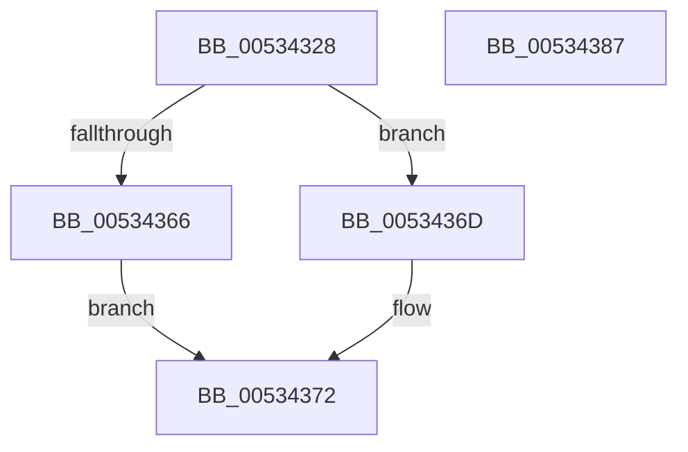

# SymCryptFdefModDivSmallPow2

- RVA: `0x00534328`–`0x00534388` (길이 `96` bytes)
- VA: `0x0000000140534328`
- 실행 섹션: `.text`
- PDB 이름 있음: `예`; PDB Function 태그: `아니요`
- unwind 정보 RVA: `0x0005C954`
- 디코드: `27`개 명령, `96/96` bytes 표시
- 미해석 바이트: `0` (있으면 어셈블리에 `.byte`로 보존)

> 이 문서는 커널 이미지의 기계어와 PDB 기호를 분석해 생성했습니다. 4번과 5번은 함수 원형과 자료형을 바이너리 사용 방식에서 추정한 C 해석이며 원본 소스 복구 결과는 아닙니다.

## 1. Dependencies

- 직접 호출 지점: **3**; 고유 호출 대상: **3**
- 직접 호출자로 확인된 함수: **2**
- RIP 상대 이미지 참조: **1**

### Outgoing calls
- `0x00534348` → [SymCryptCpuFeaturesNeverPresent](../49/SymCryptCpuFeaturesNeverPresent_function_00498CB0.md) (function, `0x00498CB0`)
- `0x00534366` → [SymCryptFdefModDivSmallPow2Mulx](../52/SymCryptFdefModDivSmallPow2Mulx_function_0052FFE0.md) (function, `0x0052FFE0`)
- `0x0053436D` → [SymCryptFdefModDivSmallPow2Generic](SymCryptFdefModDivSmallPow2Generic_function_00534390.md) (function, `0x00534390`)

### Direct callers
- [SymCryptFdefModDivPow2](SymCryptFdefModDivPow2_function_005342A8.md) at `0x005342FA`
- [SymCryptFdefModInvGeneric](SymCryptFdefModInvGeneric_function_005348C0.md) at `0x00534B52`

### Static image references
- `0x0053434D` → RVA `0x00E0A730` (`.data`; read)

## 2. Other-region calls and transfers

- 다른 실행 섹션으로 향하는 call: **0**
- 별도 외부 분기/꼬리 이동을 확인하지 못했습니다.

## 3. Assembly (complete function range)

```asm
00534328  48 89 5C 24 08                  mov qword ptr [rsp + 8], rbx
0053432D  48 89 6C 24 10                  mov qword ptr [rsp + 0x10], rbp
00534332  48 89 74 24 18                  mov qword ptr [rsp + 0x18], rsi
00534337  57                              push rdi
00534338  48 83 EC 20                     sub rsp, 0x20
0053433C  49 8B D9                        mov rbx, r9
0053433F  41 8B F8                        mov edi, r8d
00534342  48 8B F2                        mov rsi, rdx
00534345  48 8B E9                        mov rbp, rcx
00534348  E8 63 49 F6 FF                  call 0x140498cb0
0053434D  0B 05 DD 63 8D 00               or eax, dword ptr [rip + 0x8d63dd]
00534353  4C 8B CB                        mov r9, rbx
00534356  44 8B C7                        mov r8d, edi
00534359  48 8B D6                        mov rdx, rsi
0053435C  48 8B CD                        mov rcx, rbp
0053435F  A9 81 01 00 00                  test eax, 0x181
00534364  75 07                           jne 0x14053436d
00534366  E8 75 BC FF FF                  call 0x14052ffe0
0053436B  EB 05                           jmp 0x140534372
0053436D  E8 1E 00 00 00                  call 0x140534390
00534372  48 8B 5C 24 30                  mov rbx, qword ptr [rsp + 0x30]
00534377  48 8B 6C 24 38                  mov rbp, qword ptr [rsp + 0x38]
0053437C  48 8B 74 24 40                  mov rsi, qword ptr [rsp + 0x40]
00534381  48 83 C4 20                     add rsp, 0x20
00534385  5F                              pop rdi
00534386  C3                              ret
00534387  CC                              int3
```

## 4. C-style interpretation (structured pseudocode)

```c
__int64 __fastcall SymCryptFdefModDivSmallPow2(__int64 a1, __int64 a2, int a3, __int64 a4)
{
    __int64 result;
    __int64 v_rsp;
    unsigned __int64 v_stack_p10;
    unsigned __int64 v_stack_p18;
    unsigned __int64 v_stack_p8;

    v_stack_p8 = v_rbx;
    v_stack_p10 = v_rbp;
    v_stack_p18 = v_rsi;
    v_rsp = (v_rsp) - (32);
    result = SymCryptCpuFeaturesNeverPresent(a1, a2, a3, a4);
    result = (unsigned int)((result) | (*(unsigned int *)(v_rip + 9266141)));
    if ((((unsigned int)(result)) & (385)) != 0) goto loc_0053436D;
    result = SymCryptFdefModDivSmallPow2Mulx(a1, a2, (unsigned int)((unsigned int)((unsigned int)(a3))), a4);
    goto loc_00534372;
loc_0053436D:
    result = SymCryptFdefModDivSmallPow2Generic(a1, a2, (unsigned int)((unsigned int)((unsigned int)(a3))), a4);
loc_00534372:
    v_rsp = (v_rsp) + (32);
    return result;
}
```

## 5. (Beta) C Style

```c
int64_t SymCryptFdefModDivSmallPow2(int64_t Arg1, int64_t Arg2, int32_t Arg3, int64_t Arg4)
{
    int64_t result;
    int64_t local_rsp;
    uint64_t v_stack_p10;
    uint64_t v_stack_p18;
    uint64_t v_stack_p8;

    v_stack_p8 = local_rbx;
    v_stack_p10 = local_rbp;
    v_stack_p18 = local_rsi;
    local_rsp = (local_rsp) - (32);
    result = SymCryptCpuFeaturesNeverPresent(Arg1, Arg2, Arg3, Arg4);
    result = (uint32_t)((result) | (*(uint32_t *)(v_rip + 0x8D63DD)));
    if ((((uint32_t)(result)) & (385)) != 0) goto loc_0053436D;
    result = SymCryptFdefModDivSmallPow2Mulx(Arg1, Arg2, (uint32_t)((uint32_t)((uint32_t)(Arg3))), Arg4);
    goto loc_00534372;
loc_0053436D:
    result = SymCryptFdefModDivSmallPow2Generic(Arg1, Arg2, (uint32_t)((uint32_t)((uint32_t)(Arg3))), Arg4);
loc_00534372:
    local_rsp = (local_rsp) + (32);
    return result;
}
```

## 6. Execution-region graph

[열기: 2D/3D 그래프와 함수 탐색 컨트롤 패널](../../../control-panel.html?section=text&rva=0x00534328&view=graph)

- 2D 그래프는 위에서 아래로 흐르고, 3D 그래프는 빈 공간을 드래그해 회전합니다. Shift+드래그는 이동, 휠은 확대·축소, 함수 노드 선택은 대상 보고서 이동입니다.

### Static fallback


