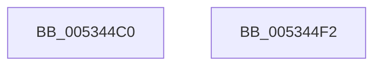

# SymCryptFdefModElementCreate

- RVA: `0x005344C0`–`0x005344F3` (길이 `51` bytes)
- VA: `0x00000001405344C0`
- 실행 섹션: `.text`
- PDB 이름 있음: `예`; PDB Function 태그: `아니요`
- unwind 정보 RVA: `0x000DB714`
- 디코드: `16`개 명령, `51/51` bytes 표시
- 미해석 바이트: `0` (있으면 어셈블리에 `.byte`로 보존)

> 이 문서는 커널 이미지의 기계어와 PDB 기호를 분석해 생성했습니다. 4번과 5번은 함수 원형과 자료형을 바이너리 사용 방식에서 추정한 C 해석이며 원본 소스 복구 결과는 아닙니다.

## 1. Dependencies

- 직접 호출 지점: **0**; 고유 호출 대상: **0**
- 직접 호출자로 확인된 함수: **1**
- RIP 상대 이미지 참조: **0**

### Outgoing calls
- 직접 디코드된 call 명령이 없습니다.

### Direct callers
- [SymCryptModElementCreate](../52/SymCryptModElementCreate_function_00525900.md) at `0x00525904`

### Static image references
- 디코드된 RIP-relative 메모리 참조가 없습니다.

## 2. Other-region calls and transfers

- 다른 실행 섹션으로 향하는 call: **0**
- 별도 외부 분기/꼬리 이동을 확인하지 못했습니다.

## 3. Assembly (complete function range)

```asm
005344C0  41 8B 50 04                     mov edx, dword ptr [r8 + 4]
005344C4  33 C0                           xor eax, eax
005344C6  C1 E2 06                        shl edx, 6
005344C9  83 EA 40                        sub edx, 0x40
005344CC  48 03 D1                        add rdx, rcx
005344CF  48 89 02                        mov qword ptr [rdx], rax
005344D2  48 89 42 08                     mov qword ptr [rdx + 8], rax
005344D6  48 89 42 10                     mov qword ptr [rdx + 0x10], rax
005344DA  48 89 42 18                     mov qword ptr [rdx + 0x18], rax
005344DE  48 89 42 20                     mov qword ptr [rdx + 0x20], rax
005344E2  48 89 42 28                     mov qword ptr [rdx + 0x28], rax
005344E6  48 89 42 30                     mov qword ptr [rdx + 0x30], rax
005344EA  48 89 42 38                     mov qword ptr [rdx + 0x38], rax
005344EE  48 8B C1                        mov rax, rcx
005344F1  C3                              ret
005344F2  CC                              int3
```

## 4. C-style interpretation (structured pseudocode)

```c
__int64 __fastcall SymCryptFdefModElementCreate(__int64 a1, __int64 a2, __int64 a3)
{
    __int64 result;

    result = 0;
    a2 = (unsigned int)(((unsigned int)(*(unsigned int *)(a3 + 4))) << (6));
    a2 = (unsigned int)((a2) - (64));
    a2 = (a2) + (a1);
    *(unsigned __int64 *)(a2) = 0;
    *(unsigned __int64 *)(a2 + 8) = 0;
    *(unsigned __int64 *)(a2 + 16) = 0;
    *(unsigned __int64 *)(a2 + 24) = 0;
    *(unsigned __int64 *)(a2 + 32) = 0;
    *(unsigned __int64 *)(a2 + 40) = 0;
    *(unsigned __int64 *)(a2 + 48) = 0;
    *(unsigned __int64 *)(a2 + 56) = 0;
    return a1;
}
```

## 5. (Beta) C Style

```c
int64_t SymCryptFdefModElementCreate(int64_t Arg1, int64_t Arg2, void *Arg3)
{
    uint8_t *arg3 = (uint8_t *)Arg3;

    int64_t result;

    result = 0;
    Arg2 = (uint32_t)(((uint32_t)(*(uint32_t *)(arg3 + 0x4))) << (6));
    Arg2 = (uint32_t)((Arg2) - (64));
    Arg2 = (Arg2) + (Arg1);
    *(uint64_t *)(Arg2) = 0;
    *(uint64_t *)(Arg2 + 0x8) = 0;
    *(uint64_t *)(Arg2 + 0x10) = 0;
    *(uint64_t *)(Arg2 + 0x18) = 0;
    *(uint64_t *)(Arg2 + 0x20) = 0;
    *(uint64_t *)(Arg2 + 0x28) = 0;
    *(uint64_t *)(Arg2 + 0x30) = 0;
    *(uint64_t *)(Arg2 + 0x38) = 0;
    return Arg1;
}
```

### 관측된 메모리 오프셋

구조체 형식이 확인되지 않은 접근은 인자 기준의 오프셋으로만 기록했습니다.

| 기준 인자 | 오프셋 표현 | 폭 (bit) | 접근 |
|---|---:|---:|---|
| `Arg3` | `+ 0x4` | `32` | `R` |

## 6. Execution-region graph

[열기: 2D/3D 그래프와 함수 탐색 컨트롤 패널](../../../control-panel.html?section=text&rva=0x005344C0&view=graph)

- 2D 그래프는 위에서 아래로 흐르고, 3D 그래프는 빈 공간을 드래그해 회전합니다. Shift+드래그는 이동, 휠은 확대·축소, 함수 노드 선택은 대상 보고서 이동입니다.

### Static fallback


