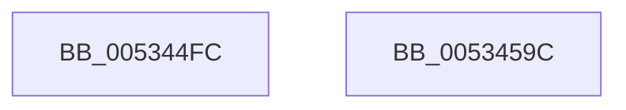

# SymCryptFdefModElementGetValue

- RVA: `0x005344FC`–`0x0053459D` (길이 `161` bytes)
- VA: `0x00000001405344FC`
- 실행 섹션: `.text`
- PDB 이름 있음: `예`; PDB Function 태그: `아니요`
- unwind 정보 RVA: `0x0005D7BC`
- 디코드: `43`개 명령, `161/161` bytes 표시
- 미해석 바이트: `0` (있으면 어셈블리에 `.byte`로 보존)

> 이 문서는 커널 이미지의 기계어와 PDB 기호를 분석해 생성했습니다. 4번과 5번은 함수 원형과 자료형을 바이너리 사용 방식에서 추정한 C 해석이며 원본 소스 복구 결과는 아닙니다.

## 1. Dependencies

- 직접 호출 지점: **3**; 고유 호출 대상: **3**
- 직접 호출자로 확인된 함수: **1**
- RIP 상대 이미지 참조: **2**

### Outgoing calls
- `0x00534539` → [EmpCheckErrataList](../49/EmpCheckErrataList_function_0049E550.md) (function, `0x0049E550`)
- `0x00534564` → [guard_dispatch_icall](../6B/guard_dispatch_icall_function_006BAAD0.md) (function, `0x006BAAD0`)
- `0x0053457C` → [SymCryptFdefRawGetValue](SymCryptFdefRawGetValue_function_00535DCC.md) (function, `0x00535DCC`)

### Direct callers
- [SymCryptModElementGetValue](../52/SymCryptModElementGetValue_function_00525918.md) at `0x0052593B`

### Static image references
- `0x00534540` → RVA `0x00006808` (`.rdata`; read)
- `0x00534547` → RVA `0x0001FC90` (`.rdata`; read)

## 2. Other-region calls and transfers

- 다른 실행 섹션으로 향하는 call: **0**
- 별도 외부 분기/꼬리 이동을 확인하지 못했습니다.

## 3. Assembly (complete function range)

```asm
005344FC  48 8B C4                        mov rax, rsp
005344FF  48 89 58 08                     mov qword ptr [rax + 8], rbx
00534503  48 89 68 10                     mov qword ptr [rax + 0x10], rbp
00534507  48 89 70 18                     mov qword ptr [rax + 0x18], rsi
0053450B  48 89 78 20                     mov qword ptr [rax + 0x20], rdi
0053450F  41 56                           push r14
00534511  48 83 EC 30                     sub rsp, 0x30
00534515  8B 71 04                        mov esi, dword ptr [rcx + 4]
00534518  4D 8B F0                        mov r14, r8
0053451B  44 8B C6                        mov r8d, esi
0053451E  48 8B DA                        mov rbx, rdx
00534521  48 8B 54 24 70                  mov rdx, qword ptr [rsp + 0x70]
00534526  48 8B F9                        mov rdi, rcx
00534529  48 8B 4C 24 68                  mov rcx, qword ptr [rsp + 0x68]
0053452E  49 8B E9                        mov rbp, r9
00534531  41 C1 E0 08                     shl r8d, 8
00534535  41 83 C0 40                     add r8d, 0x40
00534539  E8 12 A0 F6 FF                  call 0x14049e550
0053453E  8B 17                           mov edx, dword ptr [rdi]
00534540  48 8D 0D C1 22 AD FF            lea rcx, [rip - 0x52dd3f]
00534547  8B 05 43 B7 AE FF               mov eax, dword ptr [rip - 0x5148bd]
0053454D  4C 8B 4C 24 70                  mov r9, qword ptr [rsp + 0x70]
00534552  48 23 C2                        and rax, rdx
00534555  4C 8B 44 24 68                  mov r8, qword ptr [rsp + 0x68]
0053455A  48 8B D3                        mov rdx, rbx
0053455D  48 8B 04 08                     mov rax, qword ptr [rax + rcx]
00534561  48 8B CF                        mov rcx, rdi
00534564  E8 67 65 18 00                  call 0x1406baad0
00534569  8B 4C 24 60                     mov ecx, dword ptr [rsp + 0x60]
0053456D  4C 8B CD                        mov r9, rbp
00534570  89 4C 24 20                     mov dword ptr [rsp + 0x20], ecx
00534574  4D 8B C6                        mov r8, r14
00534577  48 8B C8                        mov rcx, rax
0053457A  8B D6                           mov edx, esi
0053457C  E8 4B 18 00 00                  call 0x140535dcc
00534581  48 8B 5C 24 40                  mov rbx, qword ptr [rsp + 0x40]
00534586  48 8B 6C 24 48                  mov rbp, qword ptr [rsp + 0x48]
0053458B  48 8B 74 24 50                  mov rsi, qword ptr [rsp + 0x50]
00534590  48 8B 7C 24 58                  mov rdi, qword ptr [rsp + 0x58]
00534595  48 83 C4 30                     add rsp, 0x30
00534599  41 5E                           pop r14
0053459B  C3                              ret
0053459C  CC                              int3
```

## 4. C-style interpretation (structured pseudocode)

```c
__int64 __fastcall SymCryptFdefModElementGetValue(__int64 a1, __int64 a2, __int64 a3, __int64 a4, unsigned int a5, __int64 a6, __int64 a7)
{
    __int64 result;
    __int64 v_rsp;
    unsigned int v_stack_m18;
    unsigned __int64 v_stack_p10;
    unsigned __int64 v_stack_p18;
    unsigned __int64 v_stack_p20;
    unsigned __int64 v_stack_p8;

    *(unsigned __int64 *)(v_rsp + 8) = v_rbx;
    *(unsigned __int64 *)(v_rsp + 16) = v_rbp;
    *(unsigned __int64 *)(v_rsp + 24) = v_rsi;
    *(unsigned __int64 *)(v_rsp + 32) = v_rdi;
    v_rsp = (v_rsp) - (48);
    a3 = (unsigned int)(((unsigned int)((unsigned int)((unsigned int)(*(unsigned int *)(a1 + 4))))) << (8));
    a3 = (unsigned int)((a3) + (64));
    result = EmpCheckErrataList(a6, a7, a3, a4);
    result = ((unsigned int)(*(unsigned int *)(v_rip - 5327037))) & ((unsigned int)(*(unsigned int *)(a1)));
    result = guard_dispatch_icall(a1, a2, a6, a7);
    v_stack_m18 = (unsigned int)((unsigned int)(a5));
    result = SymCryptFdefRawGetValue(result, (unsigned int)((unsigned int)((unsigned int)(*(unsigned int *)(a1 + 4)))), a3, a4);
    v_rsp = (v_rsp) + (48);
    return result;
}
```

## 5. (Beta) C Style

```c
int64_t SymCryptFdefModElementGetValue(void *Arg1, int64_t Arg2, int64_t Arg3, int64_t Arg4, uint32_t Arg5, int64_t Arg6, int64_t Arg7)
{
    uint8_t *arg1 = (uint8_t *)Arg1;

    int64_t result;
    int64_t local_rsp;
    uint32_t v_stack_m18;
    uint64_t v_stack_p10;
    uint64_t v_stack_p18;
    uint64_t v_stack_p20;
    uint64_t v_stack_p8;

    *(uint64_t *)(local_rsp + 0x8) = local_rbx;
    *(uint64_t *)(local_rsp + 0x10) = local_rbp;
    *(uint64_t *)(local_rsp + 0x18) = local_rsi;
    *(uint64_t *)(local_rsp + 0x20) = local_rdi;
    local_rsp = (local_rsp) - (48);
    Arg3 = (uint32_t)(((uint32_t)((uint32_t)((uint32_t)(*(uint32_t *)(arg1 + 0x4))))) << (8));
    Arg3 = (uint32_t)((Arg3) + (64));
    result = EmpCheckErrataList(Arg6, Arg7, Arg3, Arg4);
    result = ((uint32_t)(*(uint32_t *)(v_rip - 0x5148BD))) & ((uint32_t)(*(uint32_t *)(arg1)));
    result = guard_dispatch_icall(Arg1, Arg2, Arg6, Arg7);
    v_stack_m18 = (uint32_t)((uint32_t)(Arg5));
    result = SymCryptFdefRawGetValue(result, (uint32_t)((uint32_t)((uint32_t)(*(uint32_t *)(arg1 + 0x4)))), Arg3, Arg4);
    local_rsp = (local_rsp) + (48);
    return result;
}
```

### 관측된 메모리 오프셋

구조체 형식이 확인되지 않은 접근은 인자 기준의 오프셋으로만 기록했습니다.

| 기준 인자 | 오프셋 표현 | 폭 (bit) | 접근 |
|---|---:|---:|---|
| `Arg1` | `+ 0x0` | `32` | `R` |
| `Arg1` | `+ 0x4` | `32` | `R` |

## 6. Execution-region graph

[열기: 2D/3D 그래프와 함수 탐색 컨트롤 패널](../../../control-panel.html?section=text&rva=0x005344FC&view=graph)

- 2D 그래프는 위에서 아래로 흐르고, 3D 그래프는 빈 공간을 드래그해 회전합니다. Shift+드래그는 이동, 휠은 확대·축소, 함수 노드 선택은 대상 보고서 이동입니다.

### Static fallback


