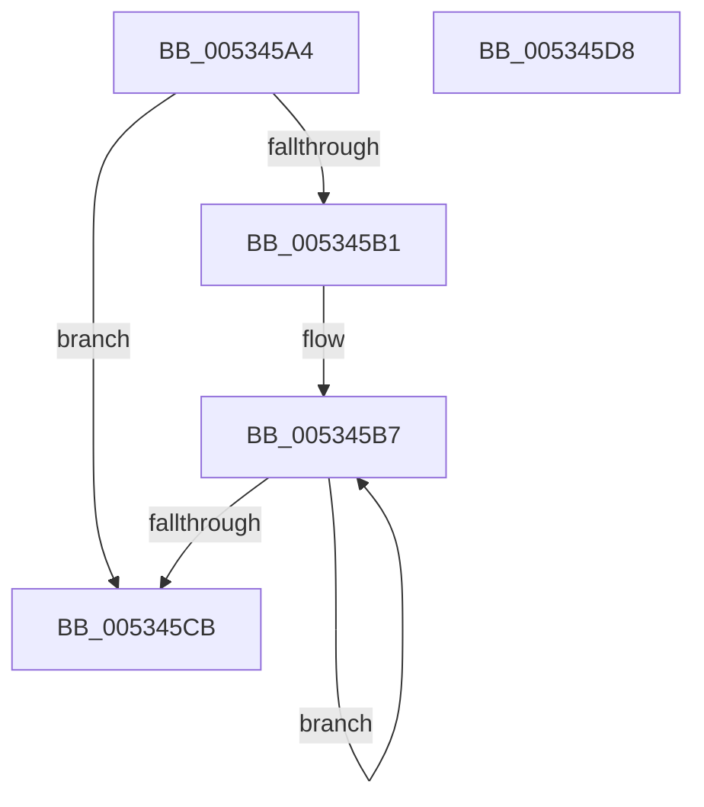

# SymCryptFdefModElementIsEqual

- RVA: `0x005345A4`–`0x005345D9` (길이 `53` bytes)
- VA: `0x00000001405345A4`
- 실행 섹션: `.text`
- PDB 이름 있음: `예`; PDB Function 태그: `아니요`
- unwind 정보 RVA: `0x000DB714`
- 디코드: `19`개 명령, `53/53` bytes 표시
- 미해석 바이트: `0` (있으면 어셈블리에 `.byte`로 보존)

> 이 문서는 커널 이미지의 기계어와 PDB 기호를 분석해 생성했습니다. 4번과 5번은 함수 원형과 자료형을 바이너리 사용 방식에서 추정한 C 해석이며 원본 소스 복구 결과는 아닙니다.

## 1. Dependencies

- 직접 호출 지점: **0**; 고유 호출 대상: **0**
- 직접 호출자로 확인된 함수: **1**
- RIP 상대 이미지 참조: **0**

### Outgoing calls
- 직접 디코드된 call 명령이 없습니다.

### Direct callers
- [SymCryptModElementIsEqual](../52/SymCryptModElementIsEqual_function_0052594C.md) at `0x00525950`

### Static image references
- 디코드된 RIP-relative 메모리 참조가 없습니다.

## 2. Other-region calls and transfers

- 다른 실행 섹션으로 향하는 call: **0**
- 별도 외부 분기/꼬리 이동을 확인하지 못했습니다.

## 3. Assembly (complete function range)

```asm
005345A4  8B 41 04                        mov eax, dword ptr [rcx + 4]
005345A7  45 33 C9                        xor r9d, r9d
005345AA  C1 E0 04                        shl eax, 4
005345AD  85 C0                           test eax, eax
005345AF  74 1A                           je 0x1405345cb
005345B1  49 2B D0                        sub rdx, r8
005345B4  44 8B D0                        mov r10d, eax
005345B7  42 8B 0C 02                     mov ecx, dword ptr [rdx + r8]
005345BB  41 33 08                        xor ecx, dword ptr [r8]
005345BE  4D 8D 40 04                     lea r8, [r8 + 4]
005345C2  44 0B C9                        or r9d, ecx
005345C5  49 83 EA 01                     sub r10, 1
005345C9  75 EC                           jne 0x1405345b7
005345CB  41 8B C1                        mov eax, r9d
005345CE  48 F7 D8                        neg rax
005345D1  48 C1 E8 20                     shr rax, 0x20
005345D5  F7 D0                           not eax
005345D7  C3                              ret
005345D8  CC                              int3
```

## 4. C-style interpretation (structured pseudocode)

```c
__int64 __fastcall SymCryptFdefModElementIsEqual(__int64 a1, __int64 a2, __int64 a3, int a4)
{
    __int64 result;
    __int64 v_r10;

    a4 = 0;
    result = (unsigned int)(((unsigned int)(*(unsigned int *)(a1 + 4))) << (4));
    if ((unsigned int)(result) == 0) goto loc_005345CB;
    a2 = (a2) - (a3);
loc_005345B7:
    a1 = (unsigned int)(((unsigned int)(*(unsigned int *)(a2 + a3 * 1))) ^ (*(unsigned int *)(a3)));
    a4 = (unsigned int)((a4) | ((unsigned int)(a1)));
    v_r10 = ((unsigned int)((unsigned int)(result))) - (1);
    if (condition_is_not_equal) goto loc_005345B7;
loc_005345CB:
    result = -((unsigned int)(a4));
    result = (result) >> (32);
    result = (unsigned int)(~(result));
    return result;
}
```

## 5. (Beta) C Style

```c
int64_t SymCryptFdefModElementIsEqual(void *Arg1, void *Arg2, void *Arg3, int32_t Arg4)
{
    uint8_t *arg1 = (uint8_t *)Arg1;
    uint8_t *arg2 = (uint8_t *)Arg2;
    uint8_t *arg3 = (uint8_t *)Arg3;

    int64_t result;
    int64_t local_r10;

    Arg4 = 0;
    result = (uint32_t)(((uint32_t)(*(uint32_t *)(arg1 + 0x4))) << (4));
    if ((uint32_t)(result) == 0) goto loc_005345CB;
    Arg2 = (Arg2) - (Arg3);
loc_005345B7:
    Arg1 = (uint32_t)(((uint32_t)(*(uint32_t *)(arg2 + arg3 * 1))) ^ (*(uint32_t *)(arg3)));
    Arg4 = (uint32_t)((Arg4) | ((uint32_t)(Arg1)));
    local_r10 = ((uint32_t)((uint32_t)(result))) - (1);
    if (condition_is_not_equal) goto loc_005345B7;
loc_005345CB:
    result = -((uint32_t)(Arg4));
    result = (result) >> (32);
    result = (uint32_t)(~(result));
    return result;
}
```

### 관측된 메모리 오프셋

구조체 형식이 확인되지 않은 접근은 인자 기준의 오프셋으로만 기록했습니다.

| 기준 인자 | 오프셋 표현 | 폭 (bit) | 접근 |
|---|---:|---:|---|
| `Arg1` | `+ 0x4` | `32` | `R` |
| `Arg2` | `+ 0x0 + r8*1` | `32` | `R` |
| `Arg3` | `+ 0x0` | `32` | `R` |
| `Arg3` | `+ 0x4` | `64` | `R` |

## 6. Execution-region graph

[열기: 2D/3D 그래프와 함수 탐색 컨트롤 패널](../../../control-panel.html?section=text&rva=0x005345A4&view=graph)

- 2D 그래프는 위에서 아래로 흐르고, 3D 그래프는 빈 공간을 드래그해 회전합니다. Shift+드래그는 이동, 휠은 확대·축소, 함수 노드 선택은 대상 보고서 이동입니다.

### Static fallback


