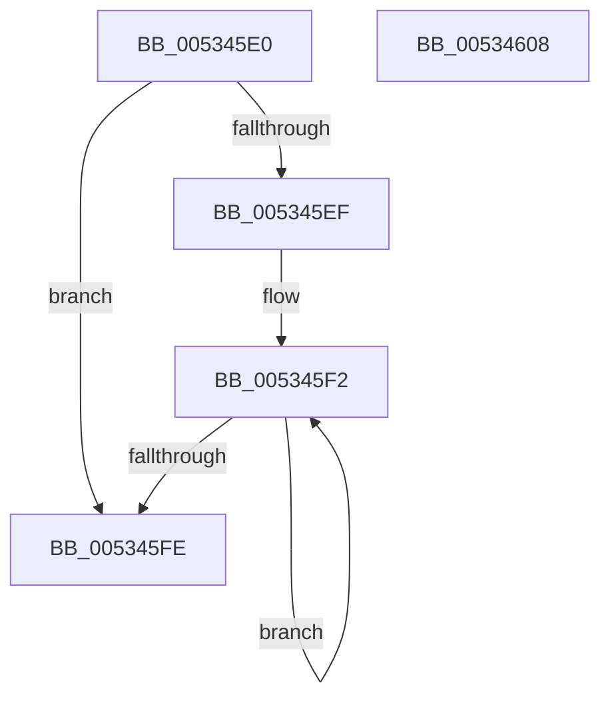

# SymCryptFdefModElementIsZero

- RVA: `0x005345E0`–`0x00534609` (길이 `41` bytes)
- VA: `0x00000001405345E0`
- 실행 섹션: `.text`
- PDB 이름 있음: `예`; PDB Function 태그: `아니요`
- unwind 정보 RVA: `0x000DB714`
- 디코드: `15`개 명령, `41/41` bytes 표시
- 미해석 바이트: `0` (있으면 어셈블리에 `.byte`로 보존)

> 이 문서는 커널 이미지의 기계어와 PDB 기호를 분석해 생성했습니다. 4번과 5번은 함수 원형과 자료형을 바이너리 사용 방식에서 추정한 C 해석이며 원본 소스 복구 결과는 아닙니다.

## 1. Dependencies

- 직접 호출 지점: **0**; 고유 호출 대상: **0**
- 직접 호출자로 확인된 함수: **1**
- RIP 상대 이미지 참조: **0**

### Outgoing calls
- 직접 디코드된 call 명령이 없습니다.

### Direct callers
- [SymCryptModElementIsZero](../52/SymCryptModElementIsZero_function_00525964.md) at `0x00525968`

### Static image references
- 디코드된 RIP-relative 메모리 참조가 없습니다.

## 2. Other-region calls and transfers

- 다른 실행 섹션으로 향하는 call: **0**
- 별도 외부 분기/꼬리 이동을 확인하지 못했습니다.

## 3. Assembly (complete function range)

```asm
005345E0  44 8B 41 04                     mov r8d, dword ptr [rcx + 4]
005345E4  33 C0                           xor eax, eax
005345E6  41 C1 E0 04                     shl r8d, 4
005345EA  45 85 C0                        test r8d, r8d
005345ED  74 0F                           je 0x1405345fe
005345EF  41 8B C8                        mov ecx, r8d
005345F2  0B 02                           or eax, dword ptr [rdx]
005345F4  48 8D 52 04                     lea rdx, [rdx + 4]
005345F8  48 83 E9 01                     sub rcx, 1
005345FC  75 F4                           jne 0x1405345f2
005345FE  48 F7 D8                        neg rax
00534601  48 C1 E8 20                     shr rax, 0x20
00534605  F7 D0                           not eax
00534607  C3                              ret
00534608  CC                              int3
```

## 4. C-style interpretation (structured pseudocode)

```c
__int64 __fastcall SymCryptFdefModElementIsZero(__int64 a1, __int64 a2)
{
    __int64 result;

    result = 0;
    a3 = (unsigned int)(((unsigned int)(*(unsigned int *)(a1 + 4))) << (4));
    if ((unsigned int)(a3) == 0) goto loc_005345FE;
loc_005345F2:
    result = (unsigned int)((result) | (*(unsigned int *)(a2)));
    a1 = ((unsigned int)((unsigned int)(a3))) - (1);
    if (condition_is_not_equal) goto loc_005345F2;
loc_005345FE:
    result = -(result);
    result = (result) >> (32);
    result = (unsigned int)(~(result));
    return result;
}
```

## 5. (Beta) C Style

```c
int64_t SymCryptFdefModElementIsZero(void *Arg1, void *Arg2)
{
    uint8_t *arg1 = (uint8_t *)Arg1;
    uint8_t *arg2 = (uint8_t *)Arg2;

    int64_t result;

    result = 0;
    a3 = (uint32_t)(((uint32_t)(*(uint32_t *)(arg1 + 0x4))) << (4));
    if ((uint32_t)(a3) == 0) goto loc_005345FE;
loc_005345F2:
    result = (uint32_t)((result) | (*(uint32_t *)(arg2)));
    Arg1 = ((uint32_t)((uint32_t)(a3))) - (1);
    if (condition_is_not_equal) goto loc_005345F2;
loc_005345FE:
    result = -(result);
    result = (result) >> (32);
    result = (uint32_t)(~(result));
    return result;
}
```

### 관측된 메모리 오프셋

구조체 형식이 확인되지 않은 접근은 인자 기준의 오프셋으로만 기록했습니다.

| 기준 인자 | 오프셋 표현 | 폭 (bit) | 접근 |
|---|---:|---:|---|
| `Arg1` | `+ 0x4` | `32` | `R` |
| `Arg2` | `+ 0x0` | `32` | `R` |
| `Arg2` | `+ 0x4` | `64` | `R` |

## 6. Execution-region graph

[열기: 2D/3D 그래프와 함수 탐색 컨트롤 패널](../../../control-panel.html?section=text&rva=0x005345E0&view=graph)

- 2D 그래프는 위에서 아래로 흐르고, 3D 그래프는 빈 공간을 드래그해 회전합니다. Shift+드래그는 이동, 휠은 확대·축소, 함수 노드 선택은 대상 보고서 이동입니다.

### Static fallback


