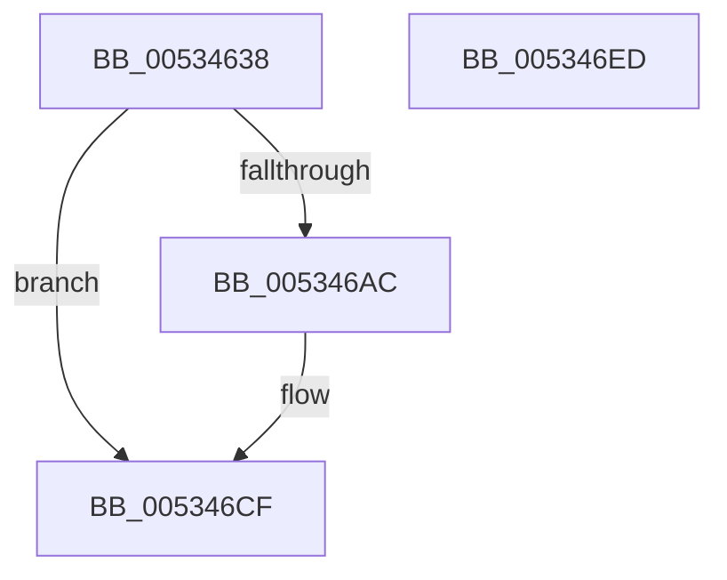

# SymCryptFdefModElementSetValueGeneric

- RVA: `0x00534638`–`0x005346EE` (길이 `182` bytes)
- VA: `0x0000000140534638`
- 실행 섹션: `.text`
- PDB 이름 있음: `예`; PDB Function 태그: `아니요`
- unwind 정보 RVA: `0x000AC264`
- 디코드: `52`개 명령, `182/182` bytes 표시
- 미해석 바이트: `0` (있으면 어셈블리에 `.byte`로 보존)

> 이 문서는 커널 이미지의 기계어와 PDB 기호를 분석해 생성했습니다. 4번과 5번은 함수 원형과 자료형을 바이너리 사용 방식에서 추정한 C 해석이며 원본 소스 복구 결과는 아닙니다.

## 1. Dependencies

- 직접 호출 지점: **3**; 고유 호출 대상: **3**
- 직접 호출자로 확인된 함수: **1**
- RIP 상대 이미지 참조: **0**

### Outgoing calls
- `0x00534685` → [EmpCheckErrataList](../49/EmpCheckErrataList_function_0049E550.md) (function, `0x0049E550`)
- `0x005346A3` → [SymCryptFdefRawSetValue](SymCryptFdefRawSetValue_function_00535EB0.md) (function, `0x00535EB0`)
- `0x005346C8` → [SymCryptFdefRawDivMod](../52/SymCryptFdefRawDivMod_function_0052DC30.md) (function, `0x0052DC30`)

### Direct callers
- [SymCryptModElementSetValue](../52/SymCryptModElementSetValue_function_00525994.md) at `0x005259CE`

### Static image references
- 디코드된 RIP-relative 메모리 참조가 없습니다.

## 2. Other-region calls and transfers

- 다른 실행 섹션으로 향하는 call: **0**
- 별도 외부 분기/꼬리 이동을 확인하지 못했습니다.

## 3. Assembly (complete function range)

```asm
00534638  48 89 5C 24 08                  mov qword ptr [rsp + 8], rbx
0053463D  48 89 6C 24 10                  mov qword ptr [rsp + 0x10], rbp
00534642  48 89 74 24 18                  mov qword ptr [rsp + 0x18], rsi
00534647  57                              push rdi
00534648  41 54                           push r12
0053464A  41 55                           push r13
0053464C  41 56                           push r14
0053464E  41 57                           push r15
00534650  48 83 EC 40                     sub rsp, 0x40
00534654  45 8B 71 04                     mov r14d, dword ptr [r9 + 4]
00534658  41 8B D8                        mov ebx, r8d
0053465B  4C 8B A4 24 A0 00 00 00         mov r12, qword ptr [rsp + 0xa0]
00534663  45 8B C6                        mov r8d, r14d
00534666  4C 8B AC 24 98 00 00 00         mov r13, qword ptr [rsp + 0x98]
0053466E  48 8B FA                        mov rdi, rdx
00534671  41 C1 E0 08                     shl r8d, 8
00534675  48 8B F1                        mov rsi, rcx
00534678  41 83 C0 40                     add r8d, 0x40
0053467C  49 8B D4                        mov rdx, r12
0053467F  49 8B CD                        mov rcx, r13
00534682  4D 8B F9                        mov r15, r9
00534685  E8 C6 9E F6 FF                  call 0x14049e550
0053468A  48 8B AC 24 90 00 00 00         mov rbp, qword ptr [rsp + 0x90]
00534692  44 8B C3                        mov r8d, ebx
00534695  4C 8B CD                        mov r9, rbp
00534698  44 89 74 24 20                  mov dword ptr [rsp + 0x20], r14d
0053469D  48 8B D7                        mov rdx, rdi
005346A0  48 8B CE                        mov rcx, rsi
005346A3  E8 08 18 00 00                  call 0x140535eb0
005346A8  85 C0                           test eax, eax
005346AA  75 23                           jne 0x1405346cf
005346AC  4C 89 64 24 30                  mov qword ptr [rsp + 0x30], r12
005346B1  4D 8D 47 40                     lea r8, [r15 + 0x40]
005346B5  4C 89 6C 24 28                  mov qword ptr [rsp + 0x28], r13
005346BA  45 33 C9                        xor r9d, r9d
005346BD  41 8B D6                        mov edx, r14d
005346C0  48 89 6C 24 20                  mov qword ptr [rsp + 0x20], rbp
005346C5  48 8B CD                        mov rcx, rbp
005346C8  E8 63 95 FF FF                  call 0x14052dc30
005346CD  33 C0                           xor eax, eax
005346CF  4C 8D 5C 24 40                  lea r11, [rsp + 0x40]
005346D4  49 8B 5B 30                     mov rbx, qword ptr [r11 + 0x30]
005346D8  49 8B 6B 38                     mov rbp, qword ptr [r11 + 0x38]
005346DC  49 8B 73 40                     mov rsi, qword ptr [r11 + 0x40]
005346E0  49 8B E3                        mov rsp, r11
005346E3  41 5F                           pop r15
005346E5  41 5E                           pop r14
005346E7  41 5D                           pop r13
005346E9  41 5C                           pop r12
005346EB  5F                              pop rdi
005346EC  C3                              ret
005346ED  CC                              int3
```

## 4. C-style interpretation (structured pseudocode)

```c
__int64 __fastcall SymCryptFdefModElementSetValueGeneric(__int64 a1, __int64 a2, int a3, __int64 a4, __int64 a5, __int64 a6, __int64 a7)
{
    __int64 result;
    __int64 v_rsp;
    unsigned __int64 v_stack_m28;
    unsigned __int64 v_stack_m38;
    unsigned __int64 v_stack_m40;
    unsigned int v_stack_m48;
    unsigned __int64 v_stack_p10;
    unsigned __int64 v_stack_p18;
    unsigned __int64 v_stack_p8;

    v_stack_p8 = v_rbx;
    v_stack_p10 = v_rbp;
    v_stack_p18 = v_rsi;
    v_rsp = (v_rsp) - (64);
    a3 = (unsigned int)(((unsigned int)((unsigned int)((unsigned int)(*(unsigned int *)(a4 + 4))))) << (8));
    a3 = (unsigned int)((a3) + (64));
    result = EmpCheckErrataList(a6, a7, a3, a4);
    v_stack_m48 = (unsigned int)((unsigned int)(*(unsigned int *)(a4 + 4)));
    result = SymCryptFdefRawSetValue(a1, a2, (unsigned int)((unsigned int)((unsigned int)(a3))), a5);
    if ((unsigned int)(result) == 0) {
        v_stack_m38 = a7;
        a3 = a4 + 64;
        v_stack_m40 = a6;
        a4 = 0;
        a2 = (unsigned int)((unsigned int)(*(unsigned int *)(a4 + 4)));
        v_stack_m48 = a5;
        a1 = a5;
        result = SymCryptFdefRawDivMod(a1, a2, a3, a4);
        result = 0;
    }
    return result;
}
```

## 5. (Beta) C Style

```c
int64_t SymCryptFdefModElementSetValueGeneric(int64_t Arg1, int64_t Arg2, int32_t Arg3, void *Arg4, int64_t Arg5, int64_t Arg6, int64_t Arg7)
{
    uint8_t *arg4 = (uint8_t *)Arg4;

    int64_t result;
    int64_t local_rsp;
    uint64_t v_stack_m28;
    uint64_t v_stack_m38;
    uint64_t v_stack_m40;
    uint32_t v_stack_m48;
    uint64_t v_stack_p10;
    uint64_t v_stack_p18;
    uint64_t v_stack_p8;

    v_stack_p8 = local_rbx;
    v_stack_p10 = local_rbp;
    v_stack_p18 = local_rsi;
    local_rsp = (local_rsp) - (64);
    Arg3 = (uint32_t)(((uint32_t)((uint32_t)((uint32_t)(*(uint32_t *)(arg4 + 0x4))))) << (8));
    Arg3 = (uint32_t)((Arg3) + (64));
    result = EmpCheckErrataList(Arg6, Arg7, Arg3, Arg4);
    v_stack_m48 = (uint32_t)((uint32_t)(*(uint32_t *)(arg4 + 0x4)));
    result = SymCryptFdefRawSetValue(Arg1, Arg2, (uint32_t)((uint32_t)((uint32_t)(Arg3))), Arg5);
    if ((uint32_t)(result) == 0) {
        v_stack_m38 = Arg7;
        Arg3 = Arg4 + 64;
        v_stack_m40 = Arg6;
        Arg4 = 0;
        Arg2 = (uint32_t)((uint32_t)(*(uint32_t *)(arg4 + 0x4)));
        v_stack_m48 = Arg5;
        Arg1 = Arg5;
        result = SymCryptFdefRawDivMod(Arg1, Arg2, Arg3, Arg4);
        result = 0;
    }
    return result;
}
```

### 관측된 메모리 오프셋

구조체 형식이 확인되지 않은 접근은 인자 기준의 오프셋으로만 기록했습니다.

| 기준 인자 | 오프셋 표현 | 폭 (bit) | 접근 |
|---|---:|---:|---|
| `Arg4` | `+ 0x4` | `32` | `R` |
| `Arg4` | `+ 0x40` | `64` | `R` |

## 6. Execution-region graph

[열기: 2D/3D 그래프와 함수 탐색 컨트롤 패널](../../../control-panel.html?section=text&rva=0x00534638&view=graph)

- 2D 그래프는 위에서 아래로 흐르고, 3D 그래프는 빈 공간을 드래그해 회전합니다. Shift+드래그는 이동, 휠은 확대·축소, 함수 노드 선택은 대상 보고서 이동입니다.

### Static fallback


