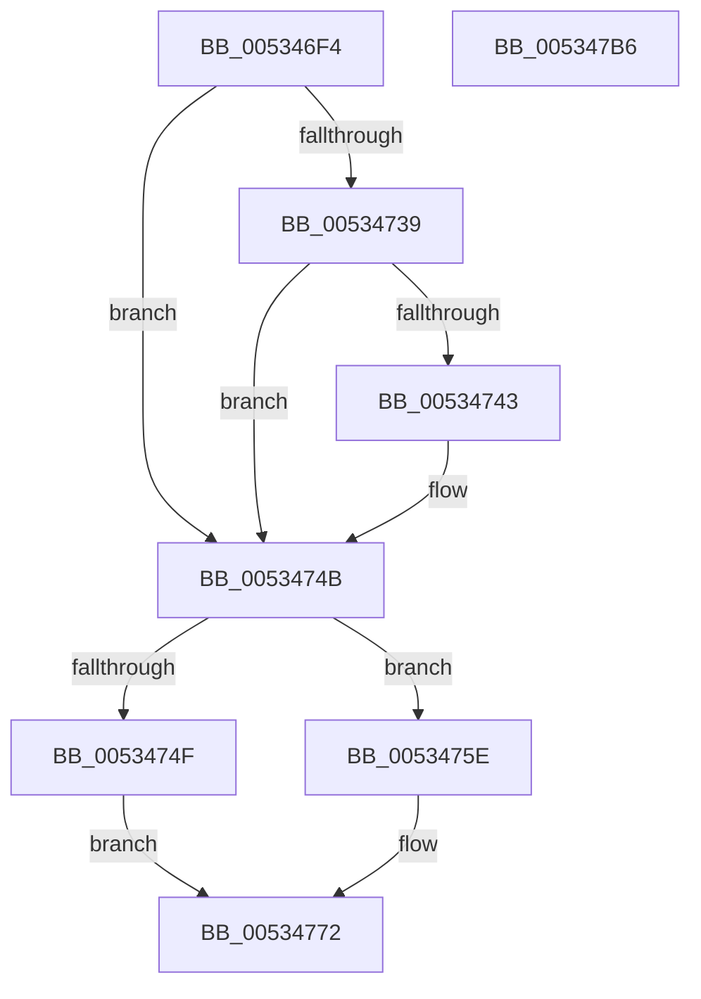

# SymCryptFdefModElementSetValueNegUint32

- RVA: `0x005346F4`–`0x005347B7` (길이 `195` bytes)
- VA: `0x00000001405346F4`
- 실행 섹션: `.text`
- PDB 이름 있음: `예`; PDB Function 태그: `아니요`
- unwind 정보 RVA: `0x0005D7BC`
- 디코드: `57`개 명령, `195/195` bytes 표시
- 미해석 바이트: `0` (있으면 어셈블리에 `.byte`로 보존)

> 이 문서는 커널 이미지의 기계어와 PDB 기호를 분석해 생성했습니다. 4번과 5번은 함수 원형과 자료형을 바이너리 사용 방식에서 추정한 C 해석이며 원본 소스 복구 결과는 아닙니다.

## 1. Dependencies

- 직접 호출 지점: **4**; 고유 호출 대상: **4**
- 직접 호출자로 확인된 함수: **1**
- RIP 상대 이미지 참조: **2**

### Outgoing calls
- `0x0053472E` → [EmpCheckErrataList](../49/EmpCheckErrataList_function_0049E550.md) (function, `0x0049E550`)
- `0x00534757` → [SymCryptWipe](../51/SymCryptWipe_function_0051F914.md) (function, `0x0051F914`)
- `0x0053476D` → [SymCryptFdefRawSubUint32](../52/SymCryptFdefRawSubUint32_function_0052E0D4.md) (function, `0x0052E0D4`)
- `0x00534796` → [guard_dispatch_icall](../6B/guard_dispatch_icall_function_006BAAD0.md) (function, `0x006BAAD0`)

### Direct callers
- [SymCryptModElementSetValueNegUint32](../52/SymCryptModElementSetValueNegUint32_function_00525A20.md) at `0x00525A2E`

### Static image references
- `0x00534777` → RVA `0x0001FC90` (`.rdata`; read)
- `0x00534788` → RVA `0x00006800` (`.rdata`; read)

## 2. Other-region calls and transfers

- 다른 실행 섹션으로 향하는 call: **0**
- 별도 외부 분기/꼬리 이동을 확인하지 못했습니다.

## 3. Assembly (complete function range)

```asm
005346F4  48 8B C4                        mov rax, rsp
005346F7  48 89 58 08                     mov qword ptr [rax + 8], rbx
005346FB  48 89 68 10                     mov qword ptr [rax + 0x10], rbp
005346FF  48 89 70 18                     mov qword ptr [rax + 0x18], rsi
00534703  48 89 78 20                     mov qword ptr [rax + 0x20], rdi
00534707  41 56                           push r14
00534709  48 83 EC 30                     sub rsp, 0x30
0053470D  8B 7A 04                        mov edi, dword ptr [rdx + 4]
00534710  49 8B E8                        mov rbp, r8
00534713  44 8B C7                        mov r8d, edi
00534716  48 8B F2                        mov rsi, rdx
00534719  48 8B 54 24 60                  mov rdx, qword ptr [rsp + 0x60]
0053471E  8B D9                           mov ebx, ecx
00534720  41 C1 E0 08                     shl r8d, 8
00534724  49 8B C9                        mov rcx, r9
00534727  41 83 C0 40                     add r8d, 0x40
0053472B  4D 8B F1                        mov r14, r9
0053472E  E8 1D 9E F6 FF                  call 0x14049e550
00534733  83 7E 4C 20                     cmp dword ptr [rsi + 0x4c], 0x20
00534737  77 12                           ja 0x14053474b
00534739  8B 8E 80 00 00 00               mov ecx, dword ptr [rsi + 0x80]
0053473F  3B D9                           cmp ebx, ecx
00534741  72 08                           jb 0x14053474b
00534743  8B C3                           mov eax, ebx
00534745  33 D2                           xor edx, edx
00534747  F7 F1                           div ecx
00534749  8B DA                           mov ebx, edx
0053474B  85 DB                           test ebx, ebx
0053474D  75 0F                           jne 0x14053475e
0053474F  C1 E7 06                        shl edi, 6
00534752  48 8B CD                        mov rcx, rbp
00534755  8B D7                           mov edx, edi
00534757  E8 B8 B1 FE FF                  call 0x14051f914
0053475C  EB 14                           jmp 0x140534772
0053475E  48 8D 8E 80 00 00 00            lea rcx, [rsi + 0x80]
00534765  44 8B CF                        mov r9d, edi
00534768  4C 8B C5                        mov r8, rbp
0053476B  8B D3                           mov edx, ebx
0053476D  E8 62 99 FF FF                  call 0x14052e0d4
00534772  8B 0E                           mov ecx, dword ptr [rsi]
00534774  4D 8B C6                        mov r8, r14
00534777  8B 05 13 B5 AE FF               mov eax, dword ptr [rip - 0x514aed]
0053477D  48 8B D5                        mov rdx, rbp
00534780  4C 8B 4C 24 60                  mov r9, qword ptr [rsp + 0x60]
00534785  48 23 C1                        and rax, rcx
00534788  48 8D 0D 71 20 AD FF            lea rcx, [rip - 0x52df8f]
0053478F  48 8B 04 08                     mov rax, qword ptr [rax + rcx]
00534793  48 8B CE                        mov rcx, rsi
00534796  E8 35 63 18 00                  call 0x1406baad0
0053479B  48 8B 5C 24 40                  mov rbx, qword ptr [rsp + 0x40]
005347A0  48 8B 6C 24 48                  mov rbp, qword ptr [rsp + 0x48]
005347A5  48 8B 74 24 50                  mov rsi, qword ptr [rsp + 0x50]
005347AA  48 8B 7C 24 58                  mov rdi, qword ptr [rsp + 0x58]
005347AF  48 83 C4 30                     add rsp, 0x30
005347B3  41 5E                           pop r14
005347B5  C3                              ret
005347B6  CC                              int3
```

## 4. C-style interpretation (structured pseudocode)

```c
__int64 __fastcall SymCryptFdefModElementSetValueNegUint32(int a1, __int64 a2, __int64 a3, __int64 a4, __int64 a5)
{
    __int64 result;
    __int64 v_rbx;
    __int64 v_rdi;
    __int64 v_rsp;
    unsigned __int64 v_stack_p10;
    unsigned __int64 v_stack_p18;
    unsigned __int64 v_stack_p20;
    unsigned __int64 v_stack_p8;

    *(unsigned __int64 *)(v_rsp + 8) = v_rbx;
    *(unsigned __int64 *)(v_rsp + 16) = v_rbp;
    *(unsigned __int64 *)(v_rsp + 24) = v_rsi;
    *(unsigned __int64 *)(v_rsp + 32) = v_rdi;
    v_rsp = (v_rsp) - (48);
    a3 = (unsigned int)(((unsigned int)((unsigned int)((unsigned int)(*(unsigned int *)(a2 + 4))))) << (8));
    a3 = (unsigned int)((a3) + (64));
    result = EmpCheckErrataList(a4, a5, a3, a4);
    if ((*(unsigned int *)(a2 + 76)) > 32) goto loc_0053474B;
    v_rbx = (unsigned int)(a1);
    if (((unsigned int)((unsigned int)(a1))) >= ((unsigned int)((unsigned int)(*(unsigned int *)(a2 + 128))))) {
        result = (unsigned int)((unsigned int)(a1));
        a2 = 0;
        v_rbx = 0;
    }
    if ((unsigned int)(v_rbx) != 0) goto loc_0053475E;
    v_rdi = (unsigned int)(((unsigned int)(*(unsigned int *)(a2 + 4))) << (6));
    result = SymCryptWipe(a3, (unsigned int)((unsigned int)(v_rdi)), a3, a4);
    goto loc_00534772;
loc_0053475E:
    result = SymCryptFdefRawSubUint32(a2 + 128, (unsigned int)((unsigned int)(v_rbx)), a3, (unsigned int)((unsigned int)(v_rdi)));
loc_00534772:
    result = ((unsigned int)(*(unsigned int *)(v_rip - 5327597))) & ((unsigned int)(*(unsigned int *)(a2)));
    result = guard_dispatch_icall(0, a3, a4, a5);
    v_rsp = (v_rsp) + (48);
    return result;
}
```

## 5. (Beta) C Style

```c
int64_t SymCryptFdefModElementSetValueNegUint32(int32_t Arg1, void *Arg2, int64_t Arg3, int64_t Arg4, int64_t Arg5)
{
    uint8_t *arg2 = (uint8_t *)Arg2;

    int64_t result;
    int64_t local_rbx;
    int64_t local_rdi;
    int64_t local_rsp;
    uint64_t v_stack_p10;
    uint64_t v_stack_p18;
    uint64_t v_stack_p20;
    uint64_t v_stack_p8;

    *(uint64_t *)(local_rsp + 0x8) = local_rbx;
    *(uint64_t *)(local_rsp + 0x10) = local_rbp;
    *(uint64_t *)(local_rsp + 0x18) = local_rsi;
    *(uint64_t *)(local_rsp + 0x20) = local_rdi;
    local_rsp = (local_rsp) - (48);
    Arg3 = (uint32_t)(((uint32_t)((uint32_t)((uint32_t)(*(uint32_t *)(arg2 + 0x4))))) << (8));
    Arg3 = (uint32_t)((Arg3) + (64));
    result = EmpCheckErrataList(Arg4, Arg5, Arg3, Arg4);
    if ((*(uint32_t *)(arg2 + 0x4C)) > 32) goto loc_0053474B;
    local_rbx = (uint32_t)(Arg1);
    if (((uint32_t)((uint32_t)(Arg1))) >= ((uint32_t)((uint32_t)(*(uint32_t *)(arg2 + 0x80))))) {
        result = (uint32_t)((uint32_t)(Arg1));
        Arg2 = 0;
        local_rbx = 0;
    }
    if ((uint32_t)(local_rbx) != 0) goto loc_0053475E;
    local_rdi = (uint32_t)(((uint32_t)(*(uint32_t *)(arg2 + 0x4))) << (6));
    result = SymCryptWipe(Arg3, (uint32_t)((uint32_t)(local_rdi)), Arg3, Arg4);
    goto loc_00534772;
loc_0053475E:
    result = SymCryptFdefRawSubUint32(Arg2 + 128, (uint32_t)((uint32_t)(local_rbx)), Arg3, (uint32_t)((uint32_t)(local_rdi)));
loc_00534772:
    result = ((uint32_t)(*(uint32_t *)(v_rip - 0x514AED))) & ((uint32_t)(*(uint32_t *)(arg2)));
    result = guard_dispatch_icall(0, Arg3, Arg4, Arg5);
    local_rsp = (local_rsp) + (48);
    return result;
}
```

### 관측된 메모리 오프셋

구조체 형식이 확인되지 않은 접근은 인자 기준의 오프셋으로만 기록했습니다.

| 기준 인자 | 오프셋 표현 | 폭 (bit) | 접근 |
|---|---:|---:|---|
| `Arg2` | `+ 0x0` | `32` | `R` |
| `Arg2` | `+ 0x4` | `32` | `R` |
| `Arg2` | `+ 0x4C` | `32` | `R` |
| `Arg2` | `+ 0x80` | `32` | `R` |
| `Arg2` | `+ 0x80` | `64` | `R` |

## 6. Execution-region graph

[열기: 2D/3D 그래프와 함수 탐색 컨트롤 패널](../../../control-panel.html?section=text&rva=0x005346F4&view=graph)

- 2D 그래프는 위에서 아래로 흐르고, 3D 그래프는 빈 공간을 드래그해 회전합니다. Shift+드래그는 이동, 휠은 확대·축소, 함수 노드 선택은 대상 보고서 이동입니다.

### Static fallback


