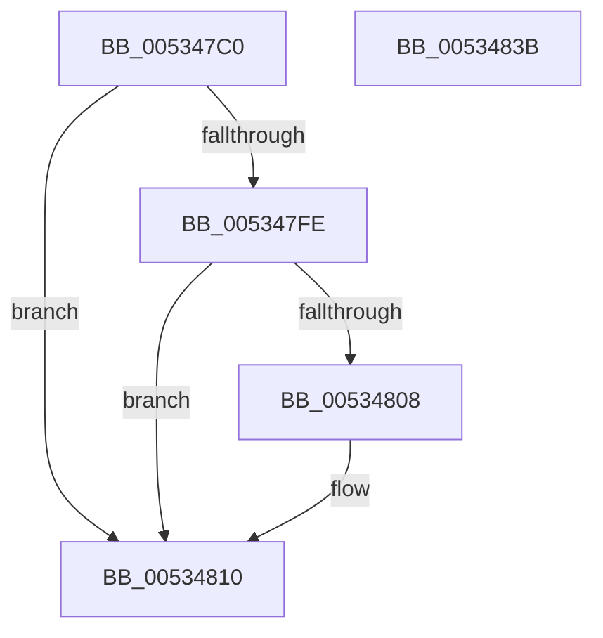

# SymCryptFdefModElementSetValueUint32Generic

- RVA: `0x005347C0`–`0x0053483C` (길이 `124` bytes)
- VA: `0x00000001405347C0`
- 실행 섹션: `.text`
- PDB 이름 있음: `예`; PDB Function 태그: `아니요`
- unwind 정보 RVA: `0x0006F978`
- 디코드: `37`개 명령, `124/124` bytes 표시
- 미해석 바이트: `0` (있으면 어셈블리에 `.byte`로 보존)

> 이 문서는 커널 이미지의 기계어와 PDB 기호를 분석해 생성했습니다. 4번과 5번은 함수 원형과 자료형을 바이너리 사용 방식에서 추정한 C 해석이며 원본 소스 복구 결과는 아닙니다.

## 1. Dependencies

- 직접 호출 지점: **2**; 고유 호출 대상: **2**
- 직접 호출자로 확인된 함수: **2**
- RIP 상대 이미지 참조: **0**

### Outgoing calls
- `0x005347F3` → [EmpCheckErrataList](../49/EmpCheckErrataList_function_0049E550.md) (function, `0x0049E550`)
- `0x00534820` → [SymCryptWipe](../51/SymCryptWipe_function_0051F914.md) (function, `0x0051F914`)

### Direct callers
- [SymCryptModElementSetValueUint32](../52/SymCryptModElementSetValueUint32_function_00525A40.md) at `0x00525A67`
- [SymCryptFdefModInvGeneric](SymCryptFdefModInvGeneric_function_005348C0.md) at `0x00534B00`
- [SymCryptFdefModInvGeneric](SymCryptFdefModInvGeneric_function_005348C0.md) at `0x00534B1A`

### Static image references
- 디코드된 RIP-relative 메모리 참조가 없습니다.

## 2. Other-region calls and transfers

- 다른 실행 섹션으로 향하는 call: **0**
- 별도 외부 분기/꼬리 이동을 확인하지 못했습니다.

## 3. Assembly (complete function range)

```asm
005347C0  48 89 5C 24 08                  mov qword ptr [rsp + 8], rbx
005347C5  48 89 74 24 10                  mov qword ptr [rsp + 0x10], rsi
005347CA  48 89 7C 24 18                  mov qword ptr [rsp + 0x18], rdi
005347CF  41 56                           push r14
005347D1  48 83 EC 20                     sub rsp, 0x20
005347D5  8B 7A 04                        mov edi, dword ptr [rdx + 4]
005347D8  4D 8B F0                        mov r14, r8
005347DB  44 8B C7                        mov r8d, edi
005347DE  48 8B F2                        mov rsi, rdx
005347E1  48 8B 54 24 50                  mov rdx, qword ptr [rsp + 0x50]
005347E6  8B D9                           mov ebx, ecx
005347E8  41 C1 E0 08                     shl r8d, 8
005347EC  49 8B C9                        mov rcx, r9
005347EF  41 83 C0 40                     add r8d, 0x40
005347F3  E8 58 9D F6 FF                  call 0x14049e550
005347F8  83 7E 4C 20                     cmp dword ptr [rsi + 0x4c], 0x20
005347FC  77 12                           ja 0x140534810
005347FE  8B 8E 80 00 00 00               mov ecx, dword ptr [rsi + 0x80]
00534804  3B D9                           cmp ebx, ecx
00534806  72 08                           jb 0x140534810
00534808  8B C3                           mov eax, ebx
0053480A  33 D2                           xor edx, edx
0053480C  F7 F1                           div ecx
0053480E  8B DA                           mov ebx, edx
00534810  C1 E7 06                        shl edi, 6
00534813  49 8D 4E 04                     lea rcx, [r14 + 4]
00534817  8B D7                           mov edx, edi
00534819  48 83 EA 04                     sub rdx, 4
0053481D  41 89 1E                        mov dword ptr [r14], ebx
00534820  E8 EF B0 FE FF                  call 0x14051f914
00534825  48 8B 5C 24 30                  mov rbx, qword ptr [rsp + 0x30]
0053482A  48 8B 74 24 38                  mov rsi, qword ptr [rsp + 0x38]
0053482F  48 8B 7C 24 40                  mov rdi, qword ptr [rsp + 0x40]
00534834  48 83 C4 20                     add rsp, 0x20
00534838  41 5E                           pop r14
0053483A  C3                              ret
0053483B  CC                              int3
```

## 4. C-style interpretation (structured pseudocode)

```c
__int64 __fastcall SymCryptFdefModElementSetValueUint32Generic(int a1, __int64 a2, __int64 a3, __int64 a4, __int64 a5)
{
    __int64 result;
    __int64 v_rbx;
    __int64 v_rdi;
    __int64 v_rsp;
    unsigned __int64 v_stack_p10;
    unsigned __int64 v_stack_p18;
    unsigned __int64 v_stack_p8;

    v_stack_p8 = v_rbx;
    v_stack_p10 = v_rsi;
    v_stack_p18 = v_rdi;
    v_rsp = (v_rsp) - (32);
    a3 = (unsigned int)(((unsigned int)((unsigned int)((unsigned int)(*(unsigned int *)(a2 + 4))))) << (8));
    a3 = (unsigned int)((a3) + (64));
    result = EmpCheckErrataList(a4, a5, a3, a4);
    if ((*(unsigned int *)(a2 + 76)) > 32) goto loc_00534810;
    v_rbx = (unsigned int)(a1);
    if (((unsigned int)((unsigned int)(a1))) >= ((unsigned int)((unsigned int)(*(unsigned int *)(a2 + 128))))) {
        result = (unsigned int)((unsigned int)(a1));
        a2 = 0;
        v_rbx = 0;
    }
    v_rdi = (unsigned int)(((unsigned int)(*(unsigned int *)(a2 + 4))) << (6));
    a2 = ((unsigned int)((unsigned int)(v_rdi))) - (4);
    *(unsigned int *)(a3) = (unsigned int)(v_rbx);
    result = SymCryptWipe(a3 + 4, a2, a3, a4);
    v_rsp = (v_rsp) + (32);
    return result;
}
```

## 5. (Beta) C Style

```c
int64_t SymCryptFdefModElementSetValueUint32Generic(int32_t Arg1, void *Arg2, void *Arg3, int64_t Arg4, int64_t Arg5)
{
    uint8_t *arg2 = (uint8_t *)Arg2;
    uint8_t *arg3 = (uint8_t *)Arg3;

    int64_t result;
    int64_t local_rbx;
    int64_t local_rdi;
    int64_t local_rsp;
    uint64_t v_stack_p10;
    uint64_t v_stack_p18;
    uint64_t v_stack_p8;

    v_stack_p8 = local_rbx;
    v_stack_p10 = local_rsi;
    v_stack_p18 = local_rdi;
    local_rsp = (local_rsp) - (32);
    Arg3 = (uint32_t)(((uint32_t)((uint32_t)((uint32_t)(*(uint32_t *)(arg2 + 0x4))))) << (8));
    Arg3 = (uint32_t)((Arg3) + (64));
    result = EmpCheckErrataList(Arg4, Arg5, Arg3, Arg4);
    if ((*(uint32_t *)(arg2 + 0x4C)) > 32) goto loc_00534810;
    local_rbx = (uint32_t)(Arg1);
    if (((uint32_t)((uint32_t)(Arg1))) >= ((uint32_t)((uint32_t)(*(uint32_t *)(arg2 + 0x80))))) {
        result = (uint32_t)((uint32_t)(Arg1));
        Arg2 = 0;
        local_rbx = 0;
    }
    local_rdi = (uint32_t)(((uint32_t)(*(uint32_t *)(arg2 + 0x4))) << (6));
    Arg2 = ((uint32_t)((uint32_t)(local_rdi))) - (4);
    *(uint32_t *)(arg3) = (uint32_t)(local_rbx);
    result = SymCryptWipe(Arg3 + 4, Arg2, Arg3, Arg4);
    local_rsp = (local_rsp) + (32);
    return result;
}
```

### 관측된 메모리 오프셋

구조체 형식이 확인되지 않은 접근은 인자 기준의 오프셋으로만 기록했습니다.

| 기준 인자 | 오프셋 표현 | 폭 (bit) | 접근 |
|---|---:|---:|---|
| `Arg2` | `+ 0x4` | `32` | `R` |
| `Arg2` | `+ 0x4C` | `32` | `R` |
| `Arg2` | `+ 0x80` | `32` | `R` |
| `Arg3` | `+ 0x0` | `32` | `W` |
| `Arg3` | `+ 0x4` | `64` | `R` |

## 6. Execution-region graph

[열기: 2D/3D 그래프와 함수 탐색 컨트롤 패널](../../../control-panel.html?section=text&rva=0x005347C0&view=graph)

- 2D 그래프는 위에서 아래로 흐르고, 3D 그래프는 빈 공간을 드래그해 회전합니다. Shift+드래그는 이동, 휠은 확대·축소, 함수 노드 선택은 대상 보고서 이동입니다.

### Static fallback


