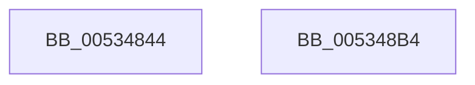

# SymCryptFdefModElementToIntGeneric

- RVA: `0x00534844`–`0x005348B5` (길이 `113` bytes)
- VA: `0x0000000140534844`
- 실행 섹션: `.text`
- PDB 이름 있음: `예`; PDB Function 태그: `아니요`
- unwind 정보 RVA: `0x00060BC4`
- 디코드: `31`개 명령, `113/113` bytes 표시
- 미해석 바이트: `0` (있으면 어셈블리에 `.byte`로 보존)

> 이 문서는 커널 이미지의 기계어와 PDB 기호를 분석해 생성했습니다. 4번과 5번은 함수 원형과 자료형을 바이너리 사용 방식에서 추정한 C 해석이며 원본 소스 복구 결과는 아닙니다.

## 1. Dependencies

- 직접 호출 지점: **3**; 고유 호출 대상: **3**
- 직접 호출자로 확인된 함수: **2**
- RIP 상대 이미지 참조: **0**

### Outgoing calls
- `0x00534868` → [memcpy](../6C/memcpy_function_006C6840.md) (function, `0x006C6840`)
- `0x00534886` → [SymCryptWipe](../51/SymCryptWipe_function_0051F914.md) (function, `0x0051F914`)
- `0x0053489F` → [EmpCheckErrataList](../49/EmpCheckErrataList_function_0049E550.md) (function, `0x0049E550`)

### Direct callers
- [SymCryptModElementToInt](../52/SymCryptModElementToInt_function_00525AB0.md) at `0x00525B04`
- [SymCryptFdefModInvGeneric](SymCryptFdefModInvGeneric_function_005348C0.md) at `0x00534A46`

### Static image references
- 디코드된 RIP-relative 메모리 참조가 없습니다.

## 2. Other-region calls and transfers

- 다른 실행 섹션으로 향하는 call: **0**
- 별도 외부 분기/꼬리 이동을 확인하지 못했습니다.

## 3. Assembly (complete function range)

```asm
00534844  48 89 5C 24 08                  mov qword ptr [rsp + 8], rbx
00534849  48 89 74 24 10                  mov qword ptr [rsp + 0x10], rsi
0053484E  57                              push rdi
0053484F  48 83 EC 20                     sub rsp, 0x20
00534853  49 8B D8                        mov rbx, r8
00534856  48 8B F9                        mov rdi, rcx
00534859  44 8B 41 04                     mov r8d, dword ptr [rcx + 4]
0053485D  49 8B F1                        mov rsi, r9
00534860  41 C1 E0 06                     shl r8d, 6
00534864  48 8D 4B 20                     lea rcx, [rbx + 0x20]
00534868  E8 D3 1F 19 00                  call 0x1406c6840
0053486D  44 8B 57 04                     mov r10d, dword ptr [rdi + 4]
00534871  8B 53 04                        mov edx, dword ptr [rbx + 4]
00534874  48 83 C3 20                     add rbx, 0x20
00534878  41 2B D2                        sub edx, r10d
0053487B  41 C1 E2 04                     shl r10d, 4
0053487F  C1 E2 06                        shl edx, 6
00534882  4A 8D 0C 93                     lea rcx, [rbx + r10*4]
00534886  E8 89 B0 FE FF                  call 0x14051f914
0053488B  44 8B 47 04                     mov r8d, dword ptr [rdi + 4]
0053488F  48 8B CE                        mov rcx, rsi
00534892  48 8B 54 24 50                  mov rdx, qword ptr [rsp + 0x50]
00534897  41 C1 E0 08                     shl r8d, 8
0053489B  41 83 C0 40                     add r8d, 0x40
0053489F  E8 AC 9C F6 FF                  call 0x14049e550
005348A4  48 8B 5C 24 30                  mov rbx, qword ptr [rsp + 0x30]
005348A9  48 8B 74 24 38                  mov rsi, qword ptr [rsp + 0x38]
005348AE  48 83 C4 20                     add rsp, 0x20
005348B2  5F                              pop rdi
005348B3  C3                              ret
005348B4  CC                              int3
```

## 4. C-style interpretation (structured pseudocode)

```c
__int64 __fastcall SymCryptFdefModElementToIntGeneric(__int64 a1, __int64 a2, __int64 a3, __int64 a4, __int64 a5)
{
    __int64 result;
    __int64 v_r10;
    __int64 v_rbx;
    __int64 v_rsp;
    unsigned __int64 v_stack_p10;
    unsigned __int64 v_stack_p8;

    v_stack_p8 = v_rbx;
    v_stack_p10 = v_rsi;
    v_rsp = (v_rsp) - (32);
    a3 = (unsigned int)(((unsigned int)(*(unsigned int *)(a1 + 4))) << (6));
    result = memcpy(a3 + 32, a2, a3, a4);
    v_rbx = (a3) + (32);
    a2 = (unsigned int)(((unsigned int)(*(unsigned int *)(a3 + 4))) - ((unsigned int)((unsigned int)(*(unsigned int *)(a1 + 4)))));
    v_r10 = (unsigned int)(((unsigned int)(*(unsigned int *)(a1 + 4))) << (4));
    a2 = (unsigned int)((a2) << (6));
    result = SymCryptWipe(v_rbx + v_r10 * 4, a2, a3, a4);
    a3 = (unsigned int)(((unsigned int)(*(unsigned int *)(a1 + 4))) << (8));
    a3 = (unsigned int)((a3) + (64));
    result = EmpCheckErrataList(a4, a5, a3, a4);
    v_rsp = (v_rsp) + (32);
    return result;
}
```

## 5. (Beta) C Style

```c
int64_t SymCryptFdefModElementToIntGeneric(void *Arg1, int64_t Arg2, void *Arg3, int64_t Arg4, int64_t Arg5)
{
    uint8_t *arg1 = (uint8_t *)Arg1;
    uint8_t *arg3 = (uint8_t *)Arg3;

    int64_t result;
    int64_t local_r10;
    int64_t local_rbx;
    int64_t local_rsp;
    uint64_t v_stack_p10;
    uint64_t v_stack_p8;

    v_stack_p8 = local_rbx;
    v_stack_p10 = local_rsi;
    local_rsp = (local_rsp) - (32);
    Arg3 = (uint32_t)(((uint32_t)(*(uint32_t *)(arg1 + 0x4))) << (6));
    result = memcpy(Arg3 + 32, Arg2, Arg3, Arg4);
    local_rbx = (Arg3) + (32);
    Arg2 = (uint32_t)(((uint32_t)(*(uint32_t *)(arg3 + 0x4))) - ((uint32_t)((uint32_t)(*(uint32_t *)(arg1 + 0x4)))));
    local_r10 = (uint32_t)(((uint32_t)(*(uint32_t *)(arg1 + 0x4))) << (4));
    Arg2 = (uint32_t)((Arg2) << (6));
    result = SymCryptWipe(local_rbx + local_r10 * 4, Arg2, Arg3, Arg4);
    Arg3 = (uint32_t)(((uint32_t)(*(uint32_t *)(arg1 + 0x4))) << (8));
    Arg3 = (uint32_t)((Arg3) + (64));
    result = EmpCheckErrataList(Arg4, Arg5, Arg3, Arg4);
    local_rsp = (local_rsp) + (32);
    return result;
}
```

### 관측된 메모리 오프셋

구조체 형식이 확인되지 않은 접근은 인자 기준의 오프셋으로만 기록했습니다.

| 기준 인자 | 오프셋 표현 | 폭 (bit) | 접근 |
|---|---:|---:|---|
| `Arg1` | `+ 0x4` | `32` | `R` |
| `Arg3` | `+ 0x0 + r10*4` | `64` | `R` |
| `Arg3` | `+ 0x4` | `32` | `R` |
| `Arg3` | `+ 0x20` | `64` | `R` |

## 6. Execution-region graph

[열기: 2D/3D 그래프와 함수 탐색 컨트롤 패널](../../../control-panel.html?section=text&rva=0x00534844&view=graph)

- 2D 그래프는 위에서 아래로 흐르고, 3D 그래프는 빈 공간을 드래그해 회전합니다. Shift+드래그는 이동, 휠은 확대·축소, 함수 노드 선택은 대상 보고서 이동입니다.

### Static fallback


