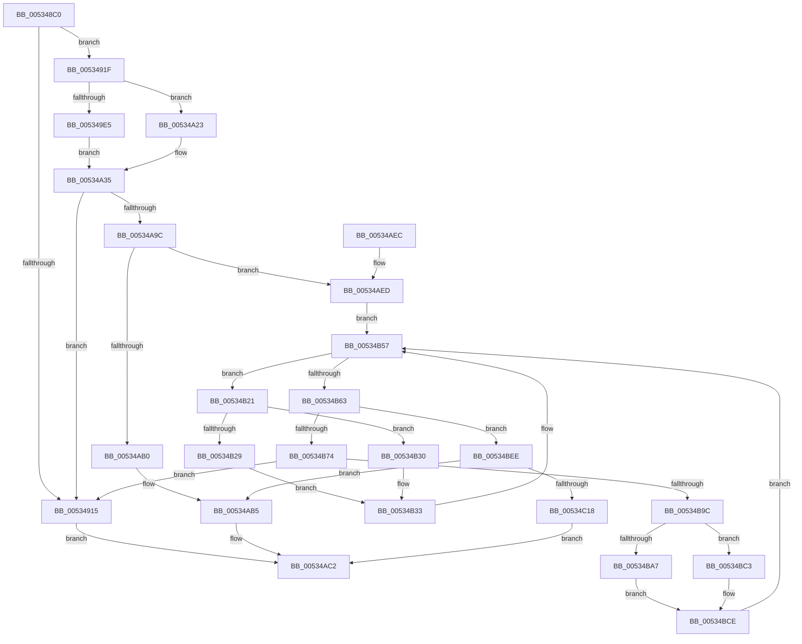

# SymCryptFdefModInvGeneric

- RVA: `0x005348C0`–`0x00534C39` (길이 `889` bytes)
- VA: `0x00000001405348C0`
- 실행 섹션: `.text`
- PDB 이름 있음: `예`; PDB Function 태그: `아니요`
- unwind 정보 RVA: `0x000C355C`
- 디코드: `243`개 명령, `889/889` bytes 표시
- 미해석 바이트: `0` (있으면 어셈블리에 `.byte`로 보존)

> 이 문서는 커널 이미지의 기계어와 PDB 기호를 분석해 생성했습니다. 4번과 5번은 함수 원형과 자료형을 바이너리 사용 방식에서 추정한 C 해석이며 원본 소스 복구 결과는 아닙니다.

## 1. Dependencies

- 직접 호출 지점: **35**; 고유 호출 대상: **19**
- 직접 호출자로 확인된 함수: **3**
- RIP 상대 이미지 참조: **1**

### Outgoing calls
- `0x0053491F` → [SymCryptSizeofModElementFromModulus](../52/SymCryptSizeofModElementFromModulus_function_00525D3C.md) (function, `0x00525D3C`)
- `0x0053492E` → [SymCryptModElementCreate](../52/SymCryptModElementCreate_function_00525900.md) (function, `0x00525900`)
- `0x00534943` → [SymCryptModElementCreate](../52/SymCryptModElementCreate_function_00525900.md) (function, `0x00525900`)
- `0x00534958` → [SymCryptModElementCreate](../52/SymCryptModElementCreate_function_00525900.md) (function, `0x00525900`)
- `0x0053496B` → [SymCryptModElementCreate](../52/SymCryptModElementCreate_function_00525900.md) (function, `0x00525900`)
- `0x0053498D` → [SymCryptSizeofIntFromDigits](../52/SymCryptSizeofIntFromDigits_function_00525D24.md) (function, `0x00525D24`)
- `0x0053499C` → [SymCryptIntCreate](../52/SymCryptIntCreate_function_0052556C.md) (function, `0x0052556C`)
- `0x005349B1` → [SymCryptIntCreate](../52/SymCryptIntCreate_function_0052556C.md) (function, `0x0052556C`)
- `0x005349C8` → [SymCryptIntCreate](../52/SymCryptIntCreate_function_0052556C.md) (function, `0x0052556C`)
- `0x005349F8` → [SymCryptModSetRandom](../52/SymCryptModSetRandom_function_00525C18.md) (function, `0x00525C18`)
- `0x00534A1C` → [SymCryptModMul](../52/SymCryptModMul_function_00525BA8.md) (function, `0x00525BA8`)
- `0x00534A30` → [SymCryptModElementCopy](../52/SymCryptModElementCopy_function_005258E8.md) (function, `0x005258E8`)
- `0x00534A46` → [SymCryptFdefModElementToIntGeneric](SymCryptFdefModElementToIntGeneric_function_00534844.md) (function, `0x00534844`)
- `0x00534A4E` → [SymCryptIntFromModulus](../52/SymCryptIntFromModulus_function_00525608.md) (function, `0x00525608`)
- `0x00534A5E` → [SymCryptIntCopy](../52/SymCryptIntCopy_function_0052553C.md) (function, `0x0052553C`)
- `0x00534A66` → [SymCryptIntGetValueLsbits32](../52/SymCryptIntGetValueLsbits32_function_00525668.md) (function, `0x00525668`)
- `0x00534A70` → [SymCryptIntGetValueLsbits32](../52/SymCryptIntGetValueLsbits32_function_00525668.md) (function, `0x00525668`)
- `0x00534A81` → [SymCryptIntIsEqualUint32](../52/SymCryptIntIsEqualUint32_function_005256B0.md) (function, `0x005256B0`)
- `0x00534A8F` → [SymCryptIntIsEqualUint32](../52/SymCryptIntIsEqualUint32_function_005256B0.md) (function, `0x005256B0`)
- `0x00534AA7` → [SymCryptIntIsEqualUint32](../52/SymCryptIntIsEqualUint32_function_005256B0.md) (function, `0x005256B0`)
- `0x00534ABD` → [SymCryptModElementCopy](../52/SymCryptModElementCopy_function_005258E8.md) (function, `0x005258E8`)
- `0x00534ACC` → [_security_check_cookie](../6A/_security_check_cookie_function_006AC640.md) (function, `0x006AC640`)
- `0x00534B00` → [SymCryptFdefModElementSetValueUint32Generic](SymCryptFdefModElementSetValueUint32Generic_function_005347C0.md) (function, `0x005347C0`)
- `0x00534B1A` → [SymCryptFdefModElementSetValueUint32Generic](SymCryptFdefModElementSetValueUint32Generic_function_005347C0.md) (function, `0x005347C0`)
- `0x00534B3F` → [SymCryptIntDivPow2](../52/SymCryptIntDivPow2_function_005255B0.md) (function, `0x005255B0`)
- `0x00534B52` → [SymCryptFdefModDivSmallPow2](SymCryptFdefModDivSmallPow2_function_00534328.md) (function, `0x00534328`)
- `0x00534B5A` → [SymCryptIntGetValueLsbits32](../52/SymCryptIntGetValueLsbits32_function_00525668.md) (function, `0x00525668`)
- `0x00534B6B` → [SymCryptIntIsEqualUint32](../52/SymCryptIntIsEqualUint32_function_005256B0.md) (function, `0x005256B0`)
- `0x00534B7F` → [SymCryptIntSubSameSize](../52/SymCryptIntSubSameSize_function_005257A8.md) (function, `0x005257A8`)
- `0x00534B8F` → [SymCryptIntIsEqualUint32](../52/SymCryptIntIsEqualUint32_function_005256B0.md) (function, `0x005256B0`)
- `0x00534BAA` → [SymCryptIntCopy](../52/SymCryptIntCopy_function_0052553C.md) (function, `0x0052553C`)
- `0x00534BC6` → [SymCryptIntNeg](../52/SymCryptIntNeg_function_00525718.md) (function, `0x00525718`)
- `0x00534BE4` → [SymCryptModSub](../52/SymCryptModSub_function_00525CB8.md) (function, `0x00525CB8`)
- `0x00534C06` → [SymCryptModMul](../52/SymCryptModMul_function_00525BA8.md) (function, `0x00525BA8`)
- `0x00534C2F` → [SymCryptModMul](../52/SymCryptModMul_function_00525BA8.md) (function, `0x00525BA8`)

### Direct callers
- [SymCryptFdefModInvMontgomery](SymCryptFdefModInvMontgomery_function_00534C40.md) at `0x00534CC8`
- [SymCryptFdefModInvMontgomery256](SymCryptFdefModInvMontgomery256_function_00534CF0.md) at `0x00534D78`
- [SymCryptFdef369ModInvMontgomery](SymCryptFdef369ModInvMontgomery_function_00537470.md) at `0x005374FD`

### Static image references
- `0x005348D7` → RVA `0x00E0A740` (`.data`; read)

## 2. Other-region calls and transfers

- 다른 실행 섹션으로 향하는 call: **0**
- 별도 외부 분기/꼬리 이동을 확인하지 못했습니다.

## 3. Assembly (complete function range)

```asm
005348C0  48 89 5C 24 20                  mov qword ptr [rsp + 0x20], rbx
005348C5  55                              push rbp
005348C6  56                              push rsi
005348C7  57                              push rdi
005348C8  41 54                           push r12
005348CA  41 55                           push r13
005348CC  41 56                           push r14
005348CE  41 57                           push r15
005348D0  48 81 EC 80 00 00 00            sub rsp, 0x80
005348D7  48 8B 05 62 5E 8D 00            mov rax, qword ptr [rip + 0x8d5e62]
005348DE  48 33 C4                        xor rax, rsp
005348E1  48 89 44 24 78                  mov qword ptr [rsp + 0x78], rax
005348E6  8B 41 0C                        mov eax, dword ptr [rcx + 0xc]
005348E9  33 F6                           xor esi, esi
005348EB  44 8B 79 04                     mov r15d, dword ptr [rcx + 4]
005348EF  83 E0 09                        and eax, 9
005348F2  4C 8B AC 24 E0 00 00 00         mov r13, qword ptr [rsp + 0xe0]
005348FA  48 8B E9                        mov rbp, rcx
005348FD  44 89 4C 24 30                  mov dword ptr [rsp + 0x30], r9d
00534902  4C 89 44 24 58                  mov qword ptr [rsp + 0x58], r8
00534907  48 89 54 24 48                  mov qword ptr [rsp + 0x48], rdx
0053490C  44 89 7C 24 70                  mov dword ptr [rsp + 0x70], r15d
00534911  3C 09                           cmp al, 9
00534913  74 0A                           je 0x14053491f
00534915  BE 0E 80 00 00                  mov esi, 0x800e
0053491A  E9 A3 01 00 00                  jmp 0x140534ac2
0053491F  E8 18 14 FF FF                  call 0x140525d3c
00534924  4C 8B C5                        mov r8, rbp
00534927  8B D0                           mov edx, eax
00534929  49 8B CD                        mov rcx, r13
0053492C  8B F8                           mov edi, eax
0053492E  E8 CD 0F FF FF                  call 0x140525900
00534933  4C 03 EF                        add r13, rdi
00534936  48 89 44 24 68                  mov qword ptr [rsp + 0x68], rax
0053493B  49 8B CD                        mov rcx, r13
0053493E  4C 8B C5                        mov r8, rbp
00534941  8B D7                           mov edx, edi
00534943  E8 B8 0F FF FF                  call 0x140525900
00534948  4C 03 EF                        add r13, rdi
0053494B  48 89 44 24 50                  mov qword ptr [rsp + 0x50], rax
00534950  49 8B CD                        mov rcx, r13
00534953  4C 8B C5                        mov r8, rbp
00534956  8B D7                           mov edx, edi
00534958  E8 A3 0F FF FF                  call 0x140525900
0053495D  4C 03 EF                        add r13, rdi
00534960  4C 8B C5                        mov r8, rbp
00534963  49 8B CD                        mov rcx, r13
00534966  8B D7                           mov edx, edi
00534968  4C 8B F0                        mov r14, rax
0053496B  E8 90 0F FF FF                  call 0x140525900
00534970  4C 8B A4 24 E8 00 00 00         mov r12, qword ptr [rsp + 0xe8]
00534978  8D 0C BD 00 00 00 00            lea ecx, [rdi*4]
0053497F  4C 2B E1                        sub r12, rcx
00534982  48 89 44 24 60                  mov qword ptr [rsp + 0x60], rax
00534987  41 8B CF                        mov ecx, r15d
0053498A  4C 03 EF                        add r13, rdi
0053498D  E8 92 13 FF FF                  call 0x140525d24
00534992  45 8B C7                        mov r8d, r15d
00534995  8B D0                           mov edx, eax
00534997  49 8B CD                        mov rcx, r13
0053499A  8B F8                           mov edi, eax
0053499C  E8 CB 0B FF FF                  call 0x14052556c
005349A1  44 8B 44 24 70                  mov r8d, dword ptr [rsp + 0x70]
005349A6  4C 03 EF                        add r13, rdi
005349A9  49 8B CD                        mov rcx, r13
005349AC  8B D7                           mov edx, edi
005349AE  4C 8B F8                        mov r15, rax
005349B1  E8 B6 0B FF FF                  call 0x14052556c
005349B6  44 8B 44 24 70                  mov r8d, dword ptr [rsp + 0x70]
005349BB  4C 03 EF                        add r13, rdi
005349BE  49 8B CD                        mov rcx, r13
005349C1  48 89 44 24 40                  mov qword ptr [rsp + 0x40], rax
005349C6  8B D7                           mov edx, edi
005349C8  E8 9F 0B FF FF                  call 0x14052556c
005349CD  8D 0C 7F                        lea ecx, [rdi + rdi*2]
005349D0  48 89 44 24 38                  mov qword ptr [rsp + 0x38], rax
005349D5  4C 2B E1                        sub r12, rcx
005349D8  4C 03 EF                        add r13, rdi
005349DB  83 64 24 30 01                  and dword ptr [rsp + 0x30], 1
005349E0  48 8B CD                        mov rcx, rbp
005349E3  75 3E                           jne 0x140534a23
005349E5  48 8B 54 24 68                  mov rdx, qword ptr [rsp + 0x68]
005349EA  4D 8B CD                        mov r9, r13
005349ED  41 B8 06 00 00 00               mov r8d, 6
005349F3  4C 89 64 24 20                  mov qword ptr [rsp + 0x20], r12
005349F8  E8 1B 12 FF FF                  call 0x140525c18
005349FD  48 8B 5C 24 50                  mov rbx, qword ptr [rsp + 0x50]
00534A02  48 8B CD                        mov rcx, rbp
00534A05  4C 8B 44 24 48                  mov r8, qword ptr [rsp + 0x48]
00534A0A  4C 8B CB                        mov r9, rbx
00534A0D  48 8B 54 24 68                  mov rdx, qword ptr [rsp + 0x68]
00534A12  4C 89 64 24 28                  mov qword ptr [rsp + 0x28], r12
00534A17  4C 89 6C 24 20                  mov qword ptr [rsp + 0x20], r13
00534A1C  E8 87 11 FF FF                  call 0x140525ba8
00534A21  EB 12                           jmp 0x140534a35
00534A23  48 8B 5C 24 50                  mov rbx, qword ptr [rsp + 0x50]
00534A28  48 8B 54 24 48                  mov rdx, qword ptr [rsp + 0x48]
00534A2D  4C 8B C3                        mov r8, rbx
00534A30  E8 B3 0E FF FF                  call 0x1405258e8
00534A35  4D 8B CD                        mov r9, r13
00534A38  4C 89 64 24 20                  mov qword ptr [rsp + 0x20], r12
00534A3D  4D 8B C7                        mov r8, r15
00534A40  48 8B D3                        mov rdx, rbx
00534A43  48 8B CD                        mov rcx, rbp
00534A46  E8 F9 FD FF FF                  call 0x140534844
00534A4B  48 8B CD                        mov rcx, rbp
00534A4E  E8 B5 0B FF FF                  call 0x140525608
00534A53  48 8B 5C 24 40                  mov rbx, qword ptr [rsp + 0x40]
00534A58  48 8B C8                        mov rcx, rax
00534A5B  48 8B D3                        mov rdx, rbx
00534A5E  E8 D9 0A FF FF                  call 0x14052553c
00534A63  48 8B CB                        mov rcx, rbx
00534A66  E8 FD 0B FF FF                  call 0x140525668
00534A6B  49 8B CF                        mov rcx, r15
00534A6E  8B F8                           mov edi, eax
00534A70  E8 F3 0B FF FF                  call 0x140525668
00534A75  0B F8                           or edi, eax
00534A77  33 D2                           xor edx, edx
00534A79  F7 D7                           not edi
00534A7B  48 8B CB                        mov rcx, rbx
00534A7E  83 E7 01                        and edi, 1
00534A81  E8 2A 0C FF FF                  call 0x1405256b0
00534A86  8B D8                           mov ebx, eax
00534A88  33 D2                           xor edx, edx
00534A8A  49 8B CF                        mov rcx, r15
00534A8D  0B DF                           or ebx, edi
00534A8F  E8 1C 0C FF FF                  call 0x1405256b0
00534A94  0B C3                           or eax, ebx
00534A96  0F 85 79 FE FF FF               jne 0x140534915
00534A9C  48 8B 5C 24 40                  mov rbx, qword ptr [rsp + 0x40]
00534AA1  8D 50 02                        lea edx, [rax + 2]
00534AA4  48 8B CB                        mov rcx, rbx
00534AA7  E8 04 0C FF FF                  call 0x1405256b0
00534AAC  85 C0                           test eax, eax
00534AAE  74 3D                           je 0x140534aed
00534AB0  48 8B 54 24 48                  mov rdx, qword ptr [rsp + 0x48]
00534AB5  4C 8B 44 24 58                  mov r8, qword ptr [rsp + 0x58]
00534ABA  48 8B CD                        mov rcx, rbp
00534ABD  E8 26 0E FF FF                  call 0x1405258e8
00534AC2  8B C6                           mov eax, esi
00534AC4  48 8B 4C 24 78                  mov rcx, qword ptr [rsp + 0x78]
00534AC9  48 33 CC                        xor rcx, rsp
00534ACC  E8 6F 7B 17 00                  call 0x1406ac640
00534AD1  48 8B 9C 24 D8 00 00 00         mov rbx, qword ptr [rsp + 0xd8]
00534AD9  48 81 C4 80 00 00 00            add rsp, 0x80
00534AE0  41 5F                           pop r15
00534AE2  41 5E                           pop r14
00534AE4  41 5D                           pop r13
00534AE6  41 5C                           pop r12
00534AE8  5F                              pop rdi
00534AE9  5E                              pop rsi
00534AEA  5D                              pop rbp
00534AEB  C3                              ret
00534AEC  CC                              int3
00534AED  4D 8B CD                        mov r9, r13
00534AF0  4C 89 64 24 20                  mov qword ptr [rsp + 0x20], r12
00534AF5  4D 8B C6                        mov r8, r14
00534AF8  48 8B D5                        mov rdx, rbp
00534AFB  B9 01 00 00 00                  mov ecx, 1
00534B00  E8 BB FC FF FF                  call 0x1405347c0
00534B05  48 8B 7C 24 60                  mov rdi, qword ptr [rsp + 0x60]
00534B0A  4D 8B CD                        mov r9, r13
00534B0D  4C 8B C7                        mov r8, rdi
00534B10  4C 89 64 24 20                  mov qword ptr [rsp + 0x20], r12
00534B15  48 8B D5                        mov rdx, rbp
00534B18  33 C9                           xor ecx, ecx
00534B1A  E8 A1 FC FF FF                  call 0x1405347c0
00534B1F  EB 36                           jmp 0x140534b57
00534B21  89 74 24 70                     mov dword ptr [rsp + 0x70], esi
00534B25  85 C0                           test eax, eax
00534B27  75 07                           jne 0x140534b30
00534B29  B8 20 00 00 00                  mov eax, 0x20
00534B2E  EB 03                           jmp 0x140534b33
00534B30  0F BC C0                        bsf eax, eax
00534B33  8B D0                           mov edx, eax
00534B35  4D 8B C7                        mov r8, r15
00534B38  49 8B CF                        mov rcx, r15
00534B3B  89 44 24 70                     mov dword ptr [rsp + 0x70], eax
00534B3F  E8 6C 0A FF FF                  call 0x1405255b0
00534B44  44 8B 44 24 70                  mov r8d, dword ptr [rsp + 0x70]
00534B49  4D 8B CE                        mov r9, r14
00534B4C  49 8B D6                        mov rdx, r14
00534B4F  48 8B CD                        mov rcx, rbp
00534B52  E8 D1 F7 FF FF                  call 0x140534328
00534B57  49 8B CF                        mov rcx, r15
00534B5A  E8 09 0B FF FF                  call 0x140525668
00534B5F  A8 01                           test al, 1
00534B61  74 BE                           je 0x140534b21
00534B63  BA 01 00 00 00                  mov edx, 1
00534B68  49 8B CF                        mov rcx, r15
00534B6B  E8 40 0B FF FF                  call 0x1405256b0
00534B70  85 C0                           test eax, eax
00534B72  75 7A                           jne 0x140534bee
00534B74  4C 8B 44 24 38                  mov r8, qword ptr [rsp + 0x38]
00534B79  49 8B D7                        mov rdx, r15
00534B7C  48 8B CB                        mov rcx, rbx
00534B7F  E8 24 0C FF FF                  call 0x1405257a8
00534B84  48 8B 4C 24 38                  mov rcx, qword ptr [rsp + 0x38]
00534B89  33 D2                           xor edx, edx
00534B8B  89 44 24 70                     mov dword ptr [rsp + 0x70], eax
00534B8F  E8 1C 0B FF FF                  call 0x1405256b0
00534B94  85 C0                           test eax, eax
00534B96  0F 85 79 FD FF FF               jne 0x140534915
00534B9C  48 8B 4C 24 38                  mov rcx, qword ptr [rsp + 0x38]
00534BA1  39 74 24 70                     cmp dword ptr [rsp + 0x70], esi
00534BA5  75 1C                           jne 0x140534bc3
00534BA7  48 8B D3                        mov rdx, rbx
00534BAA  E8 8D 09 FF FF                  call 0x14052553c
00534BAF  48 8B C3                        mov rax, rbx
00534BB2  49 8B DF                        mov rbx, r15
00534BB5  4C 8B F8                        mov r15, rax
00534BB8  48 8B C7                        mov rax, rdi
00534BBB  49 8B FE                        mov rdi, r14
00534BBE  4C 8B F0                        mov r14, rax
00534BC1  EB 0B                           jmp 0x140534bce
00534BC3  49 8B D7                        mov rdx, r15
00534BC6  E8 4D 0B FF FF                  call 0x140525718
00534BCB  49 8B C6                        mov rax, r14
00534BCE  4C 8B C7                        mov r8, rdi
00534BD1  4C 89 64 24 28                  mov qword ptr [rsp + 0x28], r12
00534BD6  4C 8B C8                        mov r9, rax
00534BD9  4C 89 6C 24 20                  mov qword ptr [rsp + 0x20], r13
00534BDE  48 8B D0                        mov rdx, rax
00534BE1  48 8B CD                        mov rcx, rbp
00534BE4  E8 CF 10 FF FF                  call 0x140525cb8
00534BE9  E9 69 FF FF FF                  jmp 0x140534b57
00534BEE  4C 8B 44 24 50                  mov r8, qword ptr [rsp + 0x50]
00534BF3  4C 8B CF                        mov r9, rdi
00534BF6  4C 89 64 24 28                  mov qword ptr [rsp + 0x28], r12
00534BFB  49 8B D6                        mov rdx, r14
00534BFE  48 8B CD                        mov rcx, rbp
00534C01  4C 89 6C 24 20                  mov qword ptr [rsp + 0x20], r13
00534C06  E8 9D 0F FF FF                  call 0x140525ba8
00534C0B  49 8B D6                        mov rdx, r14
00534C0E  39 74 24 30                     cmp dword ptr [rsp + 0x30], esi
00534C12  0F 85 9D FE FF FF               jne 0x140534ab5
00534C18  4C 8B 4C 24 58                  mov r9, qword ptr [rsp + 0x58]
00534C1D  48 8B CD                        mov rcx, rbp
00534C20  4C 8B 44 24 68                  mov r8, qword ptr [rsp + 0x68]
00534C25  4C 89 64 24 28                  mov qword ptr [rsp + 0x28], r12
00534C2A  4C 89 6C 24 20                  mov qword ptr [rsp + 0x20], r13
00534C2F  E8 74 0F FF FF                  call 0x140525ba8
00534C34  E9 89 FE FF FF                  jmp 0x140534ac2
```

## 4. C-style interpretation (structured pseudocode)

```c
__int64 __fastcall SymCryptFdefModInvGeneric(__int64 a1, __int64 a2, __int64 a3, int a4, __int64 a5, __int64 a6)
{
    __int64 result;
    __int64 v_r12;
    __int64 v_r13;
    __int64 v_rbx;
    __int64 v_rdi;
    __int64 v_rsi;
    __int64 v_rsp;
    unsigned __int64 v_stack_m40;
    unsigned int v_stack_m48;
    unsigned __int64 v_stack_m50;
    unsigned __int64 v_stack_m58;
    unsigned __int64 v_stack_m60;
    unsigned __int64 v_stack_m68;
    unsigned __int64 v_stack_m70;
    unsigned __int64 v_stack_m78;
    unsigned __int64 v_stack_m80;
    unsigned int v_stack_m88;
    unsigned __int64 v_stack_m90;
    unsigned __int64 v_stack_m98;
    unsigned __int64 v_stack_p20;
    unsigned __int64 v_stack_p28;
    unsigned int v_stack_p30;
    unsigned __int64 v_stack_p38;
    unsigned __int64 v_stack_p50;
    unsigned __int64 v_stack_p58;
    unsigned __int64 v_stack_p60;
    unsigned __int64 v_stack_p68;
    unsigned int v_stack_p70;

    v_stack_p20 = v_rbx;
    v_rsp = (v_rsp) - (128);
    result = (*(unsigned __int64 *)(v_rip + 9264738)) ^ (v_rsp);
    v_stack_m40 = result;
    v_rsi = 0;
    result = (unsigned int)(((unsigned int)(*(unsigned int *)(a1 + 12))) & (9));
    v_stack_m88 = a4;
    v_stack_m60 = a3;
    v_stack_m70 = a2;
    v_stack_m48 = (unsigned int)((unsigned int)(*(unsigned int *)(a1 + 4)));
    if (((unsigned __int8)(result)) == 9) goto loc_0053491F;
loc_00534915:
    goto loc_00534AC2;
loc_0053491F:
    result = SymCryptSizeofModElementFromModulus(a1, a2, a3, a4);
    result = SymCryptModElementCreate(a5, (unsigned int)((unsigned int)(result)), a1, a4);
    v_r13 = (a5) + ((unsigned int)((unsigned int)(result)));
    v_stack_m50 = result;
    result = SymCryptModElementCreate(v_r13, (unsigned int)((unsigned int)((unsigned int)((unsigned int)(result)))), a1, a4);
    v_r13 = (v_r13) + ((unsigned int)((unsigned int)(result)));
    v_stack_m68 = result;
    result = SymCryptModElementCreate(v_r13, (unsigned int)((unsigned int)((unsigned int)((unsigned int)(result)))), a1, a4);
    v_r13 = (v_r13) + ((unsigned int)((unsigned int)(result)));
    result = SymCryptModElementCreate(v_r13, (unsigned int)((unsigned int)((unsigned int)((unsigned int)(result)))), a1, a4);
    v_r12 = (a6) - ((unsigned int)((unsigned int)(result)) * 4);
    v_stack_m58 = result;
    v_r13 = (v_r13) + ((unsigned int)((unsigned int)(result)));
    result = SymCryptSizeofIntFromDigits((unsigned int)((unsigned int)((unsigned int)(*(unsigned int *)(a1 + 4)))), (unsigned int)((unsigned int)((unsigned int)((unsigned int)(result)))), a1, a4);
    result = SymCryptIntCreate(v_r13, (unsigned int)((unsigned int)(result)), (unsigned int)((unsigned int)((unsigned int)(*(unsigned int *)(a1 + 4)))), a4);
    v_r13 = (v_r13) + ((unsigned int)((unsigned int)(result)));
    result = SymCryptIntCreate(v_r13, (unsigned int)((unsigned int)((unsigned int)((unsigned int)(result)))), (unsigned int)(v_stack_m48), a4);
    v_r13 = (v_r13) + ((unsigned int)((unsigned int)(result)));
    v_stack_m78 = result;
    result = SymCryptIntCreate(v_r13, (unsigned int)((unsigned int)((unsigned int)((unsigned int)(result)))), (unsigned int)(v_stack_m48), a4);
    v_stack_m80 = result;
    v_r12 = (v_r12) - ((unsigned int)((unsigned int)(result)) + (unsigned int)((unsigned int)(result)) * 2);
    v_r13 = (v_r13) + ((unsigned int)((unsigned int)(result)));
    if (condition_is_not_equal) goto loc_00534A23;
    v_stack_m98 = v_r12;
    result = SymCryptModSetRandom(a1, v_stack_m50, 6, v_r13);
    v_stack_m90 = v_r12;
    v_stack_m98 = v_r13;
    result = SymCryptModMul(a1, v_stack_m50, v_stack_m70, v_stack_m68);
    goto loc_00534A35;
loc_00534A23:
    result = SymCryptModElementCopy(a1, v_stack_m70, v_stack_m68, v_stack_m68);
loc_00534A35:
    v_stack_m98 = v_r12;
    result = SymCryptFdefModElementToIntGeneric(a1, v_stack_m68, result, v_r13);
    result = SymCryptIntFromModulus(a1, v_stack_m68, result, v_r13);
    result = SymCryptIntCopy(result, v_stack_m78, result, v_r13);
    result = SymCryptIntGetValueLsbits32(v_stack_m78, v_stack_m78, result, v_r13);
    result = SymCryptIntGetValueLsbits32(result, v_stack_m78, result, v_r13);
    v_rdi = (unsigned int)(((unsigned int)((unsigned int)(result))) | ((unsigned int)(result)));
    a2 = 0;
    v_rdi = (unsigned int)(~(v_rdi));
    v_rdi = (unsigned int)((v_rdi) & (1));
    result = SymCryptIntIsEqualUint32(v_stack_m78, a2, result, v_r13);
    a2 = 0;
    v_rbx = (unsigned int)(((unsigned int)((unsigned int)(result))) | ((unsigned int)(v_rdi)));
    result = SymCryptIntIsEqualUint32(result, a2, result, v_r13);
    result = (unsigned int)((result) | ((unsigned int)(v_rbx)));
    if (condition_is_not_equal) goto loc_00534915;
    result = SymCryptIntIsEqualUint32(v_stack_m78, result + 2, result, v_r13);
    if ((unsigned int)(result) == 0) goto loc_00534AED;
loc_00534AB5:
    result = SymCryptModElementCopy(a1, v_stack_m70, v_stack_m60, v_r13);
loc_00534AC2:
    a1 = (v_stack_m40) ^ (v_rsp);
    result = _security_check_cookie(a1, v_stack_m70, v_stack_m60, v_r13);
    v_rsp = (v_rsp) + (128);
    return result;
loc_00534AED:
    v_stack_p20 = v_r12;
    result = SymCryptFdefModElementSetValueUint32Generic(1, a1, result, v_r13);
    v_stack_p20 = v_r12;
    a1 = 0;
    result = SymCryptFdefModElementSetValueUint32Generic(a1, a1, v_stack_p60, v_r13);
    goto loc_00534B57;
loc_00534B21:
    v_stack_p70 = (unsigned int)((unsigned int)(0x800EULL));
    if ((unsigned int)(result) != 0) goto loc_00534B30;
    goto loc_00534B33;
loc_00534B30:
loc_00534B33:
    v_stack_p70 = 32;
    result = SymCryptIntDivPow2(result, 32, result, v_r13);
    result = SymCryptFdefModDivSmallPow2(0, result, (unsigned int)(v_stack_p70), result);
loc_00534B57:
    result = SymCryptIntGetValueLsbits32(result, result, (unsigned int)(v_stack_p70), result);
    if ((((unsigned __int8)(result)) & (1)) == 0) goto loc_00534B21;
    result = SymCryptIntIsEqualUint32(result, 1, (unsigned int)(v_stack_p70), result);
    if ((unsigned int)(result) != 0) goto loc_00534BEE;
    result = SymCryptIntSubSameSize(v_stack_p20, result, v_stack_p38, result);
    a2 = 0;
    v_stack_p70 = (unsigned int)(result);
    result = SymCryptIntIsEqualUint32(v_stack_p38, a2, v_stack_p38, result);
    if ((unsigned int)(result) != 0) goto loc_00534915;
    if (v_stack_p70 != ((unsigned int)((unsigned int)(0x800EULL)))) goto loc_00534BC3;
    result = SymCryptIntCopy(v_stack_p38, v_stack_p20, v_stack_p38, result);
    goto loc_00534BCE;
loc_00534BC3:
    result = SymCryptIntNeg(v_stack_p38, v_stack_p20, v_stack_p38, result);
loc_00534BCE:
    v_stack_p28 = v_r12;
    v_stack_p20 = v_r13;
    result = SymCryptModSub(0, v_stack_p60, result, v_stack_p60);
    goto loc_00534B57;
loc_00534BEE:
    v_stack_p28 = v_r12;
    v_stack_p20 = v_r13;
    result = SymCryptModMul(0, v_stack_p60, v_stack_p50, result);
    if (v_stack_p30 != ((unsigned int)((unsigned int)(0x800EULL)))) goto loc_00534AB5;
    v_stack_p28 = v_r12;
    v_stack_p20 = v_r13;
    result = SymCryptModMul(0, v_stack_p60, v_stack_p68, v_stack_p58);
    goto loc_00534AC2;
}
```

## 5. (Beta) C Style

```c
int64_t SymCryptFdefModInvGeneric(void *Arg1, int64_t Arg2, int64_t Arg3, int32_t Arg4, int64_t Arg5, int64_t Arg6)
{
    uint8_t *arg1 = (uint8_t *)Arg1;

    int64_t result;
    int64_t local_r12;
    int64_t local_r13;
    int64_t local_rbx;
    int64_t local_rdi;
    int64_t local_rsi;
    int64_t local_rsp;
    uint64_t v_stack_m40;
    uint32_t v_stack_m48;
    uint64_t v_stack_m50;
    uint64_t v_stack_m58;
    uint64_t v_stack_m60;
    uint64_t v_stack_m68;
    uint64_t v_stack_m70;
    uint64_t v_stack_m78;
    uint64_t v_stack_m80;
    uint32_t v_stack_m88;
    uint64_t v_stack_m90;
    uint64_t v_stack_m98;
    uint64_t v_stack_p20;
    uint64_t v_stack_p28;
    uint32_t v_stack_p30;
    uint64_t v_stack_p38;
    uint64_t v_stack_p50;
    uint64_t v_stack_p58;
    uint64_t v_stack_p60;
    uint64_t v_stack_p68;
    uint32_t v_stack_p70;

    v_stack_p20 = local_rbx;
    local_rsp = (local_rsp) - (128);
    result = (*(uint64_t *)(v_rip + 0x8D5E62)) ^ (local_rsp);
    v_stack_m40 = result;
    local_rsi = 0;
    result = (uint32_t)(((uint32_t)(*(uint32_t *)(arg1 + 0xC))) & (9));
    v_stack_m88 = Arg4;
    v_stack_m60 = Arg3;
    v_stack_m70 = Arg2;
    v_stack_m48 = (uint32_t)((uint32_t)(*(uint32_t *)(arg1 + 0x4)));
    if (((uint8_t)(result)) == 9) goto loc_0053491F;
loc_00534915:
    goto loc_00534AC2;
loc_0053491F:
    result = SymCryptSizeofModElementFromModulus(Arg1, Arg2, Arg3, Arg4);
    result = SymCryptModElementCreate(Arg5, (uint32_t)((uint32_t)(result)), Arg1, Arg4);
    local_r13 = (Arg5) + ((uint32_t)((uint32_t)(result)));
    v_stack_m50 = result;
    result = SymCryptModElementCreate(local_r13, (uint32_t)((uint32_t)((uint32_t)((uint32_t)(result)))), Arg1, Arg4);
    local_r13 = (local_r13) + ((uint32_t)((uint32_t)(result)));
    v_stack_m68 = result;
    result = SymCryptModElementCreate(local_r13, (uint32_t)((uint32_t)((uint32_t)((uint32_t)(result)))), Arg1, Arg4);
    local_r13 = (local_r13) + ((uint32_t)((uint32_t)(result)));
    result = SymCryptModElementCreate(local_r13, (uint32_t)((uint32_t)((uint32_t)((uint32_t)(result)))), Arg1, Arg4);
    local_r12 = (Arg6) - ((uint32_t)((uint32_t)(result)) * 4);
    v_stack_m58 = result;
    local_r13 = (local_r13) + ((uint32_t)((uint32_t)(result)));
    result = SymCryptSizeofIntFromDigits((uint32_t)((uint32_t)((uint32_t)(*(uint32_t *)(arg1 + 0x4)))), (uint32_t)((uint32_t)((uint32_t)((uint32_t)(result)))), Arg1, Arg4);
    result = SymCryptIntCreate(local_r13, (uint32_t)((uint32_t)(result)), (uint32_t)((uint32_t)((uint32_t)(*(uint32_t *)(arg1 + 0x4)))), Arg4);
    local_r13 = (local_r13) + ((uint32_t)((uint32_t)(result)));
    result = SymCryptIntCreate(local_r13, (uint32_t)((uint32_t)((uint32_t)((uint32_t)(result)))), (uint32_t)(v_stack_m48), Arg4);
    local_r13 = (local_r13) + ((uint32_t)((uint32_t)(result)));
    v_stack_m78 = result;
    result = SymCryptIntCreate(local_r13, (uint32_t)((uint32_t)((uint32_t)((uint32_t)(result)))), (uint32_t)(v_stack_m48), Arg4);
    v_stack_m80 = result;
    local_r12 = (local_r12) - ((uint32_t)((uint32_t)(result)) + (uint32_t)((uint32_t)(result)) * 2);
    local_r13 = (local_r13) + ((uint32_t)((uint32_t)(result)));
    if (condition_is_not_equal) goto loc_00534A23;
    v_stack_m98 = local_r12;
    result = SymCryptModSetRandom(Arg1, v_stack_m50, 6, local_r13);
    v_stack_m90 = local_r12;
    v_stack_m98 = local_r13;
    result = SymCryptModMul(Arg1, v_stack_m50, v_stack_m70, v_stack_m68);
    goto loc_00534A35;
loc_00534A23:
    result = SymCryptModElementCopy(Arg1, v_stack_m70, v_stack_m68, v_stack_m68);
loc_00534A35:
    v_stack_m98 = local_r12;
    result = SymCryptFdefModElementToIntGeneric(Arg1, v_stack_m68, result, local_r13);
    result = SymCryptIntFromModulus(Arg1, v_stack_m68, result, local_r13);
    result = SymCryptIntCopy(result, v_stack_m78, result, local_r13);
    result = SymCryptIntGetValueLsbits32(v_stack_m78, v_stack_m78, result, local_r13);
    result = SymCryptIntGetValueLsbits32(result, v_stack_m78, result, local_r13);
    local_rdi = (uint32_t)(((uint32_t)((uint32_t)(result))) | ((uint32_t)(result)));
    Arg2 = 0;
    local_rdi = (uint32_t)(~(local_rdi));
    local_rdi = (uint32_t)((local_rdi) & (1));
    result = SymCryptIntIsEqualUint32(v_stack_m78, Arg2, result, local_r13);
    Arg2 = 0;
    local_rbx = (uint32_t)(((uint32_t)((uint32_t)(result))) | ((uint32_t)(local_rdi)));
    result = SymCryptIntIsEqualUint32(result, Arg2, result, local_r13);
    result = (uint32_t)((result) | ((uint32_t)(local_rbx)));
    if (condition_is_not_equal) goto loc_00534915;
    result = SymCryptIntIsEqualUint32(v_stack_m78, result + 2, result, local_r13);
    if ((uint32_t)(result) == 0) goto loc_00534AED;
loc_00534AB5:
    result = SymCryptModElementCopy(Arg1, v_stack_m70, v_stack_m60, local_r13);
loc_00534AC2:
    Arg1 = (v_stack_m40) ^ (local_rsp);
    result = _security_check_cookie(Arg1, v_stack_m70, v_stack_m60, local_r13);
    local_rsp = (local_rsp) + (128);
    return result;
loc_00534AED:
    v_stack_p20 = local_r12;
    result = SymCryptFdefModElementSetValueUint32Generic(1, Arg1, result, local_r13);
    v_stack_p20 = local_r12;
    Arg1 = 0;
    result = SymCryptFdefModElementSetValueUint32Generic(Arg1, Arg1, v_stack_p60, local_r13);
    goto loc_00534B57;
loc_00534B21:
    v_stack_p70 = (uint32_t)((uint32_t)(0x800EULL));
    if ((uint32_t)(result) != 0) goto loc_00534B30;
    goto loc_00534B33;
loc_00534B30:
loc_00534B33:
    v_stack_p70 = 32;
    result = SymCryptIntDivPow2(result, 32, result, local_r13);
    result = SymCryptFdefModDivSmallPow2(0, result, (uint32_t)(v_stack_p70), result);
loc_00534B57:
    result = SymCryptIntGetValueLsbits32(result, result, (uint32_t)(v_stack_p70), result);
    if ((((uint8_t)(result)) & (1)) == 0) goto loc_00534B21;
    result = SymCryptIntIsEqualUint32(result, 1, (uint32_t)(v_stack_p70), result);
    if ((uint32_t)(result) != 0) goto loc_00534BEE;
    result = SymCryptIntSubSameSize(v_stack_p20, result, v_stack_p38, result);
    Arg2 = 0;
    v_stack_p70 = (uint32_t)(result);
    result = SymCryptIntIsEqualUint32(v_stack_p38, Arg2, v_stack_p38, result);
    if ((uint32_t)(result) != 0) goto loc_00534915;
    if (v_stack_p70 != ((uint32_t)((uint32_t)(0x800EULL)))) goto loc_00534BC3;
    result = SymCryptIntCopy(v_stack_p38, v_stack_p20, v_stack_p38, result);
    goto loc_00534BCE;
loc_00534BC3:
    result = SymCryptIntNeg(v_stack_p38, v_stack_p20, v_stack_p38, result);
loc_00534BCE:
    v_stack_p28 = local_r12;
    v_stack_p20 = local_r13;
    result = SymCryptModSub(0, v_stack_p60, result, v_stack_p60);
    goto loc_00534B57;
loc_00534BEE:
    v_stack_p28 = local_r12;
    v_stack_p20 = local_r13;
    result = SymCryptModMul(0, v_stack_p60, v_stack_p50, result);
    if (v_stack_p30 != ((uint32_t)((uint32_t)(0x800EULL)))) goto loc_00534AB5;
    v_stack_p28 = local_r12;
    v_stack_p20 = local_r13;
    result = SymCryptModMul(0, v_stack_p60, v_stack_p68, v_stack_p58);
    goto loc_00534AC2;
}
```

### 관측된 메모리 오프셋

구조체 형식이 확인되지 않은 접근은 인자 기준의 오프셋으로만 기록했습니다.

| 기준 인자 | 오프셋 표현 | 폭 (bit) | 접근 |
|---|---:|---:|---|
| `Arg1` | `+ 0x4` | `32` | `R` |
| `Arg1` | `+ 0xC` | `32` | `R` |

## 6. Execution-region graph

[열기: 2D/3D 그래프와 함수 탐색 컨트롤 패널](../../../control-panel.html?section=text&rva=0x005348C0&view=graph)

- 2D 그래프는 위에서 아래로 흐르고, 3D 그래프는 빈 공간을 드래그해 회전합니다. Shift+드래그는 이동, 휠은 확대·축소, 함수 노드 선택은 대상 보고서 이동입니다.

### Static fallback


