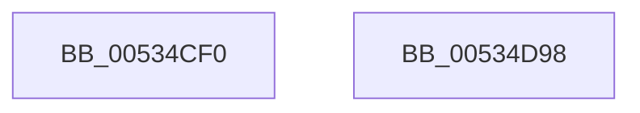

# SymCryptFdefModInvMontgomery256

- RVA: `0x00534CF0`–`0x00534D99` (길이 `169` bytes)
- VA: `0x0000000140534CF0`
- 실행 섹션: `.text`
- PDB 이름 있음: `예`; PDB Function 태그: `아니요`
- unwind 정보 RVA: `0x0005D7BC`
- 디코드: `45`개 명령, `169/169` bytes 표시
- 미해석 바이트: `0` (있으면 어셈블리에 `.byte`로 보존)

> 이 문서는 커널 이미지의 기계어와 PDB 기호를 분석해 생성했습니다. 4번과 5번은 함수 원형과 자료형을 바이너리 사용 방식에서 추정한 C 해석이며 원본 소스 복구 결과는 아닙니다.

## 1. Dependencies

- 직접 호출 지점: **5**; 고유 호출 대상: **3**
- 직접 호출자로 확인된 함수: **0**
- RIP 상대 이미지 참조: **0**

### Outgoing calls
- `0x00534D2E` → [SymCryptWipe](../51/SymCryptWipe_function_0051F914.md) (function, `0x0051F914`)
- `0x00534D3C` → [SymCryptFdefMontgomeryReduce256Asm](SymCryptFdefMontgomeryReduce256Asm_function_00537370.md) (function, `0x00537370`)
- `0x00534D4A` → [SymCryptWipe](../51/SymCryptWipe_function_0051F914.md) (function, `0x0051F914`)
- `0x00534D58` → [SymCryptFdefMontgomeryReduce256Asm](SymCryptFdefMontgomeryReduce256Asm_function_00537370.md) (function, `0x00537370`)
- `0x00534D78` → [SymCryptFdefModInvGeneric](SymCryptFdefModInvGeneric_function_005348C0.md) (function, `0x005348C0`)

### Direct callers
- 이 함수 시작 RVA로 연결되는 직접 call은 확인되지 않았습니다. 간접 호출은 완전히 역산할 수 없습니다.

### Static image references
- 디코드된 RIP-relative 메모리 참조가 없습니다.

## 2. Other-region calls and transfers

- 다른 실행 섹션으로 향하는 call: **0**
- 별도 외부 분기/꼬리 이동을 확인하지 못했습니다.

## 3. Assembly (complete function range)

```asm
00534CF0  48 8B C4                        mov rax, rsp
00534CF3  48 89 58 08                     mov qword ptr [rax + 8], rbx
00534CF7  48 89 68 10                     mov qword ptr [rax + 0x10], rbp
00534CFB  48 89 70 18                     mov qword ptr [rax + 0x18], rsi
00534CFF  48 89 78 20                     mov qword ptr [rax + 0x20], rdi
00534D03  41 56                           push r14
00534D05  48 83 EC 30                     sub rsp, 0x30
00534D09  0F 10 02                        movups xmm0, xmmword ptr [rdx]
00534D0C  48 8B 7C 24 60                  mov rdi, qword ptr [rsp + 0x60]
00534D11  48 8B E9                        mov rbp, rcx
00534D14  41 8B F1                        mov esi, r9d
00534D17  4D 8B F0                        mov r14, r8
00534D1A  0F 11 07                        movups xmmword ptr [rdi], xmm0
00534D1D  48 8D 4F 20                     lea rcx, [rdi + 0x20]
00534D21  0F 10 4A 10                     movups xmm1, xmmword ptr [rdx + 0x10]
00534D25  BA 20 00 00 00                  mov edx, 0x20
00534D2A  0F 11 4F 10                     movups xmmword ptr [rdi + 0x10], xmm1
00534D2E  E8 E1 AB FE FF                  call 0x14051f914
00534D33  4C 8B C7                        mov r8, rdi
00534D36  48 8B D7                        mov rdx, rdi
00534D39  48 8B CD                        mov rcx, rbp
00534D3C  E8 2F 26 00 00                  call 0x140537370
00534D41  BA 20 00 00 00                  mov edx, 0x20
00534D46  48 8D 4F 20                     lea rcx, [rdi + 0x20]
00534D4A  E8 C5 AB FE FF                  call 0x14051f914
00534D4F  4D 8B C6                        mov r8, r14
00534D52  48 8B D7                        mov rdx, rdi
00534D55  48 8B CD                        mov rcx, rbp
00534D58  E8 13 26 00 00                  call 0x140537370
00534D5D  48 8B 44 24 68                  mov rax, qword ptr [rsp + 0x68]
00534D62  44 8B CE                        mov r9d, esi
00534D65  48 89 44 24 28                  mov qword ptr [rsp + 0x28], rax
00534D6A  4D 8B C6                        mov r8, r14
00534D6D  49 8B D6                        mov rdx, r14
00534D70  48 89 7C 24 20                  mov qword ptr [rsp + 0x20], rdi
00534D75  48 8B CD                        mov rcx, rbp
00534D78  E8 43 FB FF FF                  call 0x1405348c0
00534D7D  48 8B 5C 24 40                  mov rbx, qword ptr [rsp + 0x40]
00534D82  48 8B 6C 24 48                  mov rbp, qword ptr [rsp + 0x48]
00534D87  48 8B 74 24 50                  mov rsi, qword ptr [rsp + 0x50]
00534D8C  48 8B 7C 24 58                  mov rdi, qword ptr [rsp + 0x58]
00534D91  48 83 C4 30                     add rsp, 0x30
00534D95  41 5E                           pop r14
00534D97  C3                              ret
00534D98  CC                              int3
```

## 4. C-style interpretation (structured pseudocode)

```c
__int64 __fastcall SymCryptFdefModInvMontgomery256(__int64 a1, __int64 a2, __int64 a3, int a4, __int64 a5, __int64 a6)
{
    __int64 result;
    __int64 v_rsp;
    unsigned __int64 v_stack_m10;
    unsigned __int64 v_stack_m18;
    unsigned __int64 v_stack_p10;
    unsigned __int64 v_stack_p18;
    unsigned __int64 v_stack_p20;
    unsigned __int64 v_stack_p8;

    *(unsigned __int64 *)(v_rsp + 8) = v_rbx;
    *(unsigned __int64 *)(v_rsp + 16) = v_rbp;
    *(unsigned __int64 *)(v_rsp + 24) = v_rsi;
    *(unsigned __int64 *)(v_rsp + 32) = v_rdi;
    v_rsp = (v_rsp) - (48);
    *(unsigned __int64 *)(a5) = v_xmm0;
    *(unsigned __int64 *)(a5 + 16) = v_xmm1;
    result = SymCryptWipe(a5 + 32, 32, a3, a4);
    result = SymCryptFdefMontgomeryReduce256Asm(a1, a5, a5, a4);
    result = SymCryptWipe(a5 + 32, 32, a5, a4);
    result = SymCryptFdefMontgomeryReduce256Asm(a1, a5, a3, a4);
    v_stack_m10 = a6;
    v_stack_m18 = a5;
    result = SymCryptFdefModInvGeneric(a1, a3, a3, (unsigned int)((unsigned int)((unsigned int)(a4))));
    v_rsp = (v_rsp) + (48);
    return result;
}
```

## 5. (Beta) C Style

```c
int64_t SymCryptFdefModInvMontgomery256(int64_t Arg1, void *Arg2, int64_t Arg3, int32_t Arg4, void *Arg5, int64_t Arg6)
{
    uint8_t *arg2 = (uint8_t *)Arg2;
    uint8_t *arg5 = (uint8_t *)Arg5;

    int64_t result;
    int64_t local_rsp;
    uint64_t v_stack_m10;
    uint64_t v_stack_m18;
    uint64_t v_stack_p10;
    uint64_t v_stack_p18;
    uint64_t v_stack_p20;
    uint64_t v_stack_p8;

    *(uint64_t *)(local_rsp + 0x8) = local_rbx;
    *(uint64_t *)(local_rsp + 0x10) = local_rbp;
    *(uint64_t *)(local_rsp + 0x18) = local_rsi;
    *(uint64_t *)(local_rsp + 0x20) = local_rdi;
    local_rsp = (local_rsp) - (48);
    *(uint64_t *)(arg5) = v_xmm0;
    *(uint64_t *)(arg5 + 0x10) = v_xmm1;
    result = SymCryptWipe(Arg5 + 32, 32, Arg3, Arg4);
    result = SymCryptFdefMontgomeryReduce256Asm(Arg1, Arg5, Arg5, Arg4);
    result = SymCryptWipe(Arg5 + 32, 32, Arg5, Arg4);
    result = SymCryptFdefMontgomeryReduce256Asm(Arg1, Arg5, Arg3, Arg4);
    v_stack_m10 = Arg6;
    v_stack_m18 = Arg5;
    result = SymCryptFdefModInvGeneric(Arg1, Arg3, Arg3, (uint32_t)((uint32_t)((uint32_t)(Arg4))));
    local_rsp = (local_rsp) + (48);
    return result;
}
```

### 관측된 메모리 오프셋

구조체 형식이 확인되지 않은 접근은 인자 기준의 오프셋으로만 기록했습니다.

| 기준 인자 | 오프셋 표현 | 폭 (bit) | 접근 |
|---|---:|---:|---|
| `Arg2` | `+ 0x0` | `128` | `R` |
| `Arg2` | `+ 0x10` | `128` | `R` |
| `Arg5` | `+ 0x0` | `128` | `R` |
| `Arg5` | `+ 0x10` | `128` | `R` |
| `Arg5` | `+ 0x20` | `64` | `R` |

## 6. Execution-region graph

[열기: 2D/3D 그래프와 함수 탐색 컨트롤 패널](../../../control-panel.html?section=text&rva=0x00534CF0&view=graph)

- 2D 그래프는 위에서 아래로 흐르고, 3D 그래프는 빈 공간을 드래그해 회전합니다. Shift+드래그는 이동, 휠은 확대·축소, 함수 노드 선택은 대상 보고서 이동입니다.

### Static fallback


