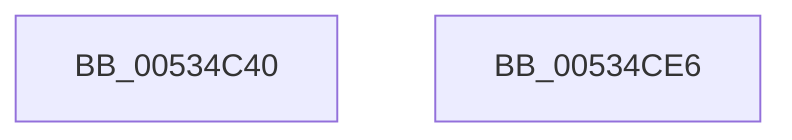

# SymCryptFdefModInvMontgomery

- RVA: `0x00534C40`–`0x00534CE7` (길이 `167` bytes)
- VA: `0x0000000140534C40`
- 실행 섹션: `.text`
- PDB 이름 있음: `예`; PDB Function 태그: `아니요`
- unwind 정보 RVA: `0x00084C9C`
- 디코드: `49`개 명령, `167/167` bytes 표시
- 미해석 바이트: `0` (있으면 어셈블리에 `.byte`로 보존)

> 이 문서는 커널 이미지의 기계어와 PDB 기호를 분석해 생성했습니다. 4번과 5번은 함수 원형과 자료형을 바이너리 사용 방식에서 추정한 C 해석이며 원본 소스 복구 결과는 아닙니다.

## 1. Dependencies

- 직접 호출 지점: **6**; 고유 호출 대상: **4**
- 직접 호출자로 확인된 함수: **0**
- RIP 상대 이미지 참조: **0**

### Outgoing calls
- `0x00534C74` → [memcpy](../6C/memcpy_function_006C6840.md) (function, `0x006C6840`)
- `0x00534C82` → [SymCryptWipe](../51/SymCryptWipe_function_0051F914.md) (function, `0x0051F914`)
- `0x00534C90` → [SymCryptFdefMontgomeryReduce](SymCryptFdefMontgomeryReduce_function_005356D0.md) (function, `0x005356D0`)
- `0x00534C9A` → [SymCryptWipe](../51/SymCryptWipe_function_0051F914.md) (function, `0x0051F914`)
- `0x00534CA8` → [SymCryptFdefMontgomeryReduce](SymCryptFdefMontgomeryReduce_function_005356D0.md) (function, `0x005356D0`)
- `0x00534CC8` → [SymCryptFdefModInvGeneric](SymCryptFdefModInvGeneric_function_005348C0.md) (function, `0x005348C0`)

### Direct callers
- 이 함수 시작 RVA로 연결되는 직접 call은 확인되지 않았습니다. 간접 호출은 완전히 역산할 수 없습니다.

### Static image references
- 디코드된 RIP-relative 메모리 참조가 없습니다.

## 2. Other-region calls and transfers

- 다른 실행 섹션으로 향하는 call: **0**
- 별도 외부 분기/꼬리 이동을 확인하지 못했습니다.

## 3. Assembly (complete function range)

```asm
00534C40  48 89 5C 24 08                  mov qword ptr [rsp + 8], rbx
00534C45  48 89 6C 24 10                  mov qword ptr [rsp + 0x10], rbp
00534C4A  48 89 74 24 18                  mov qword ptr [rsp + 0x18], rsi
00534C4F  57                              push rdi
00534C50  41 56                           push r14
00534C52  41 57                           push r15
00534C54  48 83 EC 30                     sub rsp, 0x30
00534C58  8B 41 04                        mov eax, dword ptr [rcx + 4]
00534C5B  4D 8B F8                        mov r15, r8
00534C5E  48 8B 74 24 70                  mov rsi, qword ptr [rsp + 0x70]
00534C63  4C 8B F1                        mov r14, rcx
00534C66  C1 E0 06                        shl eax, 6
00534C69  48 8B CE                        mov rcx, rsi
00534C6C  44 8B C0                        mov r8d, eax
00534C6F  41 8B E9                        mov ebp, r9d
00534C72  8B F8                           mov edi, eax
00534C74  E8 C7 1B 19 00                  call 0x1406c6840
00534C79  48 8D 1C 37                     lea rbx, [rdi + rsi]
00534C7D  8B D7                           mov edx, edi
00534C7F  48 8B CB                        mov rcx, rbx
00534C82  E8 8D AC FE FF                  call 0x14051f914
00534C87  4C 8B C6                        mov r8, rsi
00534C8A  48 8B D6                        mov rdx, rsi
00534C8D  49 8B CE                        mov rcx, r14
00534C90  E8 3B 0A 00 00                  call 0x1405356d0
00534C95  8B D7                           mov edx, edi
00534C97  48 8B CB                        mov rcx, rbx
00534C9A  E8 75 AC FE FF                  call 0x14051f914
00534C9F  4D 8B C7                        mov r8, r15
00534CA2  48 8B D6                        mov rdx, rsi
00534CA5  49 8B CE                        mov rcx, r14
00534CA8  E8 23 0A 00 00                  call 0x1405356d0
00534CAD  48 8B 44 24 78                  mov rax, qword ptr [rsp + 0x78]
00534CB2  44 8B CD                        mov r9d, ebp
00534CB5  48 89 44 24 28                  mov qword ptr [rsp + 0x28], rax
00534CBA  4D 8B C7                        mov r8, r15
00534CBD  49 8B D7                        mov rdx, r15
00534CC0  48 89 74 24 20                  mov qword ptr [rsp + 0x20], rsi
00534CC5  49 8B CE                        mov rcx, r14
00534CC8  E8 F3 FB FF FF                  call 0x1405348c0
00534CCD  48 8B 5C 24 50                  mov rbx, qword ptr [rsp + 0x50]
00534CD2  48 8B 6C 24 58                  mov rbp, qword ptr [rsp + 0x58]
00534CD7  48 8B 74 24 60                  mov rsi, qword ptr [rsp + 0x60]
00534CDC  48 83 C4 30                     add rsp, 0x30
00534CE0  41 5F                           pop r15
00534CE2  41 5E                           pop r14
00534CE4  5F                              pop rdi
00534CE5  C3                              ret
00534CE6  CC                              int3
```

## 4. C-style interpretation (structured pseudocode)

```c
__int64 __fastcall SymCryptFdefModInvMontgomery(__int64 a1, __int64 a2, __int64 a3, int a4, __int64 a5, __int64 a6)
{
    __int64 result;
    __int64 v_rsp;
    unsigned __int64 v_stack_m20;
    unsigned __int64 v_stack_m28;
    unsigned __int64 v_stack_p10;
    unsigned __int64 v_stack_p18;
    unsigned __int64 v_stack_p8;

    v_stack_p8 = v_rbx;
    v_stack_p10 = v_rbp;
    v_stack_p18 = v_rsi;
    v_rsp = (v_rsp) - (48);
    result = (unsigned int)(((unsigned int)(*(unsigned int *)(a1 + 4))) << (6));
    result = memcpy(a5, a2, (unsigned int)((unsigned int)(result)), a4);
    result = SymCryptWipe((unsigned int)((unsigned int)(result)) + a5 * 1, (unsigned int)((unsigned int)((unsigned int)((unsigned int)(result)))), (unsigned int)((unsigned int)(result)), a4);
    result = SymCryptFdefMontgomeryReduce(a1, a5, a5, a4);
    result = SymCryptWipe((unsigned int)((unsigned int)(result)) + a5 * 1, (unsigned int)((unsigned int)((unsigned int)((unsigned int)(result)))), a5, a4);
    result = SymCryptFdefMontgomeryReduce(a1, a5, a3, a4);
    v_stack_m20 = a6;
    v_stack_m28 = a5;
    result = SymCryptFdefModInvGeneric(a1, a3, a3, (unsigned int)((unsigned int)((unsigned int)(a4))));
    v_rsp = (v_rsp) + (48);
    return result;
}
```

## 5. (Beta) C Style

```c
int64_t SymCryptFdefModInvMontgomery(void *Arg1, int64_t Arg2, int64_t Arg3, int32_t Arg4, int64_t Arg5, int64_t Arg6)
{
    uint8_t *arg1 = (uint8_t *)Arg1;

    int64_t result;
    int64_t local_rsp;
    uint64_t v_stack_m20;
    uint64_t v_stack_m28;
    uint64_t v_stack_p10;
    uint64_t v_stack_p18;
    uint64_t v_stack_p8;

    v_stack_p8 = local_rbx;
    v_stack_p10 = local_rbp;
    v_stack_p18 = local_rsi;
    local_rsp = (local_rsp) - (48);
    result = (uint32_t)(((uint32_t)(*(uint32_t *)(arg1 + 0x4))) << (6));
    result = memcpy(Arg5, Arg2, (uint32_t)((uint32_t)(result)), Arg4);
    result = SymCryptWipe((uint32_t)((uint32_t)(result)) + Arg5 * 1, (uint32_t)((uint32_t)((uint32_t)((uint32_t)(result)))), (uint32_t)((uint32_t)(result)), Arg4);
    result = SymCryptFdefMontgomeryReduce(Arg1, Arg5, Arg5, Arg4);
    result = SymCryptWipe((uint32_t)((uint32_t)(result)) + Arg5 * 1, (uint32_t)((uint32_t)((uint32_t)((uint32_t)(result)))), Arg5, Arg4);
    result = SymCryptFdefMontgomeryReduce(Arg1, Arg5, Arg3, Arg4);
    v_stack_m20 = Arg6;
    v_stack_m28 = Arg5;
    result = SymCryptFdefModInvGeneric(Arg1, Arg3, Arg3, (uint32_t)((uint32_t)((uint32_t)(Arg4))));
    local_rsp = (local_rsp) + (48);
    return result;
}
```

### 관측된 메모리 오프셋

구조체 형식이 확인되지 않은 접근은 인자 기준의 오프셋으로만 기록했습니다.

| 기준 인자 | 오프셋 표현 | 폭 (bit) | 접근 |
|---|---:|---:|---|
| `Arg1` | `+ 0x4` | `32` | `R` |

## 6. Execution-region graph

[열기: 2D/3D 그래프와 함수 탐색 컨트롤 패널](../../../control-panel.html?section=text&rva=0x00534C40&view=graph)

- 2D 그래프는 위에서 아래로 흐르고, 3D 그래프는 빈 공간을 드래그해 회전합니다. Shift+드래그는 이동, 휠은 확대·축소, 함수 노드 선택은 대상 보고서 이동입니다.

### Static fallback


