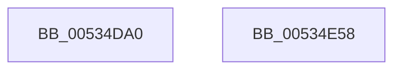

# SymCryptFdefModMulGeneric

- RVA: `0x00534DA0`–`0x00534E59` (길이 `185` bytes)
- VA: `0x0000000140534DA0`
- 실행 섹션: `.text`
- PDB 이름 있음: `예`; PDB Function 태그: `아니요`
- unwind 정보 RVA: `0x0008A668`
- 디코드: `51`개 명령, `185/185` bytes 표시
- 미해석 바이트: `0` (있으면 어셈블리에 `.byte`로 보존)

> 이 문서는 커널 이미지의 기계어와 PDB 기호를 분석해 생성했습니다. 4번과 5번은 함수 원형과 자료형을 바이너리 사용 방식에서 추정한 C 해석이며 원본 소스 복구 결과는 아닙니다.

## 1. Dependencies

- 직접 호출 지점: **3**; 고유 호출 대상: **3**
- 직접 호출자로 확인된 함수: **0**
- RIP 상대 이미지 참조: **0**

### Outgoing calls
- `0x00534DEE` → [EmpCheckErrataList](../49/EmpCheckErrataList_function_0049E550.md) (function, `0x0049E550`)
- `0x00534E04` → [SymCryptFdefRawMul](../52/SymCryptFdefRawMul_function_0052DF1C.md) (function, `0x0052DF1C`)
- `0x00534E34` → [SymCryptFdefRawDivMod](../52/SymCryptFdefRawDivMod_function_0052DC30.md) (function, `0x0052DC30`)

### Direct callers
- 이 함수 시작 RVA로 연결되는 직접 call은 확인되지 않았습니다. 간접 호출은 완전히 역산할 수 없습니다.

### Static image references
- 디코드된 RIP-relative 메모리 참조가 없습니다.

## 2. Other-region calls and transfers

- 다른 실행 섹션으로 향하는 call: **0**
- 별도 외부 분기/꼬리 이동을 확인하지 못했습니다.

## 3. Assembly (complete function range)

```asm
00534DA0  48 8B C4                        mov rax, rsp
00534DA3  48 89 58 08                     mov qword ptr [rax + 8], rbx
00534DA7  48 89 68 10                     mov qword ptr [rax + 0x10], rbp
00534DAB  48 89 70 18                     mov qword ptr [rax + 0x18], rsi
00534DAF  48 89 78 20                     mov qword ptr [rax + 0x20], rdi
00534DB3  41 54                           push r12
00534DB5  41 56                           push r14
00534DB7  41 57                           push r15
00534DB9  48 83 EC 40                     sub rsp, 0x40
00534DBD  44 8B 71 04                     mov r14d, dword ptr [rcx + 4]
00534DC1  49 8B D8                        mov rbx, r8
00534DC4  48 8B B4 24 88 00 00 00         mov rsi, qword ptr [rsp + 0x88]
00534DCC  45 8B C6                        mov r8d, r14d
00534DCF  48 8B AC 24 80 00 00 00         mov rbp, qword ptr [rsp + 0x80]
00534DD7  48 8B FA                        mov rdi, rdx
00534DDA  41 C1 E0 08                     shl r8d, 8
00534DDE  4C 8B F9                        mov r15, rcx
00534DE1  41 83 C0 40                     add r8d, 0x40
00534DE5  48 8B D6                        mov rdx, rsi
00534DE8  48 8B CD                        mov rcx, rbp
00534DEB  4D 8B E1                        mov r12, r9
00534DEE  E8 5D 97 F6 FF                  call 0x14049e550
00534DF3  45 8B CE                        mov r9d, r14d
00534DF6  48 89 6C 24 20                  mov qword ptr [rsp + 0x20], rbp
00534DFB  4C 8B C3                        mov r8, rbx
00534DFE  41 8B D6                        mov edx, r14d
00534E01  48 8B CF                        mov rcx, rdi
00534E04  E8 13 91 FF FF                  call 0x14052df1c
00534E09  41 8B C6                        mov eax, r14d
00534E0C  4D 8D 47 40                     lea r8, [r15 + 0x40]
00534E10  C1 E0 07                        shl eax, 7
00534E13  45 33 C9                        xor r9d, r9d
00534E16  8B D0                           mov edx, eax
00534E18  48 8B CD                        mov rcx, rbp
00534E1B  48 2B F2                        sub rsi, rdx
00534E1E  48 03 C5                        add rax, rbp
00534E21  48 89 74 24 30                  mov qword ptr [rsp + 0x30], rsi
00534E26  43 8D 14 36                     lea edx, [r14 + r14]
00534E2A  48 89 44 24 28                  mov qword ptr [rsp + 0x28], rax
00534E2F  4C 89 64 24 20                  mov qword ptr [rsp + 0x20], r12
00534E34  E8 F7 8D FF FF                  call 0x14052dc30
00534E39  48 8B 5C 24 60                  mov rbx, qword ptr [rsp + 0x60]
00534E3E  48 8B 6C 24 68                  mov rbp, qword ptr [rsp + 0x68]
00534E43  48 8B 74 24 70                  mov rsi, qword ptr [rsp + 0x70]
00534E48  48 8B 7C 24 78                  mov rdi, qword ptr [rsp + 0x78]
00534E4D  48 83 C4 40                     add rsp, 0x40
00534E51  41 5F                           pop r15
00534E53  41 5E                           pop r14
00534E55  41 5C                           pop r12
00534E57  C3                              ret
00534E58  CC                              int3
```

## 4. C-style interpretation (structured pseudocode)

```c
__int64 __fastcall SymCryptFdefModMulGeneric(__int64 a1, __int64 a2, __int64 a3, __int64 a4, __int64 a5, __int64 a6)
{
    __int64 result;
    __int64 v_rsi;
    __int64 v_rsp;
    unsigned __int64 v_stack_m28;
    unsigned __int64 v_stack_m30;
    unsigned __int64 v_stack_m38;
    unsigned __int64 v_stack_p10;
    unsigned __int64 v_stack_p18;
    unsigned __int64 v_stack_p20;
    unsigned __int64 v_stack_p8;

    *(unsigned __int64 *)(v_rsp + 8) = v_rbx;
    *(unsigned __int64 *)(v_rsp + 16) = v_rbp;
    *(unsigned __int64 *)(v_rsp + 24) = v_rsi;
    *(unsigned __int64 *)(v_rsp + 32) = v_rdi;
    v_rsp = (v_rsp) - (64);
    a3 = (unsigned int)(((unsigned int)((unsigned int)((unsigned int)(*(unsigned int *)(a1 + 4))))) << (8));
    a3 = (unsigned int)((a3) + (64));
    result = EmpCheckErrataList(a5, a6, a3, a4);
    v_stack_m38 = a5;
    result = SymCryptFdefRawMul(a2, (unsigned int)((unsigned int)((unsigned int)(*(unsigned int *)(a1 + 4)))), a3, (unsigned int)((unsigned int)((unsigned int)(*(unsigned int *)(a1 + 4)))));
    result = (unsigned int)(((unsigned int)((unsigned int)((unsigned int)(*(unsigned int *)(a1 + 4))))) << (7));
    a4 = 0;
    v_rsi = (a6) - ((unsigned int)((unsigned int)(result)));
    result = (result) + (a5);
    v_stack_m28 = v_rsi;
    v_stack_m30 = result;
    v_stack_m38 = 0;
    result = SymCryptFdefRawDivMod(a5, (unsigned int)(*(unsigned int *)(a1 + 4)) + (unsigned int)(*(unsigned int *)(a1 + 4)) * 1, a1 + 64, a4);
    v_rsp = (v_rsp) + (64);
    return result;
}
```

## 5. (Beta) C Style

```c
int64_t SymCryptFdefModMulGeneric(void *Arg1, int64_t Arg2, int64_t Arg3, int64_t Arg4, int64_t Arg5, int64_t Arg6)
{
    uint8_t *arg1 = (uint8_t *)Arg1;

    int64_t result;
    int64_t local_rsi;
    int64_t local_rsp;
    uint64_t v_stack_m28;
    uint64_t v_stack_m30;
    uint64_t v_stack_m38;
    uint64_t v_stack_p10;
    uint64_t v_stack_p18;
    uint64_t v_stack_p20;
    uint64_t v_stack_p8;

    *(uint64_t *)(local_rsp + 0x8) = local_rbx;
    *(uint64_t *)(local_rsp + 0x10) = local_rbp;
    *(uint64_t *)(local_rsp + 0x18) = local_rsi;
    *(uint64_t *)(local_rsp + 0x20) = local_rdi;
    local_rsp = (local_rsp) - (64);
    Arg3 = (uint32_t)(((uint32_t)((uint32_t)((uint32_t)(*(uint32_t *)(arg1 + 0x4))))) << (8));
    Arg3 = (uint32_t)((Arg3) + (64));
    result = EmpCheckErrataList(Arg5, Arg6, Arg3, Arg4);
    v_stack_m38 = Arg5;
    result = SymCryptFdefRawMul(Arg2, (uint32_t)((uint32_t)((uint32_t)(*(uint32_t *)(arg1 + 0x4)))), Arg3, (uint32_t)((uint32_t)((uint32_t)(*(uint32_t *)(arg1 + 0x4)))));
    result = (uint32_t)(((uint32_t)((uint32_t)((uint32_t)(*(uint32_t *)(arg1 + 0x4))))) << (7));
    Arg4 = 0;
    local_rsi = (Arg6) - ((uint32_t)((uint32_t)(result)));
    result = (result) + (Arg5);
    v_stack_m28 = local_rsi;
    v_stack_m30 = result;
    v_stack_m38 = 0;
    result = SymCryptFdefRawDivMod(Arg5, (uint32_t)(*(uint32_t *)(arg1 + 0x4)) + (uint32_t)(*(uint32_t *)(arg1 + 0x4)) * 1, Arg1 + 64, Arg4);
    local_rsp = (local_rsp) + (64);
    return result;
}
```

### 관측된 메모리 오프셋

구조체 형식이 확인되지 않은 접근은 인자 기준의 오프셋으로만 기록했습니다.

| 기준 인자 | 오프셋 표현 | 폭 (bit) | 접근 |
|---|---:|---:|---|
| `Arg1` | `+ 0x4` | `32` | `R` |
| `Arg1` | `+ 0x40` | `64` | `R` |

## 6. Execution-region graph

[열기: 2D/3D 그래프와 함수 탐색 컨트롤 패널](../../../control-panel.html?section=text&rva=0x00534DA0&view=graph)

- 2D 그래프는 위에서 아래로 흐르고, 3D 그래프는 빈 공간을 드래그해 회전합니다. Shift+드래그는 이동, 휠은 확대·축소, 함수 노드 선택은 대상 보고서 이동입니다.

### Static fallback


