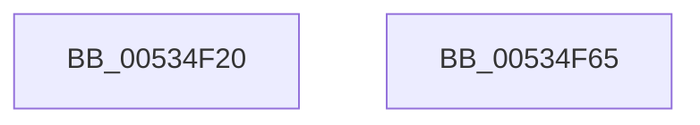

# SymCryptFdefModMulMontgomeryMulx1024

- RVA: `0x00534F20`–`0x00534F66` (길이 `70` bytes)
- VA: `0x0000000140534F20`
- 실행 섹션: `.text`
- PDB 이름 있음: `예`; PDB Function 태그: `아니요`
- unwind 정보 RVA: `0x0005CAAC`
- 디코드: `21`개 명령, `70/70` bytes 표시
- 미해석 바이트: `0` (있으면 어셈블리에 `.byte`로 보존)

> 이 문서는 커널 이미지의 기계어와 PDB 기호를 분석해 생성했습니다. 4번과 5번은 함수 원형과 자료형을 바이너리 사용 방식에서 추정한 C 해석이며 원본 소스 복구 결과는 아닙니다.

## 1. Dependencies

- 직접 호출 지점: **2**; 고유 호출 대상: **2**
- 직접 호출자로 확인된 함수: **0**
- RIP 상대 이미지 참조: **0**

### Outgoing calls
- `0x00534F45` → [SymCryptFdefRawMulMulx1024](SymCryptFdefRawMulMulx1024_function_00530CC0.md) (function, `0x00530CC0`)
- `0x00534F55` → [SymCryptFdefMontgomeryReduceMulx1024](SymCryptFdefMontgomeryReduceMulx1024_function_00533200.md) (function, `0x00533200`)

### Direct callers
- 이 함수 시작 RVA로 연결되는 직접 call은 확인되지 않았습니다. 간접 호출은 완전히 역산할 수 없습니다.

### Static image references
- 디코드된 RIP-relative 메모리 참조가 없습니다.

## 2. Other-region calls and transfers

- 다른 실행 섹션으로 향하는 call: **0**
- 별도 외부 분기/꼬리 이동을 확인하지 못했습니다.

## 3. Assembly (complete function range)

```asm
00534F20  48 89 5C 24 08                  mov qword ptr [rsp + 8], rbx
00534F25  57                              push rdi
00534F26  48 83 EC 20                     sub rsp, 0x20
00534F2A  49 8B C0                        mov rax, r8
00534F2D  4C 8B D2                        mov r10, rdx
00534F30  44 8B 41 04                     mov r8d, dword ptr [rcx + 4]
00534F34  49 8B F9                        mov rdi, r9
00534F37  4C 8B 4C 24 50                  mov r9, qword ptr [rsp + 0x50]
00534F3C  48 8B D9                        mov rbx, rcx
00534F3F  48 8B D0                        mov rdx, rax
00534F42  49 8B CA                        mov rcx, r10
00534F45  E8 76 BD FF FF                  call 0x140530cc0
00534F4A  48 8B 54 24 50                  mov rdx, qword ptr [rsp + 0x50]
00534F4F  4C 8B C7                        mov r8, rdi
00534F52  48 8B CB                        mov rcx, rbx
00534F55  E8 A6 E2 FF FF                  call 0x140533200
00534F5A  48 8B 5C 24 30                  mov rbx, qword ptr [rsp + 0x30]
00534F5F  48 83 C4 20                     add rsp, 0x20
00534F63  5F                              pop rdi
00534F64  C3                              ret
00534F65  CC                              int3
```

## 4. C-style interpretation (structured pseudocode)

```c
__int64 __fastcall SymCryptFdefModMulMontgomeryMulx1024(__int64 a1, __int64 a2, __int64 a3, __int64 a4, __int64 a5)
{
    __int64 result;
    __int64 v_rsp;
    unsigned __int64 v_stack_p8;

    v_stack_p8 = v_rbx;
    v_rsp = (v_rsp) - (32);
    result = SymCryptFdefRawMulMulx1024(a2, a3, (unsigned int)(*(unsigned int *)(a1 + 4)), a5);
    result = SymCryptFdefMontgomeryReduceMulx1024(a1, a5, a4, a5);
    v_rsp = (v_rsp) + (32);
    return result;
}
```

## 5. (Beta) C Style

```c
int64_t SymCryptFdefModMulMontgomeryMulx1024(void *Arg1, int64_t Arg2, int64_t Arg3, int64_t Arg4, int64_t Arg5)
{
    uint8_t *arg1 = (uint8_t *)Arg1;

    int64_t result;
    int64_t local_rsp;
    uint64_t v_stack_p8;

    v_stack_p8 = local_rbx;
    local_rsp = (local_rsp) - (32);
    result = SymCryptFdefRawMulMulx1024(Arg2, Arg3, (uint32_t)(*(uint32_t *)(arg1 + 0x4)), Arg5);
    result = SymCryptFdefMontgomeryReduceMulx1024(Arg1, Arg5, Arg4, Arg5);
    local_rsp = (local_rsp) + (32);
    return result;
}
```

### 관측된 메모리 오프셋

구조체 형식이 확인되지 않은 접근은 인자 기준의 오프셋으로만 기록했습니다.

| 기준 인자 | 오프셋 표현 | 폭 (bit) | 접근 |
|---|---:|---:|---|
| `Arg1` | `+ 0x4` | `32` | `R` |

## 6. Execution-region graph

[열기: 2D/3D 그래프와 함수 탐색 컨트롤 패널](../../../control-panel.html?section=text&rva=0x00534F20&view=graph)

- 2D 그래프는 위에서 아래로 흐르고, 3D 그래프는 빈 공간을 드래그해 회전합니다. Shift+드래그는 이동, 휠은 확대·축소, 함수 노드 선택은 대상 보고서 이동입니다.

### Static fallback


