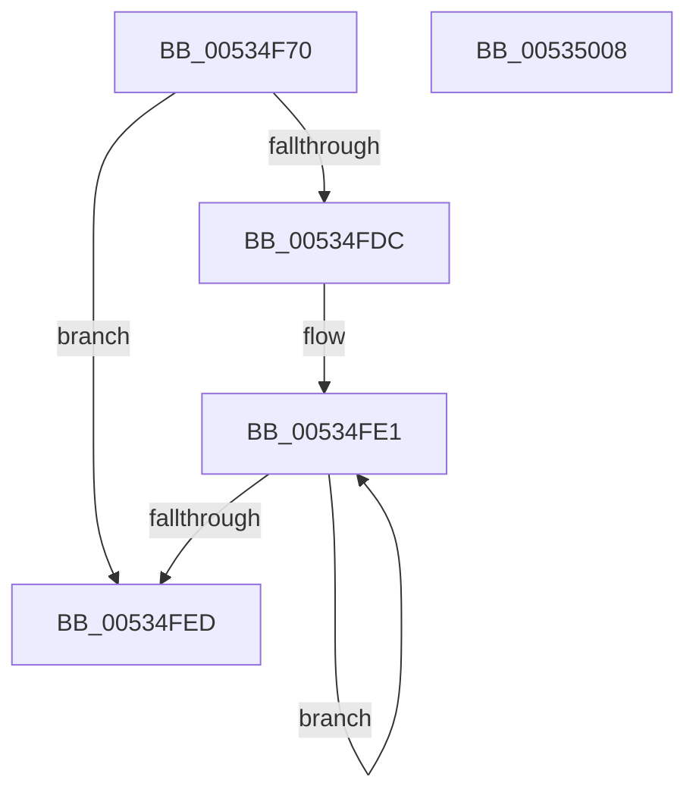

# SymCryptFdefModNegGeneric

- RVA: `0x00534F70`–`0x00535009` (길이 `153` bytes)
- VA: `0x0000000140534F70`
- 실행 섹션: `.text`
- PDB 이름 있음: `예`; PDB Function 태그: `아니요`
- unwind 정보 RVA: `0x0005E6B4`
- 디코드: `44`개 명령, `153/153` bytes 표시
- 미해석 바이트: `0` (있으면 어셈블리에 `.byte`로 보존)

> 이 문서는 커널 이미지의 기계어와 PDB 기호를 분석해 생성했습니다. 4번과 5번은 함수 원형과 자료형을 바이너리 사용 방식에서 추정한 C 해석이며 원본 소스 복구 결과는 아닙니다.

## 1. Dependencies

- 직접 호출 지점: **3**; 고유 호출 대상: **3**
- 직접 호출자로 확인된 함수: **0**
- RIP 상대 이미지 참조: **0**

### Outgoing calls
- `0x00534FA9` → [EmpCheckErrataList](../49/EmpCheckErrataList_function_0049E550.md) (function, `0x0049E550`)
- `0x00534FB7` → [SymCryptFdefRawIsEqualUint32](SymCryptFdefRawIsEqualUint32_function_00535E7C.md) (function, `0x00535E7C`)
- `0x00534FCE` → [SymCryptFdefRawSub](../52/SymCryptFdefRawSub_function_0052E0BC.md) (function, `0x0052E0BC`)

### Direct callers
- 이 함수 시작 RVA로 연결되는 직접 call은 확인되지 않았습니다. 간접 호출은 완전히 역산할 수 없습니다.

### Static image references
- 디코드된 RIP-relative 메모리 참조가 없습니다.

## 2. Other-region calls and transfers

- 다른 실행 섹션으로 향하는 call: **0**
- 별도 외부 분기/꼬리 이동을 확인하지 못했습니다.

## 3. Assembly (complete function range)

```asm
00534F70  48 8B C4                        mov rax, rsp
00534F73  48 89 58 08                     mov qword ptr [rax + 8], rbx
00534F77  48 89 68 10                     mov qword ptr [rax + 0x10], rbp
00534F7B  48 89 70 18                     mov qword ptr [rax + 0x18], rsi
00534F7F  48 89 78 20                     mov qword ptr [rax + 0x20], rdi
00534F83  41 56                           push r14
00534F85  48 83 EC 20                     sub rsp, 0x20
00534F89  44 8B 71 04                     mov r14d, dword ptr [rcx + 4]
00534F8D  49 8B F0                        mov rsi, r8
00534F90  45 8B C6                        mov r8d, r14d
00534F93  48 8B FA                        mov rdi, rdx
00534F96  48 8B 54 24 50                  mov rdx, qword ptr [rsp + 0x50]
00534F9B  48 8B D9                        mov rbx, rcx
00534F9E  41 C1 E0 08                     shl r8d, 8
00534FA2  49 8B C9                        mov rcx, r9
00534FA5  41 83 C0 40                     add r8d, 0x40
00534FA9  E8 A2 95 F6 FF                  call 0x14049e550
00534FAE  45 33 C0                        xor r8d, r8d
00534FB1  41 8B D6                        mov edx, r14d
00534FB4  48 8B CF                        mov rcx, rdi
00534FB7  E8 C0 0E 00 00                  call 0x140535e7c
00534FBC  48 8D 8B 80 00 00 00            lea rcx, [rbx + 0x80]
00534FC3  45 8B CE                        mov r9d, r14d
00534FC6  4C 8B C6                        mov r8, rsi
00534FC9  48 8B D7                        mov rdx, rdi
00534FCC  8B E8                           mov ebp, eax
00534FCE  E8 E9 90 FF FF                  call 0x14052e0bc
00534FD3  41 C1 E6 04                     shl r14d, 4
00534FD7  45 85 F6                        test r14d, r14d
00534FDA  74 11                           je 0x140534fed
00534FDC  F7 D5                           not ebp
00534FDE  41 8B C6                        mov eax, r14d
00534FE1  21 2E                           and dword ptr [rsi], ebp
00534FE3  48 8D 76 04                     lea rsi, [rsi + 4]
00534FE7  48 83 E8 01                     sub rax, 1
00534FEB  75 F4                           jne 0x140534fe1
00534FED  48 8B 5C 24 30                  mov rbx, qword ptr [rsp + 0x30]
00534FF2  48 8B 6C 24 38                  mov rbp, qword ptr [rsp + 0x38]
00534FF7  48 8B 74 24 40                  mov rsi, qword ptr [rsp + 0x40]
00534FFC  48 8B 7C 24 48                  mov rdi, qword ptr [rsp + 0x48]
00535001  48 83 C4 20                     add rsp, 0x20
00535005  41 5E                           pop r14
00535007  C3                              ret
00535008  CC                              int3
```

## 4. C-style interpretation (structured pseudocode)

```c
__int64 __fastcall SymCryptFdefModNegGeneric(__int64 a1, __int64 a2, __int64 a3, __int64 a4, __int64 a5)
{
    __int64 result;
    __int64 v_r14;
    __int64 v_rbp;
    __int64 v_rsp;
    unsigned __int64 v_stack_p10;
    unsigned __int64 v_stack_p18;
    unsigned __int64 v_stack_p20;
    unsigned __int64 v_stack_p8;

    *(unsigned __int64 *)(v_rsp + 8) = v_rbx;
    *(unsigned __int64 *)(v_rsp + 16) = v_rbp;
    *(unsigned __int64 *)(v_rsp + 24) = v_rsi;
    *(unsigned __int64 *)(v_rsp + 32) = v_rdi;
    v_rsp = (v_rsp) - (32);
    a3 = (unsigned int)(((unsigned int)((unsigned int)((unsigned int)(*(unsigned int *)(a1 + 4))))) << (8));
    a3 = (unsigned int)((a3) + (64));
    result = EmpCheckErrataList(a4, a5, a3, a4);
    a3 = 0;
    result = SymCryptFdefRawIsEqualUint32(a2, (unsigned int)((unsigned int)((unsigned int)(*(unsigned int *)(a1 + 4)))), a3, a4);
    result = SymCryptFdefRawSub(a1 + 128, a2, 0, (unsigned int)((unsigned int)((unsigned int)(*(unsigned int *)(a1 + 4)))));
    v_r14 = (unsigned int)(((unsigned int)(*(unsigned int *)(a1 + 4))) << (4));
    if ((unsigned int)(v_r14) == 0) goto loc_00534FED;
    v_rbp = (unsigned int)(~((unsigned int)((unsigned int)(result))));
loc_00534FE1:
    result = ((unsigned int)((unsigned int)(v_r14))) - (1);
    if (condition_is_not_equal) goto loc_00534FE1;
loc_00534FED:
    v_rsp = (v_rsp) + (32);
    return result;
}
```

## 5. (Beta) C Style

```c
int64_t SymCryptFdefModNegGeneric(void *Arg1, int64_t Arg2, void *Arg3, int64_t Arg4, int64_t Arg5)
{
    uint8_t *arg1 = (uint8_t *)Arg1;
    uint8_t *arg3 = (uint8_t *)Arg3;

    int64_t result;
    int64_t local_r14;
    int64_t local_rbp;
    int64_t local_rsp;
    uint64_t v_stack_p10;
    uint64_t v_stack_p18;
    uint64_t v_stack_p20;
    uint64_t v_stack_p8;

    *(uint64_t *)(local_rsp + 0x8) = local_rbx;
    *(uint64_t *)(local_rsp + 0x10) = local_rbp;
    *(uint64_t *)(local_rsp + 0x18) = local_rsi;
    *(uint64_t *)(local_rsp + 0x20) = local_rdi;
    local_rsp = (local_rsp) - (32);
    Arg3 = (uint32_t)(((uint32_t)((uint32_t)((uint32_t)(*(uint32_t *)(arg1 + 0x4))))) << (8));
    Arg3 = (uint32_t)((Arg3) + (64));
    result = EmpCheckErrataList(Arg4, Arg5, Arg3, Arg4);
    Arg3 = 0;
    result = SymCryptFdefRawIsEqualUint32(Arg2, (uint32_t)((uint32_t)((uint32_t)(*(uint32_t *)(arg1 + 0x4)))), Arg3, Arg4);
    result = SymCryptFdefRawSub(Arg1 + 128, Arg2, 0, (uint32_t)((uint32_t)((uint32_t)(*(uint32_t *)(arg1 + 0x4)))));
    local_r14 = (uint32_t)(((uint32_t)(*(uint32_t *)(arg1 + 0x4))) << (4));
    if ((uint32_t)(local_r14) == 0) goto loc_00534FED;
    local_rbp = (uint32_t)(~((uint32_t)((uint32_t)(result))));
loc_00534FE1:
    result = ((uint32_t)((uint32_t)(local_r14))) - (1);
    if (condition_is_not_equal) goto loc_00534FE1;
loc_00534FED:
    local_rsp = (local_rsp) + (32);
    return result;
}
```

### 관측된 메모리 오프셋

구조체 형식이 확인되지 않은 접근은 인자 기준의 오프셋으로만 기록했습니다.

| 기준 인자 | 오프셋 표현 | 폭 (bit) | 접근 |
|---|---:|---:|---|
| `Arg1` | `+ 0x4` | `32` | `R` |
| `Arg1` | `+ 0x80` | `64` | `R` |
| `Arg3` | `+ 0x0` | `32` | `R/W` |
| `Arg3` | `+ 0x4` | `64` | `R` |

## 6. Execution-region graph

[열기: 2D/3D 그래프와 함수 탐색 컨트롤 패널](../../../control-panel.html?section=text&rva=0x00534F70&view=graph)

- 2D 그래프는 위에서 아래로 흐르고, 3D 그래프는 빈 공간을 드래그해 회전합니다. Shift+드래그는 이동, 휠은 확대·축소, 함수 노드 선택은 대상 보고서 이동입니다.

### Static fallback


