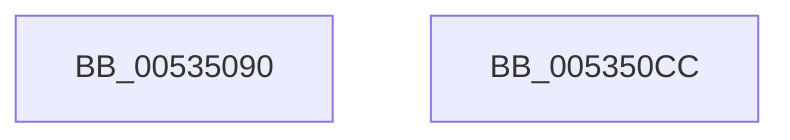

# SymCryptFdefModPreGetMontgomery256

- RVA: `0x00535090`–`0x005350CD` (길이 `61` bytes)
- VA: `0x0000000140535090`
- 실행 섹션: `.text`
- PDB 이름 있음: `예`; PDB Function 태그: `아니요`
- unwind 정보 RVA: `0x0005CF00`
- 디코드: `18`개 명령, `61/61` bytes 표시
- 미해석 바이트: `0` (있으면 어셈블리에 `.byte`로 보존)

> 이 문서는 커널 이미지의 기계어와 PDB 기호를 분석해 생성했습니다. 4번과 5번은 함수 원형과 자료형을 바이너리 사용 방식에서 추정한 C 해석이며 원본 소스 복구 결과는 아닙니다.

## 1. Dependencies

- 직접 호출 지점: **1**; 고유 호출 대상: **1**
- 직접 호출자로 확인된 함수: **0**
- RIP 상대 이미지 참조: **0**

### Outgoing calls
- `0x005350BE` → [SymCryptFdefMontgomeryReduce256Asm](SymCryptFdefMontgomeryReduce256Asm_function_00537370.md) (function, `0x00537370`)

### Direct callers
- 이 함수 시작 RVA로 연결되는 직접 call은 확인되지 않았습니다. 간접 호출은 완전히 역산할 수 없습니다.

### Static image references
- 디코드된 RIP-relative 메모리 참조가 없습니다.

## 2. Other-region calls and transfers

- 다른 실행 섹션으로 향하는 call: **0**
- 별도 외부 분기/꼬리 이동을 확인하지 못했습니다.

## 3. Assembly (complete function range)

```asm
00535090  40 53                           push rbx
00535092  48 83 EC 20                     sub rsp, 0x20
00535096  0F 10 02                        movups xmm0, xmmword ptr [rdx]
00535099  49 8B D8                        mov rbx, r8
0053509C  41 0F 11 00                     movups xmmword ptr [r8], xmm0
005350A0  0F 10 4A 10                     movups xmm1, xmmword ptr [rdx + 0x10]
005350A4  41 0F 11 48 10                  movups xmmword ptr [r8 + 0x10], xmm1
005350A9  0F 10 42 20                     movups xmm0, xmmword ptr [rdx + 0x20]
005350AD  41 0F 11 40 20                  movups xmmword ptr [r8 + 0x20], xmm0
005350B2  0F 10 4A 30                     movups xmm1, xmmword ptr [rdx + 0x30]
005350B6  49 8B D0                        mov rdx, r8
005350B9  41 0F 11 48 30                  movups xmmword ptr [r8 + 0x30], xmm1
005350BE  E8 AD 22 00 00                  call 0x140537370
005350C3  48 8B C3                        mov rax, rbx
005350C6  48 83 C4 20                     add rsp, 0x20
005350CA  5B                              pop rbx
005350CB  C3                              ret
005350CC  CC                              int3
```

## 4. C-style interpretation (structured pseudocode)

```c
__int64 __fastcall SymCryptFdefModPreGetMontgomery256(__int64 a1, __int64 a2, __int64 a3)
{
    __int64 result;
    __int64 v_rsp;

    v_rsp = (v_rsp) - (32);
    *(unsigned __int64 *)(a3) = v_xmm0;
    *(unsigned __int64 *)(a3 + 16) = v_xmm1;
    *(unsigned __int64 *)(a3 + 32) = v_xmm0;
    *(unsigned __int64 *)(a3 + 48) = v_xmm1;
    result = SymCryptFdefMontgomeryReduce256Asm(a1, a3, a3, a4);
    v_rsp = (v_rsp) + (32);
    return a3;
}
```

## 5. (Beta) C Style

```c
void *SymCryptFdefModPreGetMontgomery256(int64_t Arg1, void *Arg2, void *Arg3)
{
    uint8_t *arg2 = (uint8_t *)Arg2;
    uint8_t *arg3 = (uint8_t *)Arg3;

    int64_t result;
    int64_t local_rsp;

    local_rsp = (local_rsp) - (32);
    *(uint64_t *)(arg3) = v_xmm0;
    *(uint64_t *)(arg3 + 0x10) = v_xmm1;
    *(uint64_t *)(arg3 + 0x20) = v_xmm0;
    *(uint64_t *)(arg3 + 0x30) = v_xmm1;
    result = SymCryptFdefMontgomeryReduce256Asm(Arg1, Arg3, Arg3, a4);
    local_rsp = (local_rsp) + (32);
    return Arg3;
}
```

### 관측된 메모리 오프셋

구조체 형식이 확인되지 않은 접근은 인자 기준의 오프셋으로만 기록했습니다.

| 기준 인자 | 오프셋 표현 | 폭 (bit) | 접근 |
|---|---:|---:|---|
| `Arg2` | `+ 0x0` | `128` | `R` |
| `Arg2` | `+ 0x10` | `128` | `R` |
| `Arg2` | `+ 0x20` | `128` | `R` |
| `Arg2` | `+ 0x30` | `128` | `R` |
| `Arg3` | `+ 0x0` | `128` | `R` |
| `Arg3` | `+ 0x10` | `128` | `R` |
| `Arg3` | `+ 0x20` | `128` | `R` |
| `Arg3` | `+ 0x30` | `128` | `R` |

## 6. Execution-region graph

[열기: 2D/3D 그래프와 함수 탐색 컨트롤 패널](../../../control-panel.html?section=text&rva=0x00535090&view=graph)

- 2D 그래프는 위에서 아래로 흐르고, 3D 그래프는 빈 공간을 드래그해 회전합니다. Shift+드래그는 이동, 휠은 확대·축소, 함수 노드 선택은 대상 보고서 이동입니다.

### Static fallback


