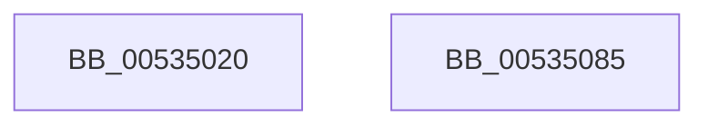

# SymCryptFdefModPreGetMontgomery

- RVA: `0x00535020`–`0x00535086` (길이 `102` bytes)
- VA: `0x0000000140535020`
- 실행 섹션: `.text`
- PDB 이름 있음: `예`; PDB Function 태그: `아니요`
- unwind 정보 RVA: `0x0006F978`
- 디코드: `30`개 명령, `102/102` bytes 표시
- 미해석 바이트: `0` (있으면 어셈블리에 `.byte`로 보존)

> 이 문서는 커널 이미지의 기계어와 PDB 기호를 분석해 생성했습니다. 4번과 5번은 함수 원형과 자료형을 바이너리 사용 방식에서 추정한 C 해석이며 원본 소스 복구 결과는 아닙니다.

## 1. Dependencies

- 직접 호출 지점: **3**; 고유 호출 대상: **3**
- 직접 호출자로 확인된 함수: **0**
- RIP 상대 이미지 참조: **0**

### Outgoing calls
- `0x0053504B` → [memcpy](../6C/memcpy_function_006C6840.md) (function, `0x006C6840`)
- `0x00535059` → [SymCryptWipe](../51/SymCryptWipe_function_0051F914.md) (function, `0x0051F914`)
- `0x00535067` → [SymCryptFdefMontgomeryReduce](SymCryptFdefMontgomeryReduce_function_005356D0.md) (function, `0x005356D0`)

### Direct callers
- 이 함수 시작 RVA로 연결되는 직접 call은 확인되지 않았습니다. 간접 호출은 완전히 역산할 수 없습니다.

### Static image references
- 디코드된 RIP-relative 메모리 참조가 없습니다.

## 2. Other-region calls and transfers

- 다른 실행 섹션으로 향하는 call: **0**
- 별도 외부 분기/꼬리 이동을 확인하지 못했습니다.

## 3. Assembly (complete function range)

```asm
00535020  48 89 5C 24 08                  mov qword ptr [rsp + 8], rbx
00535025  48 89 74 24 10                  mov qword ptr [rsp + 0x10], rsi
0053502A  48 89 7C 24 18                  mov qword ptr [rsp + 0x18], rdi
0053502F  41 56                           push r14
00535031  48 83 EC 20                     sub rsp, 0x20
00535035  8B 79 04                        mov edi, dword ptr [rcx + 4]
00535038  4D 8B F0                        mov r14, r8
0053503B  8B C7                           mov eax, edi
0053503D  48 8B F1                        mov rsi, rcx
00535040  C1 E0 06                        shl eax, 6
00535043  49 8B CE                        mov rcx, r14
00535046  44 8B C0                        mov r8d, eax
00535049  8B D8                           mov ebx, eax
0053504B  E8 F0 17 19 00                  call 0x1406c6840
00535050  C1 E7 04                        shl edi, 4
00535053  8B D3                           mov edx, ebx
00535055  49 8D 0C BE                     lea rcx, [r14 + rdi*4]
00535059  E8 B6 A8 FE FF                  call 0x14051f914
0053505E  4D 8B C6                        mov r8, r14
00535061  49 8B D6                        mov rdx, r14
00535064  48 8B CE                        mov rcx, rsi
00535067  E8 64 06 00 00                  call 0x1405356d0
0053506C  48 8B 5C 24 30                  mov rbx, qword ptr [rsp + 0x30]
00535071  49 8B C6                        mov rax, r14
00535074  48 8B 74 24 38                  mov rsi, qword ptr [rsp + 0x38]
00535079  48 8B 7C 24 40                  mov rdi, qword ptr [rsp + 0x40]
0053507E  48 83 C4 20                     add rsp, 0x20
00535082  41 5E                           pop r14
00535084  C3                              ret
00535085  CC                              int3
```

## 4. C-style interpretation (structured pseudocode)

```c
__int64 __fastcall SymCryptFdefModPreGetMontgomery(__int64 a1, __int64 a2, __int64 a3)
{
    __int64 result;
    __int64 v_rdi;
    __int64 v_rsp;
    unsigned __int64 v_stack_p10;
    unsigned __int64 v_stack_p18;
    unsigned __int64 v_stack_p8;

    v_stack_p8 = v_rbx;
    v_stack_p10 = v_rsi;
    v_stack_p18 = v_rdi;
    v_rsp = (v_rsp) - (32);
    result = (unsigned int)(((unsigned int)((unsigned int)((unsigned int)(*(unsigned int *)(a1 + 4))))) << (6));
    result = memcpy(a3, a2, (unsigned int)((unsigned int)(result)), a4);
    v_rdi = (unsigned int)(((unsigned int)(*(unsigned int *)(a1 + 4))) << (4));
    result = SymCryptWipe(a3 + v_rdi * 4, (unsigned int)((unsigned int)((unsigned int)((unsigned int)(result)))), (unsigned int)((unsigned int)(result)), a4);
    result = SymCryptFdefMontgomeryReduce(a1, a3, a3, a4);
    v_rsp = (v_rsp) + (32);
    return a3;
}
```

## 5. (Beta) C Style

```c
void *SymCryptFdefModPreGetMontgomery(void *Arg1, int64_t Arg2, void *Arg3)
{
    uint8_t *arg1 = (uint8_t *)Arg1;
    uint8_t *arg3 = (uint8_t *)Arg3;

    int64_t result;
    int64_t local_rdi;
    int64_t local_rsp;
    uint64_t v_stack_p10;
    uint64_t v_stack_p18;
    uint64_t v_stack_p8;

    v_stack_p8 = local_rbx;
    v_stack_p10 = local_rsi;
    v_stack_p18 = local_rdi;
    local_rsp = (local_rsp) - (32);
    result = (uint32_t)(((uint32_t)((uint32_t)((uint32_t)(*(uint32_t *)(arg1 + 0x4))))) << (6));
    result = memcpy(Arg3, Arg2, (uint32_t)((uint32_t)(result)), a4);
    local_rdi = (uint32_t)(((uint32_t)(*(uint32_t *)(arg1 + 0x4))) << (4));
    result = SymCryptWipe(Arg3 + local_rdi * 4, (uint32_t)((uint32_t)((uint32_t)((uint32_t)(result)))), (uint32_t)((uint32_t)(result)), a4);
    result = SymCryptFdefMontgomeryReduce(Arg1, Arg3, Arg3, a4);
    local_rsp = (local_rsp) + (32);
    return Arg3;
}
```

### 관측된 메모리 오프셋

구조체 형식이 확인되지 않은 접근은 인자 기준의 오프셋으로만 기록했습니다.

| 기준 인자 | 오프셋 표현 | 폭 (bit) | 접근 |
|---|---:|---:|---|
| `Arg1` | `+ 0x4` | `32` | `R` |
| `Arg3` | `+ 0x0 + rdi*4` | `64` | `R` |

## 6. Execution-region graph

[열기: 2D/3D 그래프와 함수 탐색 컨트롤 패널](../../../control-panel.html?section=text&rva=0x00535020&view=graph)

- 2D 그래프는 위에서 아래로 흐르고, 3D 그래프는 빈 공간을 드래그해 회전합니다. Shift+드래그는 이동, 휠은 확대·축소, 함수 노드 선택은 대상 보고서 이동입니다.

### Static fallback


