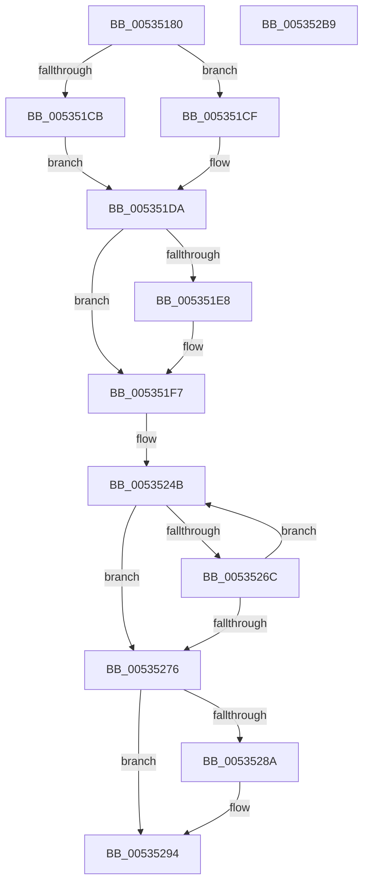

# SymCryptFdefModSetRandomGeneric

- RVA: `0x00535180`–`0x005352BA` (길이 `314` bytes)
- VA: `0x0000000140535180`
- 실행 섹션: `.text`
- PDB 이름 있음: `예`; PDB Function 태그: `아니요`
- unwind 정보 RVA: `0x000B384C`
- 디코드: `102`개 명령, `314/314` bytes 표시
- 미해석 바이트: `0` (있으면 어셈블리에 `.byte`로 보존)

> 이 문서는 커널 이미지의 기계어와 PDB 기호를 분석해 생성했습니다. 4번과 5번은 함수 원형과 자료형을 바이너리 사용 방식에서 추정한 C 해석이며 원본 소스 복구 결과는 아닙니다.

## 1. Dependencies

- 직접 호출 지점: **8**; 고유 호출 대상: **7**
- 직접 호출자로 확인된 함수: **1**
- RIP 상대 이미지 참조: **0**

### Outgoing calls
- `0x005351C1` → [EmpCheckErrataList](../49/EmpCheckErrataList_function_0049E550.md) (function, `0x0049E550`)
- `0x00535203` → [SymCryptFdefRawSubUint32](../52/SymCryptFdefRawSubUint32_function_0052E0D4.md) (function, `0x0052E0D4`)
- `0x0053523D` → [SymCryptWipe](../51/SymCryptWipe_function_0051F914.md) (function, `0x0051F914`)
- `0x00535251` → [SymCryptCallbackRandom](../6A/SymCryptCallbackRandom_function_006AC584.md) (function, `0x006AC584`)
- `0x00535263` → [SymCryptFdefRawIsLessThan](../52/SymCryptFdefRawIsLessThan_function_0052DE84.md) (function, `0x0052DE84`)
- `0x0053527D` → [SymCryptWipe](../51/SymCryptWipe_function_0051F914.md) (function, `0x0051F914`)
- `0x0053528F` → [SymCryptFatal](../5B/SymCryptFatal_function_005B24E0.md) (function, `0x005B24E0`)
- `0x0053529F` → [SymCryptFdefRawAddUint32](../52/SymCryptFdefRawAddUint32_function_0052DBFC.md) (function, `0x0052DBFC`)

### Direct callers
- [SymCryptModSetRandom](../52/SymCryptModSetRandom_function_00525C18.md) at `0x00525C3E`

### Static image references
- 디코드된 RIP-relative 메모리 참조가 없습니다.

## 2. Other-region calls and transfers

- 다른 실행 섹션으로 향하는 call: **0**
- 별도 외부 분기/꼬리 이동을 확인하지 못했습니다.

## 3. Assembly (complete function range)

```asm
00535180  48 89 5C 24 10                  mov qword ptr [rsp + 0x10], rbx
00535185  55                              push rbp
00535186  56                              push rsi
00535187  57                              push rdi
00535188  41 54                           push r12
0053518A  41 55                           push r13
0053518C  41 56                           push r14
0053518E  41 57                           push r15
00535190  48 83 EC 20                     sub rsp, 0x20
00535194  44 8B 71 04                     mov r14d, dword ptr [rcx + 4]
00535198  4C 8D A1 80 00 00 00            lea r12, [rcx + 0x80]
0053519F  41 8B D8                        mov ebx, r8d
005351A2  48 8B F2                        mov rsi, rdx
005351A5  48 8B 94 24 80 00 00 00         mov rdx, qword ptr [rsp + 0x80]
005351AD  45 8B C6                        mov r8d, r14d
005351B0  41 C1 E0 08                     shl r8d, 8
005351B4  48 8B E9                        mov rbp, rcx
005351B7  41 83 C0 40                     add r8d, 0x40
005351BB  49 8B C9                        mov rcx, r9
005351BE  4D 8B F9                        mov r15, r9
005351C1  E8 8A 93 F6 FF                  call 0x14049e550
005351C6  F6 C3 01                        test bl, 1
005351C9  74 04                           je 0x1405351cf
005351CB  33 FF                           xor edi, edi
005351CD  EB 0B                           jmp 0x1405351da
005351CF  8A C3                           mov al, bl
005351D1  24 02                           and al, 2
005351D3  F6 D8                           neg al
005351D5  1B FF                           sbb edi, edi
005351D7  83 C7 02                        add edi, 2
005351DA  C1 EB 02                        shr ebx, 2
005351DD  F7 D3                           not ebx
005351DF  83 E3 01                        and ebx, 1
005351E2  83 7D 4C 03                     cmp dword ptr [rbp + 0x4c], 3
005351E6  73 0F                           jae 0x1405351f7
005351E8  41 8B 04 24                     mov eax, dword ptr [r12]
005351EC  33 DB                           xor ebx, ebx
005351EE  FF C8                           dec eax
005351F0  3B F8                           cmp edi, eax
005351F2  0F 42 C7                        cmovb eax, edi
005351F5  8B F8                           mov edi, eax
005351F7  8D 14 3B                        lea edx, [rbx + rdi]
005351FA  45 8B CE                        mov r9d, r14d
005351FD  4D 8B C7                        mov r8, r15
00535200  49 8B CC                        mov rcx, r12
00535203  E8 CC 8E FF FF                  call 0x14052e0d4
00535208  8B 4D 4C                        mov ecx, dword ptr [rbp + 0x4c]
0053520B  41 BD 00 01 00 00               mov r13d, 0x100
00535211  45 8B E6                        mov r12d, r14d
00535214  41 C1 E4 06                     shl r12d, 6
00535218  41 8B D4                        mov edx, r12d
0053521B  44 89 64 24 70                  mov dword ptr [rsp + 0x70], r12d
00535220  8D 59 07                        lea ebx, [rcx + 7]
00535223  F7 D9                           neg ecx
00535225  83 E1 07                        and ecx, 7
00535228  C1 EB 03                        shr ebx, 3
0053522B  41 D3 FD                        sar r13d, cl
0053522E  2B D3                           sub edx, ebx
00535230  8B CB                           mov ecx, ebx
00535232  41 FF CD                        dec r13d
00535235  48 89 4C 24 60                  mov qword ptr [rsp + 0x60], rcx
0053523A  48 03 CE                        add rcx, rsi
0053523D  E8 D2 A6 FE FF                  call 0x14051f914
00535242  4C 8B 64 24 60                  mov r12, qword ptr [rsp + 0x60]
00535247  33 ED                           xor ebp, ebp
00535249  FF CB                           dec ebx
0053524B  49 8B D4                        mov rdx, r12
0053524E  48 8B CE                        mov rcx, rsi
00535251  E8 2E 73 17 00                  call 0x1406ac584
00535256  44 20 2C 33                     and byte ptr [rbx + rsi], r13b
0053525A  45 8B C6                        mov r8d, r14d
0053525D  49 8B D7                        mov rdx, r15
00535260  48 8B CE                        mov rcx, rsi
00535263  E8 1C 8C FF FF                  call 0x14052de84
00535268  85 C0                           test eax, eax
0053526A  75 0A                           jne 0x140535276
0053526C  FF C5                           inc ebp
0053526E  81 FD E8 03 00 00               cmp ebp, 0x3e8
00535274  72 D5                           jb 0x14053524b
00535276  8B 54 24 70                     mov edx, dword ptr [rsp + 0x70]
0053527A  49 8B CF                        mov rcx, r15
0053527D  E8 92 A6 FE FF                  call 0x14051f914
00535282  81 FD E8 03 00 00               cmp ebp, 0x3e8
00535288  72 0A                           jb 0x140535294
0053528A  B9 63 64 6E 72                  mov ecx, 0x726e6463
0053528F  E8 4C D2 07 00                  call 0x1405b24e0
00535294  45 8B CE                        mov r9d, r14d
00535297  4C 8B C6                        mov r8, rsi
0053529A  8B D7                           mov edx, edi
0053529C  48 8B CE                        mov rcx, rsi
0053529F  E8 58 89 FF FF                  call 0x14052dbfc
005352A4  48 8B 5C 24 68                  mov rbx, qword ptr [rsp + 0x68]
005352A9  48 83 C4 20                     add rsp, 0x20
005352AD  41 5F                           pop r15
005352AF  41 5E                           pop r14
005352B1  41 5D                           pop r13
005352B3  41 5C                           pop r12
005352B5  5F                              pop rdi
005352B6  5E                              pop rsi
005352B7  5D                              pop rbp
005352B8  C3                              ret
005352B9  CC                              int3
```

## 4. C-style interpretation (structured pseudocode)

```c
__int64 __fastcall SymCryptFdefModSetRandomGeneric(__int64 a1, __int64 a2, int a3, __int64 a4, __int64 a5)
{
    __int64 result;
    __int64 v_r12;
    __int64 v_r13;
    __int64 v_rbp;
    __int64 v_rbx;
    __int64 v_rdi;
    __int64 v_rsp;
    unsigned __int64 v_stack_p10;
    unsigned int v_stack_p18;
    unsigned __int64 v_stack_p8;

    v_stack_p10 = v_rbx;
    v_rsp = (v_rsp) - (32);
    a3 = (unsigned int)(((unsigned int)((unsigned int)((unsigned int)(*(unsigned int *)(a1 + 4))))) << (8));
    a3 = (unsigned int)((a3) + (64));
    result = EmpCheckErrataList(a4, a5, a3, a4);
    if ((((unsigned __int8)((unsigned int)(a3))) & (1)) == 0) goto loc_005351CF;
    v_rdi = 0;
    goto loc_005351DA;
loc_005351CF:
    result = (unsigned __int8)(((unsigned __int8)((unsigned int)(a3))) & (2));
    result = (unsigned __int8)(-(result));
    v_rdi = (unsigned int)((v_rdi) + (2));
loc_005351DA:
    v_rbx = (unsigned int)(((unsigned int)(a3)) >> (2));
    v_rbx = (unsigned int)(~(v_rbx));
    v_rbx = (unsigned int)((v_rbx) & (1));
    if ((*(unsigned int *)(a1 + 76)) < 3) {
        result = *(unsigned int *)(a1 + 128);
        v_rbx = 0;
        result = (unsigned int)((result) - 1);
        if (((unsigned int)(v_rdi)) < ((unsigned int)(result))) { result = (unsigned int)(v_rdi); }
        v_rdi = (unsigned int)(result);
    }
    result = SymCryptFdefRawSubUint32(a1 + 128, v_rbx + v_rdi * 1, a4, (unsigned int)((unsigned int)((unsigned int)(*(unsigned int *)(a1 + 4)))));
    v_r12 = (unsigned int)(((unsigned int)((unsigned int)((unsigned int)(*(unsigned int *)(a1 + 4))))) << (6));
    v_stack_p18 = (unsigned int)(v_r12);
    a1 = (unsigned int)(-((unsigned int)(*(unsigned int *)(a1 + 76))));
    a1 = (unsigned int)((a1) & (7));
    v_rbx = (unsigned int)(((unsigned int)(*(unsigned int *)(a1 + 76)) + 7) >> (3));
    v_r13 = (unsigned int)((256) >> ((unsigned __int8)(a1)));
    a2 = (unsigned int)(((unsigned int)((unsigned int)(v_r12))) - ((unsigned int)(v_rbx)));
    v_r13 = (unsigned int)((v_r13) - 1);
    v_stack_p8 = (unsigned int)((unsigned int)(v_rbx));
    a1 = ((unsigned int)((unsigned int)(v_rbx))) + (a2);
    result = SymCryptWipe(a1, a2, a4, (unsigned int)((unsigned int)((unsigned int)(*(unsigned int *)(a1 + 4)))));
    v_rbp = 0;
    v_rbx = (unsigned int)((v_rbx) - 1);
loc_0053524B:
    result = SymCryptCallbackRandom(a2, v_stack_p8, a4, (unsigned int)((unsigned int)((unsigned int)(*(unsigned int *)(a1 + 4)))));
    result = SymCryptFdefRawIsLessThan(a2, a4, (unsigned int)((unsigned int)((unsigned int)(*(unsigned int *)(a1 + 4)))), (unsigned int)((unsigned int)((unsigned int)(*(unsigned int *)(a1 + 4)))));
    if ((unsigned int)(result) != 0) goto loc_00535276;
    v_rbp = (unsigned int)((v_rbp) + 1);
    if (((unsigned int)(v_rbp)) < 1000) goto loc_0053524B;
loc_00535276:
    result = SymCryptWipe(a4, (unsigned int)(v_stack_p18), (unsigned int)((unsigned int)((unsigned int)(*(unsigned int *)(a1 + 4)))), (unsigned int)((unsigned int)((unsigned int)(*(unsigned int *)(a1 + 4)))));
    if (((unsigned int)(v_rbp)) >= 1000) {
        a1 = 0x726E6463ULL;
        result = SymCryptFatal(a1, (unsigned int)(v_stack_p18), (unsigned int)((unsigned int)((unsigned int)(*(unsigned int *)(a1 + 4)))), (unsigned int)((unsigned int)((unsigned int)(*(unsigned int *)(a1 + 4)))));
    }
    result = SymCryptFdefRawAddUint32(a2, (unsigned int)((unsigned int)(v_rdi)), a2, (unsigned int)((unsigned int)((unsigned int)(*(unsigned int *)(a1 + 4)))));
    v_rsp = (v_rsp) + (32);
    return result;
}
```

## 5. (Beta) C Style

```c
int64_t SymCryptFdefModSetRandomGeneric(void *Arg1, int64_t Arg2, int32_t Arg3, int64_t Arg4, int64_t Arg5)
{
    uint8_t *arg1 = (uint8_t *)Arg1;

    int64_t result;
    int64_t local_r12;
    int64_t local_r13;
    int64_t local_rbp;
    int64_t local_rbx;
    int64_t local_rdi;
    int64_t local_rsp;
    uint64_t v_stack_p10;
    uint32_t v_stack_p18;
    uint64_t v_stack_p8;

    v_stack_p10 = local_rbx;
    local_rsp = (local_rsp) - (32);
    Arg3 = (uint32_t)(((uint32_t)((uint32_t)((uint32_t)(*(uint32_t *)(arg1 + 0x4))))) << (8));
    Arg3 = (uint32_t)((Arg3) + (64));
    result = EmpCheckErrataList(Arg4, Arg5, Arg3, Arg4);
    if ((((uint8_t)((uint32_t)(Arg3))) & (1)) == 0) goto loc_005351CF;
    local_rdi = 0;
    goto loc_005351DA;
loc_005351CF:
    result = (uint8_t)(((uint8_t)((uint32_t)(Arg3))) & (2));
    result = (uint8_t)(-(result));
    local_rdi = (uint32_t)((local_rdi) + (2));
loc_005351DA:
    local_rbx = (uint32_t)(((uint32_t)(Arg3)) >> (2));
    local_rbx = (uint32_t)(~(local_rbx));
    local_rbx = (uint32_t)((local_rbx) & (1));
    if ((*(uint32_t *)(arg1 + 0x4C)) < 3) {
        result = *(uint32_t *)(arg1 + 0x80);
        local_rbx = 0;
        result = (uint32_t)((result) - 1);
        if (((uint32_t)(local_rdi)) < ((uint32_t)(result))) { result = (uint32_t)(local_rdi); }
        local_rdi = (uint32_t)(result);
    }
    result = SymCryptFdefRawSubUint32(Arg1 + 128, local_rbx + local_rdi * 1, Arg4, (uint32_t)((uint32_t)((uint32_t)(*(uint32_t *)(arg1 + 0x4)))));
    local_r12 = (uint32_t)(((uint32_t)((uint32_t)((uint32_t)(*(uint32_t *)(arg1 + 0x4))))) << (6));
    v_stack_p18 = (uint32_t)(local_r12);
    Arg1 = (uint32_t)(-((uint32_t)(*(uint32_t *)(arg1 + 0x4C))));
    Arg1 = (uint32_t)((Arg1) & (7));
    local_rbx = (uint32_t)(((uint32_t)(*(uint32_t *)(arg1 + 0x4C)) + 7) >> (3));
    local_r13 = (uint32_t)((256) >> ((uint8_t)(Arg1)));
    Arg2 = (uint32_t)(((uint32_t)((uint32_t)(local_r12))) - ((uint32_t)(local_rbx)));
    local_r13 = (uint32_t)((local_r13) - 1);
    v_stack_p8 = (uint32_t)((uint32_t)(local_rbx));
    Arg1 = ((uint32_t)((uint32_t)(local_rbx))) + (Arg2);
    result = SymCryptWipe(Arg1, Arg2, Arg4, (uint32_t)((uint32_t)((uint32_t)(*(uint32_t *)(arg1 + 0x4)))));
    local_rbp = 0;
    local_rbx = (uint32_t)((local_rbx) - 1);
loc_0053524B:
    result = SymCryptCallbackRandom(Arg2, v_stack_p8, Arg4, (uint32_t)((uint32_t)((uint32_t)(*(uint32_t *)(arg1 + 0x4)))));
    result = SymCryptFdefRawIsLessThan(Arg2, Arg4, (uint32_t)((uint32_t)((uint32_t)(*(uint32_t *)(arg1 + 0x4)))), (uint32_t)((uint32_t)((uint32_t)(*(uint32_t *)(arg1 + 0x4)))));
    if ((uint32_t)(result) != 0) goto loc_00535276;
    local_rbp = (uint32_t)((local_rbp) + 1);
    if (((uint32_t)(local_rbp)) < 1000) goto loc_0053524B;
loc_00535276:
    result = SymCryptWipe(Arg4, (uint32_t)(v_stack_p18), (uint32_t)((uint32_t)((uint32_t)(*(uint32_t *)(arg1 + 0x4)))), (uint32_t)((uint32_t)((uint32_t)(*(uint32_t *)(arg1 + 0x4)))));
    if (((uint32_t)(local_rbp)) >= 1000) {
        Arg1 = 0x726E6463ULL;
        result = SymCryptFatal(Arg1, (uint32_t)(v_stack_p18), (uint32_t)((uint32_t)((uint32_t)(*(uint32_t *)(arg1 + 0x4)))), (uint32_t)((uint32_t)((uint32_t)(*(uint32_t *)(arg1 + 0x4)))));
    }
    result = SymCryptFdefRawAddUint32(Arg2, (uint32_t)((uint32_t)(local_rdi)), Arg2, (uint32_t)((uint32_t)((uint32_t)(*(uint32_t *)(arg1 + 0x4)))));
    local_rsp = (local_rsp) + (32);
    return result;
}
```

### 관측된 메모리 오프셋

구조체 형식이 확인되지 않은 접근은 인자 기준의 오프셋으로만 기록했습니다.

| 기준 인자 | 오프셋 표현 | 폭 (bit) | 접근 |
|---|---:|---:|---|
| `Arg1` | `+ 0x0` | `32` | `R` |
| `Arg1` | `+ 0x4` | `32` | `R` |
| `Arg1` | `+ 0x4C` | `32` | `R` |
| `Arg1` | `+ 0x80` | `64` | `R` |

## 6. Execution-region graph

[열기: 2D/3D 그래프와 함수 탐색 컨트롤 패널](../../../control-panel.html?section=text&rva=0x00535180&view=graph)

- 2D 그래프는 위에서 아래로 흐르고, 3D 그래프는 빈 공간을 드래그해 회전합니다. Shift+드래그는 이동, 휠은 확대·축소, 함수 노드 선택은 대상 보고서 이동입니다.

### Static fallback


