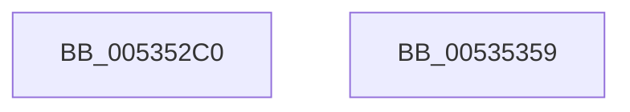

# SymCryptFdefModSquareGeneric

- RVA: `0x005352C0`–`0x0053535A` (길이 `154` bytes)
- VA: `0x00000001405352C0`
- 실행 섹션: `.text`
- PDB 이름 있음: `예`; PDB Function 태그: `아니요`
- unwind 정보 RVA: `0x00093E28`
- 디코드: `45`개 명령, `154/154` bytes 표시
- 미해석 바이트: `0` (있으면 어셈블리에 `.byte`로 보존)

> 이 문서는 커널 이미지의 기계어와 PDB 기호를 분석해 생성했습니다. 4번과 5번은 함수 원형과 자료형을 바이너리 사용 방식에서 추정한 C 해석이며 원본 소스 복구 결과는 아닙니다.

## 1. Dependencies

- 직접 호출 지점: **3**; 고유 호출 대상: **3**
- 직접 호출자로 확인된 함수: **0**
- RIP 상대 이미지 참조: **0**

### Outgoing calls
- `0x00535300` → [EmpCheckErrataList](../49/EmpCheckErrataList_function_0049E550.md) (function, `0x0049E550`)
- `0x0053530D` → [SymCryptFdefRawSquare](../52/SymCryptFdefRawSquare_function_0052E068.md) (function, `0x0052E068`)
- `0x0053533B` → [SymCryptFdefRawDivMod](../52/SymCryptFdefRawDivMod_function_0052DC30.md) (function, `0x0052DC30`)

### Direct callers
- 이 함수 시작 RVA로 연결되는 직접 call은 확인되지 않았습니다. 간접 호출은 완전히 역산할 수 없습니다.

### Static image references
- 디코드된 RIP-relative 메모리 참조가 없습니다.

## 2. Other-region calls and transfers

- 다른 실행 섹션으로 향하는 call: **0**
- 별도 외부 분기/꼬리 이동을 확인하지 못했습니다.

## 3. Assembly (complete function range)

```asm
005352C0  48 89 5C 24 08                  mov qword ptr [rsp + 8], rbx
005352C5  48 89 6C 24 10                  mov qword ptr [rsp + 0x10], rbp
005352CA  48 89 74 24 18                  mov qword ptr [rsp + 0x18], rsi
005352CF  57                              push rdi
005352D0  41 56                           push r14
005352D2  41 57                           push r15
005352D4  48 83 EC 40                     sub rsp, 0x40
005352D8  8B 71 04                        mov esi, dword ptr [rcx + 4]
005352DB  4D 8B F0                        mov r14, r8
005352DE  48 8B BC 24 80 00 00 00         mov rdi, qword ptr [rsp + 0x80]
005352E6  44 8B C6                        mov r8d, esi
005352E9  41 C1 E0 08                     shl r8d, 8
005352ED  48 8B DA                        mov rbx, rdx
005352F0  48 8B E9                        mov rbp, rcx
005352F3  41 83 C0 40                     add r8d, 0x40
005352F7  48 8B D7                        mov rdx, rdi
005352FA  49 8B C9                        mov rcx, r9
005352FD  4D 8B F9                        mov r15, r9
00535300  E8 4B 92 F6 FF                  call 0x14049e550
00535305  4D 8B C7                        mov r8, r15
00535308  8B D6                           mov edx, esi
0053530A  48 8B CB                        mov rcx, rbx
0053530D  E8 56 8D FF FF                  call 0x14052e068
00535312  8B C6                           mov eax, esi
00535314  4C 8D 45 40                     lea r8, [rbp + 0x40]
00535318  C1 E0 07                        shl eax, 7
0053531B  8D 14 36                        lea edx, [rsi + rsi]
0053531E  8B C8                           mov ecx, eax
00535320  45 33 C9                        xor r9d, r9d
00535323  48 2B F9                        sub rdi, rcx
00535326  49 03 C7                        add rax, r15
00535329  48 89 7C 24 30                  mov qword ptr [rsp + 0x30], rdi
0053532E  49 8B CF                        mov rcx, r15
00535331  48 89 44 24 28                  mov qword ptr [rsp + 0x28], rax
00535336  4C 89 74 24 20                  mov qword ptr [rsp + 0x20], r14
0053533B  E8 F0 88 FF FF                  call 0x14052dc30
00535340  48 8B 5C 24 60                  mov rbx, qword ptr [rsp + 0x60]
00535345  48 8B 6C 24 68                  mov rbp, qword ptr [rsp + 0x68]
0053534A  48 8B 74 24 70                  mov rsi, qword ptr [rsp + 0x70]
0053534F  48 83 C4 40                     add rsp, 0x40
00535353  41 5F                           pop r15
00535355  41 5E                           pop r14
00535357  5F                              pop rdi
00535358  C3                              ret
00535359  CC                              int3
```

## 4. C-style interpretation (structured pseudocode)

```c
__int64 __fastcall SymCryptFdefModSquareGeneric(__int64 a1, __int64 a2, __int64 a3, __int64 a4, __int64 a5)
{
    __int64 result;
    __int64 v_rdi;
    __int64 v_rsp;
    unsigned __int64 v_stack_m28;
    unsigned __int64 v_stack_m30;
    unsigned __int64 v_stack_m38;
    unsigned __int64 v_stack_p10;
    unsigned __int64 v_stack_p18;
    unsigned __int64 v_stack_p8;

    v_stack_p8 = v_rbx;
    v_stack_p10 = v_rbp;
    v_stack_p18 = v_rsi;
    v_rsp = (v_rsp) - (64);
    a3 = (unsigned int)(((unsigned int)((unsigned int)((unsigned int)(*(unsigned int *)(a1 + 4))))) << (8));
    a3 = (unsigned int)((a3) + (64));
    result = EmpCheckErrataList(a4, a5, a3, a4);
    result = SymCryptFdefRawSquare(a2, (unsigned int)((unsigned int)((unsigned int)(*(unsigned int *)(a1 + 4)))), a4, a4);
    result = (unsigned int)(((unsigned int)((unsigned int)((unsigned int)(*(unsigned int *)(a1 + 4))))) << (7));
    a4 = 0;
    v_rdi = (a5) - ((unsigned int)((unsigned int)(result)));
    result = (result) + (0);
    v_stack_m28 = v_rdi;
    v_stack_m30 = result;
    v_stack_m38 = a3;
    result = SymCryptFdefRawDivMod(0, (unsigned int)(*(unsigned int *)(a1 + 4)) + (unsigned int)(*(unsigned int *)(a1 + 4)) * 1, a1 + 64, a4);
    v_rsp = (v_rsp) + (64);
    return result;
}
```

## 5. (Beta) C Style

```c
int64_t SymCryptFdefModSquareGeneric(void *Arg1, int64_t Arg2, int64_t Arg3, int64_t Arg4, int64_t Arg5)
{
    uint8_t *arg1 = (uint8_t *)Arg1;

    int64_t result;
    int64_t local_rdi;
    int64_t local_rsp;
    uint64_t v_stack_m28;
    uint64_t v_stack_m30;
    uint64_t v_stack_m38;
    uint64_t v_stack_p10;
    uint64_t v_stack_p18;
    uint64_t v_stack_p8;

    v_stack_p8 = local_rbx;
    v_stack_p10 = local_rbp;
    v_stack_p18 = local_rsi;
    local_rsp = (local_rsp) - (64);
    Arg3 = (uint32_t)(((uint32_t)((uint32_t)((uint32_t)(*(uint32_t *)(arg1 + 0x4))))) << (8));
    Arg3 = (uint32_t)((Arg3) + (64));
    result = EmpCheckErrataList(Arg4, Arg5, Arg3, Arg4);
    result = SymCryptFdefRawSquare(Arg2, (uint32_t)((uint32_t)((uint32_t)(*(uint32_t *)(arg1 + 0x4)))), Arg4, Arg4);
    result = (uint32_t)(((uint32_t)((uint32_t)((uint32_t)(*(uint32_t *)(arg1 + 0x4))))) << (7));
    Arg4 = 0;
    local_rdi = (Arg5) - ((uint32_t)((uint32_t)(result)));
    result = (result) + (0);
    v_stack_m28 = local_rdi;
    v_stack_m30 = result;
    v_stack_m38 = Arg3;
    result = SymCryptFdefRawDivMod(0, (uint32_t)(*(uint32_t *)(arg1 + 0x4)) + (uint32_t)(*(uint32_t *)(arg1 + 0x4)) * 1, Arg1 + 64, Arg4);
    local_rsp = (local_rsp) + (64);
    return result;
}
```

### 관측된 메모리 오프셋

구조체 형식이 확인되지 않은 접근은 인자 기준의 오프셋으로만 기록했습니다.

| 기준 인자 | 오프셋 표현 | 폭 (bit) | 접근 |
|---|---:|---:|---|
| `Arg1` | `+ 0x4` | `32` | `R` |
| `Arg1` | `+ 0x40` | `64` | `R` |

## 6. Execution-region graph

[열기: 2D/3D 그래프와 함수 탐색 컨트롤 패널](../../../control-panel.html?section=text&rva=0x005352C0&view=graph)

- 2D 그래프는 위에서 아래로 흐르고, 3D 그래프는 빈 공간을 드래그해 회전합니다. Shift+드래그는 이동, 휠은 확대·축소, 함수 노드 선택은 대상 보고서 이동입니다.

### Static fallback


