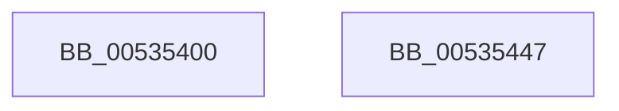

# SymCryptFdefModSquareMontgomeryMulx1024

- RVA: `0x00535400`–`0x00535448` (길이 `72` bytes)
- VA: `0x0000000140535400`
- 실행 섹션: `.text`
- PDB 이름 있음: `예`; PDB Function 태그: `아니요`
- unwind 정보 RVA: `0x00060BC4`
- 디코드: `22`개 명령, `72/72` bytes 표시
- 미해석 바이트: `0` (있으면 어셈블리에 `.byte`로 보존)

> 이 문서는 커널 이미지의 기계어와 PDB 기호를 분석해 생성했습니다. 4번과 5번은 함수 원형과 자료형을 바이너리 사용 방식에서 추정한 C 해석이며 원본 소스 복구 결과는 아닙니다.

## 1. Dependencies

- 직접 호출 지점: **2**; 고유 호출 대상: **2**
- 직접 호출자로 확인된 함수: **0**
- RIP 상대 이미지 참조: **0**

### Outgoing calls
- `0x00535424` → [SymCryptFdefRawSquareMulx1024](SymCryptFdefRawSquareMulx1024_function_00532360.md) (function, `0x00532360`)
- `0x00535432` → [SymCryptFdefMontgomeryReduceMulx1024](SymCryptFdefMontgomeryReduceMulx1024_function_00533200.md) (function, `0x00533200`)

### Direct callers
- 이 함수 시작 RVA로 연결되는 직접 call은 확인되지 않았습니다. 간접 호출은 완전히 역산할 수 없습니다.

### Static image references
- 디코드된 RIP-relative 메모리 참조가 없습니다.

## 2. Other-region calls and transfers

- 다른 실행 섹션으로 향하는 call: **0**
- 별도 외부 분기/꼬리 이동을 확인하지 못했습니다.

## 3. Assembly (complete function range)

```asm
00535400  48 89 5C 24 08                  mov qword ptr [rsp + 8], rbx
00535405  48 89 74 24 10                  mov qword ptr [rsp + 0x10], rsi
0053540A  57                              push rdi
0053540B  48 83 EC 20                     sub rsp, 0x20
0053540F  48 8B C2                        mov rax, rdx
00535412  49 8B D8                        mov rbx, r8
00535415  8B 51 04                        mov edx, dword ptr [rcx + 4]
00535418  48 8B F9                        mov rdi, rcx
0053541B  48 8B C8                        mov rcx, rax
0053541E  4D 8B C1                        mov r8, r9
00535421  49 8B F1                        mov rsi, r9
00535424  E8 37 CF FF FF                  call 0x140532360
00535429  4C 8B C3                        mov r8, rbx
0053542C  48 8B D6                        mov rdx, rsi
0053542F  48 8B CF                        mov rcx, rdi
00535432  E8 C9 DD FF FF                  call 0x140533200
00535437  48 8B 5C 24 30                  mov rbx, qword ptr [rsp + 0x30]
0053543C  48 8B 74 24 38                  mov rsi, qword ptr [rsp + 0x38]
00535441  48 83 C4 20                     add rsp, 0x20
00535445  5F                              pop rdi
00535446  C3                              ret
00535447  CC                              int3
```

## 4. C-style interpretation (structured pseudocode)

```c
__int64 __fastcall SymCryptFdefModSquareMontgomeryMulx1024(__int64 a1, __int64 a2, __int64 a3, __int64 a4)
{
    __int64 result;
    __int64 v_rsp;
    unsigned __int64 v_stack_p10;
    unsigned __int64 v_stack_p8;

    v_stack_p8 = v_rbx;
    v_stack_p10 = v_rsi;
    v_rsp = (v_rsp) - (32);
    result = SymCryptFdefRawSquareMulx1024(a2, (unsigned int)(*(unsigned int *)(a1 + 4)), a4, a4);
    result = SymCryptFdefMontgomeryReduceMulx1024(a1, a4, a3, a4);
    v_rsp = (v_rsp) + (32);
    return result;
}
```

## 5. (Beta) C Style

```c
int64_t SymCryptFdefModSquareMontgomeryMulx1024(void *Arg1, int64_t Arg2, int64_t Arg3, int64_t Arg4)
{
    uint8_t *arg1 = (uint8_t *)Arg1;

    int64_t result;
    int64_t local_rsp;
    uint64_t v_stack_p10;
    uint64_t v_stack_p8;

    v_stack_p8 = local_rbx;
    v_stack_p10 = local_rsi;
    local_rsp = (local_rsp) - (32);
    result = SymCryptFdefRawSquareMulx1024(Arg2, (uint32_t)(*(uint32_t *)(arg1 + 0x4)), Arg4, Arg4);
    result = SymCryptFdefMontgomeryReduceMulx1024(Arg1, Arg4, Arg3, Arg4);
    local_rsp = (local_rsp) + (32);
    return result;
}
```

### 관측된 메모리 오프셋

구조체 형식이 확인되지 않은 접근은 인자 기준의 오프셋으로만 기록했습니다.

| 기준 인자 | 오프셋 표현 | 폭 (bit) | 접근 |
|---|---:|---:|---|
| `Arg1` | `+ 0x4` | `32` | `R` |

## 6. Execution-region graph

[열기: 2D/3D 그래프와 함수 탐색 컨트롤 패널](../../../control-panel.html?section=text&rva=0x00535400&view=graph)

- 2D 그래프는 위에서 아래로 흐르고, 3D 그래프는 빈 공간을 드래그해 회전합니다. Shift+드래그는 이동, 휠은 확대·축소, 함수 노드 선택은 대상 보고서 이동입니다.

### Static fallback


