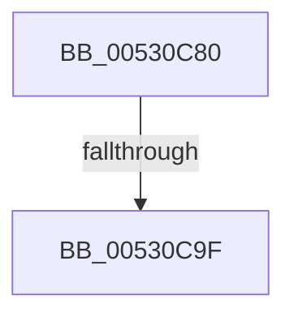

# SymCryptFdefModSquareMontgomeryMulxP384Asm

- RVA: `0x00530C80`–`0x00530CAD` (길이 `45` bytes)
- VA: `0x0000000140530C80`
- 실행 섹션: `.text`
- PDB 이름 있음: `예`; PDB Function 태그: `아니요`
- unwind 정보 RVA: `0x000C34F8`
- 디코드: `23`개 명령, `45/45` bytes 표시
- 미해석 바이트: `0` (있으면 어셈블리에 `.byte`로 보존)

> 이 문서는 커널 이미지의 기계어와 PDB 기호를 분석해 생성했습니다. 4번과 5번은 함수 원형과 자료형을 바이너리 사용 방식에서 추정한 C 해석이며 원본 소스 복구 결과는 아닙니다.

## 1. Dependencies

- 직접 호출 지점: **0**; 고유 호출 대상: **0**
- 직접 호출자로 확인된 함수: **0**
- RIP 상대 이미지 참조: **0**

### Outgoing calls
- 직접 디코드된 call 명령이 없습니다.

### Direct callers
- 이 함수 시작 RVA로 연결되는 직접 call은 확인되지 않았습니다. 간접 호출은 완전히 역산할 수 없습니다.

### Static image references
- 디코드된 RIP-relative 메모리 참조가 없습니다.

## 2. Other-region calls and transfers

- 다른 실행 섹션으로 향하는 call: **0**
- call이 아닌 외부 분기/꼬리 이동: **1**
  - `0x00530C99` → [SymCryptFdefModMulMontgomeryMulxP384Asm + 0x10](SymCryptFdefModMulMontgomeryMulxP384Asm_function_00530700.md) (`tail-transfer`)

## 3. Assembly (complete function range)

```asm
00530C80  48 56                           push rsi
00530C82  57                              push rdi
00530C83  55                              push rbp
00530C84  53                              push rbx
00530C85  41 54                           push r12
00530C87  41 55                           push r13
00530C89  41 56                           push r14
00530C8B  41 57                           push r15
00530C8D  4C 8B D2                        mov r10, rdx
00530C90  4D 8B C8                        mov r9, r8
00530C93  4D 8B C2                        mov r8, r10
00530C96  48 85 E4                        test rsp, rsp
00530C99  0F 85 71 FA FF FF               jne 0x140530710
00530C9F  CC                              int3
00530CA0  41 5F                           pop r15
00530CA2  41 5E                           pop r14
00530CA4  41 5D                           pop r13
00530CA6  41 5C                           pop r12
00530CA8  5B                              pop rbx
00530CA9  5D                              pop rbp
00530CAA  5F                              pop rdi
00530CAB  5E                              pop rsi
00530CAC  C3                              ret
```

## 4. C-style interpretation (structured pseudocode)

```c
void __fastcall SymCryptFdefModSquareMontgomeryMulxP384Asm(__int64 a1, __int64 a2, __int64 a3)
{
    return;
}
```

## 5. (Beta) C Style

```c
void SymCryptFdefModSquareMontgomeryMulxP384Asm(int64_t Arg1, int64_t Arg2, int64_t Arg3)
{
    return;
}
```

## 6. Execution-region graph

[열기: 2D/3D 그래프와 함수 탐색 컨트롤 패널](../../../control-panel.html?section=text&rva=0x00530C80&view=graph)

- 2D 그래프는 위에서 아래로 흐르고, 3D 그래프는 빈 공간을 드래그해 회전합니다. Shift+드래그는 이동, 휠은 확대·축소, 함수 노드 선택은 대상 보고서 이동입니다.

### Static fallback


