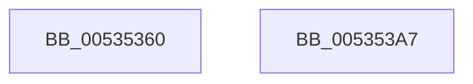

# SymCryptFdefModSquareMontgomery

- RVA: `0x00535360`–`0x005353A8` (길이 `72` bytes)
- VA: `0x0000000140535360`
- 실행 섹션: `.text`
- PDB 이름 있음: `예`; PDB Function 태그: `아니요`
- unwind 정보 RVA: `0x00060BC4`
- 디코드: `22`개 명령, `72/72` bytes 표시
- 미해석 바이트: `0` (있으면 어셈블리에 `.byte`로 보존)

> 이 문서는 커널 이미지의 기계어와 PDB 기호를 분석해 생성했습니다. 4번과 5번은 함수 원형과 자료형을 바이너리 사용 방식에서 추정한 C 해석이며 원본 소스 복구 결과는 아닙니다.

## 1. Dependencies

- 직접 호출 지점: **2**; 고유 호출 대상: **2**
- 직접 호출자로 확인된 함수: **0**
- RIP 상대 이미지 참조: **0**

### Outgoing calls
- `0x00535384` → [SymCryptFdefRawSquare](../52/SymCryptFdefRawSquare_function_0052E068.md) (function, `0x0052E068`)
- `0x00535392` → [SymCryptFdefMontgomeryReduce](SymCryptFdefMontgomeryReduce_function_005356D0.md) (function, `0x005356D0`)

### Direct callers
- 이 함수 시작 RVA로 연결되는 직접 call은 확인되지 않았습니다. 간접 호출은 완전히 역산할 수 없습니다.

### Static image references
- 디코드된 RIP-relative 메모리 참조가 없습니다.

## 2. Other-region calls and transfers

- 다른 실행 섹션으로 향하는 call: **0**
- 별도 외부 분기/꼬리 이동을 확인하지 못했습니다.

## 3. Assembly (complete function range)

```asm
00535360  48 89 5C 24 08                  mov qword ptr [rsp + 8], rbx
00535365  48 89 74 24 10                  mov qword ptr [rsp + 0x10], rsi
0053536A  57                              push rdi
0053536B  48 83 EC 20                     sub rsp, 0x20
0053536F  48 8B C2                        mov rax, rdx
00535372  49 8B D8                        mov rbx, r8
00535375  8B 51 04                        mov edx, dword ptr [rcx + 4]
00535378  48 8B F9                        mov rdi, rcx
0053537B  48 8B C8                        mov rcx, rax
0053537E  4D 8B C1                        mov r8, r9
00535381  49 8B F1                        mov rsi, r9
00535384  E8 DF 8C FF FF                  call 0x14052e068
00535389  4C 8B C3                        mov r8, rbx
0053538C  48 8B D6                        mov rdx, rsi
0053538F  48 8B CF                        mov rcx, rdi
00535392  E8 39 03 00 00                  call 0x1405356d0
00535397  48 8B 5C 24 30                  mov rbx, qword ptr [rsp + 0x30]
0053539C  48 8B 74 24 38                  mov rsi, qword ptr [rsp + 0x38]
005353A1  48 83 C4 20                     add rsp, 0x20
005353A5  5F                              pop rdi
005353A6  C3                              ret
005353A7  CC                              int3
```

## 4. C-style interpretation (structured pseudocode)

```c
__int64 __fastcall SymCryptFdefModSquareMontgomery(__int64 a1, __int64 a2, __int64 a3, __int64 a4)
{
    __int64 result;
    __int64 v_rsp;
    unsigned __int64 v_stack_p10;
    unsigned __int64 v_stack_p8;

    v_stack_p8 = v_rbx;
    v_stack_p10 = v_rsi;
    v_rsp = (v_rsp) - (32);
    result = SymCryptFdefRawSquare(a2, (unsigned int)(*(unsigned int *)(a1 + 4)), a4, a4);
    result = SymCryptFdefMontgomeryReduce(a1, a4, a3, a4);
    v_rsp = (v_rsp) + (32);
    return result;
}
```

## 5. (Beta) C Style

```c
int64_t SymCryptFdefModSquareMontgomery(void *Arg1, int64_t Arg2, int64_t Arg3, int64_t Arg4)
{
    uint8_t *arg1 = (uint8_t *)Arg1;

    int64_t result;
    int64_t local_rsp;
    uint64_t v_stack_p10;
    uint64_t v_stack_p8;

    v_stack_p8 = local_rbx;
    v_stack_p10 = local_rsi;
    local_rsp = (local_rsp) - (32);
    result = SymCryptFdefRawSquare(Arg2, (uint32_t)(*(uint32_t *)(arg1 + 0x4)), Arg4, Arg4);
    result = SymCryptFdefMontgomeryReduce(Arg1, Arg4, Arg3, Arg4);
    local_rsp = (local_rsp) + (32);
    return result;
}
```

### 관측된 메모리 오프셋

구조체 형식이 확인되지 않은 접근은 인자 기준의 오프셋으로만 기록했습니다.

| 기준 인자 | 오프셋 표현 | 폭 (bit) | 접근 |
|---|---:|---:|---|
| `Arg1` | `+ 0x4` | `32` | `R` |

## 6. Execution-region graph

[열기: 2D/3D 그래프와 함수 탐색 컨트롤 패널](../../../control-panel.html?section=text&rva=0x00535360&view=graph)

- 2D 그래프는 위에서 아래로 흐르고, 3D 그래프는 빈 공간을 드래그해 회전합니다. Shift+드래그는 이동, 휠은 확대·축소, 함수 노드 선택은 대상 보고서 이동입니다.

### Static fallback


