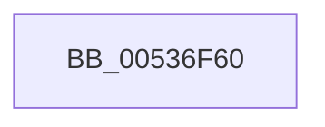

# SymCryptFdefModSub384Asm

- RVA: `0x00536F60`–`0x00537013` (길이 `179` bytes)
- VA: `0x0000000140536F60`
- 실행 섹션: `.text`
- PDB 이름 있음: `예`; PDB Function 태그: `아니요`
- unwind 정보 RVA: `0x000C3548`
- 디코드: `50`개 명령, `179/179` bytes 표시
- 미해석 바이트: `0` (있으면 어셈블리에 `.byte`로 보존)

> 이 문서는 커널 이미지의 기계어와 PDB 기호를 분석해 생성했습니다. 4번과 5번은 함수 원형과 자료형을 바이너리 사용 방식에서 추정한 C 해석이며 원본 소스 복구 결과는 아닙니다.

## 1. Dependencies

- 직접 호출 지점: **0**; 고유 호출 대상: **0**
- 직접 호출자로 확인된 함수: **0**
- RIP 상대 이미지 참조: **0**

### Outgoing calls
- 직접 디코드된 call 명령이 없습니다.

### Direct callers
- 이 함수 시작 RVA로 연결되는 직접 call은 확인되지 않았습니다. 간접 호출은 완전히 역산할 수 없습니다.

### Static image references
- 디코드된 RIP-relative 메모리 참조가 없습니다.

## 2. Other-region calls and transfers

- 다른 실행 섹션으로 향하는 call: **0**
- 별도 외부 분기/꼬리 이동을 확인하지 못했습니다.

## 3. Assembly (complete function range)

```asm
00536F60  48 56                           push rsi
00536F62  57                              push rdi
00536F63  55                              push rbp
00536F64  53                              push rbx
00536F65  41 54                           push r12
00536F67  41 55                           push r13
00536F69  48 81 C1 80 00 00 00            add rcx, 0x80
00536F70  48 8B 02                        mov rax, qword ptr [rdx]
00536F73  49 2B 00                        sub rax, qword ptr [r8]
00536F76  4C 8B 52 08                     mov r10, qword ptr [rdx + 8]
00536F7A  4D 1B 50 08                     sbb r10, qword ptr [r8 + 8]
00536F7E  4C 8B 5A 10                     mov r11, qword ptr [rdx + 0x10]
00536F82  4D 1B 58 10                     sbb r11, qword ptr [r8 + 0x10]
00536F86  48 8B 72 18                     mov rsi, qword ptr [rdx + 0x18]
00536F8A  49 1B 70 18                     sbb rsi, qword ptr [r8 + 0x18]
00536F8E  48 8B 7A 20                     mov rdi, qword ptr [rdx + 0x20]
00536F92  49 1B 78 20                     sbb rdi, qword ptr [r8 + 0x20]
00536F96  48 8B 6A 28                     mov rbp, qword ptr [rdx + 0x28]
00536F9A  49 1B 68 28                     sbb rbp, qword ptr [r8 + 0x28]
00536F9E  48 C7 C2 00 00 00 00            mov rdx, 0
00536FA5  48 0F 42 11                     cmovb rdx, qword ptr [rcx]
00536FA9  49 C7 C0 00 00 00 00            mov r8, 0
00536FB0  4C 0F 42 41 08                  cmovb r8, qword ptr [rcx + 8]
00536FB5  48 C7 C3 00 00 00 00            mov rbx, 0
00536FBC  48 0F 42 59 10                  cmovb rbx, qword ptr [rcx + 0x10]
00536FC1  49 C7 C4 00 00 00 00            mov r12, 0
00536FC8  4C 0F 42 61 18                  cmovb r12, qword ptr [rcx + 0x18]
00536FCD  49 C7 C5 00 00 00 00            mov r13, 0
00536FD4  4C 0F 42 69 20                  cmovb r13, qword ptr [rcx + 0x20]
00536FD9  48 8B 49 28                     mov rcx, qword ptr [rcx + 0x28]
00536FDD  48 0F 43 CA                     cmovae rcx, rdx
00536FE1  48 03 C2                        add rax, rdx
00536FE4  4D 13 D0                        adc r10, r8
00536FE7  4C 13 DB                        adc r11, rbx
00536FEA  49 13 F4                        adc rsi, r12
00536FED  49 13 FD                        adc rdi, r13
00536FF0  48 13 E9                        adc rbp, rcx
00536FF3  49 89 01                        mov qword ptr [r9], rax
00536FF6  4D 89 51 08                     mov qword ptr [r9 + 8], r10
00536FFA  4D 89 59 10                     mov qword ptr [r9 + 0x10], r11
00536FFE  49 89 71 18                     mov qword ptr [r9 + 0x18], rsi
00537002  49 89 79 20                     mov qword ptr [r9 + 0x20], rdi
00537006  49 89 69 28                     mov qword ptr [r9 + 0x28], rbp
0053700A  41 5D                           pop r13
0053700C  41 5C                           pop r12
0053700E  5B                              pop rbx
0053700F  5D                              pop rbp
00537010  5F                              pop rdi
00537011  5E                              pop rsi
00537012  C3                              ret
```

## 4. C-style interpretation (structured pseudocode)

```c
__int64 __fastcall SymCryptFdefModSub384Asm(__int64 a1, __int64 a2, __int64 a3, __int64 a4)
{
    __int64 result;
    __int64 v_r12;
    __int64 v_r13;
    __int64 v_rbx;

    a1 = (a1) + (128);
    result = (*(unsigned __int64 *)(a2)) - (*(unsigned __int64 *)(a3));
    a2 = 0;
    if (condition_is_below) { a2 = *(unsigned __int64 *)(a1); }
    a3 = 0;
    if (condition_is_below) { a3 = *(unsigned __int64 *)(a1 + 8); }
    v_rbx = 0;
    if (condition_is_below) { v_rbx = *(unsigned __int64 *)(a1 + 16); }
    v_r12 = 0;
    if (condition_is_below) { v_r12 = *(unsigned __int64 *)(a1 + 24); }
    v_r13 = 0;
    if (condition_is_below) { v_r13 = *(unsigned __int64 *)(a1 + 32); }
    a1 = *(unsigned __int64 *)(a1 + 40);
    if (condition_is_above_or_equal) { a1 = a2; }
    result = (result) + (a2);
    *(unsigned __int64 *)(a4) = result;
    *(unsigned __int64 *)(a4 + 8) = *(unsigned __int64 *)(a2 + 8);
    *(unsigned __int64 *)(a4 + 16) = *(unsigned __int64 *)(a2 + 16);
    *(unsigned __int64 *)(a4 + 24) = *(unsigned __int64 *)(a2 + 24);
    *(unsigned __int64 *)(a4 + 32) = *(unsigned __int64 *)(a2 + 32);
    *(unsigned __int64 *)(a4 + 40) = *(unsigned __int64 *)(a2 + 40);
    return result;
}
```

## 5. (Beta) C Style

```c
int64_t SymCryptFdefModSub384Asm(void *Arg1, void *Arg2, void *Arg3, void *Arg4)
{
    uint8_t *arg1 = (uint8_t *)Arg1;
    uint8_t *arg2 = (uint8_t *)Arg2;
    uint8_t *arg3 = (uint8_t *)Arg3;
    uint8_t *arg4 = (uint8_t *)Arg4;

    int64_t result;
    int64_t local_r12;
    int64_t local_r13;
    int64_t local_rbx;

    Arg1 = (Arg1) + (128);
    result = (*(uint64_t *)(arg2)) - (*(uint64_t *)(arg3));
    Arg2 = 0;
    if (condition_is_below) { Arg2 = *(uint64_t *)(arg1); }
    Arg3 = 0;
    if (condition_is_below) { Arg3 = *(uint64_t *)(arg1 + 0x8); }
    local_rbx = 0;
    if (condition_is_below) { local_rbx = *(uint64_t *)(arg1 + 0x10); }
    local_r12 = 0;
    if (condition_is_below) { local_r12 = *(uint64_t *)(arg1 + 0x18); }
    local_r13 = 0;
    if (condition_is_below) { local_r13 = *(uint64_t *)(arg1 + 0x20); }
    Arg1 = *(uint64_t *)(arg1 + 0x28);
    if (condition_is_above_or_equal) { Arg1 = Arg2; }
    result = (result) + (Arg2);
    *(uint64_t *)(arg4) = result;
    *(uint64_t *)(arg4 + 0x8) = *(uint64_t *)(arg2 + 0x8);
    *(uint64_t *)(arg4 + 0x10) = *(uint64_t *)(arg2 + 0x10);
    *(uint64_t *)(arg4 + 0x18) = *(uint64_t *)(arg2 + 0x18);
    *(uint64_t *)(arg4 + 0x20) = *(uint64_t *)(arg2 + 0x20);
    *(uint64_t *)(arg4 + 0x28) = *(uint64_t *)(arg2 + 0x28);
    return result;
}
```

### 관측된 메모리 오프셋

구조체 형식이 확인되지 않은 접근은 인자 기준의 오프셋으로만 기록했습니다.

| 기준 인자 | 오프셋 표현 | 폭 (bit) | 접근 |
|---|---:|---:|---|
| `Arg1` | `+ 0x0` | `64` | `R` |
| `Arg1` | `+ 0x8` | `64` | `R` |
| `Arg1` | `+ 0x10` | `64` | `R` |
| `Arg1` | `+ 0x18` | `64` | `R` |
| `Arg1` | `+ 0x20` | `64` | `R` |
| `Arg1` | `+ 0x28` | `64` | `R` |
| `Arg2` | `+ 0x0` | `64` | `R` |
| `Arg2` | `+ 0x8` | `64` | `R` |
| `Arg2` | `+ 0x10` | `64` | `R` |
| `Arg2` | `+ 0x18` | `64` | `R` |
| `Arg2` | `+ 0x20` | `64` | `R` |
| `Arg2` | `+ 0x28` | `64` | `R` |
| `Arg3` | `+ 0x0` | `64` | `R` |
| `Arg3` | `+ 0x8` | `64` | `R` |
| `Arg3` | `+ 0x10` | `64` | `R` |
| `Arg3` | `+ 0x18` | `64` | `R` |
| `Arg3` | `+ 0x20` | `64` | `R` |
| `Arg3` | `+ 0x28` | `64` | `R` |
| `Arg4` | `+ 0x0` | `64` | `W` |
| `Arg4` | `+ 0x8` | `64` | `W` |
| `Arg4` | `+ 0x10` | `64` | `W` |
| `Arg4` | `+ 0x18` | `64` | `W` |
| `Arg4` | `+ 0x20` | `64` | `W` |
| `Arg4` | `+ 0x28` | `64` | `W` |

## 6. Execution-region graph

[열기: 2D/3D 그래프와 함수 탐색 컨트롤 패널](../../../control-panel.html?section=text&rva=0x00536F60&view=graph)

- 2D 그래프는 위에서 아래로 흐르고, 3D 그래프는 빈 공간을 드래그해 회전합니다. Shift+드래그는 이동, 휠은 확대·축소, 함수 노드 선택은 대상 보고서 이동입니다.

### Static fallback


