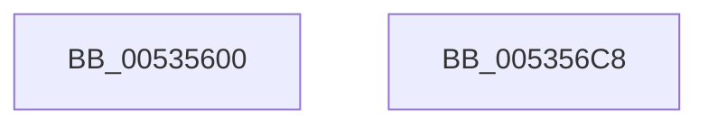

# SymCryptFdefModulusInitMontgomeryInternal

- RVA: `0x00535600`–`0x005356C9` (길이 `201` bytes)
- VA: `0x0000000140535600`
- 실행 섹션: `.text`
- PDB 이름 있음: `예`; PDB Function 태그: `아니요`
- unwind 정보 RVA: `0x000886A4`
- 디코드: `56`개 명령, `201/201` bytes 표시
- 미해석 바이트: `0` (있으면 어셈블리에 `.byte`로 보존)

> 이 문서는 커널 이미지의 기계어와 PDB 기호를 분석해 생성했습니다. 4번과 5번은 함수 원형과 자료형을 바이너리 사용 방식에서 추정한 C 해석이며 원본 소스 복구 결과는 아닙니다.

## 1. Dependencies

- 직접 호출 지점: **4**; 고유 호출 대상: **4**
- 직접 호출자로 확인된 함수: **3**
- RIP 상대 이미지 참조: **0**

### Outgoing calls
- `0x0053562F` → [SymCryptFdefSizeofDivisorFromDigits](SymCryptFdefSizeofDivisorFromDigits_function_00535F58.md) (function, `0x00535F58`)
- `0x00535651` → [SymCryptWipe](../51/SymCryptWipe_function_0051F914.md) (function, `0x0051F914`)
- `0x00535689` → [SymCryptFdefRawDivMod](../52/SymCryptFdefRawDivMod_function_0052DC30.md) (function, `0x0052DC30`)
- `0x005356A4` → [SymCryptFdefRawNeg](../52/SymCryptFdefRawNeg_function_0052E028.md) (function, `0x0052E028`)

### Direct callers
- [SymCryptFdefModulusInitMontgomery](SymCryptFdefModulusInitMontgomery_function_005355B0.md) at `0x005355C3`
- [SymCryptFdefModulusInitMontgomery256](SymCryptFdefModulusInitMontgomery256_function_005355E0.md) at `0x005355EF`
- [SymCryptFdef369ModulusInitMontgomery](SymCryptFdef369ModulusInitMontgomery_function_00537770.md) at `0x00537787`

### Static image references
- 디코드된 RIP-relative 메모리 참조가 없습니다.

## 2. Other-region calls and transfers

- 다른 실행 섹션으로 향하는 call: **0**
- 별도 외부 분기/꼬리 이동을 확인하지 못했습니다.

## 3. Assembly (complete function range)

```asm
00535600  48 8B C4                        mov rax, rsp
00535603  48 89 58 08                     mov qword ptr [rax + 8], rbx
00535607  48 89 68 10                     mov qword ptr [rax + 0x10], rbp
0053560B  48 89 70 18                     mov qword ptr [rax + 0x18], rsi
0053560F  48 89 78 20                     mov qword ptr [rax + 0x20], rdi
00535613  41 55                           push r13
00535615  41 56                           push r14
00535617  41 57                           push r15
00535619  48 83 EC 40                     sub rsp, 0x40
0053561D  44 8B 79 04                     mov r15d, dword ptr [rcx + 4]
00535621  4C 8B E9                        mov r13, rcx
00535624  41 8B CF                        mov ecx, r15d
00535627  49 8B F1                        mov rsi, r9
0053562A  4D 8B F0                        mov r14, r8
0053562D  8B FA                           mov edi, edx
0053562F  E8 24 09 00 00                  call 0x140535f58
00535634  8B C0                           mov eax, eax
00535636  49 8D 6D 40                     lea rbp, [r13 + 0x40]
0053563A  48 03 E8                        add rbp, rax
0053563D  49 8B CE                        mov rcx, r14
00535640  41 8B C7                        mov eax, r15d
00535643  49 89 6D 28                     mov qword ptr [r13 + 0x28], rbp
00535647  C1 E0 07                        shl eax, 7
0053564A  83 C0 40                        add eax, 0x40
0053564D  8B D0                           mov edx, eax
0053564F  8B D8                           mov ebx, eax
00535651  E8 BE A2 FE FF                  call 0x14051f914
00535656  8D 04 3F                        lea eax, [rdi + rdi]
00535659  48 2B F3                        sub rsi, rbx
0053565C  48 89 74 24 30                  mov qword ptr [rsp + 0x30], rsi
00535661  4D 8D 45 40                     lea r8, [r13 + 0x40]
00535665  42 8D 14 7D 01 00 00 00         lea edx, [r15*2 + 1]
0053566D  45 33 C9                        xor r9d, r9d
00535670  41 C7 04 86 01 00 00 00         mov dword ptr [r14 + rax*4], 1
00535678  49 8B CE                        mov rcx, r14
0053567B  4A 8D 04 33                     lea rax, [rbx + r14]
0053567F  48 89 44 24 28                  mov qword ptr [rsp + 0x28], rax
00535684  48 89 6C 24 20                  mov qword ptr [rsp + 0x20], rbp
00535689  E8 A2 85 FF FF                  call 0x14052dc30
0053568E  45 8B C7                        mov r8d, r15d
00535691  49 8D 8D 80 00 00 00            lea rcx, [r13 + 0x80]
00535698  41 C1 E0 06                     shl r8d, 6
0053569C  45 8B CF                        mov r9d, r15d
0053569F  4C 03 C5                        add r8, rbp
005356A2  33 D2                           xor edx, edx
005356A4  E8 7F 89 FF FF                  call 0x14052e028
005356A9  48 8B 5C 24 60                  mov rbx, qword ptr [rsp + 0x60]
005356AE  48 8B 6C 24 68                  mov rbp, qword ptr [rsp + 0x68]
005356B3  48 8B 74 24 70                  mov rsi, qword ptr [rsp + 0x70]
005356B8  48 8B 7C 24 78                  mov rdi, qword ptr [rsp + 0x78]
005356BD  48 83 C4 40                     add rsp, 0x40
005356C1  41 5F                           pop r15
005356C3  41 5E                           pop r14
005356C5  41 5D                           pop r13
005356C7  C3                              ret
005356C8  CC                              int3
```

## 4. C-style interpretation (structured pseudocode)

```c
__int64 __fastcall SymCryptFdefModulusInitMontgomeryInternal(__int64 a1, int a2, __int64 a3, __int64 a4)
{
    __int64 result;
    __int64 v_rbp;
    __int64 v_rsi;
    __int64 v_rsp;
    unsigned __int64 v_stack_m28;
    unsigned __int64 v_stack_m30;
    unsigned __int64 v_stack_m38;
    unsigned __int64 v_stack_p10;
    unsigned __int64 v_stack_p18;
    unsigned __int64 v_stack_p20;
    unsigned __int64 v_stack_p8;

    *(unsigned __int64 *)(v_rsp + 8) = v_rbx;
    *(unsigned __int64 *)(v_rsp + 16) = v_rbp;
    *(unsigned __int64 *)(v_rsp + 24) = v_rsi;
    *(unsigned __int64 *)(v_rsp + 32) = v_rdi;
    v_rsp = (v_rsp) - (64);
    result = SymCryptFdefSizeofDivisorFromDigits((unsigned int)((unsigned int)((unsigned int)(*(unsigned int *)(a1 + 4)))), a2, a3, a4);
    v_rbp = (a1 + 64) + ((unsigned int)((unsigned int)(result)));
    *(unsigned __int64 *)(a1 + 40) = v_rbp;
    result = (unsigned int)(((unsigned int)((unsigned int)((unsigned int)(*(unsigned int *)(a1 + 4))))) << (7));
    result = (unsigned int)((result) + (64));
    result = SymCryptWipe(a3, (unsigned int)((unsigned int)(result)), a3, a4);
    v_rsi = (a4) - ((unsigned int)((unsigned int)(result)));
    v_stack_m28 = v_rsi;
    a4 = 0;
    *(unsigned int *)(a3 + (unsigned int)(a2) + (unsigned int)(a2) * 1 * 4) = 1;
    v_stack_m30 = (unsigned int)((unsigned int)(result)) + a3 * 1;
    v_stack_m38 = v_rbp;
    result = SymCryptFdefRawDivMod(a3, (unsigned int)(*(unsigned int *)(a1 + 4)) * 2 + 1, a1 + 64, a4);
    a3 = (unsigned int)(((unsigned int)((unsigned int)((unsigned int)(*(unsigned int *)(a1 + 4))))) << (6));
    a3 = (a3) + (v_rbp);
    a2 = 0;
    result = SymCryptFdefRawNeg(a1 + 128, a2, a3, (unsigned int)((unsigned int)((unsigned int)(*(unsigned int *)(a1 + 4)))));
    v_rsp = (v_rsp) + (64);
    return result;
}
```

## 5. (Beta) C Style

```c
int64_t SymCryptFdefModulusInitMontgomeryInternal(void *Arg1, void *Arg2, void *Arg3, int64_t Arg4)
{
    uint8_t *arg1 = (uint8_t *)Arg1;
    uint8_t *arg2 = (uint8_t *)Arg2;
    uint8_t *arg3 = (uint8_t *)Arg3;

    int64_t result;
    int64_t local_rbp;
    int64_t local_rsi;
    int64_t local_rsp;
    uint64_t v_stack_m28;
    uint64_t v_stack_m30;
    uint64_t v_stack_m38;
    uint64_t v_stack_p10;
    uint64_t v_stack_p18;
    uint64_t v_stack_p20;
    uint64_t v_stack_p8;

    *(uint64_t *)(local_rsp + 0x8) = local_rbx;
    *(uint64_t *)(local_rsp + 0x10) = local_rbp;
    *(uint64_t *)(local_rsp + 0x18) = local_rsi;
    *(uint64_t *)(local_rsp + 0x20) = local_rdi;
    local_rsp = (local_rsp) - (64);
    result = SymCryptFdefSizeofDivisorFromDigits((uint32_t)((uint32_t)((uint32_t)(*(uint32_t *)(arg1 + 0x4)))), Arg2, Arg3, Arg4);
    local_rbp = (Arg1 + 64) + ((uint32_t)((uint32_t)(result)));
    *(uint64_t *)(arg1 + 0x28) = local_rbp;
    result = (uint32_t)(((uint32_t)((uint32_t)((uint32_t)(*(uint32_t *)(arg1 + 0x4))))) << (7));
    result = (uint32_t)((result) + (64));
    result = SymCryptWipe(Arg3, (uint32_t)((uint32_t)(result)), Arg3, Arg4);
    local_rsi = (Arg4) - ((uint32_t)((uint32_t)(result)));
    v_stack_m28 = local_rsi;
    Arg4 = 0;
    *(uint32_t *)(arg3 + (uint32_t)(arg2) + (uint32_t)(arg2) * 1 * 4) = 1;
    v_stack_m30 = (uint32_t)((uint32_t)(result)) + Arg3 * 1;
    v_stack_m38 = local_rbp;
    result = SymCryptFdefRawDivMod(Arg3, (uint32_t)(*(uint32_t *)(arg1 + 0x4)) * 2 + 1, Arg1 + 64, Arg4);
    Arg3 = (uint32_t)(((uint32_t)((uint32_t)((uint32_t)(*(uint32_t *)(arg1 + 0x4))))) << (6));
    Arg3 = (Arg3) + (local_rbp);
    Arg2 = 0;
    result = SymCryptFdefRawNeg(Arg1 + 128, Arg2, Arg3, (uint32_t)((uint32_t)((uint32_t)(*(uint32_t *)(arg1 + 0x4)))));
    local_rsp = (local_rsp) + (64);
    return result;
}
```

### 관측된 메모리 오프셋

구조체 형식이 확인되지 않은 접근은 인자 기준의 오프셋으로만 기록했습니다.

| 기준 인자 | 오프셋 표현 | 폭 (bit) | 접근 |
|---|---:|---:|---|
| `Arg1` | `+ 0x4` | `32` | `R` |
| `Arg1` | `+ 0x28` | `64` | `W` |
| `Arg1` | `+ 0x40` | `64` | `R` |
| `Arg1` | `+ 0x80` | `64` | `R` |
| `Arg2` | `+ 0x0 + rdi*1` | `32` | `R` |
| `Arg3` | `+ 0x0 + rax*4` | `32` | `W` |

## 6. Execution-region graph

[열기: 2D/3D 그래프와 함수 탐색 컨트롤 패널](../../../control-panel.html?section=text&rva=0x00535600&view=graph)

- 2D 그래프는 위에서 아래로 흐르고, 3D 그래프는 빈 공간을 드래그해 회전합니다. Shift+드래그는 이동, 휠은 확대·축소, 함수 노드 선택은 대상 보고서 이동입니다.

### Static fallback


