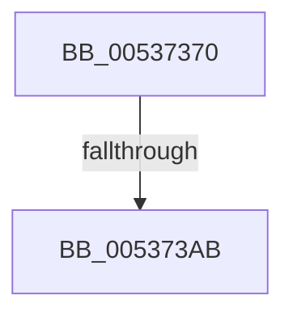

# SymCryptFdefMontgomeryReduce256Asm

- RVA: `0x00537370`–`0x005373B9` (길이 `73` bytes)
- VA: `0x0000000140537370`
- 실행 섹션: `.text`
- PDB 이름 있음: `예`; PDB Function 태그: `아니요`
- unwind 정보 RVA: `0x000C34F8`
- 디코드: `30`개 명령, `73/73` bytes 표시
- 미해석 바이트: `0` (있으면 어셈블리에 `.byte`로 보존)

> 이 문서는 커널 이미지의 기계어와 PDB 기호를 분석해 생성했습니다. 4번과 5번은 함수 원형과 자료형을 바이너리 사용 방식에서 추정한 C 해석이며 원본 소스 복구 결과는 아닙니다.

## 1. Dependencies

- 직접 호출 지점: **0**; 고유 호출 대상: **0**
- 직접 호출자로 확인된 함수: **2**
- RIP 상대 이미지 참조: **0**

### Outgoing calls
- 직접 디코드된 call 명령이 없습니다.

### Direct callers
- [SymCryptFdefModInvMontgomery256](SymCryptFdefModInvMontgomery256_function_00534CF0.md) at `0x00534D3C`
- [SymCryptFdefModInvMontgomery256](SymCryptFdefModInvMontgomery256_function_00534CF0.md) at `0x00534D58`
- [SymCryptFdefModPreGetMontgomery256](SymCryptFdefModPreGetMontgomery256_function_00535090.md) at `0x005350BE`

### Static image references
- 디코드된 RIP-relative 메모리 참조가 없습니다.

## 2. Other-region calls and transfers

- 다른 실행 섹션으로 향하는 call: **0**
- call이 아닌 외부 분기/꼬리 이동: **1**
  - `0x005373A5` → [SymCryptFdefModMulMontgomery256Asm + 0x163](SymCryptFdefModMulMontgomery256Asm_function_00537020.md) (`tail-transfer`)

## 3. Assembly (complete function range)

```asm
00537370  48 56                           push rsi
00537372  57                              push rdi
00537373  55                              push rbp
00537374  53                              push rbx
00537375  41 54                           push r12
00537377  41 55                           push r13
00537379  41 56                           push r14
0053737B  41 57                           push r15
0053737D  4C 8B D2                        mov r10, rdx
00537380  4D 8B C8                        mov r9, r8
00537383  49 8B 32                        mov rsi, qword ptr [r10]
00537386  49 8B 7A 08                     mov rdi, qword ptr [r10 + 8]
0053738A  49 8B 6A 10                     mov rbp, qword ptr [r10 + 0x10]
0053738E  49 8B 5A 18                     mov rbx, qword ptr [r10 + 0x18]
00537392  4D 8B 62 20                     mov r12, qword ptr [r10 + 0x20]
00537396  4D 8B 6A 28                     mov r13, qword ptr [r10 + 0x28]
0053739A  4D 8B 72 30                     mov r14, qword ptr [r10 + 0x30]
0053739E  4D 8B 7A 38                     mov r15, qword ptr [r10 + 0x38]
005373A2  48 85 E4                        test rsp, rsp
005373A5  0F 85 D8 FD FF FF               jne 0x140537183
005373AB  CC                              int3
005373AC  41 5F                           pop r15
005373AE  41 5E                           pop r14
005373B0  41 5D                           pop r13
005373B2  41 5C                           pop r12
005373B4  5B                              pop rbx
005373B5  5D                              pop rbp
005373B6  5F                              pop rdi
005373B7  5E                              pop rsi
005373B8  C3                              ret
```

## 4. C-style interpretation (structured pseudocode)

```c
void __fastcall SymCryptFdefMontgomeryReduce256Asm(__int64 a1, __int64 a2, __int64 a3)
{
    return;
}
```

## 5. (Beta) C Style

```c
void SymCryptFdefMontgomeryReduce256Asm(int64_t Arg1, void *Arg2, int64_t Arg3)
{
    uint8_t *arg2 = (uint8_t *)Arg2;

    return;
}
```

### 관측된 메모리 오프셋

구조체 형식이 확인되지 않은 접근은 인자 기준의 오프셋으로만 기록했습니다.

| 기준 인자 | 오프셋 표현 | 폭 (bit) | 접근 |
|---|---:|---:|---|
| `Arg2` | `+ 0x0` | `64` | `R` |
| `Arg2` | `+ 0x8` | `64` | `R` |
| `Arg2` | `+ 0x10` | `64` | `R` |
| `Arg2` | `+ 0x18` | `64` | `R` |
| `Arg2` | `+ 0x20` | `64` | `R` |
| `Arg2` | `+ 0x28` | `64` | `R` |
| `Arg2` | `+ 0x30` | `64` | `R` |
| `Arg2` | `+ 0x38` | `64` | `R` |

## 6. Execution-region graph

[열기: 2D/3D 그래프와 함수 탐색 컨트롤 패널](../../../control-panel.html?section=text&rva=0x00537370&view=graph)

- 2D 그래프는 위에서 아래로 흐르고, 3D 그래프는 빈 공간을 드래그해 회전합니다. Shift+드래그는 이동, 휠은 확대·축소, 함수 노드 선택은 대상 보고서 이동입니다.

### Static fallback


