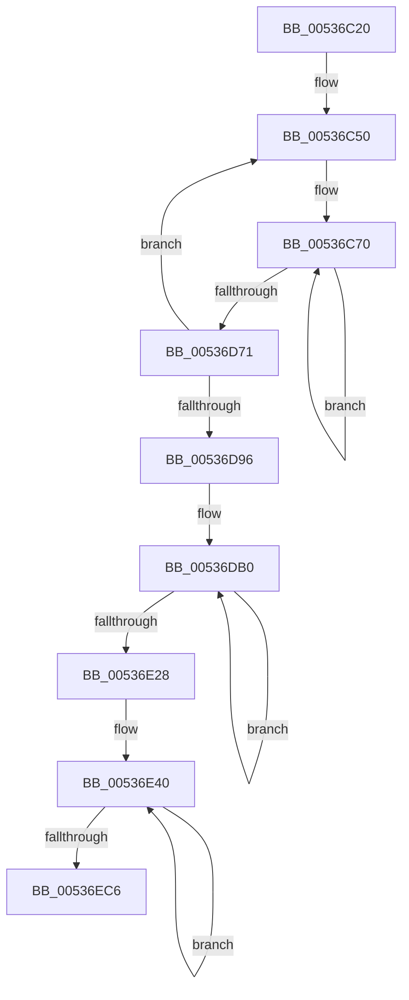

# SymCryptFdefMontgomeryReduceAsm

- RVA: `0x00536C20`–`0x00536ED3` (길이 `691` bytes)
- VA: `0x0000000140536C20`
- 실행 섹션: `.text`
- PDB 이름 있음: `예`; PDB Function 태그: `아니요`
- unwind 정보 RVA: `0x000C34F8`
- 디코드: `177`개 명령, `691/691` bytes 표시
- 미해석 바이트: `0` (있으면 어셈블리에 `.byte`로 보존)

> 이 문서는 커널 이미지의 기계어와 PDB 기호를 분석해 생성했습니다. 4번과 5번은 함수 원형과 자료형을 바이너리 사용 방식에서 추정한 C 해석이며 원본 소스 복구 결과는 아닙니다.

## 1. Dependencies

- 직접 호출 지점: **0**; 고유 호출 대상: **0**
- 직접 호출자로 확인된 함수: **1**
- RIP 상대 이미지 참조: **0**

### Outgoing calls
- 직접 디코드된 call 명령이 없습니다.

### Direct callers
- [SymCryptFdefMontgomeryReduce](SymCryptFdefMontgomeryReduce_function_005356D0.md) at `0x0053570A`

### Static image references
- 디코드된 RIP-relative 메모리 참조가 없습니다.

## 2. Other-region calls and transfers

- 다른 실행 섹션으로 향하는 call: **0**
- 별도 외부 분기/꼬리 이동을 확인하지 못했습니다.

## 3. Assembly (complete function range)

```asm
00536C20  48 56                           push rsi
00536C22  57                              push rdi
00536C23  55                              push rbp
00536C24  53                              push rbx
00536C25  41 54                           push r12
00536C27  41 55                           push r13
00536C29  41 56                           push r14
00536C2B  41 57                           push r15
00536C2D  4C 8B D2                        mov r10, rdx
00536C30  44 8B 49 04                     mov r9d, dword ptr [rcx + 4]
00536C34  4C 8B 59 18                     mov r11, qword ptr [rcx + 0x18]
00536C38  48 8D 89 80 00 00 00            lea rcx, [rcx + 0x80]
00536C3F  45 8B F9                        mov r15d, r9d
00536C42  41 C1 E7 03                     shl r15d, 3
00536C46  33 DB                           xor ebx, ebx
00536C48  0F 1F 84 00 00 00 00 00         nop dword ptr [rax + rax]
00536C50  49 8B 32                        mov rsi, qword ptr [r10]
00536C53  4D 8B EA                        mov r13, r10
00536C56  4C 8B E1                        mov r12, rcx
00536C59  49 0F AF F3                     imul rsi, r11
00536C5D  45 8B F1                        mov r14d, r9d
00536C60  33 FF                           xor edi, edi
00536C62  66 66 66 66 66 66 0F 1F 84 00 00 00 00 00  nop word ptr [rax + rax]
00536C70  49 8B 04 24                     mov rax, qword ptr [r12]
00536C74  48 F7 E6                        mul rsi
00536C77  48 8B EA                        mov rbp, rdx
00536C7A  49 03 45 00                     add rax, qword ptr [r13]
00536C7E  48 83 D5 00                     adc rbp, 0
00536C82  48 03 C7                        add rax, rdi
00536C85  49 89 45 00                     mov qword ptr [r13], rax
00536C89  48 83 D5 00                     adc rbp, 0
00536C8D  49 8B 44 24 08                  mov rax, qword ptr [r12 + 8]
00536C92  48 F7 E6                        mul rsi
00536C95  48 8B FA                        mov rdi, rdx
00536C98  49 03 45 08                     add rax, qword ptr [r13 + 8]
00536C9C  48 83 D7 00                     adc rdi, 0
00536CA0  48 03 C5                        add rax, rbp
00536CA3  49 89 45 08                     mov qword ptr [r13 + 8], rax
00536CA7  48 83 D7 00                     adc rdi, 0
00536CAB  49 8B 44 24 10                  mov rax, qword ptr [r12 + 0x10]
00536CB0  48 F7 E6                        mul rsi
00536CB3  48 8B EA                        mov rbp, rdx
00536CB6  49 03 45 10                     add rax, qword ptr [r13 + 0x10]
00536CBA  48 83 D5 00                     adc rbp, 0
00536CBE  48 03 C7                        add rax, rdi
00536CC1  49 89 45 10                     mov qword ptr [r13 + 0x10], rax
00536CC5  48 83 D5 00                     adc rbp, 0
00536CC9  49 8B 44 24 18                  mov rax, qword ptr [r12 + 0x18]
00536CCE  48 F7 E6                        mul rsi
00536CD1  48 8B FA                        mov rdi, rdx
00536CD4  49 03 45 18                     add rax, qword ptr [r13 + 0x18]
00536CD8  48 83 D7 00                     adc rdi, 0
00536CDC  48 03 C5                        add rax, rbp
00536CDF  49 89 45 18                     mov qword ptr [r13 + 0x18], rax
00536CE3  48 83 D7 00                     adc rdi, 0
00536CE7  49 8B 44 24 20                  mov rax, qword ptr [r12 + 0x20]
00536CEC  48 F7 E6                        mul rsi
00536CEF  48 8B EA                        mov rbp, rdx
00536CF2  49 03 45 20                     add rax, qword ptr [r13 + 0x20]
00536CF6  48 83 D5 00                     adc rbp, 0
00536CFA  48 03 C7                        add rax, rdi
00536CFD  49 89 45 20                     mov qword ptr [r13 + 0x20], rax
00536D01  48 83 D5 00                     adc rbp, 0
00536D05  49 8B 44 24 28                  mov rax, qword ptr [r12 + 0x28]
00536D0A  48 F7 E6                        mul rsi
00536D0D  48 8B FA                        mov rdi, rdx
00536D10  49 03 45 28                     add rax, qword ptr [r13 + 0x28]
00536D14  48 83 D7 00                     adc rdi, 0
00536D18  48 03 C5                        add rax, rbp
00536D1B  49 89 45 28                     mov qword ptr [r13 + 0x28], rax
00536D1F  48 83 D7 00                     adc rdi, 0
00536D23  49 8B 44 24 30                  mov rax, qword ptr [r12 + 0x30]
00536D28  48 F7 E6                        mul rsi
00536D2B  48 8B EA                        mov rbp, rdx
00536D2E  49 03 45 30                     add rax, qword ptr [r13 + 0x30]
00536D32  48 83 D5 00                     adc rbp, 0
00536D36  48 03 C7                        add rax, rdi
00536D39  49 89 45 30                     mov qword ptr [r13 + 0x30], rax
00536D3D  48 83 D5 00                     adc rbp, 0
00536D41  49 8B 44 24 38                  mov rax, qword ptr [r12 + 0x38]
00536D46  48 F7 E6                        mul rsi
00536D49  48 8B FA                        mov rdi, rdx
00536D4C  49 03 45 38                     add rax, qword ptr [r13 + 0x38]
00536D50  48 83 D7 00                     adc rdi, 0
00536D54  48 03 C5                        add rax, rbp
00536D57  49 89 45 38                     mov qword ptr [r13 + 0x38], rax
00536D5B  48 83 D7 00                     adc rdi, 0
00536D5F  4D 8D 64 24 40                  lea r12, [r12 + 0x40]
00536D64  4D 8D 6D 40                     lea r13, [r13 + 0x40]
00536D68  41 FF CE                        dec r14d
00536D6B  0F 85 FF FE FF FF               jne 0x140536c70
00536D71  48 03 FB                        add rdi, rbx
00536D74  BB 00 00 00 00                  mov ebx, 0
00536D79  48 83 D3 00                     adc rbx, 0
00536D7D  49 03 7D 00                     add rdi, qword ptr [r13]
00536D81  48 83 D3 00                     adc rbx, 0
00536D85  49 89 7D 00                     mov qword ptr [r13], rdi
00536D89  4D 8D 52 08                     lea r10, [r10 + 8]
00536D8D  41 FF CF                        dec r15d
00536D90  0F 85 BA FE FF FF               jne 0x140536c50
00536D96  45 8B F1                        mov r14d, r9d
00536D99  4D 8B EA                        mov r13, r10
00536D9C  4C 8B E1                        mov r12, rcx
00536D9F  49 8B F8                        mov rdi, r8
00536DA2  66 66 66 66 66 66 0F 1F 84 00 00 00 00 00  nop word ptr [rax + rax]
00536DB0  49 8B 45 00                     mov rax, qword ptr [r13]
00536DB4  49 1B 04 24                     sbb rax, qword ptr [r12]
00536DB8  48 89 07                        mov qword ptr [rdi], rax
00536DBB  49 8B 45 08                     mov rax, qword ptr [r13 + 8]
00536DBF  49 1B 44 24 08                  sbb rax, qword ptr [r12 + 8]
00536DC4  48 89 47 08                     mov qword ptr [rdi + 8], rax
00536DC8  49 8B 45 10                     mov rax, qword ptr [r13 + 0x10]
00536DCC  49 1B 44 24 10                  sbb rax, qword ptr [r12 + 0x10]
00536DD1  48 89 47 10                     mov qword ptr [rdi + 0x10], rax
00536DD5  49 8B 45 18                     mov rax, qword ptr [r13 + 0x18]
00536DD9  49 1B 44 24 18                  sbb rax, qword ptr [r12 + 0x18]
00536DDE  48 89 47 18                     mov qword ptr [rdi + 0x18], rax
00536DE2  49 8B 45 20                     mov rax, qword ptr [r13 + 0x20]
00536DE6  49 1B 44 24 20                  sbb rax, qword ptr [r12 + 0x20]
00536DEB  48 89 47 20                     mov qword ptr [rdi + 0x20], rax
00536DEF  49 8B 45 28                     mov rax, qword ptr [r13 + 0x28]
00536DF3  49 1B 44 24 28                  sbb rax, qword ptr [r12 + 0x28]
00536DF8  48 89 47 28                     mov qword ptr [rdi + 0x28], rax
00536DFC  49 8B 45 30                     mov rax, qword ptr [r13 + 0x30]
00536E00  49 1B 44 24 30                  sbb rax, qword ptr [r12 + 0x30]
00536E05  48 89 47 30                     mov qword ptr [rdi + 0x30], rax
00536E09  49 8B 45 38                     mov rax, qword ptr [r13 + 0x38]
00536E0D  49 1B 44 24 38                  sbb rax, qword ptr [r12 + 0x38]
00536E12  48 89 47 38                     mov qword ptr [rdi + 0x38], rax
00536E16  4D 8D 6D 40                     lea r13, [r13 + 0x40]
00536E1A  4D 8D 64 24 40                  lea r12, [r12 + 0x40]
00536E1F  48 8D 7F 40                     lea rdi, [rdi + 0x40]
00536E23  41 FF CE                        dec r14d
00536E26  75 88                           jne 0x140536db0
00536E28  83 DB 00                        sbb ebx, 0
00536E2B  66 0F 6E C3                     movd xmm0, ebx
00536E2F  66 0F 76 C9                     pcmpeqd xmm1, xmm1
00536E33  66 0F 70 C0 00                  pshufd xmm0, xmm0, 0
00536E38  66 0F EF C8                     pxor xmm1, xmm0
00536E3C  0F 1F 40 00                     nop dword ptr [rax]
00536E40  66 41 0F 6F 12                  movdqa xmm2, xmmword ptr [r10]
00536E45  66 41 0F 6F 18                  movdqa xmm3, xmmword ptr [r8]
00536E4A  66 0F DB D0                     pand xmm2, xmm0
00536E4E  66 0F DB D9                     pand xmm3, xmm1
00536E52  66 0F EB D3                     por xmm2, xmm3
00536E56  66 41 0F 7F 10                  movdqa xmmword ptr [r8], xmm2
00536E5B  66 41 0F 6F 52 10               movdqa xmm2, xmmword ptr [r10 + 0x10]
00536E61  66 41 0F 6F 58 10               movdqa xmm3, xmmword ptr [r8 + 0x10]
00536E67  66 0F DB D0                     pand xmm2, xmm0
00536E6B  66 0F DB D9                     pand xmm3, xmm1
00536E6F  66 0F EB D3                     por xmm2, xmm3
00536E73  66 41 0F 7F 50 10               movdqa xmmword ptr [r8 + 0x10], xmm2
00536E79  66 41 0F 6F 52 20               movdqa xmm2, xmmword ptr [r10 + 0x20]
00536E7F  66 41 0F 6F 58 20               movdqa xmm3, xmmword ptr [r8 + 0x20]
00536E85  66 0F DB D0                     pand xmm2, xmm0
00536E89  66 0F DB D9                     pand xmm3, xmm1
00536E8D  66 0F EB D3                     por xmm2, xmm3
00536E91  66 41 0F 7F 50 20               movdqa xmmword ptr [r8 + 0x20], xmm2
00536E97  66 41 0F 6F 52 30               movdqa xmm2, xmmword ptr [r10 + 0x30]
00536E9D  66 41 0F 6F 58 30               movdqa xmm3, xmmword ptr [r8 + 0x30]
00536EA3  66 0F DB D0                     pand xmm2, xmm0
00536EA7  66 0F DB D9                     pand xmm3, xmm1
00536EAB  66 0F EB D3                     por xmm2, xmm3
00536EAF  66 41 0F 7F 50 30               movdqa xmmword ptr [r8 + 0x30], xmm2
00536EB5  4D 8D 52 40                     lea r10, [r10 + 0x40]
00536EB9  4D 8D 40 40                     lea r8, [r8 + 0x40]
00536EBD  41 FF C9                        dec r9d
00536EC0  0F 85 7A FF FF FF               jne 0x140536e40
00536EC6  41 5F                           pop r15
00536EC8  41 5E                           pop r14
00536ECA  41 5D                           pop r13
00536ECC  41 5C                           pop r12
00536ECE  5B                              pop rbx
00536ECF  5D                              pop rbp
00536ED0  5F                              pop rdi
00536ED1  5E                              pop rsi
00536ED2  C3                              ret
```

## 4. C-style interpretation (structured pseudocode)

```c
__int64 __fastcall SymCryptFdefMontgomeryReduceAsm(__int64 a1, __int64 a2, __int64 a3)
{
    __int64 result;
    __int64 v_r14;
    __int64 v_r15;
    __int64 v_rbx;
    __int64 v_rdi;
    __int64 v_rsi;

    v_r15 = (unsigned int)(((unsigned int)((unsigned int)((unsigned int)(*(unsigned int *)(a1 + 4))))) << (3));
    v_rbx = 0;
loc_00536C50:
    v_rsi = (*(unsigned __int64 *)(a2)) * (*(unsigned __int64 *)(a1 + 24));
    v_rdi = 0;
loc_00536C70:
    result = (*(unsigned __int64 *)(a1 + 128)) + (*(unsigned __int64 *)(a2));
    result = (result) + (0);
    *(unsigned __int64 *)(a2) = result;
    result = (*(unsigned __int64 *)(a1 + 128 + 8)) + (*(unsigned __int64 *)(a2 + 8));
    result = (result) + (a2);
    *(unsigned __int64 *)(a2 + 8) = result;
    result = (*(unsigned __int64 *)(a1 + 128 + 16)) + (*(unsigned __int64 *)(a2 + 16));
    result = (result) + (a2);
    *(unsigned __int64 *)(a2 + 16) = result;
    result = (*(unsigned __int64 *)(a1 + 128 + 24)) + (*(unsigned __int64 *)(a2 + 24));
    result = (result) + (a2);
    *(unsigned __int64 *)(a2 + 24) = result;
    result = (*(unsigned __int64 *)(a1 + 128 + 32)) + (*(unsigned __int64 *)(a2 + 32));
    result = (result) + (a2);
    *(unsigned __int64 *)(a2 + 32) = result;
    result = (*(unsigned __int64 *)(a1 + 128 + 40)) + (*(unsigned __int64 *)(a2 + 40));
    result = (result) + (a2);
    *(unsigned __int64 *)(a2 + 40) = result;
    result = (*(unsigned __int64 *)(a1 + 128 + 48)) + (*(unsigned __int64 *)(a2 + 48));
    result = (result) + (a2);
    *(unsigned __int64 *)(a2 + 48) = result;
    result = (*(unsigned __int64 *)(a1 + 128 + 56)) + (*(unsigned __int64 *)(a2 + 56));
    result = (result) + (a2);
    *(unsigned __int64 *)(a2 + 56) = result;
    v_r14 = (unsigned int)(((unsigned int)((unsigned int)((unsigned int)(*(unsigned int *)(a1 + 4))))) - 1);
    if (condition_is_not_equal) goto loc_00536C70;
    v_rdi = (a2) + (0);
    v_rdi = (v_rdi) + (*(unsigned __int64 *)(a2 + 64));
    *(unsigned __int64 *)(a2 + 64) = v_rdi;
    v_r15 = (unsigned int)((v_r15) - 1);
    if (condition_is_not_equal) goto loc_00536C50;
loc_00536DB0:
    *(unsigned __int64 *)(a3) = *(unsigned __int64 *)(a2 + 8);
    *(unsigned __int64 *)(a3 + 8) = *(unsigned __int64 *)(a2 + 8 + 8);
    *(unsigned __int64 *)(a3 + 16) = *(unsigned __int64 *)(a2 + 8 + 16);
    *(unsigned __int64 *)(a3 + 24) = *(unsigned __int64 *)(a2 + 8 + 24);
    *(unsigned __int64 *)(a3 + 32) = *(unsigned __int64 *)(a2 + 8 + 32);
    *(unsigned __int64 *)(a3 + 40) = *(unsigned __int64 *)(a2 + 8 + 40);
    *(unsigned __int64 *)(a3 + 48) = *(unsigned __int64 *)(a2 + 8 + 48);
    *(unsigned __int64 *)(a3 + 56) = *(unsigned __int64 *)(a2 + 8 + 56);
    v_r14 = (unsigned int)(((unsigned int)((unsigned int)((unsigned int)(*(unsigned int *)(a1 + 4))))) - 1);
    if (condition_is_not_equal) goto loc_00536DB0;
loc_00536E40:
    *(unsigned __int64 *)(a3) = v_xmm2;
    *(unsigned __int64 *)(a3 + 16) = v_xmm2;
    *(unsigned __int64 *)(a3 + 32) = v_xmm2;
    *(unsigned __int64 *)(a3 + 48) = v_xmm2;
    a4 = (unsigned int)(((unsigned int)(*(unsigned int *)(a1 + 4))) - 1);
    if (condition_is_not_equal) goto loc_00536E40;
    return *(unsigned __int64 *)(a2 + 8 + 56);
}
```

## 5. (Beta) C Style

```c
int64_t SymCryptFdefMontgomeryReduceAsm(void *Arg1, void *Arg2, void *Arg3)
{
    uint8_t *arg1 = (uint8_t *)Arg1;
    uint8_t *arg2 = (uint8_t *)Arg2;
    uint8_t *arg3 = (uint8_t *)Arg3;

    int64_t result;
    int64_t local_r14;
    int64_t local_r15;
    int64_t local_rbx;
    int64_t local_rdi;
    int64_t local_rsi;

    local_r15 = (uint32_t)(((uint32_t)((uint32_t)((uint32_t)(*(uint32_t *)(arg1 + 0x4))))) << (3));
    local_rbx = 0;
loc_00536C50:
    local_rsi = (*(uint64_t *)(arg2)) * (*(uint64_t *)(arg1 + 0x18));
    local_rdi = 0;
loc_00536C70:
    result = (*(uint64_t *)(arg1 + 0x80)) + (*(uint64_t *)(arg2));
    result = (result) + (0);
    *(uint64_t *)(arg2) = result;
    result = (*(uint64_t *)(arg1 + 0x80 + 0x8)) + (*(uint64_t *)(arg2 + 0x8));
    result = (result) + (Arg2);
    *(uint64_t *)(arg2 + 0x8) = result;
    result = (*(uint64_t *)(arg1 + 0x80 + 0x10)) + (*(uint64_t *)(arg2 + 0x10));
    result = (result) + (Arg2);
    *(uint64_t *)(arg2 + 0x10) = result;
    result = (*(uint64_t *)(arg1 + 0x80 + 0x18)) + (*(uint64_t *)(arg2 + 0x18));
    result = (result) + (Arg2);
    *(uint64_t *)(arg2 + 0x18) = result;
    result = (*(uint64_t *)(arg1 + 0x80 + 0x20)) + (*(uint64_t *)(arg2 + 0x20));
    result = (result) + (Arg2);
    *(uint64_t *)(arg2 + 0x20) = result;
    result = (*(uint64_t *)(arg1 + 0x80 + 0x28)) + (*(uint64_t *)(arg2 + 0x28));
    result = (result) + (Arg2);
    *(uint64_t *)(arg2 + 0x28) = result;
    result = (*(uint64_t *)(arg1 + 0x80 + 0x30)) + (*(uint64_t *)(arg2 + 0x30));
    result = (result) + (Arg2);
    *(uint64_t *)(arg2 + 0x30) = result;
    result = (*(uint64_t *)(arg1 + 0x80 + 0x38)) + (*(uint64_t *)(arg2 + 0x38));
    result = (result) + (Arg2);
    *(uint64_t *)(arg2 + 0x38) = result;
    local_r14 = (uint32_t)(((uint32_t)((uint32_t)((uint32_t)(*(uint32_t *)(arg1 + 0x4))))) - 1);
    if (condition_is_not_equal) goto loc_00536C70;
    local_rdi = (Arg2) + (0);
    local_rdi = (local_rdi) + (*(uint64_t *)(arg2 + 0x40));
    *(uint64_t *)(arg2 + 0x40) = local_rdi;
    local_r15 = (uint32_t)((local_r15) - 1);
    if (condition_is_not_equal) goto loc_00536C50;
loc_00536DB0:
    *(uint64_t *)(arg3) = *(uint64_t *)(arg2 + 0x8);
    *(uint64_t *)(arg3 + 0x8) = *(uint64_t *)(arg2 + 0x8 + 0x8);
    *(uint64_t *)(arg3 + 0x10) = *(uint64_t *)(arg2 + 0x8 + 0x10);
    *(uint64_t *)(arg3 + 0x18) = *(uint64_t *)(arg2 + 0x8 + 0x18);
    *(uint64_t *)(arg3 + 0x20) = *(uint64_t *)(arg2 + 0x8 + 0x20);
    *(uint64_t *)(arg3 + 0x28) = *(uint64_t *)(arg2 + 0x8 + 0x28);
    *(uint64_t *)(arg3 + 0x30) = *(uint64_t *)(arg2 + 0x8 + 0x30);
    *(uint64_t *)(arg3 + 0x38) = *(uint64_t *)(arg2 + 0x8 + 0x38);
    local_r14 = (uint32_t)(((uint32_t)((uint32_t)((uint32_t)(*(uint32_t *)(arg1 + 0x4))))) - 1);
    if (condition_is_not_equal) goto loc_00536DB0;
loc_00536E40:
    *(uint64_t *)(arg3) = v_xmm2;
    *(uint64_t *)(arg3 + 0x10) = v_xmm2;
    *(uint64_t *)(arg3 + 0x20) = v_xmm2;
    *(uint64_t *)(arg3 + 0x30) = v_xmm2;
    a4 = (uint32_t)(((uint32_t)(*(uint32_t *)(arg1 + 0x4))) - 1);
    if (condition_is_not_equal) goto loc_00536E40;
    return *(uint64_t *)(arg2 + 0x8 + 0x38);
}
```

### 관측된 메모리 오프셋

구조체 형식이 확인되지 않은 접근은 인자 기준의 오프셋으로만 기록했습니다.

| 기준 인자 | 오프셋 표현 | 폭 (bit) | 접근 |
|---|---:|---:|---|
| `Arg1` | `+ 0x0` | `64` | `R` |
| `Arg1` | `+ 0x4` | `32` | `R` |
| `Arg1` | `+ 0x8` | `64` | `R` |
| `Arg1` | `+ 0x10` | `64` | `R` |
| `Arg1` | `+ 0x18` | `64` | `R` |
| `Arg1` | `+ 0x20` | `64` | `R` |
| `Arg1` | `+ 0x28` | `64` | `R` |
| `Arg1` | `+ 0x30` | `64` | `R` |
| `Arg1` | `+ 0x38` | `64` | `R` |
| `Arg1` | `+ 0x40` | `64` | `R` |
| `Arg1` | `+ 0x80` | `64` | `R` |
| `Arg2` | `+ 0x0` | `64` | `R` |
| `Arg2` | `+ 0x0` | `64` | `W` |
| `Arg2` | `+ 0x0` | `128` | `R` |
| `Arg2` | `+ 0x8` | `64` | `R` |
| `Arg2` | `+ 0x8` | `64` | `W` |
| `Arg2` | `+ 0x10` | `64` | `R` |
| `Arg2` | `+ 0x10` | `64` | `W` |
| `Arg2` | `+ 0x10` | `128` | `R` |
| `Arg2` | `+ 0x18` | `64` | `R` |
| `Arg2` | `+ 0x18` | `64` | `W` |
| `Arg2` | `+ 0x20` | `64` | `R` |
| `Arg2` | `+ 0x20` | `64` | `W` |
| `Arg2` | `+ 0x20` | `128` | `R` |
| `Arg2` | `+ 0x28` | `64` | `R` |
| `Arg2` | `+ 0x28` | `64` | `W` |
| `Arg2` | `+ 0x30` | `64` | `R` |
| `Arg2` | `+ 0x30` | `64` | `W` |
| `Arg2` | `+ 0x30` | `128` | `R` |
| `Arg2` | `+ 0x38` | `64` | `R` |
| `Arg2` | `+ 0x38` | `64` | `W` |
| `Arg2` | `+ 0x40` | `64` | `R` |

추가 오프셋 17개는 표에서 생략했습니다.

## 6. Execution-region graph

[열기: 2D/3D 그래프와 함수 탐색 컨트롤 패널](../../../control-panel.html?section=text&rva=0x00536C20&view=graph)

- 2D 그래프는 위에서 아래로 흐르고, 3D 그래프는 빈 공간을 드래그해 회전합니다. Shift+드래그는 이동, 휠은 확대·축소, 함수 노드 선택은 대상 보고서 이동입니다.

### Static fallback


