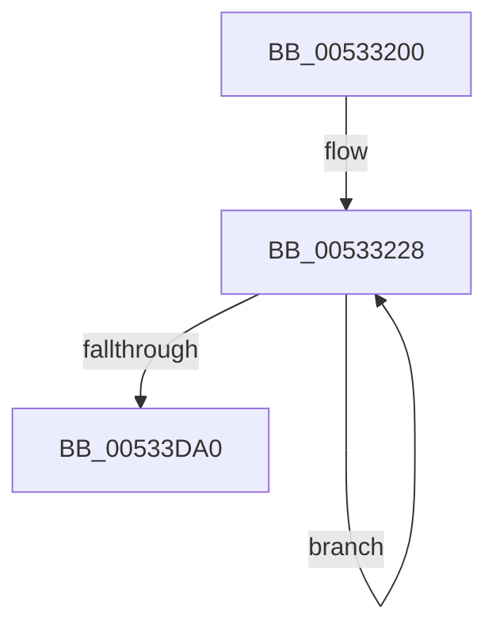

# SymCryptFdefMontgomeryReduceMulx1024

- RVA: `0x00533200`–`0x00533F72` (길이 `3,442` bytes)
- VA: `0x0000000140533200`
- 실행 섹션: `.text`
- PDB 이름 있음: `예`; PDB Function 태그: `아니요`
- unwind 정보 RVA: `0x000C34F8`
- 디코드: `652`개 명령, `3,442/3,442` bytes 표시
- 미해석 바이트: `0` (있으면 어셈블리에 `.byte`로 보존)

> 이 문서는 커널 이미지의 기계어와 PDB 기호를 분석해 생성했습니다. 4번과 5번은 함수 원형과 자료형을 바이너리 사용 방식에서 추정한 C 해석이며 원본 소스 복구 결과는 아닙니다.

## 1. Dependencies

- 직접 호출 지점: **0**; 고유 호출 대상: **0**
- 직접 호출자로 확인된 함수: **2**
- RIP 상대 이미지 참조: **0**

### Outgoing calls
- 직접 디코드된 call 명령이 없습니다.

### Direct callers
- [SymCryptFdefModMulMontgomeryMulx1024](SymCryptFdefModMulMontgomeryMulx1024_function_00534F20.md) at `0x00534F55`
- [SymCryptFdefModSquareMontgomeryMulx1024](SymCryptFdefModSquareMontgomeryMulx1024_function_00535400.md) at `0x00535432`

### Static image references
- 디코드된 RIP-relative 메모리 참조가 없습니다.

## 2. Other-region calls and transfers

- 다른 실행 섹션으로 향하는 call: **0**
- 별도 외부 분기/꼬리 이동을 확인하지 못했습니다.

## 3. Assembly (complete function range)

```asm
00533200  48 56                           push rsi
00533202  57                              push rdi
00533203  55                              push rbp
00533204  53                              push rbx
00533205  41 54                           push r12
00533207  41 55                           push r13
00533209  41 56                           push r14
0053320B  41 57                           push r15
0053320D  4C 8B D2                        mov r10, rdx
00533210  4C 89 44 24 48                  mov qword ptr [rsp + 0x48], r8
00533215  B8 02 00 00 00                  mov eax, 2
0053321A  89 44 24 50                     mov dword ptr [rsp + 0x50], eax
0053321E  45 33 C9                        xor r9d, r9d
00533221  48 8D 89 80 00 00 00            lea rcx, [rcx + 0x80]
00533228  49 8B 32                        mov rsi, qword ptr [r10]
0053322B  49 8B 7A 08                     mov rdi, qword ptr [r10 + 8]
0053322F  49 8B 6A 10                     mov rbp, qword ptr [r10 + 0x10]
00533233  49 8B 5A 18                     mov rbx, qword ptr [r10 + 0x18]
00533237  4D 8B 62 20                     mov r12, qword ptr [r10 + 0x20]
0053323B  4D 8B 6A 28                     mov r13, qword ptr [r10 + 0x28]
0053323F  4D 8B 72 30                     mov r14, qword ptr [r10 + 0x30]
00533243  4D 8B 7A 38                     mov r15, qword ptr [r10 + 0x38]
00533247  4C 8B 41 98                     mov r8, qword ptr [rcx - 0x68]
0053324B  48 8B D6                        mov rdx, rsi
0053324E  49 0F AF D0                     imul rdx, r8
00533252  48 83 C8 FF                     or rax, 0xffffffffffffffff
00533256  66 48 0F 38 F6 F0               adcx rsi, rax
0053325C  48 C7 C6 00 00 00 00            mov rsi, 0
00533263  49 89 12                        mov qword ptr [r10], rdx
00533266  C4 62 A3 F6 19                  mulx r11, r11, qword ptr [rcx]
0053326B  F3 49 0F 38 F6 FB               adox rdi, r11
00533271  C4 62 FB F6 59 08               mulx r11, rax, qword ptr [rcx + 8]
00533277  66 48 0F 38 F6 F8               adcx rdi, rax
0053327D  F3 49 0F 38 F6 EB               adox rbp, r11
00533283  C4 62 FB F6 59 10               mulx r11, rax, qword ptr [rcx + 0x10]
00533289  66 48 0F 38 F6 E8               adcx rbp, rax
0053328F  F3 49 0F 38 F6 DB               adox rbx, r11
00533295  C4 62 FB F6 59 18               mulx r11, rax, qword ptr [rcx + 0x18]
0053329B  66 48 0F 38 F6 D8               adcx rbx, rax
005332A1  F3 4D 0F 38 F6 E3               adox r12, r11
005332A7  C4 62 FB F6 59 20               mulx r11, rax, qword ptr [rcx + 0x20]
005332AD  66 4C 0F 38 F6 E0               adcx r12, rax
005332B3  F3 4D 0F 38 F6 EB               adox r13, r11
005332B9  C4 62 FB F6 59 28               mulx r11, rax, qword ptr [rcx + 0x28]
005332BF  66 4C 0F 38 F6 E8               adcx r13, rax
005332C5  F3 4D 0F 38 F6 F3               adox r14, r11
005332CB  C4 62 FB F6 59 30               mulx r11, rax, qword ptr [rcx + 0x30]
005332D1  66 4C 0F 38 F6 F0               adcx r14, rax
005332D7  F3 4D 0F 38 F6 FB               adox r15, r11
005332DD  C4 62 FB F6 59 38               mulx r11, rax, qword ptr [rcx + 0x38]
005332E3  66 4C 0F 38 F6 F8               adcx r15, rax
005332E9  66 48 0F 38 F6 F6               adcx rsi, rsi
005332EF  F3 49 0F 38 F6 F3               adox rsi, r11
005332F5  48 8B D7                        mov rdx, rdi
005332F8  49 0F AF D0                     imul rdx, r8
005332FC  48 83 C8 FF                     or rax, 0xffffffffffffffff
00533300  66 48 0F 38 F6 F8               adcx rdi, rax
00533306  48 C7 C7 00 00 00 00            mov rdi, 0
0053330D  49 89 52 08                     mov qword ptr [r10 + 8], rdx
00533311  C4 62 A3 F6 19                  mulx r11, r11, qword ptr [rcx]
00533316  F3 49 0F 38 F6 EB               adox rbp, r11
0053331C  C4 62 FB F6 59 08               mulx r11, rax, qword ptr [rcx + 8]
00533322  66 48 0F 38 F6 E8               adcx rbp, rax
00533328  F3 49 0F 38 F6 DB               adox rbx, r11
0053332E  C4 62 FB F6 59 10               mulx r11, rax, qword ptr [rcx + 0x10]
00533334  66 48 0F 38 F6 D8               adcx rbx, rax
0053333A  F3 4D 0F 38 F6 E3               adox r12, r11
00533340  C4 62 FB F6 59 18               mulx r11, rax, qword ptr [rcx + 0x18]
00533346  66 4C 0F 38 F6 E0               adcx r12, rax
0053334C  F3 4D 0F 38 F6 EB               adox r13, r11
00533352  C4 62 FB F6 59 20               mulx r11, rax, qword ptr [rcx + 0x20]
00533358  66 4C 0F 38 F6 E8               adcx r13, rax
0053335E  F3 4D 0F 38 F6 F3               adox r14, r11
00533364  C4 62 FB F6 59 28               mulx r11, rax, qword ptr [rcx + 0x28]
0053336A  66 4C 0F 38 F6 F0               adcx r14, rax
00533370  F3 4D 0F 38 F6 FB               adox r15, r11
00533376  C4 62 FB F6 59 30               mulx r11, rax, qword ptr [rcx + 0x30]
0053337C  66 4C 0F 38 F6 F8               adcx r15, rax
00533382  F3 49 0F 38 F6 F3               adox rsi, r11
00533388  C4 62 FB F6 59 38               mulx r11, rax, qword ptr [rcx + 0x38]
0053338E  66 48 0F 38 F6 F0               adcx rsi, rax
00533394  66 48 0F 38 F6 FF               adcx rdi, rdi
0053339A  F3 49 0F 38 F6 FB               adox rdi, r11
005333A0  48 8B D5                        mov rdx, rbp
005333A3  49 0F AF D0                     imul rdx, r8
005333A7  48 83 C8 FF                     or rax, 0xffffffffffffffff
005333AB  66 48 0F 38 F6 E8               adcx rbp, rax
005333B1  48 C7 C5 00 00 00 00            mov rbp, 0
005333B8  49 89 52 10                     mov qword ptr [r10 + 0x10], rdx
005333BC  C4 62 A3 F6 19                  mulx r11, r11, qword ptr [rcx]
005333C1  F3 49 0F 38 F6 DB               adox rbx, r11
005333C7  C4 62 FB F6 59 08               mulx r11, rax, qword ptr [rcx + 8]
005333CD  66 48 0F 38 F6 D8               adcx rbx, rax
005333D3  F3 4D 0F 38 F6 E3               adox r12, r11
005333D9  C4 62 FB F6 59 10               mulx r11, rax, qword ptr [rcx + 0x10]
005333DF  66 4C 0F 38 F6 E0               adcx r12, rax
005333E5  F3 4D 0F 38 F6 EB               adox r13, r11
005333EB  C4 62 FB F6 59 18               mulx r11, rax, qword ptr [rcx + 0x18]
005333F1  66 4C 0F 38 F6 E8               adcx r13, rax
005333F7  F3 4D 0F 38 F6 F3               adox r14, r11
005333FD  C4 62 FB F6 59 20               mulx r11, rax, qword ptr [rcx + 0x20]
00533403  66 4C 0F 38 F6 F0               adcx r14, rax
00533409  F3 4D 0F 38 F6 FB               adox r15, r11
0053340F  C4 62 FB F6 59 28               mulx r11, rax, qword ptr [rcx + 0x28]
00533415  66 4C 0F 38 F6 F8               adcx r15, rax
0053341B  F3 49 0F 38 F6 F3               adox rsi, r11
00533421  C4 62 FB F6 59 30               mulx r11, rax, qword ptr [rcx + 0x30]
00533427  66 48 0F 38 F6 F0               adcx rsi, rax
0053342D  F3 49 0F 38 F6 FB               adox rdi, r11
00533433  C4 62 FB F6 59 38               mulx r11, rax, qword ptr [rcx + 0x38]
00533439  66 48 0F 38 F6 F8               adcx rdi, rax
0053343F  66 48 0F 38 F6 ED               adcx rbp, rbp
00533445  F3 49 0F 38 F6 EB               adox rbp, r11
0053344B  48 8B D3                        mov rdx, rbx
0053344E  49 0F AF D0                     imul rdx, r8
00533452  48 83 C8 FF                     or rax, 0xffffffffffffffff
00533456  66 48 0F 38 F6 D8               adcx rbx, rax
0053345C  48 C7 C3 00 00 00 00            mov rbx, 0
00533463  49 89 52 18                     mov qword ptr [r10 + 0x18], rdx
00533467  C4 62 A3 F6 19                  mulx r11, r11, qword ptr [rcx]
0053346C  F3 4D 0F 38 F6 E3               adox r12, r11
00533472  C4 62 FB F6 59 08               mulx r11, rax, qword ptr [rcx + 8]
00533478  66 4C 0F 38 F6 E0               adcx r12, rax
0053347E  F3 4D 0F 38 F6 EB               adox r13, r11
00533484  C4 62 FB F6 59 10               mulx r11, rax, qword ptr [rcx + 0x10]
0053348A  66 4C 0F 38 F6 E8               adcx r13, rax
00533490  F3 4D 0F 38 F6 F3               adox r14, r11
00533496  C4 62 FB F6 59 18               mulx r11, rax, qword ptr [rcx + 0x18]
0053349C  66 4C 0F 38 F6 F0               adcx r14, rax
005334A2  F3 4D 0F 38 F6 FB               adox r15, r11
005334A8  C4 62 FB F6 59 20               mulx r11, rax, qword ptr [rcx + 0x20]
005334AE  66 4C 0F 38 F6 F8               adcx r15, rax
005334B4  F3 49 0F 38 F6 F3               adox rsi, r11
005334BA  C4 62 FB F6 59 28               mulx r11, rax, qword ptr [rcx + 0x28]
005334C0  66 48 0F 38 F6 F0               adcx rsi, rax
005334C6  F3 49 0F 38 F6 FB               adox rdi, r11
005334CC  C4 62 FB F6 59 30               mulx r11, rax, qword ptr [rcx + 0x30]
005334D2  66 48 0F 38 F6 F8               adcx rdi, rax
005334D8  F3 49 0F 38 F6 EB               adox rbp, r11
005334DE  C4 62 FB F6 59 38               mulx r11, rax, qword ptr [rcx + 0x38]
005334E4  66 48 0F 38 F6 E8               adcx rbp, rax
005334EA  66 48 0F 38 F6 DB               adcx rbx, rbx
005334F0  F3 49 0F 38 F6 DB               adox rbx, r11
005334F6  49 8B D4                        mov rdx, r12
005334F9  49 0F AF D0                     imul rdx, r8
005334FD  48 83 C8 FF                     or rax, 0xffffffffffffffff
00533501  66 4C 0F 38 F6 E0               adcx r12, rax
00533507  49 C7 C4 00 00 00 00            mov r12, 0
0053350E  49 89 52 20                     mov qword ptr [r10 + 0x20], rdx
00533512  C4 62 A3 F6 19                  mulx r11, r11, qword ptr [rcx]
00533517  F3 4D 0F 38 F6 EB               adox r13, r11
0053351D  C4 62 FB F6 59 08               mulx r11, rax, qword ptr [rcx + 8]
00533523  66 4C 0F 38 F6 E8               adcx r13, rax
00533529  F3 4D 0F 38 F6 F3               adox r14, r11
0053352F  C4 62 FB F6 59 10               mulx r11, rax, qword ptr [rcx + 0x10]
00533535  66 4C 0F 38 F6 F0               adcx r14, rax
0053353B  F3 4D 0F 38 F6 FB               adox r15, r11
00533541  C4 62 FB F6 59 18               mulx r11, rax, qword ptr [rcx + 0x18]
00533547  66 4C 0F 38 F6 F8               adcx r15, rax
0053354D  F3 49 0F 38 F6 F3               adox rsi, r11
00533553  C4 62 FB F6 59 20               mulx r11, rax, qword ptr [rcx + 0x20]
00533559  66 48 0F 38 F6 F0               adcx rsi, rax
0053355F  F3 49 0F 38 F6 FB               adox rdi, r11
00533565  C4 62 FB F6 59 28               mulx r11, rax, qword ptr [rcx + 0x28]
0053356B  66 48 0F 38 F6 F8               adcx rdi, rax
00533571  F3 49 0F 38 F6 EB               adox rbp, r11
00533577  C4 62 FB F6 59 30               mulx r11, rax, qword ptr [rcx + 0x30]
0053357D  66 48 0F 38 F6 E8               adcx rbp, rax
00533583  F3 49 0F 38 F6 DB               adox rbx, r11
00533589  C4 62 FB F6 59 38               mulx r11, rax, qword ptr [rcx + 0x38]
0053358F  66 48 0F 38 F6 D8               adcx rbx, rax
00533595  66 4D 0F 38 F6 E4               adcx r12, r12
0053359B  F3 4D 0F 38 F6 E3               adox r12, r11
005335A1  49 8B D5                        mov rdx, r13
005335A4  49 0F AF D0                     imul rdx, r8
005335A8  48 83 C8 FF                     or rax, 0xffffffffffffffff
005335AC  66 4C 0F 38 F6 E8               adcx r13, rax
005335B2  49 C7 C5 00 00 00 00            mov r13, 0
005335B9  49 89 52 28                     mov qword ptr [r10 + 0x28], rdx
005335BD  C4 62 A3 F6 19                  mulx r11, r11, qword ptr [rcx]
005335C2  F3 4D 0F 38 F6 F3               adox r14, r11
005335C8  C4 62 FB F6 59 08               mulx r11, rax, qword ptr [rcx + 8]
005335CE  66 4C 0F 38 F6 F0               adcx r14, rax
005335D4  F3 4D 0F 38 F6 FB               adox r15, r11
005335DA  C4 62 FB F6 59 10               mulx r11, rax, qword ptr [rcx + 0x10]
005335E0  66 4C 0F 38 F6 F8               adcx r15, rax
005335E6  F3 49 0F 38 F6 F3               adox rsi, r11
005335EC  C4 62 FB F6 59 18               mulx r11, rax, qword ptr [rcx + 0x18]
005335F2  66 48 0F 38 F6 F0               adcx rsi, rax
005335F8  F3 49 0F 38 F6 FB               adox rdi, r11
005335FE  C4 62 FB F6 59 20               mulx r11, rax, qword ptr [rcx + 0x20]
00533604  66 48 0F 38 F6 F8               adcx rdi, rax
0053360A  F3 49 0F 38 F6 EB               adox rbp, r11
00533610  C4 62 FB F6 59 28               mulx r11, rax, qword ptr [rcx + 0x28]
00533616  66 48 0F 38 F6 E8               adcx rbp, rax
0053361C  F3 49 0F 38 F6 DB               adox rbx, r11
00533622  C4 62 FB F6 59 30               mulx r11, rax, qword ptr [rcx + 0x30]
00533628  66 48 0F 38 F6 D8               adcx rbx, rax
0053362E  F3 4D 0F 38 F6 E3               adox r12, r11
00533634  C4 62 FB F6 59 38               mulx r11, rax, qword ptr [rcx + 0x38]
0053363A  66 4C 0F 38 F6 E0               adcx r12, rax
00533640  66 4D 0F 38 F6 ED               adcx r13, r13
00533646  F3 4D 0F 38 F6 EB               adox r13, r11
0053364C  49 8B D6                        mov rdx, r14
0053364F  49 0F AF D0                     imul rdx, r8
00533653  48 83 C8 FF                     or rax, 0xffffffffffffffff
00533657  66 4C 0F 38 F6 F0               adcx r14, rax
0053365D  49 C7 C6 00 00 00 00            mov r14, 0
00533664  49 89 52 30                     mov qword ptr [r10 + 0x30], rdx
00533668  C4 62 A3 F6 19                  mulx r11, r11, qword ptr [rcx]
0053366D  F3 4D 0F 38 F6 FB               adox r15, r11
00533673  C4 62 FB F6 59 08               mulx r11, rax, qword ptr [rcx + 8]
00533679  66 4C 0F 38 F6 F8               adcx r15, rax
0053367F  F3 49 0F 38 F6 F3               adox rsi, r11
00533685  C4 62 FB F6 59 10               mulx r11, rax, qword ptr [rcx + 0x10]
0053368B  66 48 0F 38 F6 F0               adcx rsi, rax
00533691  F3 49 0F 38 F6 FB               adox rdi, r11
00533697  C4 62 FB F6 59 18               mulx r11, rax, qword ptr [rcx + 0x18]
0053369D  66 48 0F 38 F6 F8               adcx rdi, rax
005336A3  F3 49 0F 38 F6 EB               adox rbp, r11
005336A9  C4 62 FB F6 59 20               mulx r11, rax, qword ptr [rcx + 0x20]
005336AF  66 48 0F 38 F6 E8               adcx rbp, rax
005336B5  F3 49 0F 38 F6 DB               adox rbx, r11
005336BB  C4 62 FB F6 59 28               mulx r11, rax, qword ptr [rcx + 0x28]
005336C1  66 48 0F 38 F6 D8               adcx rbx, rax
005336C7  F3 4D 0F 38 F6 E3               adox r12, r11
005336CD  C4 62 FB F6 59 30               mulx r11, rax, qword ptr [rcx + 0x30]
005336D3  66 4C 0F 38 F6 E0               adcx r12, rax
005336D9  F3 4D 0F 38 F6 EB               adox r13, r11
005336DF  C4 62 FB F6 59 38               mulx r11, rax, qword ptr [rcx + 0x38]
005336E5  66 4C 0F 38 F6 E8               adcx r13, rax
005336EB  66 4D 0F 38 F6 F6               adcx r14, r14
005336F1  F3 4D 0F 38 F6 F3               adox r14, r11
005336F7  49 8B D7                        mov rdx, r15
005336FA  49 0F AF D0                     imul rdx, r8
005336FE  48 83 C8 FF                     or rax, 0xffffffffffffffff
00533702  66 4C 0F 38 F6 F8               adcx r15, rax
00533708  49 C7 C7 00 00 00 00            mov r15, 0
0053370F  49 89 52 38                     mov qword ptr [r10 + 0x38], rdx
00533713  C4 62 A3 F6 19                  mulx r11, r11, qword ptr [rcx]
00533718  F3 49 0F 38 F6 F3               adox rsi, r11
0053371E  C4 62 FB F6 59 08               mulx r11, rax, qword ptr [rcx + 8]
00533724  66 48 0F 38 F6 F0               adcx rsi, rax
0053372A  F3 49 0F 38 F6 FB               adox rdi, r11
00533730  C4 62 FB F6 59 10               mulx r11, rax, qword ptr [rcx + 0x10]
00533736  66 48 0F 38 F6 F8               adcx rdi, rax
0053373C  F3 49 0F 38 F6 EB               adox rbp, r11
00533742  C4 62 FB F6 59 18               mulx r11, rax, qword ptr [rcx + 0x18]
00533748  66 48 0F 38 F6 E8               adcx rbp, rax
0053374E  F3 49 0F 38 F6 DB               adox rbx, r11
00533754  C4 62 FB F6 59 20               mulx r11, rax, qword ptr [rcx + 0x20]
0053375A  66 48 0F 38 F6 D8               adcx rbx, rax
00533760  F3 4D 0F 38 F6 E3               adox r12, r11
00533766  C4 62 FB F6 59 28               mulx r11, rax, qword ptr [rcx + 0x28]
0053376C  66 4C 0F 38 F6 E0               adcx r12, rax
00533772  F3 4D 0F 38 F6 EB               adox r13, r11
00533778  C4 62 FB F6 59 30               mulx r11, rax, qword ptr [rcx + 0x30]
0053377E  66 4C 0F 38 F6 E8               adcx r13, rax
00533784  F3 4D 0F 38 F6 F3               adox r14, r11
0053378A  C4 62 FB F6 59 38               mulx r11, rax, qword ptr [rcx + 0x38]
00533790  66 4C 0F 38 F6 F0               adcx r14, rax
00533796  66 4D 0F 38 F6 FF               adcx r15, r15
0053379C  F3 4D 0F 38 F6 FB               adox r15, r11
005337A2  4D 8B C2                        mov r8, r10
005337A5  48 83 C1 40                     add rcx, 0x40
005337A9  49 83 C2 40                     add r10, 0x40
005337AD  48 33 C0                        xor rax, rax
005337B0  49 8B 10                        mov rdx, qword ptr [r8]
005337B3  F3 49 0F 38 F6 32               adox rsi, qword ptr [r10]
005337B9  C4 62 FB F6 19                  mulx r11, rax, qword ptr [rcx]
005337BE  66 48 0F 38 F6 F0               adcx rsi, rax
005337C4  F3 49 0F 38 F6 FB               adox rdi, r11
005337CA  49 89 32                        mov qword ptr [r10], rsi
005337CD  C4 62 FB F6 59 08               mulx r11, rax, qword ptr [rcx + 8]
005337D3  66 48 0F 38 F6 F8               adcx rdi, rax
005337D9  F3 49 0F 38 F6 EB               adox rbp, r11
005337DF  C4 62 FB F6 59 10               mulx r11, rax, qword ptr [rcx + 0x10]
005337E5  66 48 0F 38 F6 E8               adcx rbp, rax
005337EB  F3 49 0F 38 F6 DB               adox rbx, r11
005337F1  C4 62 FB F6 59 18               mulx r11, rax, qword ptr [rcx + 0x18]
005337F7  66 48 0F 38 F6 D8               adcx rbx, rax
005337FD  F3 4D 0F 38 F6 E3               adox r12, r11
00533803  C4 62 FB F6 59 20               mulx r11, rax, qword ptr [rcx + 0x20]
00533809  66 4C 0F 38 F6 E0               adcx r12, rax
0053380F  F3 4D 0F 38 F6 EB               adox r13, r11
00533815  C4 62 FB F6 59 28               mulx r11, rax, qword ptr [rcx + 0x28]
0053381B  66 4C 0F 38 F6 E8               adcx r13, rax
00533821  F3 4D 0F 38 F6 F3               adox r14, r11
00533827  C4 62 FB F6 59 30               mulx r11, rax, qword ptr [rcx + 0x30]
0053382D  66 4C 0F 38 F6 F0               adcx r14, rax
00533833  F3 4D 0F 38 F6 FB               adox r15, r11
00533839  C4 62 FB F6 59 38               mulx r11, rax, qword ptr [rcx + 0x38]
0053383F  66 4C 0F 38 F6 F8               adcx r15, rax
00533845  48 C7 C6 00 00 00 00            mov rsi, 0
0053384C  F3 48 0F 38 F6 F6               adox rsi, rsi
00533852  66 49 0F 38 F6 F3               adcx rsi, r11
00533858  48 33 C0                        xor rax, rax
0053385B  49 8B 50 08                     mov rdx, qword ptr [r8 + 8]
0053385F  F3 49 0F 38 F6 7A 08            adox rdi, qword ptr [r10 + 8]
00533866  C4 62 FB F6 19                  mulx r11, rax, qword ptr [rcx]
0053386B  66 48 0F 38 F6 F8               adcx rdi, rax
00533871  F3 49 0F 38 F6 EB               adox rbp, r11
00533877  49 89 7A 08                     mov qword ptr [r10 + 8], rdi
0053387B  C4 62 FB F6 59 08               mulx r11, rax, qword ptr [rcx + 8]
00533881  66 48 0F 38 F6 E8               adcx rbp, rax
00533887  F3 49 0F 38 F6 DB               adox rbx, r11
0053388D  C4 62 FB F6 59 10               mulx r11, rax, qword ptr [rcx + 0x10]
00533893  66 48 0F 38 F6 D8               adcx rbx, rax
00533899  F3 4D 0F 38 F6 E3               adox r12, r11
0053389F  C4 62 FB F6 59 18               mulx r11, rax, qword ptr [rcx + 0x18]
005338A5  66 4C 0F 38 F6 E0               adcx r12, rax
005338AB  F3 4D 0F 38 F6 EB               adox r13, r11
005338B1  C4 62 FB F6 59 20               mulx r11, rax, qword ptr [rcx + 0x20]
005338B7  66 4C 0F 38 F6 E8               adcx r13, rax
005338BD  F3 4D 0F 38 F6 F3               adox r14, r11
005338C3  C4 62 FB F6 59 28               mulx r11, rax, qword ptr [rcx + 0x28]
005338C9  66 4C 0F 38 F6 F0               adcx r14, rax
005338CF  F3 4D 0F 38 F6 FB               adox r15, r11
005338D5  C4 62 FB F6 59 30               mulx r11, rax, qword ptr [rcx + 0x30]
005338DB  66 4C 0F 38 F6 F8               adcx r15, rax
005338E1  F3 49 0F 38 F6 F3               adox rsi, r11
005338E7  C4 62 FB F6 59 38               mulx r11, rax, qword ptr [rcx + 0x38]
005338ED  66 48 0F 38 F6 F0               adcx rsi, rax
005338F3  48 C7 C7 00 00 00 00            mov rdi, 0
005338FA  F3 48 0F 38 F6 FF               adox rdi, rdi
00533900  66 49 0F 38 F6 FB               adcx rdi, r11
00533906  48 33 C0                        xor rax, rax
00533909  49 8B 50 10                     mov rdx, qword ptr [r8 + 0x10]
0053390D  F3 49 0F 38 F6 6A 10            adox rbp, qword ptr [r10 + 0x10]
00533914  C4 62 FB F6 19                  mulx r11, rax, qword ptr [rcx]
00533919  66 48 0F 38 F6 E8               adcx rbp, rax
0053391F  F3 49 0F 38 F6 DB               adox rbx, r11
00533925  49 89 6A 10                     mov qword ptr [r10 + 0x10], rbp
00533929  C4 62 FB F6 59 08               mulx r11, rax, qword ptr [rcx + 8]
0053392F  66 48 0F 38 F6 D8               adcx rbx, rax
00533935  F3 4D 0F 38 F6 E3               adox r12, r11
0053393B  C4 62 FB F6 59 10               mulx r11, rax, qword ptr [rcx + 0x10]
00533941  66 4C 0F 38 F6 E0               adcx r12, rax
00533947  F3 4D 0F 38 F6 EB               adox r13, r11
0053394D  C4 62 FB F6 59 18               mulx r11, rax, qword ptr [rcx + 0x18]
00533953  66 4C 0F 38 F6 E8               adcx r13, rax
00533959  F3 4D 0F 38 F6 F3               adox r14, r11
0053395F  C4 62 FB F6 59 20               mulx r11, rax, qword ptr [rcx + 0x20]
00533965  66 4C 0F 38 F6 F0               adcx r14, rax
0053396B  F3 4D 0F 38 F6 FB               adox r15, r11
00533971  C4 62 FB F6 59 28               mulx r11, rax, qword ptr [rcx + 0x28]
00533977  66 4C 0F 38 F6 F8               adcx r15, rax
0053397D  F3 49 0F 38 F6 F3               adox rsi, r11
00533983  C4 62 FB F6 59 30               mulx r11, rax, qword ptr [rcx + 0x30]
00533989  66 48 0F 38 F6 F0               adcx rsi, rax
0053398F  F3 49 0F 38 F6 FB               adox rdi, r11
00533995  C4 62 FB F6 59 38               mulx r11, rax, qword ptr [rcx + 0x38]
0053399B  66 48 0F 38 F6 F8               adcx rdi, rax
005339A1  48 C7 C5 00 00 00 00            mov rbp, 0
005339A8  F3 48 0F 38 F6 ED               adox rbp, rbp
005339AE  66 49 0F 38 F6 EB               adcx rbp, r11
005339B4  48 33 C0                        xor rax, rax
005339B7  49 8B 50 18                     mov rdx, qword ptr [r8 + 0x18]
005339BB  F3 49 0F 38 F6 5A 18            adox rbx, qword ptr [r10 + 0x18]
005339C2  C4 62 FB F6 19                  mulx r11, rax, qword ptr [rcx]
005339C7  66 48 0F 38 F6 D8               adcx rbx, rax
005339CD  F3 4D 0F 38 F6 E3               adox r12, r11
005339D3  49 89 5A 18                     mov qword ptr [r10 + 0x18], rbx
005339D7  C4 62 FB F6 59 08               mulx r11, rax, qword ptr [rcx + 8]
005339DD  66 4C 0F 38 F6 E0               adcx r12, rax
005339E3  F3 4D 0F 38 F6 EB               adox r13, r11
005339E9  C4 62 FB F6 59 10               mulx r11, rax, qword ptr [rcx + 0x10]
005339EF  66 4C 0F 38 F6 E8               adcx r13, rax
005339F5  F3 4D 0F 38 F6 F3               adox r14, r11
005339FB  C4 62 FB F6 59 18               mulx r11, rax, qword ptr [rcx + 0x18]
00533A01  66 4C 0F 38 F6 F0               adcx r14, rax
00533A07  F3 4D 0F 38 F6 FB               adox r15, r11
00533A0D  C4 62 FB F6 59 20               mulx r11, rax, qword ptr [rcx + 0x20]
00533A13  66 4C 0F 38 F6 F8               adcx r15, rax
00533A19  F3 49 0F 38 F6 F3               adox rsi, r11
00533A1F  C4 62 FB F6 59 28               mulx r11, rax, qword ptr [rcx + 0x28]
00533A25  66 48 0F 38 F6 F0               adcx rsi, rax
00533A2B  F3 49 0F 38 F6 FB               adox rdi, r11
00533A31  C4 62 FB F6 59 30               mulx r11, rax, qword ptr [rcx + 0x30]
00533A37  66 48 0F 38 F6 F8               adcx rdi, rax
00533A3D  F3 49 0F 38 F6 EB               adox rbp, r11
00533A43  C4 62 FB F6 59 38               mulx r11, rax, qword ptr [rcx + 0x38]
00533A49  66 48 0F 38 F6 E8               adcx rbp, rax
00533A4F  48 C7 C3 00 00 00 00            mov rbx, 0
00533A56  F3 48 0F 38 F6 DB               adox rbx, rbx
00533A5C  66 49 0F 38 F6 DB               adcx rbx, r11
00533A62  48 33 C0                        xor rax, rax
00533A65  49 8B 50 20                     mov rdx, qword ptr [r8 + 0x20]
00533A69  F3 4D 0F 38 F6 62 20            adox r12, qword ptr [r10 + 0x20]
00533A70  C4 62 FB F6 19                  mulx r11, rax, qword ptr [rcx]
00533A75  66 4C 0F 38 F6 E0               adcx r12, rax
00533A7B  F3 4D 0F 38 F6 EB               adox r13, r11
00533A81  4D 89 62 20                     mov qword ptr [r10 + 0x20], r12
00533A85  C4 62 FB F6 59 08               mulx r11, rax, qword ptr [rcx + 8]
00533A8B  66 4C 0F 38 F6 E8               adcx r13, rax
00533A91  F3 4D 0F 38 F6 F3               adox r14, r11
00533A97  C4 62 FB F6 59 10               mulx r11, rax, qword ptr [rcx + 0x10]
00533A9D  66 4C 0F 38 F6 F0               adcx r14, rax
00533AA3  F3 4D 0F 38 F6 FB               adox r15, r11
00533AA9  C4 62 FB F6 59 18               mulx r11, rax, qword ptr [rcx + 0x18]
00533AAF  66 4C 0F 38 F6 F8               adcx r15, rax
00533AB5  F3 49 0F 38 F6 F3               adox rsi, r11
00533ABB  C4 62 FB F6 59 20               mulx r11, rax, qword ptr [rcx + 0x20]
00533AC1  66 48 0F 38 F6 F0               adcx rsi, rax
00533AC7  F3 49 0F 38 F6 FB               adox rdi, r11
00533ACD  C4 62 FB F6 59 28               mulx r11, rax, qword ptr [rcx + 0x28]
00533AD3  66 48 0F 38 F6 F8               adcx rdi, rax
00533AD9  F3 49 0F 38 F6 EB               adox rbp, r11
00533ADF  C4 62 FB F6 59 30               mulx r11, rax, qword ptr [rcx + 0x30]
00533AE5  66 48 0F 38 F6 E8               adcx rbp, rax
00533AEB  F3 49 0F 38 F6 DB               adox rbx, r11
00533AF1  C4 62 FB F6 59 38               mulx r11, rax, qword ptr [rcx + 0x38]
00533AF7  66 48 0F 38 F6 D8               adcx rbx, rax
00533AFD  49 C7 C4 00 00 00 00            mov r12, 0
00533B04  F3 4D 0F 38 F6 E4               adox r12, r12
00533B0A  66 4D 0F 38 F6 E3               adcx r12, r11
00533B10  48 33 C0                        xor rax, rax
00533B13  49 8B 50 28                     mov rdx, qword ptr [r8 + 0x28]
00533B17  F3 4D 0F 38 F6 6A 28            adox r13, qword ptr [r10 + 0x28]
00533B1E  C4 62 FB F6 19                  mulx r11, rax, qword ptr [rcx]
00533B23  66 4C 0F 38 F6 E8               adcx r13, rax
00533B29  F3 4D 0F 38 F6 F3               adox r14, r11
00533B2F  4D 89 6A 28                     mov qword ptr [r10 + 0x28], r13
00533B33  C4 62 FB F6 59 08               mulx r11, rax, qword ptr [rcx + 8]
00533B39  66 4C 0F 38 F6 F0               adcx r14, rax
00533B3F  F3 4D 0F 38 F6 FB               adox r15, r11
00533B45  C4 62 FB F6 59 10               mulx r11, rax, qword ptr [rcx + 0x10]
00533B4B  66 4C 0F 38 F6 F8               adcx r15, rax
00533B51  F3 49 0F 38 F6 F3               adox rsi, r11
00533B57  C4 62 FB F6 59 18               mulx r11, rax, qword ptr [rcx + 0x18]
00533B5D  66 48 0F 38 F6 F0               adcx rsi, rax
00533B63  F3 49 0F 38 F6 FB               adox rdi, r11
00533B69  C4 62 FB F6 59 20               mulx r11, rax, qword ptr [rcx + 0x20]
00533B6F  66 48 0F 38 F6 F8               adcx rdi, rax
00533B75  F3 49 0F 38 F6 EB               adox rbp, r11
00533B7B  C4 62 FB F6 59 28               mulx r11, rax, qword ptr [rcx + 0x28]
00533B81  66 48 0F 38 F6 E8               adcx rbp, rax
00533B87  F3 49 0F 38 F6 DB               adox rbx, r11
00533B8D  C4 62 FB F6 59 30               mulx r11, rax, qword ptr [rcx + 0x30]
00533B93  66 48 0F 38 F6 D8               adcx rbx, rax
00533B99  F3 4D 0F 38 F6 E3               adox r12, r11
00533B9F  C4 62 FB F6 59 38               mulx r11, rax, qword ptr [rcx + 0x38]
00533BA5  66 4C 0F 38 F6 E0               adcx r12, rax
00533BAB  49 C7 C5 00 00 00 00            mov r13, 0
00533BB2  F3 4D 0F 38 F6 ED               adox r13, r13
00533BB8  66 4D 0F 38 F6 EB               adcx r13, r11
00533BBE  48 33 C0                        xor rax, rax
00533BC1  49 8B 50 30                     mov rdx, qword ptr [r8 + 0x30]
00533BC5  F3 4D 0F 38 F6 72 30            adox r14, qword ptr [r10 + 0x30]
00533BCC  C4 62 FB F6 19                  mulx r11, rax, qword ptr [rcx]
00533BD1  66 4C 0F 38 F6 F0               adcx r14, rax
00533BD7  F3 4D 0F 38 F6 FB               adox r15, r11
00533BDD  4D 89 72 30                     mov qword ptr [r10 + 0x30], r14
00533BE1  C4 62 FB F6 59 08               mulx r11, rax, qword ptr [rcx + 8]
00533BE7  66 4C 0F 38 F6 F8               adcx r15, rax
00533BED  F3 49 0F 38 F6 F3               adox rsi, r11
00533BF3  C4 62 FB F6 59 10               mulx r11, rax, qword ptr [rcx + 0x10]
00533BF9  66 48 0F 38 F6 F0               adcx rsi, rax
00533BFF  F3 49 0F 38 F6 FB               adox rdi, r11
00533C05  C4 62 FB F6 59 18               mulx r11, rax, qword ptr [rcx + 0x18]
00533C0B  66 48 0F 38 F6 F8               adcx rdi, rax
00533C11  F3 49 0F 38 F6 EB               adox rbp, r11
00533C17  C4 62 FB F6 59 20               mulx r11, rax, qword ptr [rcx + 0x20]
00533C1D  66 48 0F 38 F6 E8               adcx rbp, rax
00533C23  F3 49 0F 38 F6 DB               adox rbx, r11
00533C29  C4 62 FB F6 59 28               mulx r11, rax, qword ptr [rcx + 0x28]
00533C2F  66 48 0F 38 F6 D8               adcx rbx, rax
00533C35  F3 4D 0F 38 F6 E3               adox r12, r11
00533C3B  C4 62 FB F6 59 30               mulx r11, rax, qword ptr [rcx + 0x30]
00533C41  66 4C 0F 38 F6 E0               adcx r12, rax
00533C47  F3 4D 0F 38 F6 EB               adox r13, r11
00533C4D  C4 62 FB F6 59 38               mulx r11, rax, qword ptr [rcx + 0x38]
00533C53  66 4C 0F 38 F6 E8               adcx r13, rax
00533C59  49 C7 C6 00 00 00 00            mov r14, 0
00533C60  F3 4D 0F 38 F6 F6               adox r14, r14
00533C66  66 4D 0F 38 F6 F3               adcx r14, r11
00533C6C  48 33 C0                        xor rax, rax
00533C6F  49 8B 50 38                     mov rdx, qword ptr [r8 + 0x38]
00533C73  F3 4D 0F 38 F6 7A 38            adox r15, qword ptr [r10 + 0x38]
00533C7A  C4 62 FB F6 19                  mulx r11, rax, qword ptr [rcx]
00533C7F  66 4C 0F 38 F6 F8               adcx r15, rax
00533C85  F3 49 0F 38 F6 F3               adox rsi, r11
00533C8B  4D 89 7A 38                     mov qword ptr [r10 + 0x38], r15
00533C8F  C4 62 FB F6 59 08               mulx r11, rax, qword ptr [rcx + 8]
00533C95  66 48 0F 38 F6 F0               adcx rsi, rax
00533C9B  F3 49 0F 38 F6 FB               adox rdi, r11
00533CA1  C4 62 FB F6 59 10               mulx r11, rax, qword ptr [rcx + 0x10]
00533CA7  66 48 0F 38 F6 F8               adcx rdi, rax
00533CAD  F3 49 0F 38 F6 EB               adox rbp, r11
00533CB3  C4 62 FB F6 59 18               mulx r11, rax, qword ptr [rcx + 0x18]
00533CB9  66 48 0F 38 F6 E8               adcx rbp, rax
00533CBF  F3 49 0F 38 F6 DB               adox rbx, r11
00533CC5  C4 62 FB F6 59 20               mulx r11, rax, qword ptr [rcx + 0x20]
00533CCB  66 48 0F 38 F6 D8               adcx rbx, rax
00533CD1  F3 4D 0F 38 F6 E3               adox r12, r11
00533CD7  C4 62 FB F6 59 28               mulx r11, rax, qword ptr [rcx + 0x28]
00533CDD  66 4C 0F 38 F6 E0               adcx r12, rax
00533CE3  F3 4D 0F 38 F6 EB               adox r13, r11
00533CE9  C4 62 FB F6 59 30               mulx r11, rax, qword ptr [rcx + 0x30]
00533CEF  66 4C 0F 38 F6 E8               adcx r13, rax
00533CF5  F3 4D 0F 38 F6 F3               adox r14, r11
00533CFB  C4 62 FB F6 59 38               mulx r11, rax, qword ptr [rcx + 0x38]
00533D01  66 4C 0F 38 F6 F0               adcx r14, rax
00533D07  49 C7 C7 00 00 00 00            mov r15, 0
00533D0E  F3 4D 0F 38 F6 FF               adox r15, r15
00533D14  66 4D 0F 38 F6 FB               adcx r15, r11
00533D1A  48 83 C1 40                     add rcx, 0x40
00533D1E  49 83 C2 40                     add r10, 0x40
00533D22  41 F7 D9                        neg r9d
00533D25  41 B9 00 00 00 00               mov r9d, 0
00533D2B  49 8B 02                        mov rax, qword ptr [r10]
00533D2E  48 13 C6                        adc rax, rsi
00533D31  49 89 02                        mov qword ptr [r10], rax
00533D34  4D 8B 5A 08                     mov r11, qword ptr [r10 + 8]
00533D38  4C 13 DF                        adc r11, rdi
00533D3B  4D 89 5A 08                     mov qword ptr [r10 + 8], r11
00533D3F  49 8B 42 10                     mov rax, qword ptr [r10 + 0x10]
00533D43  48 13 C5                        adc rax, rbp
00533D46  49 89 42 10                     mov qword ptr [r10 + 0x10], rax
00533D4A  4D 8B 5A 18                     mov r11, qword ptr [r10 + 0x18]
00533D4E  4C 13 DB                        adc r11, rbx
00533D51  4D 89 5A 18                     mov qword ptr [r10 + 0x18], r11
00533D55  49 8B 42 20                     mov rax, qword ptr [r10 + 0x20]
00533D59  49 13 C4                        adc rax, r12
00533D5C  49 89 42 20                     mov qword ptr [r10 + 0x20], rax
00533D60  4D 8B 5A 28                     mov r11, qword ptr [r10 + 0x28]
00533D64  4D 13 DD                        adc r11, r13
00533D67  4D 89 5A 28                     mov qword ptr [r10 + 0x28], r11
00533D6B  49 8B 42 30                     mov rax, qword ptr [r10 + 0x30]
00533D6F  49 13 C6                        adc rax, r14
00533D72  49 89 42 30                     mov qword ptr [r10 + 0x30], rax
00533D76  4D 8B 5A 38                     mov r11, qword ptr [r10 + 0x38]
00533D7A  4D 13 DF                        adc r11, r15
00533D7D  4D 89 5A 38                     mov qword ptr [r10 + 0x38], r11
00533D81  45 13 C9                        adc r9d, r9d
00533D84  49 83 EA 40                     sub r10, 0x40
00533D88  48 81 E9 80 00 00 00            sub rcx, 0x80
00533D8F  8B 44 24 50                     mov eax, dword ptr [rsp + 0x50]
00533D93  83 E8 01                        sub eax, 1
00533D96  89 44 24 50                     mov dword ptr [rsp + 0x50], eax
00533D9A  0F 85 88 F4 FF FF               jne 0x140533228
00533DA0  4C 8B 44 24 48                  mov r8, qword ptr [rsp + 0x48]
00533DA5  49 8B 02                        mov rax, qword ptr [r10]
00533DA8  48 1B 01                        sbb rax, qword ptr [rcx]
00533DAB  49 89 00                        mov qword ptr [r8], rax
00533DAE  4D 8B 5A 08                     mov r11, qword ptr [r10 + 8]
00533DB2  4C 1B 59 08                     sbb r11, qword ptr [rcx + 8]
00533DB6  4D 89 58 08                     mov qword ptr [r8 + 8], r11
00533DBA  49 8B 42 10                     mov rax, qword ptr [r10 + 0x10]
00533DBE  48 1B 41 10                     sbb rax, qword ptr [rcx + 0x10]
00533DC2  49 89 40 10                     mov qword ptr [r8 + 0x10], rax
00533DC6  4D 8B 5A 18                     mov r11, qword ptr [r10 + 0x18]
00533DCA  4C 1B 59 18                     sbb r11, qword ptr [rcx + 0x18]
00533DCE  4D 89 58 18                     mov qword ptr [r8 + 0x18], r11
00533DD2  49 8B 42 20                     mov rax, qword ptr [r10 + 0x20]
00533DD6  48 1B 41 20                     sbb rax, qword ptr [rcx + 0x20]
00533DDA  49 89 40 20                     mov qword ptr [r8 + 0x20], rax
00533DDE  4D 8B 5A 28                     mov r11, qword ptr [r10 + 0x28]
00533DE2  4C 1B 59 28                     sbb r11, qword ptr [rcx + 0x28]
00533DE6  4D 89 58 28                     mov qword ptr [r8 + 0x28], r11
00533DEA  49 8B 42 30                     mov rax, qword ptr [r10 + 0x30]
00533DEE  48 1B 41 30                     sbb rax, qword ptr [rcx + 0x30]
00533DF2  49 89 40 30                     mov qword ptr [r8 + 0x30], rax
00533DF6  4D 8B 5A 38                     mov r11, qword ptr [r10 + 0x38]
00533DFA  4C 1B 59 38                     sbb r11, qword ptr [rcx + 0x38]
00533DFE  4D 89 58 38                     mov qword ptr [r8 + 0x38], r11
00533E02  49 8B 42 40                     mov rax, qword ptr [r10 + 0x40]
00533E06  48 1B 41 40                     sbb rax, qword ptr [rcx + 0x40]
00533E0A  49 89 40 40                     mov qword ptr [r8 + 0x40], rax
00533E0E  4D 8B 5A 48                     mov r11, qword ptr [r10 + 0x48]
00533E12  4C 1B 59 48                     sbb r11, qword ptr [rcx + 0x48]
00533E16  4D 89 58 48                     mov qword ptr [r8 + 0x48], r11
00533E1A  49 8B 42 50                     mov rax, qword ptr [r10 + 0x50]
00533E1E  48 1B 41 50                     sbb rax, qword ptr [rcx + 0x50]
00533E22  49 89 40 50                     mov qword ptr [r8 + 0x50], rax
00533E26  4D 8B 5A 58                     mov r11, qword ptr [r10 + 0x58]
00533E2A  4C 1B 59 58                     sbb r11, qword ptr [rcx + 0x58]
00533E2E  4D 89 58 58                     mov qword ptr [r8 + 0x58], r11
00533E32  49 8B 42 60                     mov rax, qword ptr [r10 + 0x60]
00533E36  48 1B 41 60                     sbb rax, qword ptr [rcx + 0x60]
00533E3A  49 89 40 60                     mov qword ptr [r8 + 0x60], rax
00533E3E  4D 8B 5A 68                     mov r11, qword ptr [r10 + 0x68]
00533E42  4C 1B 59 68                     sbb r11, qword ptr [rcx + 0x68]
00533E46  4D 89 58 68                     mov qword ptr [r8 + 0x68], r11
00533E4A  49 8B 42 70                     mov rax, qword ptr [r10 + 0x70]
00533E4E  48 1B 41 70                     sbb rax, qword ptr [rcx + 0x70]
00533E52  49 89 40 70                     mov qword ptr [r8 + 0x70], rax
00533E56  4D 8B 5A 78                     mov r11, qword ptr [r10 + 0x78]
00533E5A  4C 1B 59 78                     sbb r11, qword ptr [rcx + 0x78]
00533E5E  4D 89 58 78                     mov qword ptr [r8 + 0x78], r11
00533E62  41 83 D9 00                     sbb r9d, 0
00533E66  66 41 0F 6E C1                  movd xmm0, r9d
00533E6B  66 0F 76 C9                     pcmpeqd xmm1, xmm1
00533E6F  66 0F 70 C0 00                  pshufd xmm0, xmm0, 0
00533E74  66 0F EF C8                     pxor xmm1, xmm0
00533E78  66 41 0F 6F 12                  movdqa xmm2, xmmword ptr [r10]
00533E7D  66 41 0F 6F 18                  movdqa xmm3, xmmword ptr [r8]
00533E82  66 0F DB D0                     pand xmm2, xmm0
00533E86  66 0F DB D9                     pand xmm3, xmm1
00533E8A  66 0F EB D3                     por xmm2, xmm3
00533E8E  66 41 0F 7F 10                  movdqa xmmword ptr [r8], xmm2
00533E93  66 41 0F 6F 52 10               movdqa xmm2, xmmword ptr [r10 + 0x10]
00533E99  66 41 0F 6F 58 10               movdqa xmm3, xmmword ptr [r8 + 0x10]
00533E9F  66 0F DB D0                     pand xmm2, xmm0
00533EA3  66 0F DB D9                     pand xmm3, xmm1
00533EA7  66 0F EB D3                     por xmm2, xmm3
00533EAB  66 41 0F 7F 50 10               movdqa xmmword ptr [r8 + 0x10], xmm2
00533EB1  66 41 0F 6F 52 20               movdqa xmm2, xmmword ptr [r10 + 0x20]
00533EB7  66 41 0F 6F 58 20               movdqa xmm3, xmmword ptr [r8 + 0x20]
00533EBD  66 0F DB D0                     pand xmm2, xmm0
00533EC1  66 0F DB D9                     pand xmm3, xmm1
00533EC5  66 0F EB D3                     por xmm2, xmm3
00533EC9  66 41 0F 7F 50 20               movdqa xmmword ptr [r8 + 0x20], xmm2
00533ECF  66 41 0F 6F 52 30               movdqa xmm2, xmmword ptr [r10 + 0x30]
00533ED5  66 41 0F 6F 58 30               movdqa xmm3, xmmword ptr [r8 + 0x30]
00533EDB  66 0F DB D0                     pand xmm2, xmm0
00533EDF  66 0F DB D9                     pand xmm3, xmm1
00533EE3  66 0F EB D3                     por xmm2, xmm3
00533EE7  66 41 0F 7F 50 30               movdqa xmmword ptr [r8 + 0x30], xmm2
00533EED  66 41 0F 6F 52 40               movdqa xmm2, xmmword ptr [r10 + 0x40]
00533EF3  66 41 0F 6F 58 40               movdqa xmm3, xmmword ptr [r8 + 0x40]
00533EF9  66 0F DB D0                     pand xmm2, xmm0
00533EFD  66 0F DB D9                     pand xmm3, xmm1
00533F01  66 0F EB D3                     por xmm2, xmm3
00533F05  66 41 0F 7F 50 40               movdqa xmmword ptr [r8 + 0x40], xmm2
00533F0B  66 41 0F 6F 52 50               movdqa xmm2, xmmword ptr [r10 + 0x50]
00533F11  66 41 0F 6F 58 50               movdqa xmm3, xmmword ptr [r8 + 0x50]
00533F17  66 0F DB D0                     pand xmm2, xmm0
00533F1B  66 0F DB D9                     pand xmm3, xmm1
00533F1F  66 0F EB D3                     por xmm2, xmm3
00533F23  66 41 0F 7F 50 50               movdqa xmmword ptr [r8 + 0x50], xmm2
00533F29  66 41 0F 6F 52 60               movdqa xmm2, xmmword ptr [r10 + 0x60]
00533F2F  66 41 0F 6F 58 60               movdqa xmm3, xmmword ptr [r8 + 0x60]
00533F35  66 0F DB D0                     pand xmm2, xmm0
00533F39  66 0F DB D9                     pand xmm3, xmm1
00533F3D  66 0F EB D3                     por xmm2, xmm3
00533F41  66 41 0F 7F 50 60               movdqa xmmword ptr [r8 + 0x60], xmm2
00533F47  66 41 0F 6F 52 70               movdqa xmm2, xmmword ptr [r10 + 0x70]
00533F4D  66 41 0F 6F 58 70               movdqa xmm3, xmmword ptr [r8 + 0x70]
00533F53  66 0F DB D0                     pand xmm2, xmm0
00533F57  66 0F DB D9                     pand xmm3, xmm1
00533F5B  66 0F EB D3                     por xmm2, xmm3
00533F5F  66 41 0F 7F 50 70               movdqa xmmword ptr [r8 + 0x70], xmm2
00533F65  41 5F                           pop r15
00533F67  41 5E                           pop r14
00533F69  41 5D                           pop r13
00533F6B  41 5C                           pop r12
00533F6D  5B                              pop rbx
00533F6E  5D                              pop rbp
00533F6F  5F                              pop rdi
00533F70  5E                              pop rsi
00533F71  C3                              ret
```

## 4. C-style interpretation (structured pseudocode)

```c
__int64 __fastcall SymCryptFdefMontgomeryReduceMulx1024(__int64 a1, __int64 a2, __int64 a3, int a4)
{
    __int64 result;
    __int64 v_r10;
    unsigned int v_stack_p10;
    unsigned __int64 v_stack_p8;

    v_stack_p8 = a3;
    v_stack_p10 = 2;
    a4 = 0;
loc_00533228:
    a2 = (*(unsigned __int64 *)(a2)) * (*(unsigned __int64 *)(a1 + 128 - 104));
    result = (2) | (-1);
    *(unsigned __int64 *)(a2) = a2;
    a2 = (*(unsigned __int64 *)(a2 + 8)) * (*(unsigned __int64 *)(a1 + 128 - 104));
    result = (result) | (-1);
    *(unsigned __int64 *)(a2 + 8) = a2;
    a2 = (*(unsigned __int64 *)(a2 + 16)) * (*(unsigned __int64 *)(a1 + 128 - 104));
    result = (result) | (-1);
    *(unsigned __int64 *)(a2 + 16) = a2;
    a2 = (*(unsigned __int64 *)(a2 + 24)) * (*(unsigned __int64 *)(a1 + 128 - 104));
    result = (result) | (-1);
    *(unsigned __int64 *)(a2 + 24) = a2;
    a2 = (*(unsigned __int64 *)(a2 + 32)) * (*(unsigned __int64 *)(a1 + 128 - 104));
    result = (result) | (-1);
    *(unsigned __int64 *)(a2 + 32) = a2;
    a2 = (*(unsigned __int64 *)(a2 + 40)) * (*(unsigned __int64 *)(a1 + 128 - 104));
    result = (result) | (-1);
    *(unsigned __int64 *)(a2 + 40) = a2;
    a2 = (*(unsigned __int64 *)(a2 + 48)) * (*(unsigned __int64 *)(a1 + 128 - 104));
    result = (result) | (-1);
    *(unsigned __int64 *)(a2 + 48) = a2;
    a2 = (*(unsigned __int64 *)(a2 + 56)) * (*(unsigned __int64 *)(a1 + 128 - 104));
    result = (result) | (-1);
    *(unsigned __int64 *)(a2 + 56) = a2;
    a1 = (a1 + 128) + (64);
    v_r10 = (a2) + (64);
    result = 0;
    *(unsigned __int64 *)(v_r10) = 0;
    result = 0;
    *(unsigned __int64 *)(v_r10 + 8) = 0;
    result = 0;
    *(unsigned __int64 *)(v_r10 + 16) = 0;
    result = 0;
    *(unsigned __int64 *)(v_r10 + 24) = 0;
    result = 0;
    *(unsigned __int64 *)(v_r10 + 32) = 0;
    result = 0;
    *(unsigned __int64 *)(v_r10 + 40) = 0;
    result = 0;
    *(unsigned __int64 *)(v_r10 + 48) = 0;
    result = 0;
    *(unsigned __int64 *)(v_r10 + 56) = 0;
    a1 = (a1) + (64);
    v_r10 = (v_r10) + (64);
    a4 = (unsigned int)(-(a4));
    *(unsigned __int64 *)(v_r10) = *(unsigned __int64 *)(v_r10);
    *(unsigned __int64 *)(v_r10 + 8) = *(unsigned __int64 *)(v_r10 + 8);
    *(unsigned __int64 *)(v_r10 + 16) = *(unsigned __int64 *)(v_r10 + 16);
    *(unsigned __int64 *)(v_r10 + 24) = *(unsigned __int64 *)(v_r10 + 24);
    *(unsigned __int64 *)(v_r10 + 32) = *(unsigned __int64 *)(v_r10 + 32);
    *(unsigned __int64 *)(v_r10 + 40) = *(unsigned __int64 *)(v_r10 + 40);
    *(unsigned __int64 *)(v_r10 + 48) = *(unsigned __int64 *)(v_r10 + 48);
    *(unsigned __int64 *)(v_r10 + 56) = *(unsigned __int64 *)(v_r10 + 56);
    v_r10 = (v_r10) - (64);
    a1 = (a1) - (128);
    result = (unsigned int)(((unsigned int)(v_stack_p10)) - (1));
    v_stack_p10 = (unsigned int)(result);
    if (condition_is_not_equal) goto loc_00533228;
    *(unsigned __int64 *)(v_stack_p8) = *(unsigned __int64 *)(v_r10);
    *(unsigned __int64 *)(v_stack_p8 + 8) = *(unsigned __int64 *)(v_r10 + 8);
    *(unsigned __int64 *)(v_stack_p8 + 16) = *(unsigned __int64 *)(v_r10 + 16);
    *(unsigned __int64 *)(v_stack_p8 + 24) = *(unsigned __int64 *)(v_r10 + 24);
    *(unsigned __int64 *)(v_stack_p8 + 32) = *(unsigned __int64 *)(v_r10 + 32);
    *(unsigned __int64 *)(v_stack_p8 + 40) = *(unsigned __int64 *)(v_r10 + 40);
    *(unsigned __int64 *)(v_stack_p8 + 48) = *(unsigned __int64 *)(v_r10 + 48);
    *(unsigned __int64 *)(v_stack_p8 + 56) = *(unsigned __int64 *)(v_r10 + 56);
    *(unsigned __int64 *)(v_stack_p8 + 64) = *(unsigned __int64 *)(v_r10 + 64);
    *(unsigned __int64 *)(v_stack_p8 + 72) = *(unsigned __int64 *)(v_r10 + 72);
    *(unsigned __int64 *)(v_stack_p8 + 80) = *(unsigned __int64 *)(v_r10 + 80);
    *(unsigned __int64 *)(v_stack_p8 + 88) = *(unsigned __int64 *)(v_r10 + 88);
    *(unsigned __int64 *)(v_stack_p8 + 96) = *(unsigned __int64 *)(v_r10 + 96);
    *(unsigned __int64 *)(v_stack_p8 + 104) = *(unsigned __int64 *)(v_r10 + 104);
    *(unsigned __int64 *)(v_stack_p8 + 112) = *(unsigned __int64 *)(v_r10 + 112);
    *(unsigned __int64 *)(v_stack_p8 + 120) = *(unsigned __int64 *)(v_r10 + 120);
    *(unsigned __int64 *)(v_stack_p8) = v_xmm2;
    *(unsigned __int64 *)(v_stack_p8 + 16) = v_xmm2;
    *(unsigned __int64 *)(v_stack_p8 + 32) = v_xmm2;
    *(unsigned __int64 *)(v_stack_p8 + 48) = v_xmm2;
    *(unsigned __int64 *)(v_stack_p8 + 64) = v_xmm2;
    *(unsigned __int64 *)(v_stack_p8 + 80) = v_xmm2;
    *(unsigned __int64 *)(v_stack_p8 + 96) = v_xmm2;
    *(unsigned __int64 *)(v_stack_p8 + 112) = v_xmm2;
    return *(unsigned __int64 *)(v_r10 + 112);
}
```

## 5. (Beta) C Style

```c
int64_t SymCryptFdefMontgomeryReduceMulx1024(void *Arg1, void *Arg2, int64_t Arg3, int32_t Arg4)
{
    uint8_t *arg1 = (uint8_t *)Arg1;
    uint8_t *arg2 = (uint8_t *)Arg2;

    int64_t result;
    int64_t local_r10;
    uint32_t v_stack_p10;
    uint64_t v_stack_p8;

    v_stack_p8 = Arg3;
    v_stack_p10 = 2;
    Arg4 = 0;
loc_00533228:
    Arg2 = (*(uint64_t *)(arg2)) * (*(uint64_t *)(arg1 + 0x80 - 0x68));
    result = (2) | (-1);
    *(void **)(arg2) = Arg2;
    Arg2 = (*(uint64_t *)(arg2 + 0x8)) * (*(uint64_t *)(arg1 + 0x80 - 0x68));
    result = (result) | (-1);
    *(void **)(arg2 + 0x8) = Arg2;
    Arg2 = (*(uint64_t *)(arg2 + 0x10)) * (*(uint64_t *)(arg1 + 0x80 - 0x68));
    result = (result) | (-1);
    *(void **)(arg2 + 0x10) = Arg2;
    Arg2 = (*(uint64_t *)(arg2 + 0x18)) * (*(uint64_t *)(arg1 + 0x80 - 0x68));
    result = (result) | (-1);
    *(void **)(arg2 + 0x18) = Arg2;
    Arg2 = (*(uint64_t *)(arg2 + 0x20)) * (*(uint64_t *)(arg1 + 0x80 - 0x68));
    result = (result) | (-1);
    *(void **)(arg2 + 0x20) = Arg2;
    Arg2 = (*(uint64_t *)(arg2 + 0x28)) * (*(uint64_t *)(arg1 + 0x80 - 0x68));
    result = (result) | (-1);
    *(void **)(arg2 + 0x28) = Arg2;
    Arg2 = (*(uint64_t *)(arg2 + 0x30)) * (*(uint64_t *)(arg1 + 0x80 - 0x68));
    result = (result) | (-1);
    *(void **)(arg2 + 0x30) = Arg2;
    Arg2 = (*(uint64_t *)(arg2 + 0x38)) * (*(uint64_t *)(arg1 + 0x80 - 0x68));
    result = (result) | (-1);
    *(void **)(arg2 + 0x38) = Arg2;
    Arg1 = (Arg1 + 128) + (64);
    local_r10 = (Arg2) + (64);
    result = 0;
    *(uint64_t *)(local_r10) = 0;
    result = 0;
    *(uint64_t *)(local_r10 + 0x8) = 0;
    result = 0;
    *(uint64_t *)(local_r10 + 0x10) = 0;
    result = 0;
    *(uint64_t *)(local_r10 + 0x18) = 0;
    result = 0;
    *(uint64_t *)(local_r10 + 0x20) = 0;
    result = 0;
    *(uint64_t *)(local_r10 + 0x28) = 0;
    result = 0;
    *(uint64_t *)(local_r10 + 0x30) = 0;
    result = 0;
    *(uint64_t *)(local_r10 + 0x38) = 0;
    Arg1 = (Arg1) + (64);
    local_r10 = (local_r10) + (64);
    Arg4 = (uint32_t)(-(Arg4));
    *(uint64_t *)(local_r10) = *(uint64_t *)(local_r10);
    *(uint64_t *)(local_r10 + 0x8) = *(uint64_t *)(local_r10 + 0x8);
    *(uint64_t *)(local_r10 + 0x10) = *(uint64_t *)(local_r10 + 0x10);
    *(uint64_t *)(local_r10 + 0x18) = *(uint64_t *)(local_r10 + 0x18);
    *(uint64_t *)(local_r10 + 0x20) = *(uint64_t *)(local_r10 + 0x20);
    *(uint64_t *)(local_r10 + 0x28) = *(uint64_t *)(local_r10 + 0x28);
    *(uint64_t *)(local_r10 + 0x30) = *(uint64_t *)(local_r10 + 0x30);
    *(uint64_t *)(local_r10 + 0x38) = *(uint64_t *)(local_r10 + 0x38);
    local_r10 = (local_r10) - (64);
    Arg1 = (Arg1) - (128);
    result = (uint32_t)(((uint32_t)(v_stack_p10)) - (1));
    v_stack_p10 = (uint32_t)(result);
    if (condition_is_not_equal) goto loc_00533228;
    *(uint64_t *)(v_stack_p8) = *(uint64_t *)(local_r10);
    *(uint64_t *)(v_stack_p8 + 0x8) = *(uint64_t *)(local_r10 + 0x8);
    *(uint64_t *)(v_stack_p8 + 0x10) = *(uint64_t *)(local_r10 + 0x10);
    *(uint64_t *)(v_stack_p8 + 0x18) = *(uint64_t *)(local_r10 + 0x18);
    *(uint64_t *)(v_stack_p8 + 0x20) = *(uint64_t *)(local_r10 + 0x20);
    *(uint64_t *)(v_stack_p8 + 0x28) = *(uint64_t *)(local_r10 + 0x28);
    *(uint64_t *)(v_stack_p8 + 0x30) = *(uint64_t *)(local_r10 + 0x30);
    *(uint64_t *)(v_stack_p8 + 0x38) = *(uint64_t *)(local_r10 + 0x38);
    *(uint64_t *)(v_stack_p8 + 0x40) = *(uint64_t *)(local_r10 + 0x40);
    *(uint64_t *)(v_stack_p8 + 0x48) = *(uint64_t *)(local_r10 + 0x48);
    *(uint64_t *)(v_stack_p8 + 0x50) = *(uint64_t *)(local_r10 + 0x50);
    *(uint64_t *)(v_stack_p8 + 0x58) = *(uint64_t *)(local_r10 + 0x58);
    *(uint64_t *)(v_stack_p8 + 0x60) = *(uint64_t *)(local_r10 + 0x60);
    *(uint64_t *)(v_stack_p8 + 0x68) = *(uint64_t *)(local_r10 + 0x68);
    *(uint64_t *)(v_stack_p8 + 0x70) = *(uint64_t *)(local_r10 + 0x70);
    *(uint64_t *)(v_stack_p8 + 0x78) = *(uint64_t *)(local_r10 + 0x78);
    *(uint64_t *)(v_stack_p8) = v_xmm2;
    *(uint64_t *)(v_stack_p8 + 0x10) = v_xmm2;
    *(uint64_t *)(v_stack_p8 + 0x20) = v_xmm2;
    *(uint64_t *)(v_stack_p8 + 0x30) = v_xmm2;
    *(uint64_t *)(v_stack_p8 + 0x40) = v_xmm2;
    *(uint64_t *)(v_stack_p8 + 0x50) = v_xmm2;
    *(uint64_t *)(v_stack_p8 + 0x60) = v_xmm2;
    *(uint64_t *)(v_stack_p8 + 0x70) = v_xmm2;
    return *(uint64_t *)(local_r10 + 0x70);
}
```

### 관측된 메모리 오프셋

구조체 형식이 확인되지 않은 접근은 인자 기준의 오프셋으로만 기록했습니다.

| 기준 인자 | 오프셋 표현 | 폭 (bit) | 접근 |
|---|---:|---:|---|
| `Arg1` | `- 0x68` | `64` | `R` |
| `Arg1` | `+ 0x0` | `64` | `R` |
| `Arg1` | `+ 0x8` | `64` | `R` |
| `Arg1` | `+ 0x10` | `64` | `R` |
| `Arg1` | `+ 0x18` | `64` | `R` |
| `Arg1` | `+ 0x20` | `64` | `R` |
| `Arg1` | `+ 0x28` | `64` | `R` |
| `Arg1` | `+ 0x30` | `64` | `R` |
| `Arg1` | `+ 0x38` | `64` | `R` |
| `Arg1` | `+ 0x40` | `64` | `R` |
| `Arg1` | `+ 0x48` | `64` | `R` |
| `Arg1` | `+ 0x50` | `64` | `R` |
| `Arg1` | `+ 0x58` | `64` | `R` |
| `Arg1` | `+ 0x60` | `64` | `R` |
| `Arg1` | `+ 0x68` | `64` | `R` |
| `Arg1` | `+ 0x70` | `64` | `R` |
| `Arg1` | `+ 0x78` | `64` | `R` |
| `Arg1` | `+ 0x80` | `64` | `R` |
| `Arg2` | `+ 0x0` | `64` | `R` |
| `Arg2` | `+ 0x0` | `64` | `W` |
| `Arg2` | `+ 0x0` | `128` | `R` |
| `Arg2` | `+ 0x8` | `64` | `R` |
| `Arg2` | `+ 0x8` | `64` | `W` |
| `Arg2` | `+ 0x10` | `64` | `R` |
| `Arg2` | `+ 0x10` | `64` | `W` |
| `Arg2` | `+ 0x10` | `128` | `R` |
| `Arg2` | `+ 0x18` | `64` | `R` |
| `Arg2` | `+ 0x18` | `64` | `W` |
| `Arg2` | `+ 0x20` | `64` | `R` |
| `Arg2` | `+ 0x20` | `64` | `W` |
| `Arg2` | `+ 0x20` | `128` | `R` |
| `Arg2` | `+ 0x28` | `64` | `R` |

추가 오프셋 18개는 표에서 생략했습니다.

## 6. Execution-region graph

[열기: 2D/3D 그래프와 함수 탐색 컨트롤 패널](../../../control-panel.html?section=text&rva=0x00533200&view=graph)

- 2D 그래프는 위에서 아래로 흐르고, 3D 그래프는 빈 공간을 드래그해 회전합니다. Shift+드래그는 이동, 휠은 확대·축소, 함수 노드 선택은 대상 보고서 이동입니다.

### Static fallback


