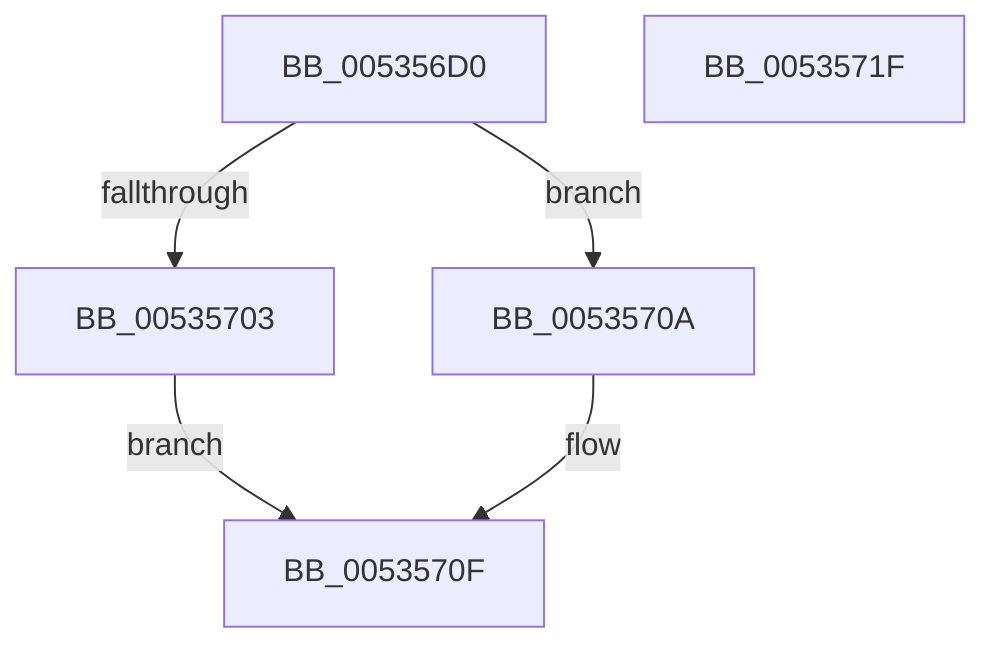

# SymCryptFdefMontgomeryReduce

- RVA: `0x005356D0`–`0x00535720` (길이 `80` bytes)
- VA: `0x00000001405356D0`
- 실행 섹션: `.text`
- PDB 이름 있음: `예`; PDB Function 태그: `아니요`
- unwind 정보 RVA: `0x00060BC4`
- 디코드: `23`개 명령, `80/80` bytes 표시
- 미해석 바이트: `0` (있으면 어셈블리에 `.byte`로 보존)

> 이 문서는 커널 이미지의 기계어와 PDB 기호를 분석해 생성했습니다. 4번과 5번은 함수 원형과 자료형을 바이너리 사용 방식에서 추정한 C 해석이며 원본 소스 복구 결과는 아닙니다.

## 1. Dependencies

- 직접 호출 지점: **3**; 고유 호출 대상: **3**
- 직접 호출자로 확인된 함수: **5**
- RIP 상대 이미지 참조: **1**

### Outgoing calls
- `0x005356E8` → [SymCryptCpuFeaturesNeverPresent](../49/SymCryptCpuFeaturesNeverPresent_function_00498CB0.md) (function, `0x00498CB0`)
- `0x00535703` → [SymCryptFdefMontgomeryReduceMulx](../52/SymCryptFdefMontgomeryReduceMulx_function_0052F2E0.md) (function, `0x0052F2E0`)
- `0x0053570A` → [SymCryptFdefMontgomeryReduceAsm](SymCryptFdefMontgomeryReduceAsm_function_00536C20.md) (function, `0x00536C20`)

### Direct callers
- [SymCryptFdefModInvMontgomery](SymCryptFdefModInvMontgomery_function_00534C40.md) at `0x00534C90`
- [SymCryptFdefModInvMontgomery](SymCryptFdefModInvMontgomery_function_00534C40.md) at `0x00534CA8`
- [SymCryptFdefModMulMontgomery](SymCryptFdefModMulMontgomery_function_00534E60.md) at `0x00534E99`
- [SymCryptFdefModPreGetMontgomery](SymCryptFdefModPreGetMontgomery_function_00535020.md) at `0x00535067`
- [SymCryptFdefModSetPostMontgomery](SymCryptFdefModSetPostMontgomery_function_005350E0.md) at `0x00535118`
- [SymCryptFdefModSquareMontgomery](SymCryptFdefModSquareMontgomery_function_00535360.md) at `0x00535392`

### Static image references
- `0x005356ED` → RVA `0x00E0A730` (`.data`; read)

## 2. Other-region calls and transfers

- 다른 실행 섹션으로 향하는 call: **0**
- 별도 외부 분기/꼬리 이동을 확인하지 못했습니다.

## 3. Assembly (complete function range)

```asm
005356D0  48 89 5C 24 08                  mov qword ptr [rsp + 8], rbx
005356D5  48 89 74 24 10                  mov qword ptr [rsp + 0x10], rsi
005356DA  57                              push rdi
005356DB  48 83 EC 20                     sub rsp, 0x20
005356DF  49 8B D8                        mov rbx, r8
005356E2  48 8B FA                        mov rdi, rdx
005356E5  48 8B F1                        mov rsi, rcx
005356E8  E8 C3 35 F6 FF                  call 0x140498cb0
005356ED  0B 05 3D 50 8D 00               or eax, dword ptr [rip + 0x8d503d]
005356F3  4C 8B C3                        mov r8, rbx
005356F6  48 8B D7                        mov rdx, rdi
005356F9  48 8B CE                        mov rcx, rsi
005356FC  A9 81 01 00 00                  test eax, 0x181
00535701  75 07                           jne 0x14053570a
00535703  E8 D8 9B FF FF                  call 0x14052f2e0
00535708  EB 05                           jmp 0x14053570f
0053570A  E8 11 15 00 00                  call 0x140536c20
0053570F  48 8B 5C 24 30                  mov rbx, qword ptr [rsp + 0x30]
00535714  48 8B 74 24 38                  mov rsi, qword ptr [rsp + 0x38]
00535719  48 83 C4 20                     add rsp, 0x20
0053571D  5F                              pop rdi
0053571E  C3                              ret
0053571F  CC                              int3
```

## 4. C-style interpretation (structured pseudocode)

```c
__int64 __fastcall SymCryptFdefMontgomeryReduce(__int64 a1, __int64 a2, __int64 a3)
{
    __int64 result;
    __int64 v_rsp;
    unsigned __int64 v_stack_p10;
    unsigned __int64 v_stack_p8;

    v_stack_p8 = v_rbx;
    v_stack_p10 = v_rsi;
    v_rsp = (v_rsp) - (32);
    result = SymCryptCpuFeaturesNeverPresent(a1, a2, a3, a4);
    result = (unsigned int)((result) | (*(unsigned int *)(v_rip + 9261117)));
    if ((((unsigned int)(result)) & (385)) != 0) goto loc_0053570A;
    result = SymCryptFdefMontgomeryReduceMulx(a1, a2, a3, a4);
    goto loc_0053570F;
loc_0053570A:
    result = SymCryptFdefMontgomeryReduceAsm(a1, a2, a3, a4);
loc_0053570F:
    v_rsp = (v_rsp) + (32);
    return result;
}
```

## 5. (Beta) C Style

```c
int64_t SymCryptFdefMontgomeryReduce(int64_t Arg1, int64_t Arg2, int64_t Arg3)
{
    int64_t result;
    int64_t local_rsp;
    uint64_t v_stack_p10;
    uint64_t v_stack_p8;

    v_stack_p8 = local_rbx;
    v_stack_p10 = local_rsi;
    local_rsp = (local_rsp) - (32);
    result = SymCryptCpuFeaturesNeverPresent(Arg1, Arg2, Arg3, a4);
    result = (uint32_t)((result) | (*(uint32_t *)(v_rip + 0x8D503D)));
    if ((((uint32_t)(result)) & (385)) != 0) goto loc_0053570A;
    result = SymCryptFdefMontgomeryReduceMulx(Arg1, Arg2, Arg3, a4);
    goto loc_0053570F;
loc_0053570A:
    result = SymCryptFdefMontgomeryReduceAsm(Arg1, Arg2, Arg3, a4);
loc_0053570F:
    local_rsp = (local_rsp) + (32);
    return result;
}
```

## 6. Execution-region graph

[열기: 2D/3D 그래프와 함수 탐색 컨트롤 패널](../../../control-panel.html?section=text&rva=0x005356D0&view=graph)

- 2D 그래프는 위에서 아래로 흐르고, 3D 그래프는 빈 공간을 드래그해 회전합니다. Shift+드래그는 이동, 휠은 확대·축소, 함수 노드 선택은 대상 보고서 이동입니다.

### Static fallback


