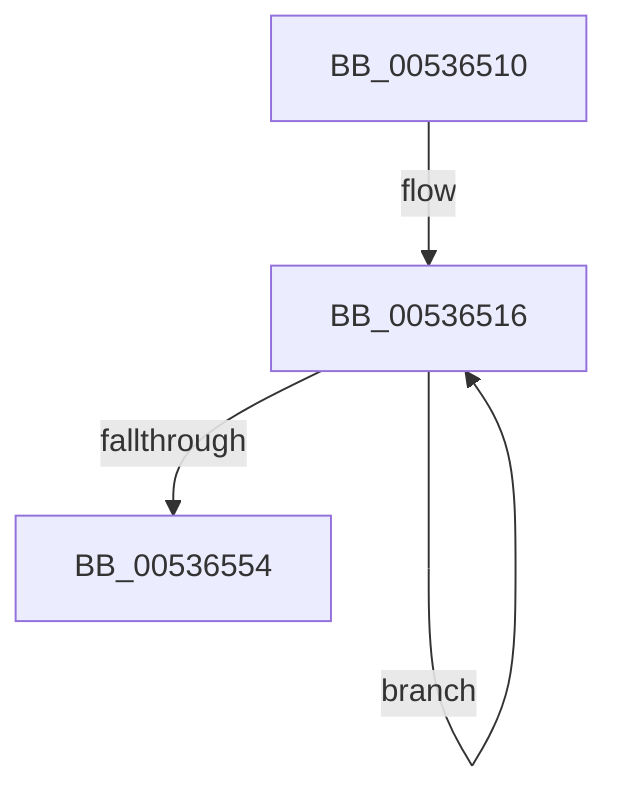

# SymCryptFdefRawAddAsm

- RVA: `0x00536510`–`0x0053655F` (길이 `79` bytes)
- VA: `0x0000000140536510`
- 실행 섹션: `.text`
- PDB 이름 있음: `예`; PDB Function 태그: `아니요`
- unwind 정보 RVA: `0x000C3108`
- 디코드: `22`개 명령, `79/79` bytes 표시
- 미해석 바이트: `0` (있으면 어셈블리에 `.byte`로 보존)

> 이 문서는 커널 이미지의 기계어와 PDB 기호를 분석해 생성했습니다. 4번과 5번은 함수 원형과 자료형을 바이너리 사용 방식에서 추정한 C 해석이며 원본 소스 복구 결과는 아닙니다.

## 1. Dependencies

- 직접 호출 지점: **0**; 고유 호출 대상: **0**
- 직접 호출자로 확인된 함수: **2**
- RIP 상대 이미지 참조: **0**

### Outgoing calls
- 직접 디코드된 call 명령이 없습니다.

### Direct callers
- [SymCryptFdefIntAddMixedSize](../52/SymCryptFdefIntAddMixedSize_function_0052D41C.md) at `0x0052D45F`
- [SymCryptFdefIntAddMixedSize](../52/SymCryptFdefIntAddMixedSize_function_0052D41C.md) at `0x0052D4A0`
- [SymCryptFdefRawAdd](../52/SymCryptFdefRawAdd_function_0052DBE4.md) at `0x0052DBE8`

### Static image references
- 디코드된 RIP-relative 메모리 참조가 없습니다.

## 2. Other-region calls and transfers

- 다른 실행 섹션으로 향하는 call: **0**
- 별도 외부 분기/꼬리 이동을 확인하지 못했습니다.

## 3. Assembly (complete function range)

```asm
00536510  45 03 C9                        add r9d, r9d
00536513  48 33 C0                        xor rax, rax
00536516  48 8B 01                        mov rax, qword ptr [rcx]
00536519  48 13 02                        adc rax, qword ptr [rdx]
0053651C  49 89 00                        mov qword ptr [r8], rax
0053651F  48 8B 41 08                     mov rax, qword ptr [rcx + 8]
00536523  48 13 42 08                     adc rax, qword ptr [rdx + 8]
00536527  49 89 40 08                     mov qword ptr [r8 + 8], rax
0053652B  48 8B 41 10                     mov rax, qword ptr [rcx + 0x10]
0053652F  48 13 42 10                     adc rax, qword ptr [rdx + 0x10]
00536533  49 89 40 10                     mov qword ptr [r8 + 0x10], rax
00536537  48 8B 41 18                     mov rax, qword ptr [rcx + 0x18]
0053653B  48 13 42 18                     adc rax, qword ptr [rdx + 0x18]
0053653F  49 89 40 18                     mov qword ptr [r8 + 0x18], rax
00536543  48 8D 49 20                     lea rcx, [rcx + 0x20]
00536547  48 8D 52 20                     lea rdx, [rdx + 0x20]
0053654B  4D 8D 40 20                     lea r8, [r8 + 0x20]
0053654F  41 FF C9                        dec r9d
00536552  75 C2                           jne 0x140536516
00536554  48 C7 C0 00 00 00 00            mov rax, 0
0053655B  48 13 C0                        adc rax, rax
0053655E  C3                              ret
```

## 4. C-style interpretation (structured pseudocode)

```c
__int64 __fastcall SymCryptFdefRawAddAsm(__int64 a1, __int64 a2, __int64 a3, int a4)
{
    __int64 result;

    a4 = (unsigned int)((a4) + (a4));
    result = 0;
loc_00536516:
    *(unsigned __int64 *)(a3) = *(unsigned __int64 *)(a1);
    *(unsigned __int64 *)(a3 + 8) = *(unsigned __int64 *)(a1 + 8);
    *(unsigned __int64 *)(a3 + 16) = *(unsigned __int64 *)(a1 + 16);
    *(unsigned __int64 *)(a3 + 24) = *(unsigned __int64 *)(a1 + 24);
    a4 = (unsigned int)((a4) - 1);
    if (condition_is_not_equal) goto loc_00536516;
    return 0;
}
```

## 5. (Beta) C Style

```c
int64_t SymCryptFdefRawAddAsm(void *Arg1, void *Arg2, void *Arg3, int32_t Arg4)
{
    uint8_t *arg1 = (uint8_t *)Arg1;
    uint8_t *arg2 = (uint8_t *)Arg2;
    uint8_t *arg3 = (uint8_t *)Arg3;

    int64_t result;

    Arg4 = (uint32_t)((Arg4) + (Arg4));
    result = 0;
loc_00536516:
    *(uint64_t *)(arg3) = *(uint64_t *)(arg1);
    *(uint64_t *)(arg3 + 0x8) = *(uint64_t *)(arg1 + 0x8);
    *(uint64_t *)(arg3 + 0x10) = *(uint64_t *)(arg1 + 0x10);
    *(uint64_t *)(arg3 + 0x18) = *(uint64_t *)(arg1 + 0x18);
    Arg4 = (uint32_t)((Arg4) - 1);
    if (condition_is_not_equal) goto loc_00536516;
    return 0;
}
```

### 관측된 메모리 오프셋

구조체 형식이 확인되지 않은 접근은 인자 기준의 오프셋으로만 기록했습니다.

| 기준 인자 | 오프셋 표현 | 폭 (bit) | 접근 |
|---|---:|---:|---|
| `Arg1` | `+ 0x0` | `64` | `R` |
| `Arg1` | `+ 0x8` | `64` | `R` |
| `Arg1` | `+ 0x10` | `64` | `R` |
| `Arg1` | `+ 0x18` | `64` | `R` |
| `Arg1` | `+ 0x20` | `64` | `R` |
| `Arg2` | `+ 0x0` | `64` | `R` |
| `Arg2` | `+ 0x8` | `64` | `R` |
| `Arg2` | `+ 0x10` | `64` | `R` |
| `Arg2` | `+ 0x18` | `64` | `R` |
| `Arg2` | `+ 0x20` | `64` | `R` |
| `Arg3` | `+ 0x0` | `64` | `W` |
| `Arg3` | `+ 0x8` | `64` | `W` |
| `Arg3` | `+ 0x10` | `64` | `W` |
| `Arg3` | `+ 0x18` | `64` | `W` |
| `Arg3` | `+ 0x20` | `64` | `R` |

## 6. Execution-region graph

[열기: 2D/3D 그래프와 함수 탐색 컨트롤 패널](../../../control-panel.html?section=text&rva=0x00536510&view=graph)

- 2D 그래프는 위에서 아래로 흐르고, 3D 그래프는 빈 공간을 드래그해 회전합니다. Shift+드래그는 이동, 휠은 확대·축소, 함수 노드 선택은 대상 보고서 이동입니다.

### Static fallback


