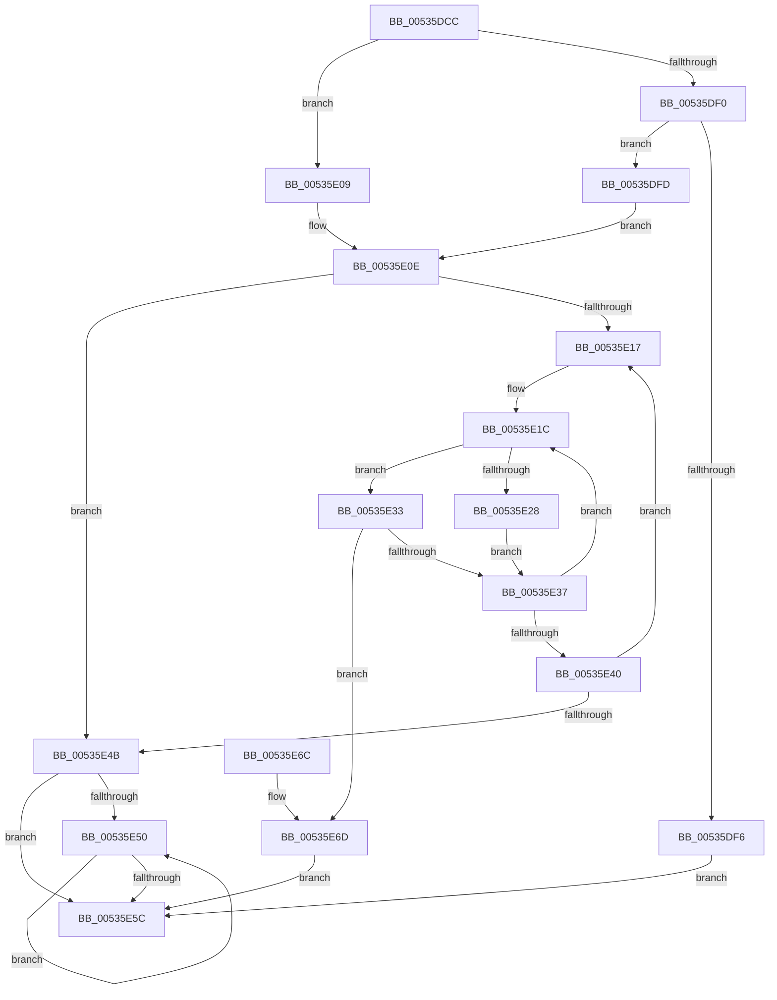

# SymCryptFdefRawGetValue

- RVA: `0x00535DCC`–`0x00535E74` (길이 `168` bytes)
- VA: `0x0000000140535DCC`
- 실행 섹션: `.text`
- PDB 이름 있음: `예`; PDB Function 태그: `아니요`
- unwind 정보 RVA: `0x000C3580`
- 디코드: `54`개 명령, `168/168` bytes 표시
- 미해석 바이트: `0` (있으면 어셈블리에 `.byte`로 보존)

> 이 문서는 커널 이미지의 기계어와 PDB 기호를 분석해 생성했습니다. 4번과 5번은 함수 원형과 자료형을 바이너리 사용 방식에서 추정한 C 해석이며 원본 소스 복구 결과는 아닙니다.

## 1. Dependencies

- 직접 호출 지점: **0**; 고유 호출 대상: **0**
- 직접 호출자로 확인된 함수: **3**
- RIP 상대 이미지 참조: **0**

### Outgoing calls
- 직접 디코드된 call 명령이 없습니다.

### Direct callers
- [SymCryptFdefDecideModulusType](SymCryptFdefDecideModulusType_function_00533F78.md) at `0x00533FF6`
- [SymCryptFdefModElementGetValue](SymCryptFdefModElementGetValue_function_005344FC.md) at `0x0053457C`
- [SymCryptFdefIntGetValue](SymCryptFdefIntGetValue_function_00535BB8.md) at `0x00535BD1`

### Static image references
- 디코드된 RIP-relative 메모리 참조가 없습니다.

## 2. Other-region calls and transfers

- 다른 실행 섹션으로 향하는 call: **0**
- 별도 외부 분기/꼬리 이동을 확인하지 못했습니다.

## 3. Assembly (complete function range)

```asm
00535DCC  48 89 5C 24 08                  mov qword ptr [rsp + 8], rbx
00535DD1  48 89 74 24 10                  mov qword ptr [rsp + 0x10], rsi
00535DD6  48 89 7C 24 18                  mov qword ptr [rsp + 0x18], rdi
00535DDB  44 8B 54 24 28                  mov r10d, dword ptr [rsp + 0x28]
00535DE0  44 8B DA                        mov r11d, edx
00535DE3  41 C1 E3 04                     shl r11d, 4
00535DE7  48 8B F9                        mov rdi, rcx
00535DEA  41 83 EA 01                     sub r10d, 1
00535DEE  74 19                           je 0x140535e09
00535DF0  41 83 FA 01                     cmp r10d, 1
00535DF4  74 07                           je 0x140535dfd
00535DF6  B8 0E 80 00 00                  mov eax, 0x800e
00535DFB  EB 5F                           jmp 0x140535e5c
00535DFD  49 FF C8                        dec r8
00535E00  4D 03 C1                        add r8, r9
00535E03  48 83 C9 FF                     or rcx, 0xffffffffffffffff
00535E07  EB 05                           jmp 0x140535e0e
00535E09  B9 01 00 00 00                  mov ecx, 1
00535E0E  33 C0                           xor eax, eax
00535E10  8B D0                           mov edx, eax
00535E12  45 85 DB                        test r11d, r11d
00535E15  74 34                           je 0x140535e4b
00535E17  8B 37                           mov esi, dword ptr [rdi]
00535E19  44 8B D0                        mov r10d, eax
00535E1C  40 0F B6 DE                     movzx ebx, sil
00535E20  C1 EE 08                        shr esi, 8
00535E23  4D 85 C9                        test r9, r9
00535E26  74 0B                           je 0x140535e33
00535E28  49 FF C9                        dec r9
00535E2B  41 88 18                        mov byte ptr [r8], bl
00535E2E  4C 03 C1                        add r8, rcx
00535E31  EB 04                           jmp 0x140535e37
00535E33  85 DB                           test ebx, ebx
00535E35  75 36                           jne 0x140535e6d
00535E37  41 FF C2                        inc r10d
00535E3A  41 83 FA 04                     cmp r10d, 4
00535E3E  72 DC                           jb 0x140535e1c
00535E40  FF C2                           inc edx
00535E42  48 83 C7 04                     add rdi, 4
00535E46  41 3B D3                        cmp edx, r11d
00535E49  72 CC                           jb 0x140535e17
00535E4B  4D 85 C9                        test r9, r9
00535E4E  74 0C                           je 0x140535e5c
00535E50  41 88 00                        mov byte ptr [r8], al
00535E53  4C 03 C1                        add r8, rcx
00535E56  49 83 E9 01                     sub r9, 1
00535E5A  75 F4                           jne 0x140535e50
00535E5C  48 8B 5C 24 08                  mov rbx, qword ptr [rsp + 8]
00535E61  48 8B 74 24 10                  mov rsi, qword ptr [rsp + 0x10]
00535E66  48 8B 7C 24 18                  mov rdi, qword ptr [rsp + 0x18]
00535E6B  C3                              ret
00535E6C  CC                              int3
00535E6D  B8 0D 80 00 00                  mov eax, 0x800d
00535E72  EB E8                           jmp 0x140535e5c
```

## 4. C-style interpretation (structured pseudocode)

```c
__int64 __fastcall SymCryptFdefRawGetValue(__int64 a1, int a2, __int64 a3, __int64 a4, unsigned int a5)
{
    __int64 result;
    __int64 v_r10;
    __int64 v_r11;
    __int64 v_rdi;
    __int64 v_rsi;
    unsigned __int64 v_stack_p10;
    unsigned __int64 v_stack_p18;
    unsigned __int64 v_stack_p8;

    v_stack_p8 = v_rbx;
    v_stack_p10 = v_rsi;
    v_stack_p18 = v_rdi;
    v_r11 = (unsigned int)(((unsigned int)(a2)) << (4));
    v_r10 = (unsigned int)(((unsigned int)(a5)) - (1));
    if (condition_is_equal) goto loc_00535E09;
    if (((unsigned int)(v_r10)) == 1) goto loc_00535DFD;
    goto loc_00535E5C;
loc_00535DFD:
    a3 = (a3) - 1;
    a3 = (a3) + (a4);
    a1 = (a1) | (-1);
    goto loc_00535E0E;
loc_00535E09:
loc_00535E0E:
    result = 0;
    if ((unsigned int)(v_r11) == 0) goto loc_00535E4B;
loc_00535E17:
loc_00535E1C:
    v_rsi = (unsigned int)(((unsigned int)(*(unsigned int *)(a1))) >> (8));
    if (a4 == 0) goto loc_00535E33;
    a4 = (a4) - 1;
    *(unsigned __int8 *)(a3) = (unsigned __int8)((unsigned __int8)((unsigned int)(*(unsigned int *)(a1))));
    a3 = (a3) + (1);
    goto loc_00535E37;
loc_00535E33:
    if ((unsigned int)((unsigned __int8)((unsigned int)(*(unsigned int *)(a1)))) != 0) goto loc_00535E6D;
loc_00535E37:
    v_r10 = (unsigned int)((0) + 1);
    if (((unsigned int)(v_r10)) < 4) goto loc_00535E1C;
    a2 = (unsigned int)((0) + 1);
    v_rdi = (a1) + (4);
    if (a2 < ((unsigned int)(v_r11))) goto loc_00535E17;
loc_00535E4B:
    if (a4 == 0) goto loc_00535E5C;
loc_00535E50:
    *(unsigned __int8 *)(a3) = 0;
    a3 = (a3) + (1);
    a4 = (a4) - (1);
    if (condition_is_not_equal) goto loc_00535E50;
loc_00535E5C:
    return result;
loc_00535E6D:
    goto loc_00535E5C;
}
```

## 5. (Beta) C Style

```c
int64_t SymCryptFdefRawGetValue(void *Arg1, int32_t Arg2, int64_t Arg3, int64_t Arg4, uint32_t Arg5)
{
    uint8_t *arg1 = (uint8_t *)Arg1;

    int64_t result;
    int64_t local_r10;
    int64_t local_r11;
    int64_t local_rdi;
    int64_t local_rsi;
    uint64_t v_stack_p10;
    uint64_t v_stack_p18;
    uint64_t v_stack_p8;

    v_stack_p8 = local_rbx;
    v_stack_p10 = local_rsi;
    v_stack_p18 = local_rdi;
    local_r11 = (uint32_t)(((uint32_t)(Arg2)) << (4));
    local_r10 = (uint32_t)(((uint32_t)(Arg5)) - (1));
    if (condition_is_equal) goto loc_00535E09;
    if (((uint32_t)(local_r10)) == 1) goto loc_00535DFD;
    goto loc_00535E5C;
loc_00535DFD:
    Arg3 = (Arg3) - 1;
    Arg3 = (Arg3) + (Arg4);
    Arg1 = (Arg1) | (-1);
    goto loc_00535E0E;
loc_00535E09:
loc_00535E0E:
    result = 0;
    if ((uint32_t)(local_r11) == 0) goto loc_00535E4B;
loc_00535E17:
loc_00535E1C:
    local_rsi = (uint32_t)(((uint32_t)(*(uint32_t *)(arg1))) >> (8));
    if (Arg4 == 0) goto loc_00535E33;
    Arg4 = (Arg4) - 1;
    *(uint8_t *)(Arg3) = (uint8_t)((uint8_t)((uint32_t)(*(uint32_t *)(arg1))));
    Arg3 = (Arg3) + (1);
    goto loc_00535E37;
loc_00535E33:
    if ((uint32_t)((uint8_t)((uint32_t)(*(uint32_t *)(arg1)))) != 0) goto loc_00535E6D;
loc_00535E37:
    local_r10 = (uint32_t)((0) + 1);
    if (((uint32_t)(local_r10)) < 4) goto loc_00535E1C;
    Arg2 = (uint32_t)((0) + 1);
    local_rdi = (Arg1) + (4);
    if (Arg2 < ((uint32_t)(local_r11))) goto loc_00535E17;
loc_00535E4B:
    if (Arg4 == 0) goto loc_00535E5C;
loc_00535E50:
    *(uint8_t *)(Arg3) = 0;
    Arg3 = (Arg3) + (1);
    Arg4 = (Arg4) - (1);
    if (condition_is_not_equal) goto loc_00535E50;
loc_00535E5C:
    return result;
loc_00535E6D:
    goto loc_00535E5C;
}
```

### 관측된 메모리 오프셋

구조체 형식이 확인되지 않은 접근은 인자 기준의 오프셋으로만 기록했습니다.

| 기준 인자 | 오프셋 표현 | 폭 (bit) | 접근 |
|---|---:|---:|---|
| `Arg1` | `+ 0x0` | `32` | `R` |

## 6. Execution-region graph

[열기: 2D/3D 그래프와 함수 탐색 컨트롤 패널](../../../control-panel.html?section=text&rva=0x00535DCC&view=graph)

- 2D 그래프는 위에서 아래로 흐르고, 3D 그래프는 빈 공간을 드래그해 회전합니다. Shift+드래그는 이동, 휠은 확대·축소, 함수 노드 선택은 대상 보고서 이동입니다.

### Static fallback


