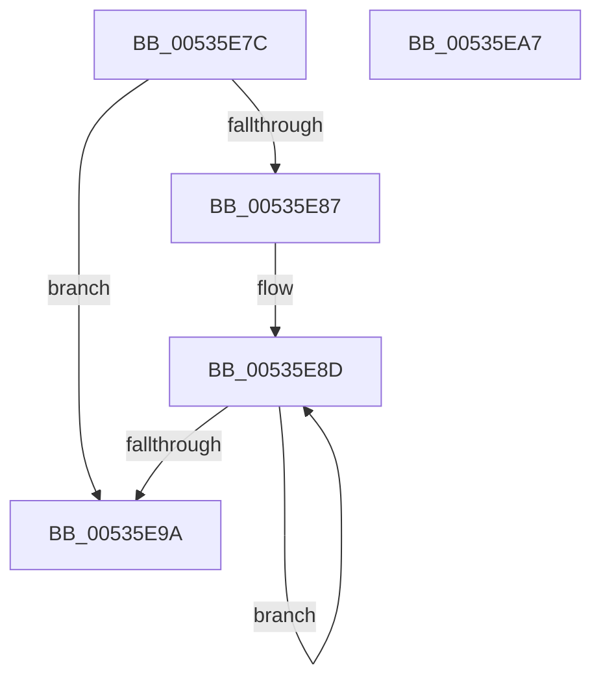

# SymCryptFdefRawIsEqualUint32

- RVA: `0x00535E7C`–`0x00535EA8` (길이 `44` bytes)
- VA: `0x0000000140535E7C`
- 실행 섹션: `.text`
- PDB 이름 있음: `예`; PDB Function 태그: `아니요`
- unwind 정보 RVA: `0x000DB714`
- 디코드: `16`개 명령, `44/44` bytes 표시
- 미해석 바이트: `0` (있으면 어셈블리에 `.byte`로 보존)

> 이 문서는 커널 이미지의 기계어와 PDB 기호를 분석해 생성했습니다. 4번과 5번은 함수 원형과 자료형을 바이너리 사용 방식에서 추정한 C 해석이며 원본 소스 복구 결과는 아닙니다.

## 1. Dependencies

- 직접 호출 지점: **0**; 고유 호출 대상: **0**
- 직접 호출자로 확인된 함수: **2**
- RIP 상대 이미지 참조: **0**

### Outgoing calls
- 직접 디코드된 call 명령이 없습니다.

### Direct callers
- [SymCryptFdefModNegGeneric](SymCryptFdefModNegGeneric_function_00534F70.md) at `0x00534FB7`
- [SymCryptFdefIntIsEqualUint32](SymCryptFdefIntIsEqualUint32_function_00535CCC.md) at `0x00535CDD`

### Static image references
- 디코드된 RIP-relative 메모리 참조가 없습니다.

## 2. Other-region calls and transfers

- 다른 실행 섹션으로 향하는 call: **0**
- 별도 외부 분기/꼬리 이동을 확인하지 못했습니다.

## 3. Assembly (complete function range)

```asm
00535E7C  44 33 01                        xor r8d, dword ptr [rcx]
00535E7F  C1 E2 04                        shl edx, 4
00535E82  83 FA 01                        cmp edx, 1
00535E85  76 13                           jbe 0x140535e9a
00535E87  48 83 C1 04                     add rcx, 4
00535E8B  FF CA                           dec edx
00535E8D  44 0B 01                        or r8d, dword ptr [rcx]
00535E90  48 8D 49 04                     lea rcx, [rcx + 4]
00535E94  48 83 EA 01                     sub rdx, 1
00535E98  75 F3                           jne 0x140535e8d
00535E9A  41 8B C0                        mov eax, r8d
00535E9D  48 F7 D8                        neg rax
00535EA0  48 C1 E8 20                     shr rax, 0x20
00535EA4  F7 D0                           not eax
00535EA6  C3                              ret
00535EA7  CC                              int3
```

## 4. C-style interpretation (structured pseudocode)

```c
__int64 __fastcall SymCryptFdefRawIsEqualUint32(__int64 a1, int a2, int a3)
{
    __int64 result;

    a3 = (unsigned int)((a3) ^ (*(unsigned int *)(a1)));
    a2 = (unsigned int)((a2) << (4));
    if (a2 <= 1) goto loc_00535E9A;
    a1 = (a1) + (4);
    a2 = (unsigned int)((a2) - 1);
loc_00535E8D:
    a3 = (unsigned int)((a3) | (*(unsigned int *)(a1)));
    a2 = (a2) - (1);
    if (condition_is_not_equal) goto loc_00535E8D;
loc_00535E9A:
    result = -((unsigned int)(a3));
    result = (result) >> (32);
    result = (unsigned int)(~(result));
    return result;
}
```

## 5. (Beta) C Style

```c
int64_t SymCryptFdefRawIsEqualUint32(void *Arg1, int32_t Arg2, int32_t Arg3)
{
    uint8_t *arg1 = (uint8_t *)Arg1;

    int64_t result;

    Arg3 = (uint32_t)((Arg3) ^ (*(uint32_t *)(arg1)));
    Arg2 = (uint32_t)((Arg2) << (4));
    if (Arg2 <= 1) goto loc_00535E9A;
    Arg1 = (Arg1) + (4);
    Arg2 = (uint32_t)((Arg2) - 1);
loc_00535E8D:
    Arg3 = (uint32_t)((Arg3) | (*(uint32_t *)(arg1)));
    Arg2 = (Arg2) - (1);
    if (condition_is_not_equal) goto loc_00535E8D;
loc_00535E9A:
    result = -((uint32_t)(Arg3));
    result = (result) >> (32);
    result = (uint32_t)(~(result));
    return result;
}
```

### 관측된 메모리 오프셋

구조체 형식이 확인되지 않은 접근은 인자 기준의 오프셋으로만 기록했습니다.

| 기준 인자 | 오프셋 표현 | 폭 (bit) | 접근 |
|---|---:|---:|---|
| `Arg1` | `+ 0x0` | `32` | `R` |
| `Arg1` | `+ 0x4` | `64` | `R` |

## 6. Execution-region graph

[열기: 2D/3D 그래프와 함수 탐색 컨트롤 패널](../../../control-panel.html?section=text&rva=0x00535E7C&view=graph)

- 2D 그래프는 위에서 아래로 흐르고, 3D 그래프는 빈 공간을 드래그해 회전합니다. Shift+드래그는 이동, 휠은 확대·축소, 함수 노드 선택은 대상 보고서 이동입니다.

### Static fallback


