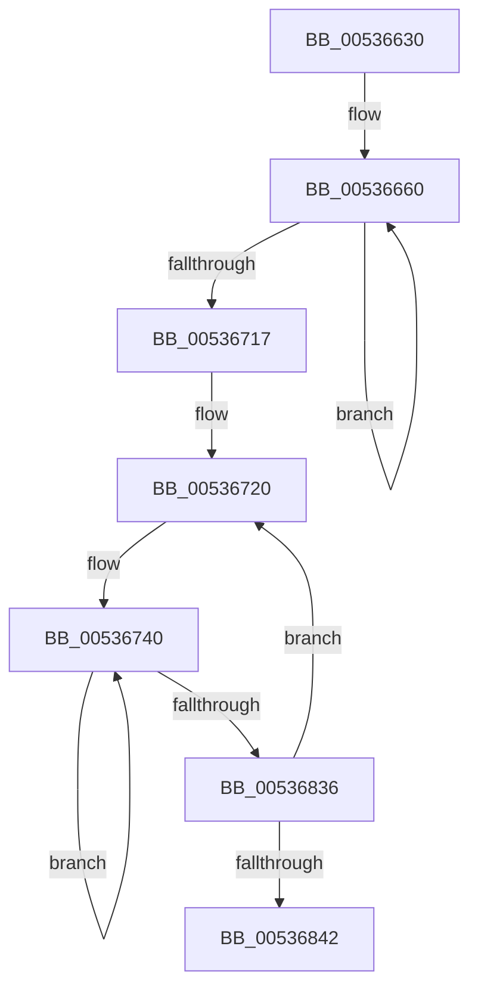

# SymCryptFdefRawMulAsm

- RVA: `0x00536630`–`0x0053684B` (길이 `539` bytes)
- VA: `0x0000000140536630`
- 실행 섹션: `.text`
- PDB 이름 있음: `예`; PDB Function 태그: `아니요`
- unwind 정보 RVA: `0x000C3548`
- 디코드: `156`개 명령, `539/539` bytes 표시
- 미해석 바이트: `0` (있으면 어셈블리에 `.byte`로 보존)

> 이 문서는 커널 이미지의 기계어와 PDB 기호를 분석해 생성했습니다. 4번과 5번은 함수 원형과 자료형을 바이너리 사용 방식에서 추정한 C 해석이며 원본 소스 복구 결과는 아닙니다.

## 1. Dependencies

- 직접 호출 지점: **0**; 고유 호출 대상: **0**
- 직접 호출자로 확인된 함수: **1**
- RIP 상대 이미지 참조: **0**

### Outgoing calls
- 직접 디코드된 call 명령이 없습니다.

### Direct callers
- [SymCryptFdefRawMul](../52/SymCryptFdefRawMul_function_0052DF1C.md) at `0x0052DF69`

### Static image references
- 디코드된 RIP-relative 메모리 참조가 없습니다.

## 2. Other-region calls and transfers

- 다른 실행 섹션으로 향하는 call: **0**
- 별도 외부 분기/꼬리 이동을 확인하지 못했습니다.

## 3. Assembly (complete function range)

```asm
00536630  48 56                           push rsi
00536632  57                              push rdi
00536633  55                              push rbp
00536634  53                              push rbx
00536635  41 54                           push r12
00536637  41 55                           push r13
00536639  4C 8B D2                        mov r10, rdx
0053663C  4C 8B 5C 24 58                  mov r11, qword ptr [rsp + 0x58]
00536641  49 C1 E2 03                     shl r10, 3
00536645  49 8B F0                        mov rsi, r8
00536648  49 8B FB                        mov rdi, r11
0053664B  48 8B 29                        mov rbp, qword ptr [rcx]
0053664E  48 33 DB                        xor rbx, rbx
00536651  4D 8B E1                        mov r12, r9
00536654  66 66 66 66 0F 1F 84 00 00 00 00 00  nop word ptr [rax + rax]
00536660  48 8B 06                        mov rax, qword ptr [rsi]
00536663  48 F7 E5                        mul rbp
00536666  4C 8B EA                        mov r13, rdx
00536669  48 03 C3                        add rax, rbx
0053666C  48 89 07                        mov qword ptr [rdi], rax
0053666F  49 83 D5 00                     adc r13, 0
00536673  48 8B 46 08                     mov rax, qword ptr [rsi + 8]
00536677  48 F7 E5                        mul rbp
0053667A  48 8B DA                        mov rbx, rdx
0053667D  49 03 C5                        add rax, r13
00536680  48 89 47 08                     mov qword ptr [rdi + 8], rax
00536684  48 83 D3 00                     adc rbx, 0
00536688  48 8B 46 10                     mov rax, qword ptr [rsi + 0x10]
0053668C  48 F7 E5                        mul rbp
0053668F  4C 8B EA                        mov r13, rdx
00536692  48 03 C3                        add rax, rbx
00536695  48 89 47 10                     mov qword ptr [rdi + 0x10], rax
00536699  49 83 D5 00                     adc r13, 0
0053669D  48 8B 46 18                     mov rax, qword ptr [rsi + 0x18]
005366A1  48 F7 E5                        mul rbp
005366A4  48 8B DA                        mov rbx, rdx
005366A7  49 03 C5                        add rax, r13
005366AA  48 89 47 18                     mov qword ptr [rdi + 0x18], rax
005366AE  48 83 D3 00                     adc rbx, 0
005366B2  48 8B 46 20                     mov rax, qword ptr [rsi + 0x20]
005366B6  48 F7 E5                        mul rbp
005366B9  4C 8B EA                        mov r13, rdx
005366BC  48 03 C3                        add rax, rbx
005366BF  48 89 47 20                     mov qword ptr [rdi + 0x20], rax
005366C3  49 83 D5 00                     adc r13, 0
005366C7  48 8B 46 28                     mov rax, qword ptr [rsi + 0x28]
005366CB  48 F7 E5                        mul rbp
005366CE  48 8B DA                        mov rbx, rdx
005366D1  49 03 C5                        add rax, r13
005366D4  48 89 47 28                     mov qword ptr [rdi + 0x28], rax
005366D8  48 83 D3 00                     adc rbx, 0
005366DC  48 8B 46 30                     mov rax, qword ptr [rsi + 0x30]
005366E0  48 F7 E5                        mul rbp
005366E3  4C 8B EA                        mov r13, rdx
005366E6  48 03 C3                        add rax, rbx
005366E9  48 89 47 30                     mov qword ptr [rdi + 0x30], rax
005366ED  49 83 D5 00                     adc r13, 0
005366F1  48 8B 46 38                     mov rax, qword ptr [rsi + 0x38]
005366F5  48 F7 E5                        mul rbp
005366F8  48 8B DA                        mov rbx, rdx
005366FB  49 03 C5                        add rax, r13
005366FE  48 89 47 38                     mov qword ptr [rdi + 0x38], rax
00536702  48 83 D3 00                     adc rbx, 0
00536706  48 8D 76 40                     lea rsi, [rsi + 0x40]
0053670A  48 8D 7F 40                     lea rdi, [rdi + 0x40]
0053670E  49 FF CC                        dec r12
00536711  0F 85 49 FF FF FF               jne 0x140536660
00536717  48 89 1F                        mov qword ptr [rdi], rbx
0053671A  49 FF CA                        dec r10
0053671D  0F 1F 00                        nop dword ptr [rax]
00536720  48 83 C1 08                     add rcx, 8
00536724  49 83 C3 08                     add r11, 8
00536728  48 8B 29                        mov rbp, qword ptr [rcx]
0053672B  49 8B F0                        mov rsi, r8
0053672E  49 8B FB                        mov rdi, r11
00536731  48 33 DB                        xor rbx, rbx
00536734  4D 8B E1                        mov r12, r9
00536737  66 0F 1F 84 00 00 00 00 00      nop word ptr [rax + rax]
00536740  48 8B 06                        mov rax, qword ptr [rsi]
00536743  48 F7 E5                        mul rbp
00536746  4C 8B EA                        mov r13, rdx
00536749  48 03 07                        add rax, qword ptr [rdi]
0053674C  49 83 D5 00                     adc r13, 0
00536750  48 03 C3                        add rax, rbx
00536753  48 89 07                        mov qword ptr [rdi], rax
00536756  49 83 D5 00                     adc r13, 0
0053675A  48 8B 46 08                     mov rax, qword ptr [rsi + 8]
0053675E  48 F7 E5                        mul rbp
00536761  48 8B DA                        mov rbx, rdx
00536764  48 03 47 08                     add rax, qword ptr [rdi + 8]
00536768  48 83 D3 00                     adc rbx, 0
0053676C  49 03 C5                        add rax, r13
0053676F  48 89 47 08                     mov qword ptr [rdi + 8], rax
00536773  48 83 D3 00                     adc rbx, 0
00536777  48 8B 46 10                     mov rax, qword ptr [rsi + 0x10]
0053677B  48 F7 E5                        mul rbp
0053677E  4C 8B EA                        mov r13, rdx
00536781  48 03 47 10                     add rax, qword ptr [rdi + 0x10]
00536785  49 83 D5 00                     adc r13, 0
00536789  48 03 C3                        add rax, rbx
0053678C  48 89 47 10                     mov qword ptr [rdi + 0x10], rax
00536790  49 83 D5 00                     adc r13, 0
00536794  48 8B 46 18                     mov rax, qword ptr [rsi + 0x18]
00536798  48 F7 E5                        mul rbp
0053679B  48 8B DA                        mov rbx, rdx
0053679E  48 03 47 18                     add rax, qword ptr [rdi + 0x18]
005367A2  48 83 D3 00                     adc rbx, 0
005367A6  49 03 C5                        add rax, r13
005367A9  48 89 47 18                     mov qword ptr [rdi + 0x18], rax
005367AD  48 83 D3 00                     adc rbx, 0
005367B1  48 8B 46 20                     mov rax, qword ptr [rsi + 0x20]
005367B5  48 F7 E5                        mul rbp
005367B8  4C 8B EA                        mov r13, rdx
005367BB  48 03 47 20                     add rax, qword ptr [rdi + 0x20]
005367BF  49 83 D5 00                     adc r13, 0
005367C3  48 03 C3                        add rax, rbx
005367C6  48 89 47 20                     mov qword ptr [rdi + 0x20], rax
005367CA  49 83 D5 00                     adc r13, 0
005367CE  48 8B 46 28                     mov rax, qword ptr [rsi + 0x28]
005367D2  48 F7 E5                        mul rbp
005367D5  48 8B DA                        mov rbx, rdx
005367D8  48 03 47 28                     add rax, qword ptr [rdi + 0x28]
005367DC  48 83 D3 00                     adc rbx, 0
005367E0  49 03 C5                        add rax, r13
005367E3  48 89 47 28                     mov qword ptr [rdi + 0x28], rax
005367E7  48 83 D3 00                     adc rbx, 0
005367EB  48 8B 46 30                     mov rax, qword ptr [rsi + 0x30]
005367EF  48 F7 E5                        mul rbp
005367F2  4C 8B EA                        mov r13, rdx
005367F5  48 03 47 30                     add rax, qword ptr [rdi + 0x30]
005367F9  49 83 D5 00                     adc r13, 0
005367FD  48 03 C3                        add rax, rbx
00536800  48 89 47 30                     mov qword ptr [rdi + 0x30], rax
00536804  49 83 D5 00                     adc r13, 0
00536808  48 8B 46 38                     mov rax, qword ptr [rsi + 0x38]
0053680C  48 F7 E5                        mul rbp
0053680F  48 8B DA                        mov rbx, rdx
00536812  48 03 47 38                     add rax, qword ptr [rdi + 0x38]
00536816  48 83 D3 00                     adc rbx, 0
0053681A  49 03 C5                        add rax, r13
0053681D  48 89 47 38                     mov qword ptr [rdi + 0x38], rax
00536821  48 83 D3 00                     adc rbx, 0
00536825  48 8D 76 40                     lea rsi, [rsi + 0x40]
00536829  48 8D 7F 40                     lea rdi, [rdi + 0x40]
0053682D  49 FF CC                        dec r12
00536830  0F 85 0A FF FF FF               jne 0x140536740
00536836  48 89 1F                        mov qword ptr [rdi], rbx
00536839  49 FF CA                        dec r10
0053683C  0F 85 DE FE FF FF               jne 0x140536720
00536842  41 5D                           pop r13
00536844  41 5C                           pop r12
00536846  5B                              pop rbx
00536847  5D                              pop rbp
00536848  5F                              pop rdi
00536849  5E                              pop rsi
0053684A  C3                              ret
```

## 4. C-style interpretation (structured pseudocode)

```c
__int64 __fastcall SymCryptFdefRawMulAsm(__int64 a1, __int64 a2, __int64 a3, __int64 a4, __int64 a5)
{
    __int64 result;
    __int64 v_r10;
    __int64 v_r11;
    __int64 v_r12;
    __int64 v_rbx;

    v_r10 = (a2) << (3);
    v_rbx = 0;
loc_00536660:
    result = (*(unsigned __int64 *)(a3)) + (0);
    *(unsigned __int64 *)(a5) = result;
    result = (*(unsigned __int64 *)(a3 + 8)) + (a2);
    *(unsigned __int64 *)(a5 + 8) = result;
    result = (*(unsigned __int64 *)(a3 + 16)) + (a2);
    *(unsigned __int64 *)(a5 + 16) = result;
    result = (*(unsigned __int64 *)(a3 + 24)) + (a2);
    *(unsigned __int64 *)(a5 + 24) = result;
    result = (*(unsigned __int64 *)(a3 + 32)) + (a2);
    *(unsigned __int64 *)(a5 + 32) = result;
    result = (*(unsigned __int64 *)(a3 + 40)) + (a2);
    *(unsigned __int64 *)(a5 + 40) = result;
    result = (*(unsigned __int64 *)(a3 + 48)) + (a2);
    *(unsigned __int64 *)(a5 + 48) = result;
    result = (*(unsigned __int64 *)(a3 + 56)) + (a2);
    *(unsigned __int64 *)(a5 + 56) = result;
    v_r12 = (a4) - 1;
    if (condition_is_not_equal) goto loc_00536660;
    *(unsigned __int64 *)(a5 + 64) = a2;
    v_r10 = (v_r10) - 1;
loc_00536720:
    a1 = (a1) + (8);
    v_r11 = (a5) + (8);
    v_rbx = 0;
loc_00536740:
    result = (*(unsigned __int64 *)(a3)) + (*(unsigned __int64 *)(v_r11));
    result = (result) + (0);
    *(unsigned __int64 *)(v_r11) = result;
    result = (*(unsigned __int64 *)(a3 + 8)) + (*(unsigned __int64 *)(v_r11 + 8));
    result = (result) + (a2);
    *(unsigned __int64 *)(v_r11 + 8) = result;
    result = (*(unsigned __int64 *)(a3 + 16)) + (*(unsigned __int64 *)(v_r11 + 16));
    result = (result) + (a2);
    *(unsigned __int64 *)(v_r11 + 16) = result;
    result = (*(unsigned __int64 *)(a3 + 24)) + (*(unsigned __int64 *)(v_r11 + 24));
    result = (result) + (a2);
    *(unsigned __int64 *)(v_r11 + 24) = result;
    result = (*(unsigned __int64 *)(a3 + 32)) + (*(unsigned __int64 *)(v_r11 + 32));
    result = (result) + (a2);
    *(unsigned __int64 *)(v_r11 + 32) = result;
    result = (*(unsigned __int64 *)(a3 + 40)) + (*(unsigned __int64 *)(v_r11 + 40));
    result = (result) + (a2);
    *(unsigned __int64 *)(v_r11 + 40) = result;
    result = (*(unsigned __int64 *)(a3 + 48)) + (*(unsigned __int64 *)(v_r11 + 48));
    result = (result) + (a2);
    *(unsigned __int64 *)(v_r11 + 48) = result;
    result = (*(unsigned __int64 *)(a3 + 56)) + (*(unsigned __int64 *)(v_r11 + 56));
    result = (result) + (a2);
    *(unsigned __int64 *)(v_r11 + 56) = result;
    v_r12 = (a4) - 1;
    if (condition_is_not_equal) goto loc_00536740;
    *(unsigned __int64 *)(v_r11 + 64) = a2;
    v_r10 = (v_r10) - 1;
    if (condition_is_not_equal) goto loc_00536720;
    return result;
}
```

## 5. (Beta) C Style

```c
int64_t SymCryptFdefRawMulAsm(void *Arg1, int64_t Arg2, void *Arg3, int64_t Arg4, void *Arg5)
{
    uint8_t *arg1 = (uint8_t *)Arg1;
    uint8_t *arg3 = (uint8_t *)Arg3;
    uint8_t *arg5 = (uint8_t *)Arg5;

    int64_t result;
    int64_t local_r10;
    int64_t local_r11;
    int64_t local_r12;
    int64_t local_rbx;

    local_r10 = (Arg2) << (3);
    local_rbx = 0;
loc_00536660:
    result = (*(uint64_t *)(arg3)) + (0);
    *(uint64_t *)(arg5) = result;
    result = (*(uint64_t *)(arg3 + 0x8)) + (Arg2);
    *(uint64_t *)(arg5 + 0x8) = result;
    result = (*(uint64_t *)(arg3 + 0x10)) + (Arg2);
    *(uint64_t *)(arg5 + 0x10) = result;
    result = (*(uint64_t *)(arg3 + 0x18)) + (Arg2);
    *(uint64_t *)(arg5 + 0x18) = result;
    result = (*(uint64_t *)(arg3 + 0x20)) + (Arg2);
    *(uint64_t *)(arg5 + 0x20) = result;
    result = (*(uint64_t *)(arg3 + 0x28)) + (Arg2);
    *(uint64_t *)(arg5 + 0x28) = result;
    result = (*(uint64_t *)(arg3 + 0x30)) + (Arg2);
    *(uint64_t *)(arg5 + 0x30) = result;
    result = (*(uint64_t *)(arg3 + 0x38)) + (Arg2);
    *(uint64_t *)(arg5 + 0x38) = result;
    local_r12 = (Arg4) - 1;
    if (condition_is_not_equal) goto loc_00536660;
    *(uint64_t *)(arg5 + 0x40) = Arg2;
    local_r10 = (local_r10) - 1;
loc_00536720:
    Arg1 = (Arg1) + (8);
    local_r11 = (Arg5) + (8);
    local_rbx = 0;
loc_00536740:
    result = (*(uint64_t *)(arg3)) + (*(uint64_t *)(local_r11));
    result = (result) + (0);
    *(uint64_t *)(local_r11) = result;
    result = (*(uint64_t *)(arg3 + 0x8)) + (*(uint64_t *)(local_r11 + 0x8));
    result = (result) + (Arg2);
    *(uint64_t *)(local_r11 + 0x8) = result;
    result = (*(uint64_t *)(arg3 + 0x10)) + (*(uint64_t *)(local_r11 + 0x10));
    result = (result) + (Arg2);
    *(uint64_t *)(local_r11 + 0x10) = result;
    result = (*(uint64_t *)(arg3 + 0x18)) + (*(uint64_t *)(local_r11 + 0x18));
    result = (result) + (Arg2);
    *(uint64_t *)(local_r11 + 0x18) = result;
    result = (*(uint64_t *)(arg3 + 0x20)) + (*(uint64_t *)(local_r11 + 0x20));
    result = (result) + (Arg2);
    *(uint64_t *)(local_r11 + 0x20) = result;
    result = (*(uint64_t *)(arg3 + 0x28)) + (*(uint64_t *)(local_r11 + 0x28));
    result = (result) + (Arg2);
    *(uint64_t *)(local_r11 + 0x28) = result;
    result = (*(uint64_t *)(arg3 + 0x30)) + (*(uint64_t *)(local_r11 + 0x30));
    result = (result) + (Arg2);
    *(uint64_t *)(local_r11 + 0x30) = result;
    result = (*(uint64_t *)(arg3 + 0x38)) + (*(uint64_t *)(local_r11 + 0x38));
    result = (result) + (Arg2);
    *(uint64_t *)(local_r11 + 0x38) = result;
    local_r12 = (Arg4) - 1;
    if (condition_is_not_equal) goto loc_00536740;
    *(uint64_t *)(local_r11 + 0x40) = Arg2;
    local_r10 = (local_r10) - 1;
    if (condition_is_not_equal) goto loc_00536720;
    return result;
}
```

### 관측된 메모리 오프셋

구조체 형식이 확인되지 않은 접근은 인자 기준의 오프셋으로만 기록했습니다.

| 기준 인자 | 오프셋 표현 | 폭 (bit) | 접근 |
|---|---:|---:|---|
| `Arg1` | `+ 0x0` | `64` | `R` |
| `Arg3` | `+ 0x0` | `64` | `R` |
| `Arg3` | `+ 0x8` | `64` | `R` |
| `Arg3` | `+ 0x10` | `64` | `R` |
| `Arg3` | `+ 0x18` | `64` | `R` |
| `Arg3` | `+ 0x20` | `64` | `R` |
| `Arg3` | `+ 0x28` | `64` | `R` |
| `Arg3` | `+ 0x30` | `64` | `R` |
| `Arg3` | `+ 0x38` | `64` | `R` |
| `Arg3` | `+ 0x40` | `64` | `R` |
| `Arg5` | `+ 0x0` | `64` | `R` |
| `Arg5` | `+ 0x0` | `64` | `W` |
| `Arg5` | `+ 0x8` | `64` | `R` |
| `Arg5` | `+ 0x8` | `64` | `W` |
| `Arg5` | `+ 0x10` | `64` | `R` |
| `Arg5` | `+ 0x10` | `64` | `W` |
| `Arg5` | `+ 0x18` | `64` | `R` |
| `Arg5` | `+ 0x18` | `64` | `W` |
| `Arg5` | `+ 0x20` | `64` | `R` |
| `Arg5` | `+ 0x20` | `64` | `W` |
| `Arg5` | `+ 0x28` | `64` | `R` |
| `Arg5` | `+ 0x28` | `64` | `W` |
| `Arg5` | `+ 0x30` | `64` | `R` |
| `Arg5` | `+ 0x30` | `64` | `W` |
| `Arg5` | `+ 0x38` | `64` | `R` |
| `Arg5` | `+ 0x38` | `64` | `W` |
| `Arg5` | `+ 0x40` | `64` | `R` |

## 6. Execution-region graph

[열기: 2D/3D 그래프와 함수 탐색 컨트롤 패널](../../../control-panel.html?section=text&rva=0x00536630&view=graph)

- 2D 그래프는 위에서 아래로 흐르고, 3D 그래프는 빈 공간을 드래그해 회전합니다. Shift+드래그는 이동, 휠은 확대·축소, 함수 노드 선택은 대상 보고서 이동입니다.

### Static fallback


