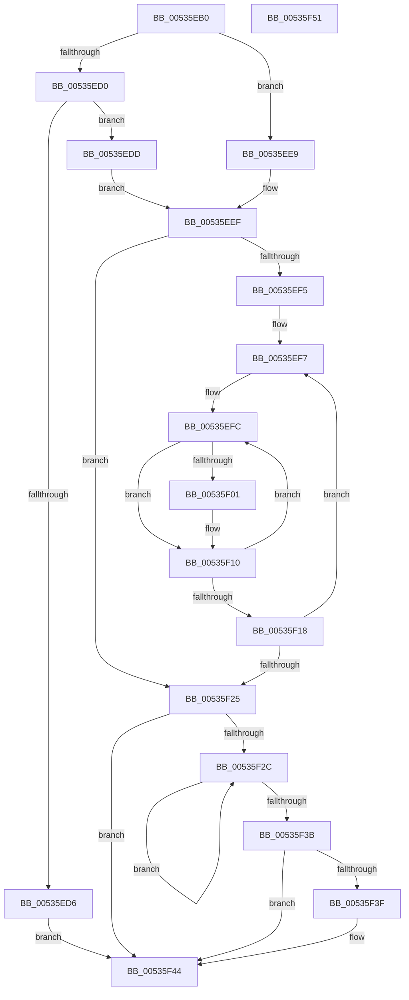

# SymCryptFdefRawSetValue

- RVA: `0x00535EB0`–`0x00535F52` (길이 `162` bytes)
- VA: `0x0000000140535EB0`
- 실행 섹션: `.text`
- PDB 이름 있음: `예`; PDB Function 태그: `아니요`
- unwind 정보 RVA: `0x000950EC`
- 디코드: `54`개 명령, `162/162` bytes 표시
- 미해석 바이트: `0` (있으면 어셈블리에 `.byte`로 보존)

> 이 문서는 커널 이미지의 기계어와 PDB 기호를 분석해 생성했습니다. 4번과 5번은 함수 원형과 자료형을 바이너리 사용 방식에서 추정한 C 해석이며 원본 소스 복구 결과는 아닙니다.

## 1. Dependencies

- 직접 호출 지점: **0**; 고유 호출 대상: **0**
- 직접 호출자로 확인된 함수: **2**
- RIP 상대 이미지 참조: **0**

### Outgoing calls
- 직접 디코드된 call 명령이 없습니다.

### Direct callers
- [SymCryptFdefModElementSetValueGeneric](SymCryptFdefModElementSetValueGeneric_function_00534638.md) at `0x005346A3`
- [SymCryptFdefIntSetValue](SymCryptFdefIntSetValue_function_00535D14.md) at `0x00535D24`

### Static image references
- 디코드된 RIP-relative 메모리 참조가 없습니다.

## 2. Other-region calls and transfers

- 다른 실행 섹션으로 향하는 call: **0**
- 별도 외부 분기/꼬리 이동을 확인하지 못했습니다.

## 3. Assembly (complete function range)

```asm
00535EB0  48 89 5C 24 08                  mov qword ptr [rsp + 8], rbx
00535EB5  48 89 7C 24 10                  mov qword ptr [rsp + 0x10], rdi
00535EBA  4C 8B D1                        mov r10, rcx
00535EBD  49 8B D9                        mov rbx, r9
00535EC0  8B 4C 24 28                     mov ecx, dword ptr [rsp + 0x28]
00535EC4  4C 8B DA                        mov r11, rdx
00535EC7  C1 E1 04                        shl ecx, 4
00535ECA  41 83 E8 01                     sub r8d, 1
00535ECE  74 19                           je 0x140535ee9
00535ED0  41 83 F8 01                     cmp r8d, 1
00535ED4  74 07                           je 0x140535edd
00535ED6  BA 0E 80 00 00                  mov edx, 0x800e
00535EDB  EB 67                           jmp 0x140535f44
00535EDD  49 FF CA                        dec r10
00535EE0  4C 03 D2                        add r10, rdx
00535EE3  49 83 C8 FF                     or r8, 0xffffffffffffffff
00535EE7  EB 06                           jmp 0x140535eef
00535EE9  41 B8 01 00 00 00               mov r8d, 1
00535EEF  33 D2                           xor edx, edx
00535EF1  85 C9                           test ecx, ecx
00535EF3  74 30                           je 0x140535f25
00535EF5  8B F9                           mov edi, ecx
00535EF7  44 8B CA                        mov r9d, edx
00535EFA  8B CA                           mov ecx, edx
00535EFC  4D 85 DB                        test r11, r11
00535EFF  74 0F                           je 0x140535f10
00535F01  41 0F B6 02                     movzx eax, byte ptr [r10]
00535F05  49 FF CB                        dec r11
00535F08  D3 E0                           shl eax, cl
00535F0A  4D 03 D0                        add r10, r8
00535F0D  44 0B C8                        or r9d, eax
00535F10  83 C1 08                        add ecx, 8
00535F13  83 F9 20                        cmp ecx, 0x20
00535F16  72 E4                           jb 0x140535efc
00535F18  44 89 0B                        mov dword ptr [rbx], r9d
00535F1B  48 83 C3 04                     add rbx, 4
00535F1F  48 83 EF 01                     sub rdi, 1
00535F23  75 D2                           jne 0x140535ef7
00535F25  8B CA                           mov ecx, edx
00535F27  4D 85 DB                        test r11, r11
00535F2A  74 18                           je 0x140535f44
00535F2C  41 0F B6 02                     movzx eax, byte ptr [r10]
00535F30  4D 03 D0                        add r10, r8
00535F33  0B C8                           or ecx, eax
00535F35  49 83 EB 01                     sub r11, 1
00535F39  75 F1                           jne 0x140535f2c
00535F3B  85 C9                           test ecx, ecx
00535F3D  74 05                           je 0x140535f44
00535F3F  BA 0D 80 00 00                  mov edx, 0x800d
00535F44  48 8B 5C 24 08                  mov rbx, qword ptr [rsp + 8]
00535F49  8B C2                           mov eax, edx
00535F4B  48 8B 7C 24 10                  mov rdi, qword ptr [rsp + 0x10]
00535F50  C3                              ret
00535F51  CC                              int3
```

## 4. C-style interpretation (structured pseudocode)

```c
__int64 __fastcall SymCryptFdefRawSetValue(__int64 a1, __int64 a2, int a3, __int64 a4, unsigned int a5)
{
    __int64 result;
    __int64 v_r10;
    __int64 v_r11;
    __int64 v_rbx;
    __int64 v_rdi;
    unsigned __int64 v_stack_p10;
    unsigned __int64 v_stack_p8;

    v_stack_p8 = v_rbx;
    v_stack_p10 = v_rdi;
    a1 = (unsigned int)(((unsigned int)(a5)) << (4));
    a3 = (unsigned int)((a3) - (1));
    if (condition_is_equal) goto loc_00535EE9;
    if (a3 == 1) goto loc_00535EDD;
    goto loc_00535F44;
loc_00535EDD:
    v_r10 = (a1) - 1;
    v_r10 = (v_r10) + ((unsigned int)(0x800EULL));
    a3 = (a3) | (-1);
    goto loc_00535EEF;
loc_00535EE9:
loc_00535EEF:
    a2 = 0;
    if ((unsigned int)(a1) == 0) goto loc_00535F25;
loc_00535EF7:
loc_00535EFC:
    v_r11 = a2;
    if (0 != 0) {
        result = *(unsigned __int8 *)(v_r10);
        v_r11 = (a2) - 1;
        result = (unsigned int)((result) << (0));
        v_r10 = (v_r10) + (1);
        a4 = (unsigned int)((0) | ((unsigned int)(result)));
    }
    a1 = (unsigned int)((0) + (8));
    if (((unsigned int)(a1)) < 32) goto loc_00535EFC;
    *(unsigned int *)(a4) = (unsigned int)(a4);
    v_rbx = (a4) + (4);
    v_rdi = ((unsigned int)((unsigned int)(a1))) - (1);
    if (condition_is_not_equal) goto loc_00535EF7;
loc_00535F25:
    if (v_r11 == 0) goto loc_00535F44;
loc_00535F2C:
    v_r10 = (v_r10) + (1);
    a1 = (unsigned int)((0) | ((unsigned int)(*(unsigned __int8 *)(v_r10))));
    v_r11 = (v_r11) - (1);
    if (condition_is_not_equal) goto loc_00535F2C;
    if ((unsigned int)(a1) != 0) {
        a2 = 0x800DULL;
    }
    return (unsigned int)((unsigned int)(a2));
}
```

## 5. (Beta) C Style

```c
int64_t SymCryptFdefRawSetValue(int64_t Arg1, int64_t Arg2, int32_t Arg3, void *Arg4, uint32_t Arg5)
{
    uint8_t *arg4 = (uint8_t *)Arg4;

    int64_t result;
    int64_t local_r10;
    int64_t local_r11;
    int64_t local_rbx;
    int64_t local_rdi;
    uint64_t v_stack_p10;
    uint64_t v_stack_p8;

    v_stack_p8 = local_rbx;
    v_stack_p10 = local_rdi;
    Arg1 = (uint32_t)(((uint32_t)(Arg5)) << (4));
    Arg3 = (uint32_t)((Arg3) - (1));
    if (condition_is_equal) goto loc_00535EE9;
    if (Arg3 == 1) goto loc_00535EDD;
    goto loc_00535F44;
loc_00535EDD:
    local_r10 = (Arg1) - 1;
    local_r10 = (local_r10) + ((uint32_t)(0x800EULL));
    Arg3 = (Arg3) | (-1);
    goto loc_00535EEF;
loc_00535EE9:
loc_00535EEF:
    Arg2 = 0;
    if ((uint32_t)(Arg1) == 0) goto loc_00535F25;
loc_00535EF7:
loc_00535EFC:
    local_r11 = Arg2;
    if (0 != 0) {
        result = *(uint8_t *)(local_r10);
        local_r11 = (Arg2) - 1;
        result = (uint32_t)((result) << (0));
        local_r10 = (local_r10) + (1);
        Arg4 = (uint32_t)((0) | ((uint32_t)(result)));
    }
    Arg1 = (uint32_t)((0) + (8));
    if (((uint32_t)(Arg1)) < 32) goto loc_00535EFC;
    *(uint32_t *)(arg4) = (uint32_t)(Arg4);
    local_rbx = (Arg4) + (4);
    local_rdi = ((uint32_t)((uint32_t)(Arg1))) - (1);
    if (condition_is_not_equal) goto loc_00535EF7;
loc_00535F25:
    if (local_r11 == 0) goto loc_00535F44;
loc_00535F2C:
    local_r10 = (local_r10) + (1);
    Arg1 = (uint32_t)((0) | ((uint32_t)(*(uint8_t *)(local_r10))));
    local_r11 = (local_r11) - (1);
    if (condition_is_not_equal) goto loc_00535F2C;
    if ((uint32_t)(Arg1) != 0) {
        Arg2 = 0x800DULL;
    }
    return (uint32_t)((uint32_t)(Arg2));
}
```

### 관측된 메모리 오프셋

구조체 형식이 확인되지 않은 접근은 인자 기준의 오프셋으로만 기록했습니다.

| 기준 인자 | 오프셋 표현 | 폭 (bit) | 접근 |
|---|---:|---:|---|
| `Arg4` | `+ 0x0` | `32` | `W` |

## 6. Execution-region graph

[열기: 2D/3D 그래프와 함수 탐색 컨트롤 패널](../../../control-panel.html?section=text&rva=0x00535EB0&view=graph)

- 2D 그래프는 위에서 아래로 흐르고, 3D 그래프는 빈 공간을 드래그해 회전합니다. Shift+드래그는 이동, 휠은 확대·축소, 함수 노드 선택은 대상 보고서 이동입니다.

### Static fallback


