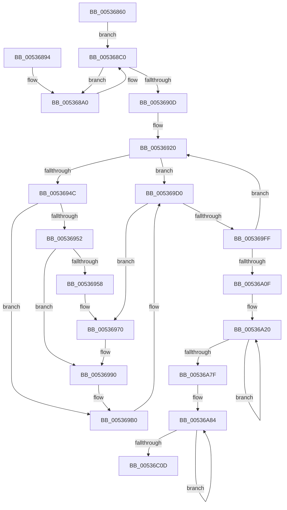

# SymCryptFdefRawSquareAsm

- RVA: `0x00536860`–`0x00536C18` (길이 `952` bytes)
- VA: `0x0000000140536860`
- 실행 섹션: `.text`
- PDB 이름 있음: `예`; PDB Function 태그: `아니요`
- unwind 정보 RVA: `0x000C3530`
- 디코드: `269`개 명령, `952/952` bytes 표시
- 미해석 바이트: `0` (있으면 어셈블리에 `.byte`로 보존)

> 이 문서는 커널 이미지의 기계어와 PDB 기호를 분석해 생성했습니다. 4번과 5번은 함수 원형과 자료형을 바이너리 사용 방식에서 추정한 C 해석이며 원본 소스 복구 결과는 아닙니다.

## 1. Dependencies

- 직접 호출 지점: **0**; 고유 호출 대상: **0**
- 직접 호출자로 확인된 함수: **1**
- RIP 상대 이미지 참조: **0**

### Outgoing calls
- 직접 디코드된 call 명령이 없습니다.

### Direct callers
- [SymCryptFdefRawSquare](../52/SymCryptFdefRawSquare_function_0052E068.md) at `0x0052E0A0`

### Static image references
- 디코드된 RIP-relative 메모리 참조가 없습니다.

## 2. Other-region calls and transfers

- 다른 실행 섹션으로 향하는 call: **0**
- 별도 외부 분기/꼬리 이동을 확인하지 못했습니다.

## 3. Assembly (complete function range)

```asm
00536860  48 56                           push rsi
00536862  57                              push rdi
00536863  55                              push rbp
00536864  53                              push rbx
00536865  41 54                           push r12
00536867  41 55                           push r13
00536869  41 56                           push r14
0053686B  4C 8B D2                        mov r10, rdx
0053686E  48 89 4C 24 40                  mov qword ptr [rsp + 0x40], rcx
00536873  4D 8B E2                        mov r12, r10
00536876  49 C1 E4 03                     shl r12, 3
0053687A  49 8B D8                        mov rbx, r8
0053687D  4C 8B C9                        mov r9, rcx
00536880  4D 8B D8                        mov r11, r8
00536883  48 8B 31                        mov rsi, qword ptr [rcx]
00536886  48 33 FF                        xor rdi, rdi
00536889  48 33 ED                        xor rbp, rbp
0053688C  4D 8B EC                        mov r13, r12
0053688F  49 89 3B                        mov qword ptr [r11], rdi
00536892  EB 2C                           jmp 0x1405368c0
00536894  66 66 66 66 0F 1F 84 00 00 00 00 00  nop word ptr [rax + rax]
005368A0  49 8B 01                        mov rax, qword ptr [r9]
005368A3  48 F7 E6                        mul rsi
005368A6  48 8B EA                        mov rbp, rdx
005368A9  48 03 C7                        add rax, rdi
005368AC  49 89 03                        mov qword ptr [r11], rax
005368AF  48 83 D5 00                     adc rbp, 0
005368B3  66 66 66 66 66 0F 1F 84 00 00 00 00 00  nop word ptr [rax + rax]
005368C0  49 8B 41 08                     mov rax, qword ptr [r9 + 8]
005368C4  48 F7 E6                        mul rsi
005368C7  48 8B FA                        mov rdi, rdx
005368CA  48 03 C5                        add rax, rbp
005368CD  49 89 43 08                     mov qword ptr [r11 + 8], rax
005368D1  48 83 D7 00                     adc rdi, 0
005368D5  49 8B 41 10                     mov rax, qword ptr [r9 + 0x10]
005368D9  48 F7 E6                        mul rsi
005368DC  48 8B EA                        mov rbp, rdx
005368DF  48 03 C7                        add rax, rdi
005368E2  49 89 43 10                     mov qword ptr [r11 + 0x10], rax
005368E6  48 83 D5 00                     adc rbp, 0
005368EA  49 8B 41 18                     mov rax, qword ptr [r9 + 0x18]
005368EE  48 F7 E6                        mul rsi
005368F1  48 8B FA                        mov rdi, rdx
005368F4  48 03 C5                        add rax, rbp
005368F7  49 89 43 18                     mov qword ptr [r11 + 0x18], rax
005368FB  48 83 D7 00                     adc rdi, 0
005368FF  4D 8D 49 20                     lea r9, [r9 + 0x20]
00536903  4D 8D 5B 20                     lea r11, [r11 + 0x20]
00536907  49 83 ED 04                     sub r13, 4
0053690B  75 93                           jne 0x1405368a0
0053690D  49 89 3B                        mov qword ptr [r11], rdi
00536910  49 FF CC                        dec r12
00536913  49 C7 C6 01 00 00 00            mov r14, 1
0053691A  66 0F 1F 44 00 00               nop word ptr [rax + rax]
00536920  48 83 C3 08                     add rbx, 8
00536924  4C 8B C9                        mov r9, rcx
00536927  4C 8B DB                        mov r11, rbx
0053692A  4A 8B 34 F1                     mov rsi, qword ptr [rcx + r14*8]
0053692E  41 FE C6                        inc r14b
00536931  4D 8B EC                        mov r13, r12
00536934  49 83 C5 02                     add r13, 2
00536938  49 83 E5 FC                     and r13, 0xfffffffffffffffc
0053693C  48 33 FF                        xor rdi, rdi
0053693F  48 33 ED                        xor rbp, rbp
00536942  41 80 FE 03                     cmp r14b, 3
00536946  0F 84 84 00 00 00               je 0x1405369d0
0053694C  41 80 FE 02                     cmp r14b, 2
00536950  74 5E                           je 0x1405369b0
00536952  41 80 FE 01                     cmp r14b, 1
00536956  74 38                           je 0x140536990
00536958  45 32 F6                        xor r14b, r14b
0053695B  48 83 C1 20                     add rcx, 0x20
0053695F  48 83 C3 20                     add rbx, 0x20
00536963  4C 8B C9                        mov r9, rcx
00536966  4C 8B DB                        mov r11, rbx
00536969  0F 1F 80 00 00 00 00            nop dword ptr [rax]
00536970  49 8B 01                        mov rax, qword ptr [r9]
00536973  48 F7 E6                        mul rsi
00536976  48 8B EA                        mov rbp, rdx
00536979  49 03 03                        add rax, qword ptr [r11]
0053697C  48 83 D5 00                     adc rbp, 0
00536980  48 03 C7                        add rax, rdi
00536983  49 89 03                        mov qword ptr [r11], rax
00536986  48 83 D5 00                     adc rbp, 0
0053698A  66 0F 1F 44 00 00               nop word ptr [rax + rax]
00536990  49 8B 41 08                     mov rax, qword ptr [r9 + 8]
00536994  48 F7 E6                        mul rsi
00536997  48 8B FA                        mov rdi, rdx
0053699A  49 03 43 08                     add rax, qword ptr [r11 + 8]
0053699E  48 83 D7 00                     adc rdi, 0
005369A2  48 03 C5                        add rax, rbp
005369A5  49 89 43 08                     mov qword ptr [r11 + 8], rax
005369A9  48 83 D7 00                     adc rdi, 0
005369AD  0F 1F 00                        nop dword ptr [rax]
005369B0  49 8B 41 10                     mov rax, qword ptr [r9 + 0x10]
005369B4  48 F7 E6                        mul rsi
005369B7  48 8B EA                        mov rbp, rdx
005369BA  49 03 43 10                     add rax, qword ptr [r11 + 0x10]
005369BE  48 83 D5 00                     adc rbp, 0
005369C2  48 03 C7                        add rax, rdi
005369C5  49 89 43 10                     mov qword ptr [r11 + 0x10], rax
005369C9  48 83 D5 00                     adc rbp, 0
005369CD  0F 1F 00                        nop dword ptr [rax]
005369D0  49 8B 41 18                     mov rax, qword ptr [r9 + 0x18]
005369D4  48 F7 E6                        mul rsi
005369D7  48 8B FA                        mov rdi, rdx
005369DA  49 03 43 18                     add rax, qword ptr [r11 + 0x18]
005369DE  48 83 D7 00                     adc rdi, 0
005369E2  48 03 C5                        add rax, rbp
005369E5  49 89 43 18                     mov qword ptr [r11 + 0x18], rax
005369E9  48 83 D7 00                     adc rdi, 0
005369ED  4D 8D 49 20                     lea r9, [r9 + 0x20]
005369F1  4D 8D 5B 20                     lea r11, [r11 + 0x20]
005369F5  49 83 ED 04                     sub r13, 4
005369F9  0F 85 71 FF FF FF               jne 0x140536970
005369FF  49 89 3B                        mov qword ptr [r11], rdi
00536A02  49 FF CC                        dec r12
00536A05  49 83 FC 01                     cmp r12, 1
00536A09  0F 85 11 FF FF FF               jne 0x140536920
00536A0F  48 33 D2                        xor rdx, rdx
00536A12  48 89 53 28                     mov qword ptr [rbx + 0x28], rdx
00536A16  4D 8B E2                        mov r12, r10
00536A19  4D 8B D8                        mov r11, r8
00536A1C  49 D1 E4                        shl r12, 1
00536A1F  90                              nop
00536A20  49 8B 03                        mov rax, qword ptr [r11]
00536A23  48 13 C0                        adc rax, rax
00536A26  49 89 03                        mov qword ptr [r11], rax
00536A29  49 8B 43 08                     mov rax, qword ptr [r11 + 8]
00536A2D  48 13 C0                        adc rax, rax
00536A30  49 89 43 08                     mov qword ptr [r11 + 8], rax
00536A34  49 8B 43 10                     mov rax, qword ptr [r11 + 0x10]
00536A38  48 13 C0                        adc rax, rax
00536A3B  49 89 43 10                     mov qword ptr [r11 + 0x10], rax
00536A3F  49 8B 43 18                     mov rax, qword ptr [r11 + 0x18]
00536A43  48 13 C0                        adc rax, rax
00536A46  49 89 43 18                     mov qword ptr [r11 + 0x18], rax
00536A4A  49 8B 43 20                     mov rax, qword ptr [r11 + 0x20]
00536A4E  48 13 C0                        adc rax, rax
00536A51  49 89 43 20                     mov qword ptr [r11 + 0x20], rax
00536A55  49 8B 43 28                     mov rax, qword ptr [r11 + 0x28]
00536A59  48 13 C0                        adc rax, rax
00536A5C  49 89 43 28                     mov qword ptr [r11 + 0x28], rax
00536A60  49 8B 43 30                     mov rax, qword ptr [r11 + 0x30]
00536A64  48 13 C0                        adc rax, rax
00536A67  49 89 43 30                     mov qword ptr [r11 + 0x30], rax
00536A6B  49 8B 43 38                     mov rax, qword ptr [r11 + 0x38]
00536A6F  48 13 C0                        adc rax, rax
00536A72  49 89 43 38                     mov qword ptr [r11 + 0x38], rax
00536A76  4D 8D 5B 40                     lea r11, [r11 + 0x40]
00536A7A  49 FF CC                        dec r12
00536A7D  75 A1                           jne 0x140536a20
00536A7F  48 8B 4C 24 40                  mov rcx, qword ptr [rsp + 0x40]
00536A84  48 8B 01                        mov rax, qword ptr [rcx]
00536A87  48 F7 E0                        mul rax
00536A8A  49 03 00                        add rax, qword ptr [r8]
00536A8D  48 83 D2 00                     adc rdx, 0
00536A91  49 03 C4                        add rax, r12
00536A94  48 83 D2 00                     adc rdx, 0
00536A98  49 89 00                        mov qword ptr [r8], rax
00536A9B  48 8B C2                        mov rax, rdx
00536A9E  48 33 D2                        xor rdx, rdx
00536AA1  49 03 40 08                     add rax, qword ptr [r8 + 8]
00536AA5  48 83 D2 00                     adc rdx, 0
00536AA9  49 89 40 08                     mov qword ptr [r8 + 8], rax
00536AAD  4C 8B E2                        mov r12, rdx
00536AB0  48 8B 41 08                     mov rax, qword ptr [rcx + 8]
00536AB4  48 F7 E0                        mul rax
00536AB7  49 03 40 10                     add rax, qword ptr [r8 + 0x10]
00536ABB  48 83 D2 00                     adc rdx, 0
00536ABF  49 03 C4                        add rax, r12
00536AC2  48 83 D2 00                     adc rdx, 0
00536AC6  49 89 40 10                     mov qword ptr [r8 + 0x10], rax
00536ACA  48 8B C2                        mov rax, rdx
00536ACD  48 33 D2                        xor rdx, rdx
00536AD0  49 03 40 18                     add rax, qword ptr [r8 + 0x18]
00536AD4  48 83 D2 00                     adc rdx, 0
00536AD8  49 89 40 18                     mov qword ptr [r8 + 0x18], rax
00536ADC  4C 8B E2                        mov r12, rdx
00536ADF  48 8B 41 10                     mov rax, qword ptr [rcx + 0x10]
00536AE3  48 F7 E0                        mul rax
00536AE6  49 03 40 20                     add rax, qword ptr [r8 + 0x20]
00536AEA  48 83 D2 00                     adc rdx, 0
00536AEE  49 03 C4                        add rax, r12
00536AF1  48 83 D2 00                     adc rdx, 0
00536AF5  49 89 40 20                     mov qword ptr [r8 + 0x20], rax
00536AF9  48 8B C2                        mov rax, rdx
00536AFC  48 33 D2                        xor rdx, rdx
00536AFF  49 03 40 28                     add rax, qword ptr [r8 + 0x28]
00536B03  48 83 D2 00                     adc rdx, 0
00536B07  49 89 40 28                     mov qword ptr [r8 + 0x28], rax
00536B0B  4C 8B E2                        mov r12, rdx
00536B0E  48 8B 41 18                     mov rax, qword ptr [rcx + 0x18]
00536B12  48 F7 E0                        mul rax
00536B15  49 03 40 30                     add rax, qword ptr [r8 + 0x30]
00536B19  48 83 D2 00                     adc rdx, 0
00536B1D  49 03 C4                        add rax, r12
00536B20  48 83 D2 00                     adc rdx, 0
00536B24  49 89 40 30                     mov qword ptr [r8 + 0x30], rax
00536B28  48 8B C2                        mov rax, rdx
00536B2B  48 33 D2                        xor rdx, rdx
00536B2E  49 03 40 38                     add rax, qword ptr [r8 + 0x38]
00536B32  48 83 D2 00                     adc rdx, 0
00536B36  49 89 40 38                     mov qword ptr [r8 + 0x38], rax
00536B3A  4C 8B E2                        mov r12, rdx
00536B3D  48 8B 41 20                     mov rax, qword ptr [rcx + 0x20]
00536B41  48 F7 E0                        mul rax
00536B44  49 03 40 40                     add rax, qword ptr [r8 + 0x40]
00536B48  48 83 D2 00                     adc rdx, 0
00536B4C  49 03 C4                        add rax, r12
00536B4F  48 83 D2 00                     adc rdx, 0
00536B53  49 89 40 40                     mov qword ptr [r8 + 0x40], rax
00536B57  48 8B C2                        mov rax, rdx
00536B5A  48 33 D2                        xor rdx, rdx
00536B5D  49 03 40 48                     add rax, qword ptr [r8 + 0x48]
00536B61  48 83 D2 00                     adc rdx, 0
00536B65  49 89 40 48                     mov qword ptr [r8 + 0x48], rax
00536B69  4C 8B E2                        mov r12, rdx
00536B6C  48 8B 41 28                     mov rax, qword ptr [rcx + 0x28]
00536B70  48 F7 E0                        mul rax
00536B73  49 03 40 50                     add rax, qword ptr [r8 + 0x50]
00536B77  48 83 D2 00                     adc rdx, 0
00536B7B  49 03 C4                        add rax, r12
00536B7E  48 83 D2 00                     adc rdx, 0
00536B82  49 89 40 50                     mov qword ptr [r8 + 0x50], rax
00536B86  48 8B C2                        mov rax, rdx
00536B89  48 33 D2                        xor rdx, rdx
00536B8C  49 03 40 58                     add rax, qword ptr [r8 + 0x58]
00536B90  48 83 D2 00                     adc rdx, 0
00536B94  49 89 40 58                     mov qword ptr [r8 + 0x58], rax
00536B98  4C 8B E2                        mov r12, rdx
00536B9B  48 8B 41 30                     mov rax, qword ptr [rcx + 0x30]
00536B9F  48 F7 E0                        mul rax
00536BA2  49 03 40 60                     add rax, qword ptr [r8 + 0x60]
00536BA6  48 83 D2 00                     adc rdx, 0
00536BAA  49 03 C4                        add rax, r12
00536BAD  48 83 D2 00                     adc rdx, 0
00536BB1  49 89 40 60                     mov qword ptr [r8 + 0x60], rax
00536BB5  48 8B C2                        mov rax, rdx
00536BB8  48 33 D2                        xor rdx, rdx
00536BBB  49 03 40 68                     add rax, qword ptr [r8 + 0x68]
00536BBF  48 83 D2 00                     adc rdx, 0
00536BC3  49 89 40 68                     mov qword ptr [r8 + 0x68], rax
00536BC7  4C 8B E2                        mov r12, rdx
00536BCA  48 8B 41 38                     mov rax, qword ptr [rcx + 0x38]
00536BCE  48 F7 E0                        mul rax
00536BD1  49 03 40 70                     add rax, qword ptr [r8 + 0x70]
00536BD5  48 83 D2 00                     adc rdx, 0
00536BD9  49 03 C4                        add rax, r12
00536BDC  48 83 D2 00                     adc rdx, 0
00536BE0  49 89 40 70                     mov qword ptr [r8 + 0x70], rax
00536BE4  48 8B C2                        mov rax, rdx
00536BE7  48 33 D2                        xor rdx, rdx
00536BEA  49 03 40 78                     add rax, qword ptr [r8 + 0x78]
00536BEE  48 83 D2 00                     adc rdx, 0
00536BF2  49 89 40 78                     mov qword ptr [r8 + 0x78], rax
00536BF6  4C 8B E2                        mov r12, rdx
00536BF9  48 83 C1 40                     add rcx, 0x40
00536BFD  49 81 C0 80 00 00 00            add r8, 0x80
00536C04  49 FF CA                        dec r10
00536C07  0F 85 77 FE FF FF               jne 0x140536a84
00536C0D  41 5E                           pop r14
00536C0F  41 5D                           pop r13
00536C11  41 5C                           pop r12
00536C13  5B                              pop rbx
00536C14  5D                              pop rbp
00536C15  5F                              pop rdi
00536C16  5E                              pop rsi
00536C17  C3                              ret
```

## 4. C-style interpretation (structured pseudocode)

```c
__int64 __fastcall SymCryptFdefRawSquareAsm(__int64 a1, __int64 a2, __int64 a3)
{
    __int64 result;
    __int64 v_r10;
    __int64 v_r12;
    __int64 v_r13;
    __int64 v_r14;
    __int64 v_rbp;
    __int64 v_rbx;
    __int64 v_rdi;
    unsigned __int64 v_stack_p8;

    v_stack_p8 = a1;
    v_r12 = (a2) << (3);
    v_rdi = 0;
    v_rbp = 0;
    *(unsigned __int64 *)(a3) = 0;
    goto loc_005368C0;
loc_005368A0:
    result = (*(unsigned __int64 *)(a1)) + (0);
    *(unsigned __int64 *)(a3) = result;
loc_005368C0:
    result = (*(unsigned __int64 *)(a1 + 8)) + (a2);
    *(unsigned __int64 *)(a3 + 8) = result;
    result = (*(unsigned __int64 *)(a1 + 16)) + (a2);
    *(unsigned __int64 *)(a3 + 16) = result;
    result = (*(unsigned __int64 *)(a1 + 24)) + (a2);
    *(unsigned __int64 *)(a3 + 24) = result;
    v_r13 = (v_r12) - (4);
    if (condition_is_not_equal) goto loc_005368A0;
    *(unsigned __int64 *)(a3 + 32) = a2;
    v_r12 = (v_r12) - 1;
loc_00536920:
    v_rbx = (a3) + (8);
    v_r14 = (unsigned __int8)((1) + 1);
    v_r13 = (v_r12) + (2);
    v_r13 = (v_r13) & (-4);
    v_rdi = 0;
    v_rbp = 0;
    if (((unsigned __int8)(v_r14)) == 3) goto loc_005369D0;
    if (((unsigned __int8)(v_r14)) == 2) goto loc_005369B0;
    if (((unsigned __int8)(v_r14)) == 1) goto loc_00536990;
    v_r14 = 0;
    a1 = (a1) + (32);
    v_rbx = (v_rbx) + (32);
loc_00536970:
    result = (*(unsigned __int64 *)(a1)) + (*(unsigned __int64 *)(v_rbx));
    result = (result) + (0);
    *(unsigned __int64 *)(v_rbx) = result;
loc_00536990:
    result = (*(unsigned __int64 *)(a1 + 8)) + (*(unsigned __int64 *)(v_rbx + 8));
    result = (result) + (a2);
    *(unsigned __int64 *)(v_rbx + 8) = result;
loc_005369B0:
    result = (*(unsigned __int64 *)(a1 + 16)) + (*(unsigned __int64 *)(v_rbx + 16));
    result = (result) + (a2);
    *(unsigned __int64 *)(v_rbx + 16) = result;
loc_005369D0:
    result = (*(unsigned __int64 *)(a1 + 24)) + (*(unsigned __int64 *)(v_rbx + 24));
    result = (result) + (a2);
    *(unsigned __int64 *)(v_rbx + 24) = result;
    v_r13 = (v_r13) - (4);
    if (condition_is_not_equal) goto loc_00536970;
    *(unsigned __int64 *)(v_rbx + 32) = a2;
    v_r12 = (v_r12) - 1;
    if (v_r12 != 1) goto loc_00536920;
    a2 = 0;
    *(unsigned __int64 *)(v_rbx + 40) = 0;
    v_r12 = (0) << (1);
loc_00536A20:
    *(unsigned __int64 *)(a3) = *(unsigned __int64 *)(a3);
    *(unsigned __int64 *)(a3 + 8) = *(unsigned __int64 *)(a3 + 8);
    *(unsigned __int64 *)(a3 + 16) = *(unsigned __int64 *)(a3 + 16);
    *(unsigned __int64 *)(a3 + 24) = *(unsigned __int64 *)(a3 + 24);
    *(unsigned __int64 *)(a3 + 32) = *(unsigned __int64 *)(a3 + 32);
    *(unsigned __int64 *)(a3 + 40) = *(unsigned __int64 *)(a3 + 40);
    *(unsigned __int64 *)(a3 + 48) = *(unsigned __int64 *)(a3 + 48);
    *(unsigned __int64 *)(a3 + 56) = *(unsigned __int64 *)(a3 + 56);
    v_r12 = (v_r12) - 1;
    if (condition_is_not_equal) goto loc_00536A20;
loc_00536A84:
    result = (*(unsigned __int64 *)(v_stack_p8)) + (*(unsigned __int64 *)(a3));
    result = (result) + (v_r12);
    *(unsigned __int64 *)(a3) = result;
    a2 = 0;
    result = (0) + (*(unsigned __int64 *)(a3 + 8));
    *(unsigned __int64 *)(a3 + 8) = result;
    result = (*(unsigned __int64 *)(v_stack_p8 + 8)) + (*(unsigned __int64 *)(a3 + 16));
    result = (result) + (0);
    *(unsigned __int64 *)(a3 + 16) = result;
    a2 = 0;
    result = (0) + (*(unsigned __int64 *)(a3 + 24));
    *(unsigned __int64 *)(a3 + 24) = result;
    result = (*(unsigned __int64 *)(v_stack_p8 + 16)) + (*(unsigned __int64 *)(a3 + 32));
    result = (result) + (0);
    *(unsigned __int64 *)(a3 + 32) = result;
    a2 = 0;
    result = (0) + (*(unsigned __int64 *)(a3 + 40));
    *(unsigned __int64 *)(a3 + 40) = result;
    result = (*(unsigned __int64 *)(v_stack_p8 + 24)) + (*(unsigned __int64 *)(a3 + 48));
    result = (result) + (0);
    *(unsigned __int64 *)(a3 + 48) = result;
    a2 = 0;
    result = (0) + (*(unsigned __int64 *)(a3 + 56));
    *(unsigned __int64 *)(a3 + 56) = result;
    result = (*(unsigned __int64 *)(v_stack_p8 + 32)) + (*(unsigned __int64 *)(a3 + 64));
    result = (result) + (0);
    *(unsigned __int64 *)(a3 + 64) = result;
    a2 = 0;
    result = (0) + (*(unsigned __int64 *)(a3 + 72));
    *(unsigned __int64 *)(a3 + 72) = result;
    result = (*(unsigned __int64 *)(v_stack_p8 + 40)) + (*(unsigned __int64 *)(a3 + 80));
    result = (result) + (0);
    *(unsigned __int64 *)(a3 + 80) = result;
    a2 = 0;
    result = (0) + (*(unsigned __int64 *)(a3 + 88));
    *(unsigned __int64 *)(a3 + 88) = result;
    result = (*(unsigned __int64 *)(v_stack_p8 + 48)) + (*(unsigned __int64 *)(a3 + 96));
    result = (result) + (0);
    *(unsigned __int64 *)(a3 + 96) = result;
    a2 = 0;
    result = (0) + (*(unsigned __int64 *)(a3 + 104));
    *(unsigned __int64 *)(a3 + 104) = result;
    result = (*(unsigned __int64 *)(v_stack_p8 + 56)) + (*(unsigned __int64 *)(a3 + 112));
    result = (result) + (0);
    *(unsigned __int64 *)(a3 + 112) = result;
    a2 = 0;
    result = (0) + (*(unsigned __int64 *)(a3 + 120));
    *(unsigned __int64 *)(a3 + 120) = result;
    a1 = (v_stack_p8) + (64);
    a3 = (a3) + (128);
    v_r10 = (a2) - 1;
    if (condition_is_not_equal) goto loc_00536A84;
    return result;
}
```

## 5. (Beta) C Style

```c
int64_t SymCryptFdefRawSquareAsm(void *Arg1, int64_t Arg2, void *Arg3)
{
    uint8_t *arg1 = (uint8_t *)Arg1;
    uint8_t *arg3 = (uint8_t *)Arg3;

    int64_t result;
    int64_t local_r10;
    int64_t local_r12;
    int64_t local_r13;
    int64_t local_r14;
    int64_t local_rbp;
    int64_t local_rbx;
    int64_t local_rdi;
    uint64_t v_stack_p8;

    v_stack_p8 = Arg1;
    local_r12 = (Arg2) << (3);
    local_rdi = 0;
    local_rbp = 0;
    *(uint64_t *)(arg3) = 0;
    goto loc_005368C0;
loc_005368A0:
    result = (*(uint64_t *)(arg1)) + (0);
    *(uint64_t *)(arg3) = result;
loc_005368C0:
    result = (*(uint64_t *)(arg1 + 0x8)) + (Arg2);
    *(uint64_t *)(arg3 + 0x8) = result;
    result = (*(uint64_t *)(arg1 + 0x10)) + (Arg2);
    *(uint64_t *)(arg3 + 0x10) = result;
    result = (*(uint64_t *)(arg1 + 0x18)) + (Arg2);
    *(uint64_t *)(arg3 + 0x18) = result;
    local_r13 = (local_r12) - (4);
    if (condition_is_not_equal) goto loc_005368A0;
    *(uint64_t *)(arg3 + 0x20) = Arg2;
    local_r12 = (local_r12) - 1;
loc_00536920:
    local_rbx = (Arg3) + (8);
    local_r14 = (uint8_t)((1) + 1);
    local_r13 = (local_r12) + (2);
    local_r13 = (local_r13) & (-4);
    local_rdi = 0;
    local_rbp = 0;
    if (((uint8_t)(local_r14)) == 3) goto loc_005369D0;
    if (((uint8_t)(local_r14)) == 2) goto loc_005369B0;
    if (((uint8_t)(local_r14)) == 1) goto loc_00536990;
    local_r14 = 0;
    Arg1 = (Arg1) + (32);
    local_rbx = (local_rbx) + (32);
loc_00536970:
    result = (*(uint64_t *)(arg1)) + (*(uint64_t *)(local_rbx));
    result = (result) + (0);
    *(uint64_t *)(local_rbx) = result;
loc_00536990:
    result = (*(uint64_t *)(arg1 + 0x8)) + (*(uint64_t *)(local_rbx + 0x8));
    result = (result) + (Arg2);
    *(uint64_t *)(local_rbx + 0x8) = result;
loc_005369B0:
    result = (*(uint64_t *)(arg1 + 0x10)) + (*(uint64_t *)(local_rbx + 0x10));
    result = (result) + (Arg2);
    *(uint64_t *)(local_rbx + 0x10) = result;
loc_005369D0:
    result = (*(uint64_t *)(arg1 + 0x18)) + (*(uint64_t *)(local_rbx + 0x18));
    result = (result) + (Arg2);
    *(uint64_t *)(local_rbx + 0x18) = result;
    local_r13 = (local_r13) - (4);
    if (condition_is_not_equal) goto loc_00536970;
    *(uint64_t *)(local_rbx + 0x20) = Arg2;
    local_r12 = (local_r12) - 1;
    if (local_r12 != 1) goto loc_00536920;
    Arg2 = 0;
    *(uint64_t *)(local_rbx + 0x28) = 0;
    local_r12 = (0) << (1);
loc_00536A20:
    *(uint64_t *)(arg3) = *(uint64_t *)(arg3);
    *(uint64_t *)(arg3 + 0x8) = *(uint64_t *)(arg3 + 0x8);
    *(uint64_t *)(arg3 + 0x10) = *(uint64_t *)(arg3 + 0x10);
    *(uint64_t *)(arg3 + 0x18) = *(uint64_t *)(arg3 + 0x18);
    *(uint64_t *)(arg3 + 0x20) = *(uint64_t *)(arg3 + 0x20);
    *(uint64_t *)(arg3 + 0x28) = *(uint64_t *)(arg3 + 0x28);
    *(uint64_t *)(arg3 + 0x30) = *(uint64_t *)(arg3 + 0x30);
    *(uint64_t *)(arg3 + 0x38) = *(uint64_t *)(arg3 + 0x38);
    local_r12 = (local_r12) - 1;
    if (condition_is_not_equal) goto loc_00536A20;
loc_00536A84:
    result = (*(uint64_t *)(v_stack_p8)) + (*(uint64_t *)(arg3));
    result = (result) + (local_r12);
    *(uint64_t *)(arg3) = result;
    Arg2 = 0;
    result = (0) + (*(uint64_t *)(arg3 + 0x8));
    *(uint64_t *)(arg3 + 0x8) = result;
    result = (*(uint64_t *)(v_stack_p8 + 0x8)) + (*(uint64_t *)(arg3 + 0x10));
    result = (result) + (0);
    *(uint64_t *)(arg3 + 0x10) = result;
    Arg2 = 0;
    result = (0) + (*(uint64_t *)(arg3 + 0x18));
    *(uint64_t *)(arg3 + 0x18) = result;
    result = (*(uint64_t *)(v_stack_p8 + 0x10)) + (*(uint64_t *)(arg3 + 0x20));
    result = (result) + (0);
    *(uint64_t *)(arg3 + 0x20) = result;
    Arg2 = 0;
    result = (0) + (*(uint64_t *)(arg3 + 0x28));
    *(uint64_t *)(arg3 + 0x28) = result;
    result = (*(uint64_t *)(v_stack_p8 + 0x18)) + (*(uint64_t *)(arg3 + 0x30));
    result = (result) + (0);
    *(uint64_t *)(arg3 + 0x30) = result;
    Arg2 = 0;
    result = (0) + (*(uint64_t *)(arg3 + 0x38));
    *(uint64_t *)(arg3 + 0x38) = result;
    result = (*(uint64_t *)(v_stack_p8 + 0x20)) + (*(uint64_t *)(arg3 + 0x40));
    result = (result) + (0);
    *(uint64_t *)(arg3 + 0x40) = result;
    Arg2 = 0;
    result = (0) + (*(uint64_t *)(arg3 + 0x48));
    *(uint64_t *)(arg3 + 0x48) = result;
    result = (*(uint64_t *)(v_stack_p8 + 0x28)) + (*(uint64_t *)(arg3 + 0x50));
    result = (result) + (0);
    *(uint64_t *)(arg3 + 0x50) = result;
    Arg2 = 0;
    result = (0) + (*(uint64_t *)(arg3 + 0x58));
    *(uint64_t *)(arg3 + 0x58) = result;
    result = (*(uint64_t *)(v_stack_p8 + 0x30)) + (*(uint64_t *)(arg3 + 0x60));
    result = (result) + (0);
    *(uint64_t *)(arg3 + 0x60) = result;
    Arg2 = 0;
    result = (0) + (*(uint64_t *)(arg3 + 0x68));
    *(uint64_t *)(arg3 + 0x68) = result;
    result = (*(uint64_t *)(v_stack_p8 + 0x38)) + (*(uint64_t *)(arg3 + 0x70));
    result = (result) + (0);
    *(uint64_t *)(arg3 + 0x70) = result;
    Arg2 = 0;
    result = (0) + (*(uint64_t *)(arg3 + 0x78));
    *(uint64_t *)(arg3 + 0x78) = result;
    Arg1 = (v_stack_p8) + (64);
    Arg3 = (Arg3) + (128);
    local_r10 = (Arg2) - 1;
    if (condition_is_not_equal) goto loc_00536A84;
    return result;
}
```

### 관측된 메모리 오프셋

구조체 형식이 확인되지 않은 접근은 인자 기준의 오프셋으로만 기록했습니다.

| 기준 인자 | 오프셋 표현 | 폭 (bit) | 접근 |
|---|---:|---:|---|
| `Arg1` | `+ 0x0` | `64` | `R` |
| `Arg1` | `+ 0x0 + r14*8` | `64` | `R` |
| `Arg1` | `+ 0x8` | `64` | `R` |
| `Arg1` | `+ 0x10` | `64` | `R` |
| `Arg1` | `+ 0x18` | `64` | `R` |
| `Arg1` | `+ 0x20` | `64` | `R` |
| `Arg3` | `+ 0x0` | `64` | `R` |
| `Arg3` | `+ 0x0` | `64` | `W` |
| `Arg3` | `+ 0x8` | `64` | `R` |
| `Arg3` | `+ 0x8` | `64` | `W` |
| `Arg3` | `+ 0x10` | `64` | `R` |
| `Arg3` | `+ 0x10` | `64` | `W` |
| `Arg3` | `+ 0x18` | `64` | `R` |
| `Arg3` | `+ 0x18` | `64` | `W` |
| `Arg3` | `+ 0x20` | `64` | `R` |
| `Arg3` | `+ 0x20` | `64` | `W` |
| `Arg3` | `+ 0x28` | `64` | `R` |
| `Arg3` | `+ 0x28` | `64` | `W` |
| `Arg3` | `+ 0x30` | `64` | `R` |
| `Arg3` | `+ 0x30` | `64` | `W` |
| `Arg3` | `+ 0x38` | `64` | `R` |
| `Arg3` | `+ 0x38` | `64` | `W` |
| `Arg3` | `+ 0x40` | `64` | `R` |
| `Arg3` | `+ 0x40` | `64` | `W` |
| `Arg3` | `+ 0x48` | `64` | `R` |
| `Arg3` | `+ 0x48` | `64` | `W` |
| `Arg3` | `+ 0x50` | `64` | `R` |
| `Arg3` | `+ 0x50` | `64` | `W` |
| `Arg3` | `+ 0x58` | `64` | `R` |
| `Arg3` | `+ 0x58` | `64` | `W` |
| `Arg3` | `+ 0x60` | `64` | `R` |
| `Arg3` | `+ 0x60` | `64` | `W` |

추가 오프셋 6개는 표에서 생략했습니다.

## 6. Execution-region graph

[열기: 2D/3D 그래프와 함수 탐색 컨트롤 패널](../../../control-panel.html?section=text&rva=0x00536860&view=graph)

- 2D 그래프는 위에서 아래로 흐르고, 3D 그래프는 빈 공간을 드래그해 회전합니다. Shift+드래그는 이동, 휠은 확대·축소, 함수 노드 선택은 대상 보고서 이동입니다.

### Static fallback


