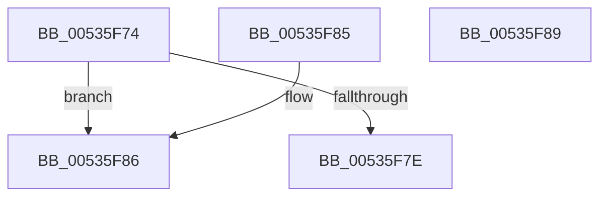

# SymCryptFdefSizeofIntFromDigits

- RVA: `0x00535F74`–`0x00535F8A` (길이 `22` bytes)
- VA: `0x0000000140535F74`
- 실행 섹션: `.text`
- PDB 이름 있음: `예`; PDB Function 태그: `아니요`
- unwind 정보 RVA: `0x000DB714`
- 디코드: `10`개 명령, `22/22` bytes 표시
- 미해석 바이트: `0` (있으면 어셈블리에 `.byte`로 보존)

> 이 문서는 커널 이미지의 기계어와 PDB 기호를 분석해 생성했습니다. 4번과 5번은 함수 원형과 자료형을 바이너리 사용 방식에서 추정한 C 해석이며 원본 소스 복구 결과는 아닙니다.

## 1. Dependencies

- 직접 호출 지점: **0**; 고유 호출 대상: **0**
- 직접 호출자로 확인된 함수: **1**
- RIP 상대 이미지 참조: **0**

### Outgoing calls
- 직접 디코드된 call 명령이 없습니다.

### Direct callers
- [SymCryptSizeofIntFromDigits](../52/SymCryptSizeofIntFromDigits_function_00525D24.md) at `0x00525D28`

### Static image references
- 디코드된 RIP-relative 메모리 참조가 없습니다.

## 2. Other-region calls and transfers

- 다른 실행 섹션으로 향하는 call: **0**
- 별도 외부 분기/꼬리 이동을 확인하지 못했습니다.

## 3. Assembly (complete function range)

```asm
00535F74  8D 41 FF                        lea eax, [rcx - 1]
00535F77  3D FF 07 00 00                  cmp eax, 0x7ff
00535F7C  77 08                           ja 0x140535f86
00535F7E  C1 E1 06                        shl ecx, 6
00535F81  8D 41 20                        lea eax, [rcx + 0x20]
00535F84  C3                              ret
00535F85  CC                              int3
00535F86  33 C0                           xor eax, eax
00535F88  C3                              ret
00535F89  CC                              int3
```

## 4. C-style interpretation (structured pseudocode)

```c
__int64 __fastcall SymCryptFdefSizeofIntFromDigits(__int64 a1)
{
    __int64 result;

    if (((unsigned int)(a1 - 1)) > 0x7FFULL) goto loc_00535F86;
    a1 = (unsigned int)((a1) << (6));
    return a1 + 32;
loc_00535F86:
    result = 0;
    return result;
}
```

## 5. (Beta) C Style

```c
void *SymCryptFdefSizeofIntFromDigits(void *Arg1)
{
    uint8_t *arg1 = (uint8_t *)Arg1;

    int64_t result;

    if (((uint32_t)(Arg1 - 1)) > 0x7FFULL) goto loc_00535F86;
    Arg1 = (uint32_t)((Arg1) << (6));
    return Arg1 + 32;
loc_00535F86:
    result = 0;
    return result;
}
```

### 관측된 메모리 오프셋

구조체 형식이 확인되지 않은 접근은 인자 기준의 오프셋으로만 기록했습니다.

| 기준 인자 | 오프셋 표현 | 폭 (bit) | 접근 |
|---|---:|---:|---|
| `Arg1` | `- 0x1` | `32` | `R` |

## 6. Execution-region graph

[열기: 2D/3D 그래프와 함수 탐색 컨트롤 패널](../../../control-panel.html?section=text&rva=0x00535F74&view=graph)

- 2D 그래프는 위에서 아래로 흐르고, 3D 그래프는 빈 공간을 드래그해 회전합니다. Shift+드래그는 이동, 휠은 확대·축소, 함수 노드 선택은 대상 보고서 이동입니다.

### Static fallback


