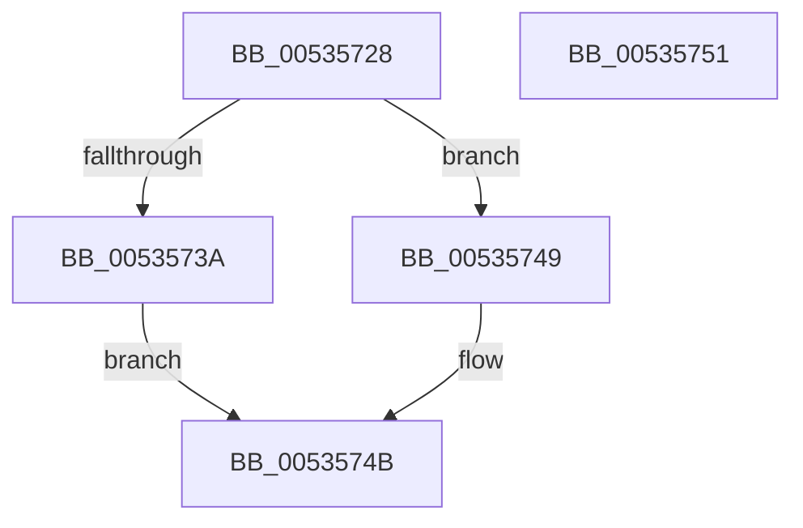

# SymCryptFdefSizeofModulusFromDigits

- RVA: `0x00535728`–`0x00535752` (길이 `42` bytes)
- VA: `0x0000000140535728`
- 실행 섹션: `.text`
- PDB 이름 있음: `예`; PDB Function 태그: `아니요`
- unwind 정보 RVA: `0x0005CF00`
- 디코드: `16`개 명령, `42/42` bytes 표시
- 미해석 바이트: `0` (있으면 어셈블리에 `.byte`로 보존)

> 이 문서는 커널 이미지의 기계어와 PDB 기호를 분석해 생성했습니다. 4번과 5번은 함수 원형과 자료형을 바이너리 사용 방식에서 추정한 C 해석이며 원본 소스 복구 결과는 아닙니다.

## 1. Dependencies

- 직접 호출 지점: **1**; 고유 호출 대상: **1**
- 직접 호출자로 확인된 함수: **2**
- RIP 상대 이미지 참조: **0**

### Outgoing calls
- `0x0053573A` → [SymCryptFdefSizeofDivisorFromDigits](SymCryptFdefSizeofDivisorFromDigits_function_00535F58.md) (function, `0x00535F58`)

### Direct callers
- [SymCryptSizeofModulusFromDigits](../52/SymCryptSizeofModulusFromDigits_function_00525D54.md) at `0x00525D58`
- [SymCryptFdefModulusCreate](SymCryptFdefModulusCreate_function_0053552C.md) at `0x0053554E`

### Static image references
- 디코드된 RIP-relative 메모리 참조가 없습니다.

## 2. Other-region calls and transfers

- 다른 실행 섹션으로 향하는 call: **0**
- 별도 외부 분기/꼬리 이동을 확인하지 못했습니다.

## 3. Assembly (complete function range)

```asm
00535728  40 53                           push rbx
0053572A  48 83 EC 20                     sub rsp, 0x20
0053572E  8D 41 FF                        lea eax, [rcx - 1]
00535731  8B D9                           mov ebx, ecx
00535733  3D FF 07 00 00                  cmp eax, 0x7ff
00535738  77 0F                           ja 0x140535749
0053573A  E8 19 08 00 00                  call 0x140535f58
0053573F  C1 E3 07                        shl ebx, 7
00535742  83 C3 40                        add ebx, 0x40
00535745  03 C3                           add eax, ebx
00535747  EB 02                           jmp 0x14053574b
00535749  33 C0                           xor eax, eax
0053574B  48 83 C4 20                     add rsp, 0x20
0053574F  5B                              pop rbx
00535750  C3                              ret
00535751  CC                              int3
```

## 4. C-style interpretation (structured pseudocode)

```c
__int64 __fastcall SymCryptFdefSizeofModulusFromDigits(__int64 a1)
{
    __int64 result;
    __int64 v_rbx;
    __int64 v_rsp;

    v_rsp = (v_rsp) - (32);
    if (((unsigned int)(a1 - 1)) > 0x7FFULL) goto loc_00535749;
    result = SymCryptFdefSizeofDivisorFromDigits(a1, a2, a3, a4);
    v_rbx = (unsigned int)(((unsigned int)((unsigned int)(a1))) << (7));
    v_rbx = (unsigned int)((v_rbx) + (64));
    result = (unsigned int)((result) + ((unsigned int)(v_rbx)));
    goto loc_0053574B;
loc_00535749:
    result = 0;
loc_0053574B:
    v_rsp = (v_rsp) + (32);
    return result;
}
```

## 5. (Beta) C Style

```c
int64_t SymCryptFdefSizeofModulusFromDigits(void *Arg1)
{
    uint8_t *arg1 = (uint8_t *)Arg1;

    int64_t result;
    int64_t local_rbx;
    int64_t local_rsp;

    local_rsp = (local_rsp) - (32);
    if (((uint32_t)(Arg1 - 1)) > 0x7FFULL) goto loc_00535749;
    result = SymCryptFdefSizeofDivisorFromDigits(Arg1, a2, a3, a4);
    local_rbx = (uint32_t)(((uint32_t)((uint32_t)(Arg1))) << (7));
    local_rbx = (uint32_t)((local_rbx) + (64));
    result = (uint32_t)((result) + ((uint32_t)(local_rbx)));
    goto loc_0053574B;
loc_00535749:
    result = 0;
loc_0053574B:
    local_rsp = (local_rsp) + (32);
    return result;
}
```

### 관측된 메모리 오프셋

구조체 형식이 확인되지 않은 접근은 인자 기준의 오프셋으로만 기록했습니다.

| 기준 인자 | 오프셋 표현 | 폭 (bit) | 접근 |
|---|---:|---:|---|
| `Arg1` | `- 0x1` | `32` | `R` |

## 6. Execution-region graph

[열기: 2D/3D 그래프와 함수 탐색 컨트롤 패널](../../../control-panel.html?section=text&rva=0x00535728&view=graph)

- 2D 그래프는 위에서 아래로 흐르고, 3D 그래프는 빈 공간을 드래그해 회전합니다. Shift+드래그는 이동, 휠은 확대·축소, 함수 노드 선택은 대상 보고서 이동입니다.

### Static fallback


