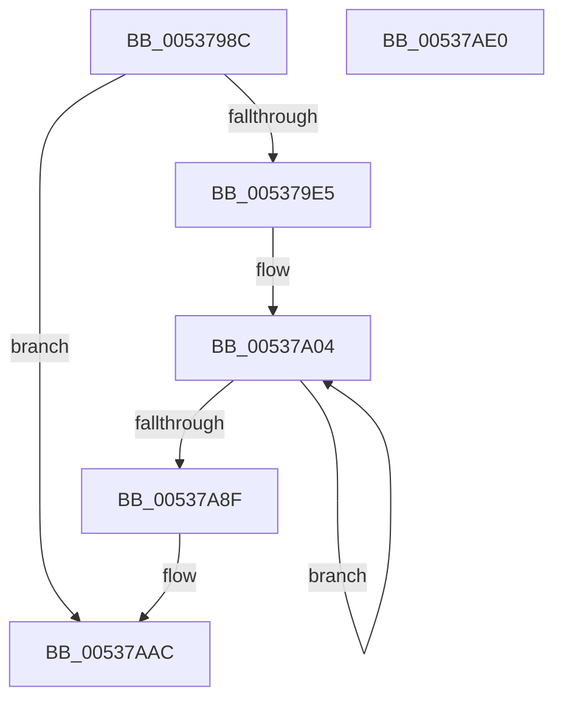

# SymCryptFixedWindowRecoding

- RVA: `0x0053798C`–`0x00537AE1` (길이 `341` bytes)
- VA: `0x000000014053798C`
- 실행 섹션: `.text`
- PDB 이름 있음: `예`; PDB Function 태그: `아니요`
- unwind 정보 RVA: `0x000D2368`
- 디코드: `98`개 명령, `341/341` bytes 표시
- 미해석 바이트: `0` (있으면 어셈블리에 `.byte`로 보존)

> 이 문서는 커널 이미지의 기계어와 PDB 기호를 분석해 생성했습니다. 4번과 5번은 함수 원형과 자료형을 바이너리 사용 방식에서 추정한 C 해석이며 원본 소스 복구 결과는 아닙니다.

## 1. Dependencies

- 직접 호출 지점: **6**; 고유 호출 대상: **5**
- 직접 호출자로 확인된 함수: **1**
- RIP 상대 이미지 참조: **0**

### Outgoing calls
- `0x00537A07` → [SymCryptIntGetValueLsbits32](../52/SymCryptIntGetValueLsbits32_function_00525668.md) (function, `0x00525668`)
- `0x00537A48` → [SymCryptIntSubUint32](../52/SymCryptIntSubUint32_function_005257C0.md) (function, `0x005257C0`)
- `0x00537A55` → [SymCryptIntAddUint32](../52/SymCryptIntAddUint32_function_005254AC.md) (function, `0x005254AC`)
- `0x00537A6C` → [SymCryptIntMaskedCopy](../52/SymCryptIntMaskedCopy_function_005256E0.md) (function, `0x005256E0`)
- `0x00537A7C` → [SymCryptIntDivPow2](../52/SymCryptIntDivPow2_function_005255B0.md) (function, `0x005255B0`)
- `0x00537AB4` → [SymCryptIntGetValueLsbits32](../52/SymCryptIntGetValueLsbits32_function_00525668.md) (function, `0x00525668`)

### Direct callers
- [SymCryptEcpointScalarMulFixedWindow](../52/SymCryptEcpointScalarMulFixedWindow_function_0052BE30.md) at `0x0052C0F6`

### Static image references
- 디코드된 RIP-relative 메모리 참조가 없습니다.

## 2. Other-region calls and transfers

- 다른 실행 섹션으로 향하는 call: **0**
- 별도 외부 분기/꼬리 이동을 확인하지 못했습니다.

## 3. Assembly (complete function range)

```asm
0053798C  4C 8B DC                        mov r11, rsp
0053798F  49 89 5B 08                     mov qword ptr [r11 + 8], rbx
00537993  4D 89 4B 20                     mov qword ptr [r11 + 0x20], r9
00537997  4D 89 43 18                     mov qword ptr [r11 + 0x18], r8
0053799B  49 89 53 10                     mov qword ptr [r11 + 0x10], rdx
0053799F  55                              push rbp
005379A0  56                              push rsi
005379A1  57                              push rdi
005379A2  41 54                           push r12
005379A4  41 55                           push r13
005379A6  41 56                           push r14
005379A8  41 57                           push r15
005379AA  48 83 EC 40                     sub rsp, 0x40
005379AE  8B AC 24 A8 00 00 00            mov ebp, dword ptr [rsp + 0xa8]
005379B5  83 CE FF                        or esi, 0xffffffff
005379B8  4C 8B B4 24 A0 00 00 00         mov r14, qword ptr [rsp + 0xa0]
005379C0  41 BF 01 00 00 00               mov r15d, 1
005379C6  D3 E6                           shl esi, cl
005379C8  4D 8B E9                        mov r13, r9
005379CB  FF C9                           dec ecx
005379CD  F7 D6                           not esi
005379CF  41 D3 E7                        shl r15d, cl
005379D2  83 ED 01                        sub ebp, 1
005379D5  41 8B FF                        mov edi, r15d
005379D8  F7 D7                           not edi
005379DA  48 89 6C 24 38                  mov qword ptr [rsp + 0x38], rbp
005379DF  0F 84 C7 00 00 00               je 0x140537aac
005379E5  4C 89 74 24 20                  mov qword ptr [rsp + 0x20], r14
005379EA  4D 8B E1                        mov r12, r9
005379ED  4C 8B 6C 24 20                  mov r13, qword ptr [rsp + 0x20]
005379F2  4D 2B E6                        sub r12, r14
005379F5  8B C1                           mov eax, ecx
005379F7  4C 8B F2                        mov r14, rdx
005379FA  48 89 44 24 30                  mov qword ptr [rsp + 0x30], rax
005379FF  48 89 6C 24 28                  mov qword ptr [rsp + 0x28], rbp
00537A04  49 8B CE                        mov rcx, r14
00537A07  E8 5C DC FE FF                  call 0x140525668
00537A0C  23 C6                           and eax, esi
00537A0E  45 8B C7                        mov r8d, r15d
00537A11  8B C8                           mov ecx, eax
00537A13  8B D7                           mov edx, edi
00537A15  4C 23 C1                        and r8, rcx
00537A18  23 D1                           and edx, ecx
00537A1A  49 F7 D8                        neg r8
00537A1D  41 8B DF                        mov ebx, r15d
00537A20  49 C1 E8 20                     shr r8, 0x20
00537A24  2B D9                           sub ebx, ecx
00537A26  41 8B C0                        mov eax, r8d
00537A29  49 8B CE                        mov rcx, r14
00537A2C  F7 D0                           not eax
00537A2E  44 23 C2                        and r8d, edx
00537A31  41 89 45 00                     mov dword ptr [r13], eax
00537A35  23 C3                           and eax, ebx
00537A37  41 0B C0                        or eax, r8d
00537A3A  4C 8B 84 24 90 00 00 00         mov r8, qword ptr [rsp + 0x90]
00537A42  D1 E8                           shr eax, 1
00537A44  43 89 04 2C                     mov dword ptr [r12 + r13], eax
00537A48  E8 73 DD FE FF                  call 0x1405257c0
00537A4D  4D 8B C6                        mov r8, r14
00537A50  8B D3                           mov edx, ebx
00537A52  49 8B CE                        mov rcx, r14
00537A55  E8 52 DA FE FF                  call 0x1405254ac
00537A5A  45 8B 45 00                     mov r8d, dword ptr [r13]
00537A5E  49 8B D6                        mov rdx, r14
00537A61  48 8B 8C 24 90 00 00 00         mov rcx, qword ptr [rsp + 0x90]
00537A69  41 F7 D0                        not r8d
00537A6C  E8 6F DC FE FF                  call 0x1405256e0
00537A71  48 8B 54 24 30                  mov rdx, qword ptr [rsp + 0x30]
00537A76  4D 8B C6                        mov r8, r14
00537A79  49 8B CE                        mov rcx, r14
00537A7C  E8 2F DB FE FF                  call 0x1405255b0
00537A81  4D 8D 6D 04                     lea r13, [r13 + 4]
00537A85  48 83 ED 01                     sub rbp, 1
00537A89  0F 85 75 FF FF FF               jne 0x140537a04
00537A8F  48 8B 6C 24 38                  mov rbp, qword ptr [rsp + 0x38]
00537A94  4C 8B B4 24 A0 00 00 00         mov r14, qword ptr [rsp + 0xa0]
00537A9C  4C 8B AC 24 98 00 00 00         mov r13, qword ptr [rsp + 0x98]
00537AA4  48 8B 94 24 88 00 00 00         mov rdx, qword ptr [rsp + 0x88]
00537AAC  41 83 24 AE 00                  and dword ptr [r14 + rbp*4], 0
00537AB1  48 8B CA                        mov rcx, rdx
00537AB4  E8 AF DB FE FF                  call 0x140525668
00537AB9  48 8B 9C 24 80 00 00 00         mov rbx, qword ptr [rsp + 0x80]
00537AC1  D1 E8                           shr eax, 1
00537AC3  D1 EF                           shr edi, 1
00537AC5  23 C7                           and eax, edi
00537AC7  D1 EE                           shr esi, 1
00537AC9  23 C6                           and eax, esi
00537ACB  41 89 44 AD 00                  mov dword ptr [r13 + rbp*4], eax
00537AD0  48 83 C4 40                     add rsp, 0x40
00537AD4  41 5F                           pop r15
00537AD6  41 5E                           pop r14
00537AD8  41 5D                           pop r13
00537ADA  41 5C                           pop r12
00537ADC  5F                              pop rdi
00537ADD  5E                              pop rsi
00537ADE  5D                              pop rbp
00537ADF  C3                              ret
00537AE0  CC                              int3
```

## 4. C-style interpretation (structured pseudocode)

```c
__int64 __fastcall SymCryptFixedWindowRecoding(int a1, __int64 a2, __int64 a3, __int64 a4, __int64 a5, unsigned int a6)
{
    __int64 result;
    __int64 v_r12;
    __int64 v_r15;
    __int64 v_rbp;
    __int64 v_rbx;
    __int64 v_rdi;
    __int64 v_rsi;
    __int64 v_rsp;
    unsigned __int64 v_stack_m40;
    unsigned __int64 v_stack_m48;
    unsigned __int64 v_stack_m50;
    unsigned __int64 v_stack_m58;
    unsigned __int64 v_stack_p10;
    unsigned __int64 v_stack_p18;
    unsigned __int64 v_stack_p20;
    unsigned __int64 v_stack_p8;

    *(unsigned __int64 *)(v_rsp + 8) = v_rbx;
    *(unsigned __int64 *)(v_rsp + 32) = a4;
    *(unsigned __int64 *)(v_rsp + 24) = a3;
    *(unsigned __int64 *)(v_rsp + 16) = a2;
    v_rsp = (v_rsp) - (64);
    v_rsi = (unsigned int)((v_rsi) | (0xFFFFFFFFULL));
    v_rsi = (unsigned int)((v_rsi) << ((unsigned __int8)(a1)));
    a1 = (unsigned int)((a1) - 1);
    v_rsi = (unsigned int)(~(v_rsi));
    v_r15 = (unsigned int)((1) << ((unsigned __int8)(a1)));
    v_rbp = (unsigned int)(((unsigned int)(a6)) - (1));
    v_rdi = (unsigned int)(~((unsigned int)((unsigned int)(v_r15))));
    v_stack_m40 = v_rbp;
    if (condition_is_equal) goto loc_00537AAC;
    v_stack_m58 = a5;
    v_r12 = (a4) - (a5);
    v_stack_m48 = (unsigned int)(a1);
    v_stack_m50 = v_rbp;
loc_00537A04:
    result = SymCryptIntGetValueLsbits32(a2, a2, a3, a4);
    result = (unsigned int)((result) & ((unsigned int)(v_rsi)));
    a3 = ((unsigned int)((unsigned int)(v_r15))) & ((unsigned int)((unsigned int)(result)));
    a2 = (unsigned int)(((unsigned int)((unsigned int)(v_rdi))) & ((unsigned int)((unsigned int)((unsigned int)(result)))));
    a3 = -(a3);
    a3 = (a3) >> (32);
    v_rbx = (unsigned int)(((unsigned int)((unsigned int)(v_r15))) - ((unsigned int)((unsigned int)((unsigned int)(result)))));
    result = (unsigned int)(~((unsigned int)((unsigned int)(a3))));
    a3 = (unsigned int)((a3) & ((unsigned int)(a2)));
    *(unsigned int *)(v_stack_m58) = (unsigned int)(result);
    result = (unsigned int)((result) & ((unsigned int)(v_rbx)));
    result = (unsigned int)((result) | ((unsigned int)(a3)));
    result = (unsigned int)((result) >> (1));
    *(unsigned int *)(v_r12 + v_stack_m58 * 1) = (unsigned int)(result);
    result = SymCryptIntSubUint32(a2, a2, v_stack_p18, a4);
    result = SymCryptIntAddUint32(a2, (unsigned int)((unsigned int)(v_rbx)), a2, a4);
    a3 = (unsigned int)(~((unsigned int)(*(unsigned int *)(v_stack_m58))));
    result = SymCryptIntMaskedCopy(v_stack_p18, a2, a3, a4);
    result = SymCryptIntDivPow2(a2, v_stack_m48, a2, a4);
    v_rbp = (v_rbp) - (1);
    if (condition_is_not_equal) goto loc_00537A04;
loc_00537AAC:
    result = SymCryptIntGetValueLsbits32(v_stack_p10, v_stack_p10, a2, a4);
    result = (unsigned int)((result) >> (1));
    v_rdi = (unsigned int)((v_rdi) >> (1));
    result = (unsigned int)((result) & ((unsigned int)(v_rdi)));
    v_rsi = (unsigned int)((v_rsi) >> (1));
    result = (unsigned int)((result) & ((unsigned int)(v_rsi)));
    *(unsigned int *)(v_stack_p20 + v_stack_m40 * 4) = (unsigned int)(result);
    v_rsp = (v_rsp) + (64);
    return result;
}
```

## 5. (Beta) C Style

```c
int64_t SymCryptFixedWindowRecoding(int32_t Arg1, int64_t Arg2, int64_t Arg3, void *Arg4, void *Arg5, uint32_t Arg6)
{
    uint8_t *arg4 = (uint8_t *)Arg4;
    uint8_t *arg5 = (uint8_t *)Arg5;

    int64_t result;
    int64_t local_r12;
    int64_t local_r15;
    int64_t local_rbp;
    int64_t local_rbx;
    int64_t local_rdi;
    int64_t local_rsi;
    int64_t local_rsp;
    uint64_t v_stack_m40;
    uint64_t v_stack_m48;
    uint64_t v_stack_m50;
    uint64_t v_stack_m58;
    uint64_t v_stack_p10;
    uint64_t v_stack_p18;
    uint64_t v_stack_p20;
    uint64_t v_stack_p8;

    *(uint64_t *)(local_rsp + 0x8) = local_rbx;
    *(void **)(local_rsp + 0x20) = Arg4;
    *(uint64_t *)(local_rsp + 0x18) = Arg3;
    *(uint64_t *)(local_rsp + 0x10) = Arg2;
    local_rsp = (local_rsp) - (64);
    local_rsi = (uint32_t)((local_rsi) | (0xFFFFFFFFULL));
    local_rsi = (uint32_t)((local_rsi) << ((uint8_t)(Arg1)));
    Arg1 = (uint32_t)((Arg1) - 1);
    local_rsi = (uint32_t)(~(local_rsi));
    local_r15 = (uint32_t)((1) << ((uint8_t)(Arg1)));
    local_rbp = (uint32_t)(((uint32_t)(Arg6)) - (1));
    local_rdi = (uint32_t)(~((uint32_t)((uint32_t)(local_r15))));
    v_stack_m40 = local_rbp;
    if (condition_is_equal) goto loc_00537AAC;
    v_stack_m58 = Arg5;
    local_r12 = (Arg4) - (Arg5);
    v_stack_m48 = (uint32_t)(Arg1);
    v_stack_m50 = local_rbp;
loc_00537A04:
    result = SymCryptIntGetValueLsbits32(Arg2, Arg2, Arg3, Arg4);
    result = (uint32_t)((result) & ((uint32_t)(local_rsi)));
    Arg3 = ((uint32_t)((uint32_t)(local_r15))) & ((uint32_t)((uint32_t)(result)));
    Arg2 = (uint32_t)(((uint32_t)((uint32_t)(local_rdi))) & ((uint32_t)((uint32_t)((uint32_t)(result)))));
    Arg3 = -(Arg3);
    Arg3 = (Arg3) >> (32);
    local_rbx = (uint32_t)(((uint32_t)((uint32_t)(local_r15))) - ((uint32_t)((uint32_t)((uint32_t)(result)))));
    result = (uint32_t)(~((uint32_t)((uint32_t)(Arg3))));
    Arg3 = (uint32_t)((Arg3) & ((uint32_t)(Arg2)));
    *(uint32_t *)(v_stack_m58) = (uint32_t)(result);
    result = (uint32_t)((result) & ((uint32_t)(local_rbx)));
    result = (uint32_t)((result) | ((uint32_t)(Arg3)));
    result = (uint32_t)((result) >> (1));
    *(uint32_t *)(local_r12 + v_stack_m58 * 1) = (uint32_t)(result);
    result = SymCryptIntSubUint32(Arg2, Arg2, v_stack_p18, Arg4);
    result = SymCryptIntAddUint32(Arg2, (uint32_t)((uint32_t)(local_rbx)), Arg2, Arg4);
    Arg3 = (uint32_t)(~((uint32_t)(*(uint32_t *)(v_stack_m58))));
    result = SymCryptIntMaskedCopy(v_stack_p18, Arg2, Arg3, Arg4);
    result = SymCryptIntDivPow2(Arg2, v_stack_m48, Arg2, Arg4);
    local_rbp = (local_rbp) - (1);
    if (condition_is_not_equal) goto loc_00537A04;
loc_00537AAC:
    result = SymCryptIntGetValueLsbits32(v_stack_p10, v_stack_p10, Arg2, Arg4);
    result = (uint32_t)((result) >> (1));
    local_rdi = (uint32_t)((local_rdi) >> (1));
    result = (uint32_t)((result) & ((uint32_t)(local_rdi)));
    local_rsi = (uint32_t)((local_rsi) >> (1));
    result = (uint32_t)((result) & ((uint32_t)(local_rsi)));
    *(uint32_t *)(v_stack_p20 + v_stack_m40 * 4) = (uint32_t)(result);
    local_rsp = (local_rsp) + (64);
    return result;
}
```

### 관측된 메모리 오프셋

구조체 형식이 확인되지 않은 접근은 인자 기준의 오프셋으로만 기록했습니다.

| 기준 인자 | 오프셋 표현 | 폭 (bit) | 접근 |
|---|---:|---:|---|
| `Arg4` | `+ 0x0 + r13*1` | `32` | `W` |
| `Arg5` | `+ 0x0 + rbp*4` | `32` | `R/W` |

## 6. Execution-region graph

[열기: 2D/3D 그래프와 함수 탐색 컨트롤 패널](../../../control-panel.html?section=text&rva=0x0053798C&view=graph)

- 2D 그래프는 위에서 아래로 흐르고, 3D 그래프는 빈 공간을 드래그해 회전합니다. Shift+드래그는 이동, 휠은 확대·축소, 함수 노드 선택은 대상 보고서 이동입니다.

### Static fallback


