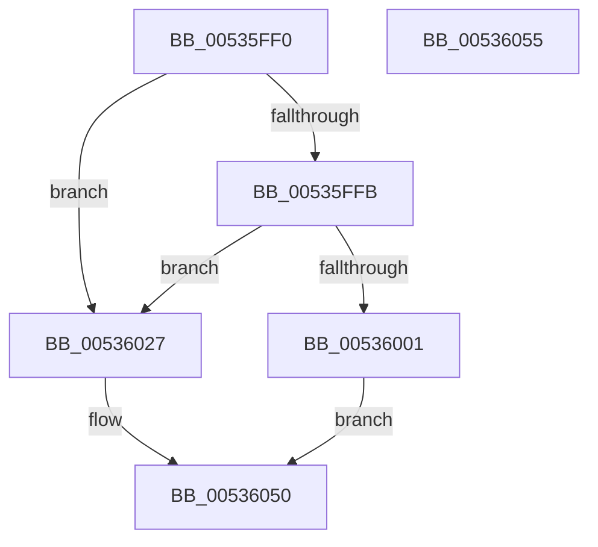

# SymCryptModExpGeneric

- RVA: `0x00535FF0`–`0x00536056` (길이 `102` bytes)
- VA: `0x0000000140535FF0`
- 실행 섹션: `.text`
- PDB 이름 있음: `예`; PDB Function 태그: `아니요`
- unwind 정보 RVA: `0x00063458`
- 디코드: `22`개 명령, `102/102` bytes 표시
- 미해석 바이트: `0` (있으면 어셈블리에 `.byte`로 보존)

> 이 문서는 커널 이미지의 기계어와 PDB 기호를 분석해 생성했습니다. 4번과 5번은 함수 원형과 자료형을 바이너리 사용 방식에서 추정한 C 해석이며 원본 소스 복구 결과는 아닙니다.

## 1. Dependencies

- 직접 호출 지점: **2**; 고유 호출 대상: **2**
- 직접 호출자로 확인된 함수: **1**
- RIP 상대 이미지 참조: **0**

### Outgoing calls
- `0x00536020` → [SymCryptModExpSquareAndMultiply32](SymCryptModExpSquareAndMultiply32_function_0053605C.md) (function, `0x0053605C`)
- `0x0053604B` → [SymCryptModExpWindowed](SymCryptModExpWindowed_function_00536188.md) (function, `0x00536188`)

### Direct callers
- [SymCryptModExp](../52/SymCryptModExp_function_00525B28.md) at `0x00525B58`

### Static image references
- 디코드된 RIP-relative 메모리 참조가 없습니다.

## 2. Other-region calls and transfers

- 다른 실행 섹션으로 향하는 call: **0**
- 별도 외부 분기/꼬리 이동을 확인하지 못했습니다.

## 3. Assembly (complete function range)

```asm
00535FF0  48 83 EC 48                     sub rsp, 0x48
00535FF4  F6 44 24 70 01                  test byte ptr [rsp + 0x70], 1
00535FF9  74 2C                           je 0x140536027
00535FFB  41 83 F9 20                     cmp r9d, 0x20
00535FFF  77 26                           ja 0x140536027
00536001  48 8B 84 24 88 00 00 00         mov rax, qword ptr [rsp + 0x88]
00536009  4C 8B 4C 24 78                  mov r9, qword ptr [rsp + 0x78]
0053600E  48 89 44 24 28                  mov qword ptr [rsp + 0x28], rax
00536013  48 8B 84 24 80 00 00 00         mov rax, qword ptr [rsp + 0x80]
0053601B  48 89 44 24 20                  mov qword ptr [rsp + 0x20], rax
00536020  E8 37 00 00 00                  call 0x14053605c
00536025  EB 29                           jmp 0x140536050
00536027  48 8B 84 24 88 00 00 00         mov rax, qword ptr [rsp + 0x88]
0053602F  48 89 44 24 30                  mov qword ptr [rsp + 0x30], rax
00536034  48 8B 84 24 80 00 00 00         mov rax, qword ptr [rsp + 0x80]
0053603C  48 89 44 24 28                  mov qword ptr [rsp + 0x28], rax
00536041  48 8B 44 24 78                  mov rax, qword ptr [rsp + 0x78]
00536046  48 89 44 24 20                  mov qword ptr [rsp + 0x20], rax
0053604B  E8 38 01 00 00                  call 0x140536188
00536050  48 83 C4 48                     add rsp, 0x48
00536054  C3                              ret
00536055  CC                              int3
```

## 4. C-style interpretation (structured pseudocode)

```c
__int64 __fastcall SymCryptModExpGeneric(__int64 a1, __int64 a2, __int64 a3, int a4, unsigned __int8 a5, __int64 a6, __int64 a7, __int64 a8)
{
    __int64 result;
    __int64 v_rsp;
    unsigned __int64 v_stack_m18;
    unsigned __int64 v_stack_m20;
    unsigned __int64 v_stack_m28;

    v_rsp = (v_rsp) - (72);
    if (((a5) & (1)) == 0) goto loc_00536027;
    if (a4 > 32) goto loc_00536027;
    v_stack_m20 = a8;
    v_stack_m28 = a7;
    result = SymCryptModExpSquareAndMultiply32(a1, a2, a3, a6);
    goto loc_00536050;
loc_00536027:
    v_stack_m18 = a8;
    v_stack_m20 = a7;
    v_stack_m28 = a6;
    result = SymCryptModExpWindowed(a1, a2, a3, a6);
loc_00536050:
    v_rsp = (v_rsp) + (72);
    return result;
}
```

## 5. (Beta) C Style

```c
int64_t SymCryptModExpGeneric(int64_t Arg1, int64_t Arg2, int64_t Arg3, int32_t Arg4, uint8_t Arg5, int64_t Arg6, int64_t Arg7, int64_t Arg8)
{
    int64_t result;
    int64_t local_rsp;
    uint64_t v_stack_m18;
    uint64_t v_stack_m20;
    uint64_t v_stack_m28;

    local_rsp = (local_rsp) - (72);
    if (((Arg5) & (1)) == 0) goto loc_00536027;
    if (Arg4 > 32) goto loc_00536027;
    v_stack_m20 = Arg8;
    v_stack_m28 = Arg7;
    result = SymCryptModExpSquareAndMultiply32(Arg1, Arg2, Arg3, Arg6);
    goto loc_00536050;
loc_00536027:
    v_stack_m18 = Arg8;
    v_stack_m20 = Arg7;
    v_stack_m28 = Arg6;
    result = SymCryptModExpWindowed(Arg1, Arg2, Arg3, Arg6);
loc_00536050:
    local_rsp = (local_rsp) + (72);
    return result;
}
```

## 6. Execution-region graph

[열기: 2D/3D 그래프와 함수 탐색 컨트롤 패널](../../../control-panel.html?section=text&rva=0x00535FF0&view=graph)

- 2D 그래프는 위에서 아래로 흐르고, 3D 그래프는 빈 공간을 드래그해 회전합니다. Shift+드래그는 이동, 휠은 확대·축소, 함수 노드 선택은 대상 보고서 이동입니다.

### Static fallback


