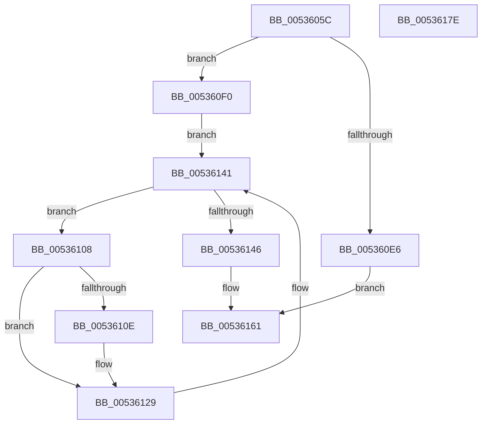

# SymCryptModExpSquareAndMultiply32

- RVA: `0x0053605C`–`0x0053617F` (길이 `291` bytes)
- VA: `0x000000014053605C`
- 실행 섹션: `.text`
- PDB 이름 있음: `예`; PDB Function 태그: `아니요`
- unwind 정보 RVA: `0x0008C20C`
- 디코드: `86`개 명령, `291/291` bytes 표시
- 미해석 바이트: `0` (있으면 어셈블리에 `.byte`로 보존)

> 이 문서는 커널 이미지의 기계어와 PDB 기호를 분석해 생성했습니다. 4번과 5번은 함수 원형과 자료형을 바이너리 사용 방식에서 추정한 C 해석이며 원본 소스 복구 결과는 아닙니다.

## 1. Dependencies

- 직접 호출 지점: **10**; 고유 호출 대상: **7**
- 직접 호출자로 확인된 함수: **1**
- RIP 상대 이미지 참조: **0**

### Outgoing calls
- `0x00536084` → [SymCryptSizeofModElementFromModulus](../52/SymCryptSizeofModElementFromModulus_function_00525D3C.md) (function, `0x00525D3C`)
- `0x0053608E` → [SymCryptIntGetValueLsbits32](../52/SymCryptIntGetValueLsbits32_function_00525668.md) (function, `0x00525668`)
- `0x005360A5` → [SymCryptModElementCreate](../52/SymCryptModElementCreate_function_00525900.md) (function, `0x00525900`)
- `0x005360B8` → [SymCryptModElementCreate](../52/SymCryptModElementCreate_function_00525900.md) (function, `0x00525900`)
- `0x005360E9` → [SymCryptModElementSetValueUint32](../52/SymCryptModElementSetValueUint32_function_00525A40.md) (function, `0x00525A40`)
- `0x005360F3` → [SymCryptModElementSetValueUint32](../52/SymCryptModElementSetValueUint32_function_00525A40.md) (function, `0x00525A40`)
- `0x00536101` → [SymCryptModElementCopy](../52/SymCryptModElementCopy_function_005258E8.md) (function, `0x005258E8`)
- `0x00536124` → [SymCryptModMul](../52/SymCryptModMul_function_00525BA8.md) (function, `0x00525BA8`)
- `0x0053613A` → [SymCryptModSquare](../52/SymCryptModSquare_function_00525C84.md) (function, `0x00525C84`)
- `0x0053615C` → [SymCryptModMul](../52/SymCryptModMul_function_00525BA8.md) (function, `0x00525BA8`)

### Direct callers
- [SymCryptModExpGeneric](SymCryptModExpGeneric_function_00535FF0.md) at `0x00536020`

### Static image references
- 디코드된 RIP-relative 메모리 참조가 없습니다.

## 2. Other-region calls and transfers

- 다른 실행 섹션으로 향하는 call: **0**
- 별도 외부 분기/꼬리 이동을 확인하지 못했습니다.

## 3. Assembly (complete function range)

```asm
0053605C  48 89 5C 24 08                  mov qword ptr [rsp + 8], rbx
00536061  48 89 6C 24 10                  mov qword ptr [rsp + 0x10], rbp
00536066  48 89 74 24 18                  mov qword ptr [rsp + 0x18], rsi
0053606B  57                              push rdi
0053606C  41 54                           push r12
0053606E  41 55                           push r13
00536070  41 56                           push r14
00536072  41 57                           push r15
00536074  48 83 EC 30                     sub rsp, 0x30
00536078  4D 8B E1                        mov r12, r9
0053607B  49 8B F8                        mov rdi, r8
0053607E  4C 8B EA                        mov r13, rdx
00536081  48 8B F1                        mov rsi, rcx
00536084  E8 B3 FC FE FF                  call 0x140525d3c
00536089  48 8B CF                        mov rcx, rdi
0053608C  8B D8                           mov ebx, eax
0053608E  E8 D5 F5 FE FF                  call 0x140525668
00536093  48 8B BC 24 80 00 00 00         mov rdi, qword ptr [rsp + 0x80]
0053609B  4C 8B C6                        mov r8, rsi
0053609E  48 8B CF                        mov rcx, rdi
005360A1  8B D3                           mov edx, ebx
005360A3  8B E8                           mov ebp, eax
005360A5  E8 56 F8 FE FF                  call 0x140525900
005360AA  48 03 FB                        add rdi, rbx
005360AD  4C 8B C6                        mov r8, rsi
005360B0  48 8B CF                        mov rcx, rdi
005360B3  8B D3                           mov edx, ebx
005360B5  4C 8B F8                        mov r15, rax
005360B8  E8 43 F8 FE FF                  call 0x140525900
005360BD  48 6B CB FE                     imul rcx, rbx, -2
005360C1  48 03 FB                        add rdi, rbx
005360C4  4C 8B F0                        mov r14, rax
005360C7  48 8B 9C 24 88 00 00 00         mov rbx, qword ptr [rsp + 0x88]
005360CF  4C 8B CF                        mov r9, rdi
005360D2  48 03 D9                        add rbx, rcx
005360D5  48 8B D6                        mov rdx, rsi
005360D8  48 89 5C 24 20                  mov qword ptr [rsp + 0x20], rbx
005360DD  B9 01 00 00 00                  mov ecx, 1
005360E2  85 ED                           test ebp, ebp
005360E4  75 0A                           jne 0x1405360f0
005360E6  4D 8B C4                        mov r8, r12
005360E9  E8 52 F9 FE FF                  call 0x140525a40
005360EE  EB 71                           jmp 0x140536161
005360F0  4D 8B C7                        mov r8, r15
005360F3  E8 48 F9 FE FF                  call 0x140525a40
005360F8  4D 8B C6                        mov r8, r14
005360FB  49 8B D5                        mov rdx, r13
005360FE  48 8B CE                        mov rcx, rsi
00536101  E8 E2 F7 FE FF                  call 0x1405258e8
00536106  EB 39                           jmp 0x140536141
00536108  40 F6 C5 01                     test bpl, 1
0053610C  74 1B                           je 0x140536129
0053610E  48 89 5C 24 28                  mov qword ptr [rsp + 0x28], rbx
00536113  4D 8B CF                        mov r9, r15
00536116  4D 8B C6                        mov r8, r14
00536119  48 89 7C 24 20                  mov qword ptr [rsp + 0x20], rdi
0053611E  49 8B D7                        mov rdx, r15
00536121  48 8B CE                        mov rcx, rsi
00536124  E8 7F FA FE FF                  call 0x140525ba8
00536129  4C 8B CF                        mov r9, rdi
0053612C  48 89 5C 24 20                  mov qword ptr [rsp + 0x20], rbx
00536131  4D 8B C6                        mov r8, r14
00536134  49 8B D6                        mov rdx, r14
00536137  48 8B CE                        mov rcx, rsi
0053613A  E8 45 FB FE FF                  call 0x140525c84
0053613F  D1 ED                           shr ebp, 1
00536141  83 FD 01                        cmp ebp, 1
00536144  77 C2                           ja 0x140536108
00536146  48 89 5C 24 28                  mov qword ptr [rsp + 0x28], rbx
0053614B  4D 8B CC                        mov r9, r12
0053614E  4D 8B C6                        mov r8, r14
00536151  48 89 7C 24 20                  mov qword ptr [rsp + 0x20], rdi
00536156  49 8B D7                        mov rdx, r15
00536159  48 8B CE                        mov rcx, rsi
0053615C  E8 47 FA FE FF                  call 0x140525ba8
00536161  48 8B 5C 24 60                  mov rbx, qword ptr [rsp + 0x60]
00536166  48 8B 6C 24 68                  mov rbp, qword ptr [rsp + 0x68]
0053616B  48 8B 74 24 70                  mov rsi, qword ptr [rsp + 0x70]
00536170  48 83 C4 30                     add rsp, 0x30
00536174  41 5F                           pop r15
00536176  41 5E                           pop r14
00536178  41 5D                           pop r13
0053617A  41 5C                           pop r12
0053617C  5F                              pop rdi
0053617D  C3                              ret
0053617E  CC                              int3
```

## 4. C-style interpretation (structured pseudocode)

```c
__int64 __fastcall SymCryptModExpSquareAndMultiply32(__int64 a1, __int64 a2, __int64 a3, __int64 a4, __int64 a5, __int64 a6)
{
    __int64 result;
    __int64 v_rbp;
    __int64 v_rbx;
    __int64 v_rdi;
    __int64 v_rsp;
    unsigned __int64 v_stack_m30;
    unsigned __int64 v_stack_m38;
    unsigned __int64 v_stack_p10;
    unsigned __int64 v_stack_p18;
    unsigned __int64 v_stack_p8;

    v_stack_p8 = v_rbx;
    v_stack_p10 = v_rbp;
    v_stack_p18 = v_rsi;
    v_rsp = (v_rsp) - (48);
    result = SymCryptSizeofModElementFromModulus(a1, a2, a3, a4);
    result = SymCryptIntGetValueLsbits32(a3, a2, a3, a4);
    result = SymCryptModElementCreate(a5, (unsigned int)((unsigned int)((unsigned int)((unsigned int)(result)))), a1, a4);
    v_rdi = (a5) + ((unsigned int)((unsigned int)(result)));
    result = SymCryptModElementCreate(v_rdi, (unsigned int)((unsigned int)((unsigned int)((unsigned int)(result)))), a1, a4);
    a1 = (v_rdi) * ((unsigned int)((unsigned int)(result)));
    v_rdi = (v_rdi) + ((unsigned int)((unsigned int)(result)));
    v_rbx = (a6) + (a1);
    v_stack_m38 = v_rbx;
    if ((unsigned int)((unsigned int)((unsigned int)(result))) != 0) goto loc_005360F0;
    result = SymCryptModElementSetValueUint32(1, a1, a4, v_rdi);
    goto loc_00536161;
loc_005360F0:
    result = SymCryptModElementSetValueUint32(1, a1, result, v_rdi);
    result = SymCryptModElementCopy(a1, a2, result, v_rdi);
    goto loc_00536141;
loc_00536108:
    if ((((unsigned __int8)((unsigned int)((unsigned int)(result)))) & (1)) != 0) {
        v_stack_m30 = v_rbx;
        a4 = result;
        a3 = result;
        v_stack_m38 = v_rdi;
        a2 = result;
        a1 = a1;
        result = SymCryptModMul(a1, a2, a3, a4);
    }
    v_stack_m38 = v_rbx;
    result = SymCryptModSquare(a1, result, result, v_rdi);
    v_rbp = (unsigned int)(((unsigned int)((unsigned int)(result))) >> (1));
loc_00536141:
    if (((unsigned int)(v_rbp)) > 1) goto loc_00536108;
    v_stack_m30 = v_rbx;
    v_stack_m38 = v_rdi;
    result = SymCryptModMul(a1, result, result, a4);
loc_00536161:
    v_rsp = (v_rsp) + (48);
    return result;
}
```

## 5. (Beta) C Style

```c
int64_t SymCryptModExpSquareAndMultiply32(int64_t Arg1, int64_t Arg2, int64_t Arg3, int64_t Arg4, int64_t Arg5, int64_t Arg6)
{
    int64_t result;
    int64_t local_rbp;
    int64_t local_rbx;
    int64_t local_rdi;
    int64_t local_rsp;
    uint64_t v_stack_m30;
    uint64_t v_stack_m38;
    uint64_t v_stack_p10;
    uint64_t v_stack_p18;
    uint64_t v_stack_p8;

    v_stack_p8 = local_rbx;
    v_stack_p10 = local_rbp;
    v_stack_p18 = local_rsi;
    local_rsp = (local_rsp) - (48);
    result = SymCryptSizeofModElementFromModulus(Arg1, Arg2, Arg3, Arg4);
    result = SymCryptIntGetValueLsbits32(Arg3, Arg2, Arg3, Arg4);
    result = SymCryptModElementCreate(Arg5, (uint32_t)((uint32_t)((uint32_t)((uint32_t)(result)))), Arg1, Arg4);
    local_rdi = (Arg5) + ((uint32_t)((uint32_t)(result)));
    result = SymCryptModElementCreate(local_rdi, (uint32_t)((uint32_t)((uint32_t)((uint32_t)(result)))), Arg1, Arg4);
    Arg1 = (local_rdi) * ((uint32_t)((uint32_t)(result)));
    local_rdi = (local_rdi) + ((uint32_t)((uint32_t)(result)));
    local_rbx = (Arg6) + (Arg1);
    v_stack_m38 = local_rbx;
    if ((uint32_t)((uint32_t)((uint32_t)(result))) != 0) goto loc_005360F0;
    result = SymCryptModElementSetValueUint32(1, Arg1, Arg4, local_rdi);
    goto loc_00536161;
loc_005360F0:
    result = SymCryptModElementSetValueUint32(1, Arg1, result, local_rdi);
    result = SymCryptModElementCopy(Arg1, Arg2, result, local_rdi);
    goto loc_00536141;
loc_00536108:
    if ((((uint8_t)((uint32_t)((uint32_t)(result)))) & (1)) != 0) {
        v_stack_m30 = local_rbx;
        Arg4 = result;
        Arg3 = result;
        v_stack_m38 = local_rdi;
        Arg2 = result;
        Arg1 = Arg1;
        result = SymCryptModMul(Arg1, Arg2, Arg3, Arg4);
    }
    v_stack_m38 = local_rbx;
    result = SymCryptModSquare(Arg1, result, result, local_rdi);
    local_rbp = (uint32_t)(((uint32_t)((uint32_t)(result))) >> (1));
loc_00536141:
    if (((uint32_t)(local_rbp)) > 1) goto loc_00536108;
    v_stack_m30 = local_rbx;
    v_stack_m38 = local_rdi;
    result = SymCryptModMul(Arg1, result, result, Arg4);
loc_00536161:
    local_rsp = (local_rsp) + (48);
    return result;
}
```

## 6. Execution-region graph

[열기: 2D/3D 그래프와 함수 탐색 컨트롤 패널](../../../control-panel.html?section=text&rva=0x0053605C&view=graph)

- 2D 그래프는 위에서 아래로 흐르고, 3D 그래프는 빈 공간을 드래그해 회전합니다. Shift+드래그는 이동, 휠은 확대·축소, 함수 노드 선택은 대상 보고서 이동입니다.

### Static fallback


