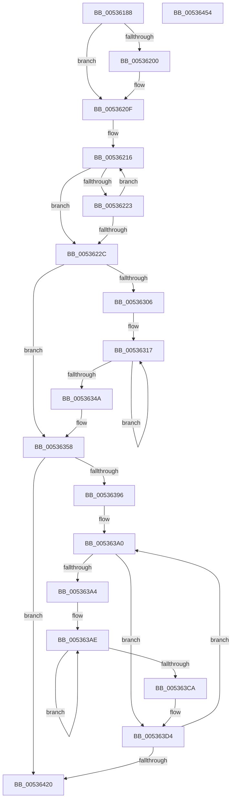

# SymCryptModExpWindowed

- RVA: `0x00536188`–`0x00536455` (길이 `717` bytes)
- VA: `0x0000000140536188`
- 실행 섹션: `.text`
- PDB 이름 있음: `예`; PDB Function 태그: `아니요`
- unwind 정보 RVA: `0x000D298C`
- 디코드: `196`개 명령, `717/717` bytes 표시
- 미해석 바이트: `0` (있으면 어셈블리에 `.byte`로 보존)

> 이 문서는 커널 이미지의 기계어와 PDB 기호를 분석해 생성했습니다. 4번과 5번은 함수 원형과 자료형을 바이너리 사용 방식에서 추정한 C 해석이며 원본 소스 복구 결과는 아닙니다.

## 1. Dependencies

- 직접 호출 지점: **21**; 고유 호출 대상: **13**
- 직접 호출자로 확인된 함수: **1**
- RIP 상대 이미지 참조: **2**

### Outgoing calls
- `0x005361E8` → [SymCryptSizeofModElementFromModulus](../52/SymCryptSizeofModElementFromModulus_function_00525D3C.md) (function, `0x00525D3C`)
- `0x005361F6` → [SymCryptIntBitsizeOfObject](../52/SymCryptIntBitsizeOfObject_function_005254DC.md) (function, `0x005254DC`)
- `0x00536203` → [SymCryptIntBitsizeOfObject](../52/SymCryptIntBitsizeOfObject_function_005254DC.md) (function, `0x005254DC`)
- `0x00536247` → [SymCryptScsTableInit](SymCryptScsTableInit_function_0053AF58.md) (function, `0x0053AF58`)
- `0x00536259` → [MiWriteCloneFlags](../48/MiWriteCloneFlags_function_0048AD78.md) (function, `0x0048AD78`)
- `0x0053626F` → [SymCryptModElementCreate](../52/SymCryptModElementCreate_function_00525900.md) (function, `0x00525900`)
- `0x00536283` → [SymCryptModElementCreate](../52/SymCryptModElementCreate_function_00525900.md) (function, `0x00525900`)
- `0x005362BD` → [SymCryptModElementSetValueUint32](../52/SymCryptModElementSetValueUint32_function_00525A40.md) (function, `0x00525A40`)
- `0x005362D1` → [SymCryptScsTableStore](SymCryptScsTableStore_function_0053B398.md) (function, `0x0053B398`)
- `0x005362E1` → [SymCryptModElementCopy](../52/SymCryptModElementCopy_function_005258E8.md) (function, `0x005258E8`)
- `0x005362F6` → [SymCryptScsTableStore](SymCryptScsTableStore_function_0053B398.md) (function, `0x0053B398`)
- `0x0053632D` → [SymCryptModMul](../52/SymCryptModMul_function_00525BA8.md) (function, `0x00525BA8`)
- `0x0053633F` → [SymCryptScsTableStore](SymCryptScsTableStore_function_0053B398.md) (function, `0x0053B398`)
- `0x00536372` → [SymCryptIntGetBits](../52/SymCryptIntGetBits_function_00525638.md) (function, `0x00525638`)
- `0x00536389` → [SymCryptScsTableLoad](SymCryptScsTableLoad_function_0053AF9C.md) (function, `0x0053AF9C`)
- `0x005363BF` → [SymCryptModSquare](../52/SymCryptModSquare_function_00525C84.md) (function, `0x00525C84`)
- `0x005363DE` → [SymCryptIntGetBits](../52/SymCryptIntGetBits_function_00525638.md) (function, `0x00525638`)
- `0x005363F0` → [SymCryptScsTableLoad](SymCryptScsTableLoad_function_0053AF9C.md) (function, `0x0053AF9C`)
- `0x00536413` → [SymCryptModMul](../52/SymCryptModMul_function_00525BA8.md) (function, `0x00525BA8`)
- `0x0053642B` → [SymCryptModElementCopy](../52/SymCryptModElementCopy_function_005258E8.md) (function, `0x005258E8`)
- `0x0053643B` → [_security_check_cookie](../6A/_security_check_cookie_function_006AC640.md) (function, `0x006AC640`)

### Direct callers
- [SymCryptModExpGeneric](SymCryptModExpGeneric_function_00535FF0.md) at `0x0053604B`

### Static image references
- `0x0053619C` → RVA `0x00E0A740` (`.data`; read)
- `0x00536216` → RVA `0x00020880` (`.rdata`; read)

## 2. Other-region calls and transfers

- 다른 실행 섹션으로 향하는 call: **0**
- 별도 외부 분기/꼬리 이동을 확인하지 못했습니다.

## 3. Assembly (complete function range)

```asm
00536188  40 53                           push rbx
0053618A  55                              push rbp
0053618B  56                              push rsi
0053618C  57                              push rdi
0053618D  41 54                           push r12
0053618F  41 55                           push r13
00536191  41 56                           push r14
00536193  41 57                           push r15
00536195  48 81 EC 98 00 00 00            sub rsp, 0x98
0053619C  48 8B 05 9D 45 8D 00            mov rax, qword ptr [rip + 0x8d459d]
005361A3  48 33 C4                        xor rax, rsp
005361A6  48 89 84 24 80 00 00 00         mov qword ptr [rsp + 0x80], rax
005361AE  48 8B 84 24 00 01 00 00         mov rax, qword ptr [rsp + 0x100]
005361B6  0F 57 C0                        xorps xmm0, xmm0
005361B9  4C 8B A4 24 08 01 00 00         mov r12, qword ptr [rsp + 0x108]
005361C1  45 8B F1                        mov r14d, r9d
005361C4  48 89 44 24 58                  mov qword ptr [rsp + 0x58], rax
005361C9  4D 8B E8                        mov r13, r8
005361CC  0F 11 44 24 60                  movups xmmword ptr [rsp + 0x60], xmm0
005361D1  44 89 4C 24 3C                  mov dword ptr [rsp + 0x3c], r9d
005361D6  4C 8B F9                        mov r15, rcx
005361D9  0F 11 44 24 70                  movups xmmword ptr [rsp + 0x70], xmm0
005361DE  4C 89 44 24 50                  mov qword ptr [rsp + 0x50], r8
005361E3  48 89 54 24 40                  mov qword ptr [rsp + 0x40], rdx
005361E8  E8 4F FB FE FF                  call 0x140525d3c
005361ED  8B E8                           mov ebp, eax
005361EF  49 8B CD                        mov rcx, r13
005361F2  89 6C 24 30                     mov dword ptr [rsp + 0x30], ebp
005361F6  E8 E1 F2 FE FF                  call 0x1405254dc
005361FB  44 3B F0                        cmp r14d, eax
005361FE  72 0F                           jb 0x14053620f
00536200  49 8B CD                        mov rcx, r13
00536203  E8 D4 F2 FE FF                  call 0x1405254dc
00536208  44 8B F0                        mov r14d, eax
0053620B  89 44 24 3C                     mov dword ptr [rsp + 0x3c], eax
0053620F  BE 04 00 00 00                  mov esi, 4
00536214  33 D2                           xor edx, edx
00536216  48 8D 05 63 A6 AE FF            lea rax, [rip - 0x51599d]
0053621D  44 39 34 90                     cmp dword ptr [rax + rdx*4], r14d
00536221  73 09                           jae 0x14053622c
00536223  FF C6                           inc esi
00536225  FF C2                           inc edx
00536227  83 FA 01                        cmp edx, 1
0053622A  72 EA                           jb 0x140536216
0053622C  8B CE                           mov ecx, esi
0053622E  89 74 24 38                     mov dword ptr [rsp + 0x38], esi
00536232  B8 01 00 00 00                  mov eax, 1
00536237  44 8B C5                        mov r8d, ebp
0053623A  D3 E0                           shl eax, cl
0053623C  48 8D 4C 24 60                  lea rcx, [rsp + 0x60]
00536241  8B D0                           mov edx, eax
00536243  89 44 24 34                     mov dword ptr [rsp + 0x34], eax
00536247  E8 0C 4D 00 00                  call 0x14053af58
0053624C  44 8B C0                        mov r8d, eax
0053624F  8B D8                           mov ebx, eax
00536251  49 8B D4                        mov rdx, r12
00536254  48 8D 4C 24 60                  lea rcx, [rsp + 0x60]
00536259  E8 1A 4B F5 FF                  call 0x14048ad78
0053625E  4C 03 E3                        add r12, rbx
00536261  8B FB                           mov edi, ebx
00536263  49 8B CC                        mov rcx, r12
00536266  4D 8B C7                        mov r8, r15
00536269  48 8B D5                        mov rdx, rbp
0053626C  48 8B DD                        mov rbx, rbp
0053626F  E8 8C F6 FE FF                  call 0x140525900
00536274  4C 03 E3                        add r12, rbx
00536277  4D 8B C7                        mov r8, r15
0053627A  49 8B CC                        mov rcx, r12
0053627D  48 8B D3                        mov rdx, rbx
00536280  48 8B E8                        mov rbp, rax
00536283  E8 78 F6 FE FF                  call 0x140525900
00536288  48 89 44 24 48                  mov qword ptr [rsp + 0x48], rax
0053628D  4C 03 E3                        add r12, rbx
00536290  48 8B 84 24 10 01 00 00         mov rax, qword ptr [rsp + 0x110]
00536298  4D 8B CC                        mov r9, r12
0053629B  48 6B CB FE                     imul rcx, rbx, -2
0053629F  4C 8B C5                        mov r8, rbp
005362A2  49 8B D7                        mov rdx, r15
005362A5  48 2B CF                        sub rcx, rdi
005362A8  48 03 C1                        add rax, rcx
005362AB  B9 01 00 00 00                  mov ecx, 1
005362B0  48 89 84 24 10 01 00 00         mov qword ptr [rsp + 0x110], rax
005362B8  48 89 44 24 20                  mov qword ptr [rsp + 0x20], rax
005362BD  E8 7E F7 FE FF                  call 0x140525a40
005362C2  44 8B CB                        mov r9d, ebx
005362C5  48 8D 4C 24 60                  lea rcx, [rsp + 0x60]
005362CA  4C 8B C5                        mov r8, rbp
005362CD  33 D2                           xor edx, edx
005362CF  8B FB                           mov edi, ebx
005362D1  E8 C2 50 00 00                  call 0x14053b398
005362D6  48 8B 54 24 40                  mov rdx, qword ptr [rsp + 0x40]
005362DB  4C 8B C5                        mov r8, rbp
005362DE  49 8B CF                        mov rcx, r15
005362E1  E8 02 F6 FE FF                  call 0x1405258e8
005362E6  44 8B CB                        mov r9d, ebx
005362E9  48 8D 4C 24 60                  lea rcx, [rsp + 0x60]
005362EE  4C 8B C5                        mov r8, rbp
005362F1  BA 01 00 00 00                  mov edx, 1
005362F6  E8 9D 50 00 00                  call 0x14053b398
005362FB  BB 02 00 00 00                  mov ebx, 2
00536300  39 5C 24 34                     cmp dword ptr [rsp + 0x34], ebx
00536304  76 52                           jbe 0x140536358
00536306  4C 8B AC 24 10 01 00 00         mov r13, qword ptr [rsp + 0x110]
0053630E  4C 8B 74 24 40                  mov r14, qword ptr [rsp + 0x40]
00536313  8B 74 24 34                     mov esi, dword ptr [rsp + 0x34]
00536317  4C 89 6C 24 28                  mov qword ptr [rsp + 0x28], r13
0053631C  4C 8B CD                        mov r9, rbp
0053631F  4D 8B C6                        mov r8, r14
00536322  4C 89 64 24 20                  mov qword ptr [rsp + 0x20], r12
00536327  48 8B D5                        mov rdx, rbp
0053632A  49 8B CF                        mov rcx, r15
0053632D  E8 76 F8 FE FF                  call 0x140525ba8
00536332  44 8B CF                        mov r9d, edi
00536335  48 8D 4C 24 60                  lea rcx, [rsp + 0x60]
0053633A  4C 8B C5                        mov r8, rbp
0053633D  8B D3                           mov edx, ebx
0053633F  E8 54 50 00 00                  call 0x14053b398
00536344  FF C3                           inc ebx
00536346  3B DE                           cmp ebx, esi
00536348  72 CD                           jb 0x140536317
0053634A  8B 74 24 38                     mov esi, dword ptr [rsp + 0x38]
0053634E  44 8B 74 24 3C                  mov r14d, dword ptr [rsp + 0x3c]
00536353  4C 8B 6C 24 50                  mov r13, qword ptr [rsp + 0x50]
00536358  41 8D 46 FF                     lea eax, [r14 - 1]
0053635C  33 D2                           xor edx, edx
0053635E  F7 F6                           div esi
00536360  49 8B CD                        mov rcx, r13
00536363  8B D8                           mov ebx, eax
00536365  8B F8                           mov edi, eax
00536367  0F AF DE                        imul ebx, esi
0053636A  44 2B F3                        sub r14d, ebx
0053636D  8B D3                           mov edx, ebx
0053636F  45 8B C6                        mov r8d, r14d
00536372  E8 C1 F2 FE FF                  call 0x140525638
00536377  44 8B 74 24 30                  mov r14d, dword ptr [rsp + 0x30]
0053637C  48 8D 4C 24 60                  lea rcx, [rsp + 0x60]
00536381  45 8B CE                        mov r9d, r14d
00536384  4C 8B C5                        mov r8, rbp
00536387  8B D0                           mov edx, eax
00536389  E8 0E 4C 00 00                  call 0x14053af9c
0053638E  85 FF                           test edi, edi
00536390  0F 84 8A 00 00 00               je 0x140536420
00536396  48 89 7C 24 40                  mov qword ptr [rsp + 0x40], rdi
0053639B  48 8B 7C 24 48                  mov rdi, qword ptr [rsp + 0x48]
005363A0  85 F6                           test esi, esi
005363A2  74 30                           je 0x1405363d4
005363A4  4C 8B B4 24 10 01 00 00         mov r14, qword ptr [rsp + 0x110]
005363AC  8B FE                           mov edi, esi
005363AE  4D 8B CC                        mov r9, r12
005363B1  4C 89 74 24 20                  mov qword ptr [rsp + 0x20], r14
005363B6  4C 8B C5                        mov r8, rbp
005363B9  48 8B D5                        mov rdx, rbp
005363BC  49 8B CF                        mov rcx, r15
005363BF  E8 C0 F8 FE FF                  call 0x140525c84
005363C4  48 83 EF 01                     sub rdi, 1
005363C8  75 E4                           jne 0x1405363ae
005363CA  44 8B 74 24 30                  mov r14d, dword ptr [rsp + 0x30]
005363CF  48 8B 7C 24 48                  mov rdi, qword ptr [rsp + 0x48]
005363D4  2B DE                           sub ebx, esi
005363D6  44 8B C6                        mov r8d, esi
005363D9  8B D3                           mov edx, ebx
005363DB  49 8B CD                        mov rcx, r13
005363DE  E8 55 F2 FE FF                  call 0x140525638
005363E3  45 8B CE                        mov r9d, r14d
005363E6  48 8D 4C 24 60                  lea rcx, [rsp + 0x60]
005363EB  4C 8B C7                        mov r8, rdi
005363EE  8B D0                           mov edx, eax
005363F0  E8 A7 4B 00 00                  call 0x14053af9c
005363F5  48 8B 84 24 10 01 00 00         mov rax, qword ptr [rsp + 0x110]
005363FD  4C 8B CD                        mov r9, rbp
00536400  48 89 44 24 28                  mov qword ptr [rsp + 0x28], rax
00536405  4C 8B C7                        mov r8, rdi
00536408  48 8B D5                        mov rdx, rbp
0053640B  4C 89 64 24 20                  mov qword ptr [rsp + 0x20], r12
00536410  49 8B CF                        mov rcx, r15
00536413  E8 90 F7 FE FF                  call 0x140525ba8
00536418  48 83 6C 24 40 01               sub qword ptr [rsp + 0x40], 1
0053641E  75 80                           jne 0x1405363a0
00536420  4C 8B 44 24 58                  mov r8, qword ptr [rsp + 0x58]
00536425  48 8B D5                        mov rdx, rbp
00536428  49 8B CF                        mov rcx, r15
0053642B  E8 B8 F4 FE FF                  call 0x1405258e8
00536430  48 8B 8C 24 80 00 00 00         mov rcx, qword ptr [rsp + 0x80]
00536438  48 33 CC                        xor rcx, rsp
0053643B  E8 00 62 17 00                  call 0x1406ac640
00536440  48 81 C4 98 00 00 00            add rsp, 0x98
00536447  41 5F                           pop r15
00536449  41 5E                           pop r14
0053644B  41 5D                           pop r13
0053644D  41 5C                           pop r12
0053644F  5F                              pop rdi
00536450  5E                              pop rsi
00536451  5D                              pop rbp
00536452  5B                              pop rbx
00536453  C3                              ret
00536454  CC                              int3
```

## 4. C-style interpretation (structured pseudocode)

```c
__int64 __fastcall SymCryptModExpWindowed(__int64 a1, __int64 a2, __int64 a3, int a4, __int64 a5, __int64 a6, __int64 a7)
{
    __int64 result;
    __int64 v_r12;
    __int64 v_r14;
    __int64 v_rbx;
    __int64 v_rdi;
    __int64 v_rsi;
    __int64 v_rsp;
    unsigned __int64 v_stack_m58;
    unsigned __int64 v_stack_m68;
    unsigned __int64 v_stack_m78;
    unsigned __int64 v_stack_m80;
    unsigned __int64 v_stack_m88;
    unsigned __int64 v_stack_m90;
    unsigned __int64 v_stack_m98;
    unsigned int v_stack_m9C;
    unsigned int v_stack_mA0;
    unsigned int v_stack_mA4;
    unsigned int v_stack_mA8;
    unsigned __int64 v_stack_mB0;
    unsigned __int64 v_stack_mB8;
    unsigned __int64 v_stack_p38;

    v_rsp = (v_rsp) - (152);
    result = (*(unsigned __int64 *)(v_rip + 9258397)) ^ (v_rsp);
    v_stack_m58 = result;
    v_stack_m80 = a5;
    v_stack_m78 = v_xmm0;
    v_stack_m9C = a4;
    v_stack_m68 = v_xmm0;
    v_stack_m88 = a3;
    v_stack_m98 = a2;
    result = SymCryptSizeofModElementFromModulus(a1, a2, a3, a4);
    v_stack_mA8 = (unsigned int)((unsigned int)((unsigned int)(result)));
    result = SymCryptIntBitsizeOfObject(a3, a2, a3, a4);
    v_r14 = (unsigned int)(a4);
    if (((unsigned int)((unsigned int)(a4))) >= ((unsigned int)(result))) {
        a1 = a3;
        result = SymCryptIntBitsizeOfObject(a1, a2, a3, a4);
        v_r14 = (unsigned int)(result);
        v_stack_m9C = (unsigned int)(result);
    }
    a2 = 0;
loc_00536216:
    if ((*(unsigned int *)(v_rip - 5331357 + a2 * 4)) >= ((unsigned int)(v_r14))) goto loc_0053622C;
    v_rsi = (unsigned int)((4) + 1);
    a2 = (unsigned int)((a2) + 1);
    if (((unsigned int)(a2)) < 1) goto loc_00536216;
loc_0053622C:
    v_stack_mA0 = (unsigned int)(v_rsi);
    result = (unsigned int)((1) << ((unsigned __int8)((unsigned int)((unsigned int)(v_rsi)))));
    v_stack_mA4 = (unsigned int)(result);
    result = SymCryptScsTableInit(v_stack_m78, (unsigned int)((unsigned int)(result)), (unsigned int)((unsigned int)((unsigned int)((unsigned int)(result)))), a4);
    result = MiWriteCloneFlags(v_stack_m78, a6, (unsigned int)((unsigned int)(result)), a4);
    v_r12 = (a6) + ((unsigned int)((unsigned int)(result)));
    result = SymCryptModElementCreate(v_r12, (unsigned int)((unsigned int)(result)), a1, a4);
    v_r12 = (v_r12) + ((unsigned int)((unsigned int)(result)));
    result = SymCryptModElementCreate(v_r12, (unsigned int)((unsigned int)(result)), a1, a4);
    v_stack_m90 = result;
    v_r12 = (v_r12) + ((unsigned int)((unsigned int)(result)));
    a1 = (v_r12) * ((unsigned int)((unsigned int)(result)));
    a1 = (a1) - ((unsigned int)((unsigned int)((unsigned int)((unsigned int)(result)))));
    result = (a7) + (a1);
    v_stack_p38 = result;
    v_stack_mB8 = result;
    result = SymCryptModElementSetValueUint32(1, a1, result, v_r12);
    a2 = 0;
    result = SymCryptScsTableStore(v_stack_m78, a2, result, (unsigned int)((unsigned int)((unsigned int)((unsigned int)(result)))));
    result = SymCryptModElementCopy(a1, v_stack_m98, result, (unsigned int)((unsigned int)((unsigned int)((unsigned int)(result)))));
    result = SymCryptScsTableStore(v_stack_m78, 1, result, (unsigned int)((unsigned int)((unsigned int)((unsigned int)(result)))));
    if (v_stack_mA4 <= 2) goto loc_00536358;
loc_00536317:
    v_stack_mB0 = a7;
    v_stack_mB8 = v_r12;
    result = SymCryptModMul(a1, result, v_stack_m98, result);
    result = SymCryptScsTableStore(v_stack_m78, 2, result, (unsigned int)((unsigned int)((unsigned int)((unsigned int)((unsigned int)((unsigned int)(result)))))));
    v_rbx = (unsigned int)((2) + 1);
    if (((unsigned int)(v_rbx)) < ((unsigned int)((unsigned int)(v_stack_mA4)))) goto loc_00536317;
loc_00536358:
    a2 = 0;
    v_rbx = (unsigned int)(((unsigned int)((unsigned int)((unsigned int)(v_stack_m9C) - 1))) * ((unsigned int)((unsigned int)(v_stack_mA0))));
    v_r14 = (unsigned int)(((unsigned int)(v_stack_m9C)) - ((unsigned int)(v_rbx)));
    result = SymCryptIntGetBits(v_stack_m88, (unsigned int)((unsigned int)(v_rbx)), (unsigned int)((unsigned int)(v_r14)), (unsigned int)((unsigned int)((unsigned int)((unsigned int)((unsigned int)((unsigned int)(result)))))));
    result = SymCryptScsTableLoad(v_stack_m78, (unsigned int)((unsigned int)(result)), result, (unsigned int)((unsigned int)((unsigned int)(v_stack_mA8))));
    if ((unsigned int)((unsigned int)((unsigned int)((unsigned int)(v_stack_m9C) - 1))) == 0) goto loc_00536420;
    v_stack_m98 = (unsigned int)((unsigned int)((unsigned int)(v_stack_m9C) - 1));
loc_005363A0:
    if ((unsigned int)((unsigned int)(v_stack_mA0)) == 0) goto loc_005363D4;
loc_005363AE:
    v_stack_mB8 = a7;
    result = SymCryptModSquare(a1, result, result, v_r12);
    v_rdi = ((unsigned int)((unsigned int)((unsigned int)(v_stack_mA0)))) - (1);
    if (condition_is_not_equal) goto loc_005363AE;
loc_005363D4:
    v_rbx = (unsigned int)((v_rbx) - ((unsigned int)((unsigned int)(v_stack_mA0))));
    result = SymCryptIntGetBits(v_stack_m88, (unsigned int)((unsigned int)(v_rbx)), (unsigned int)((unsigned int)((unsigned int)(v_stack_mA0))), v_r12);
    result = SymCryptScsTableLoad(v_stack_m78, (unsigned int)((unsigned int)(result)), v_stack_m90, (unsigned int)((unsigned int)((unsigned int)(v_stack_mA8))));
    v_stack_mB0 = a7;
    v_stack_mB8 = v_r12;
    result = SymCryptModMul(a1, result, v_stack_m90, result);
    if (condition_is_not_equal) goto loc_005363A0;
loc_00536420:
    result = SymCryptModElementCopy(a1, result, v_stack_m80, result);
    a1 = (v_stack_m58) ^ (v_rsp);
    result = _security_check_cookie(a1, result, v_stack_m80, result);
    v_rsp = (v_rsp) + (152);
    return result;
}
```

## 5. (Beta) C Style

```c
int64_t SymCryptModExpWindowed(int64_t Arg1, int64_t Arg2, int64_t Arg3, int32_t Arg4, int64_t Arg5, int64_t Arg6, int64_t Arg7)
{
    int64_t result;
    int64_t local_r12;
    int64_t local_r14;
    int64_t local_rbx;
    int64_t local_rdi;
    int64_t local_rsi;
    int64_t local_rsp;
    uint64_t v_stack_m58;
    uint64_t v_stack_m68;
    uint64_t v_stack_m78;
    uint64_t v_stack_m80;
    uint64_t v_stack_m88;
    uint64_t v_stack_m90;
    uint64_t v_stack_m98;
    uint32_t v_stack_m9C;
    uint32_t v_stack_mA0;
    uint32_t v_stack_mA4;
    uint32_t v_stack_mA8;
    uint64_t v_stack_mB0;
    uint64_t v_stack_mB8;
    uint64_t v_stack_p38;

    local_rsp = (local_rsp) - (152);
    result = (*(uint64_t *)(v_rip + 0x8D459D)) ^ (local_rsp);
    v_stack_m58 = result;
    v_stack_m80 = Arg5;
    v_stack_m78 = v_xmm0;
    v_stack_m9C = Arg4;
    v_stack_m68 = v_xmm0;
    v_stack_m88 = Arg3;
    v_stack_m98 = Arg2;
    result = SymCryptSizeofModElementFromModulus(Arg1, Arg2, Arg3, Arg4);
    v_stack_mA8 = (uint32_t)((uint32_t)((uint32_t)(result)));
    result = SymCryptIntBitsizeOfObject(Arg3, Arg2, Arg3, Arg4);
    local_r14 = (uint32_t)(Arg4);
    if (((uint32_t)((uint32_t)(Arg4))) >= ((uint32_t)(result))) {
        Arg1 = Arg3;
        result = SymCryptIntBitsizeOfObject(Arg1, Arg2, Arg3, Arg4);
        local_r14 = (uint32_t)(result);
        v_stack_m9C = (uint32_t)(result);
    }
    Arg2 = 0;
loc_00536216:
    if ((*(uint32_t *)(v_rip - 0x51599D + Arg2 * 4)) >= ((uint32_t)(local_r14))) goto loc_0053622C;
    local_rsi = (uint32_t)((4) + 1);
    Arg2 = (uint32_t)((Arg2) + 1);
    if (((uint32_t)(Arg2)) < 1) goto loc_00536216;
loc_0053622C:
    v_stack_mA0 = (uint32_t)(local_rsi);
    result = (uint32_t)((1) << ((uint8_t)((uint32_t)((uint32_t)(local_rsi)))));
    v_stack_mA4 = (uint32_t)(result);
    result = SymCryptScsTableInit(v_stack_m78, (uint32_t)((uint32_t)(result)), (uint32_t)((uint32_t)((uint32_t)((uint32_t)(result)))), Arg4);
    result = MiWriteCloneFlags(v_stack_m78, Arg6, (uint32_t)((uint32_t)(result)), Arg4);
    local_r12 = (Arg6) + ((uint32_t)((uint32_t)(result)));
    result = SymCryptModElementCreate(local_r12, (uint32_t)((uint32_t)(result)), Arg1, Arg4);
    local_r12 = (local_r12) + ((uint32_t)((uint32_t)(result)));
    result = SymCryptModElementCreate(local_r12, (uint32_t)((uint32_t)(result)), Arg1, Arg4);
    v_stack_m90 = result;
    local_r12 = (local_r12) + ((uint32_t)((uint32_t)(result)));
    Arg1 = (local_r12) * ((uint32_t)((uint32_t)(result)));
    Arg1 = (Arg1) - ((uint32_t)((uint32_t)((uint32_t)((uint32_t)(result)))));
    result = (Arg7) + (Arg1);
    v_stack_p38 = result;
    v_stack_mB8 = result;
    result = SymCryptModElementSetValueUint32(1, Arg1, result, local_r12);
    Arg2 = 0;
    result = SymCryptScsTableStore(v_stack_m78, Arg2, result, (uint32_t)((uint32_t)((uint32_t)((uint32_t)(result)))));
    result = SymCryptModElementCopy(Arg1, v_stack_m98, result, (uint32_t)((uint32_t)((uint32_t)((uint32_t)(result)))));
    result = SymCryptScsTableStore(v_stack_m78, 1, result, (uint32_t)((uint32_t)((uint32_t)((uint32_t)(result)))));
    if (v_stack_mA4 <= 2) goto loc_00536358;
loc_00536317:
    v_stack_mB0 = Arg7;
    v_stack_mB8 = local_r12;
    result = SymCryptModMul(Arg1, result, v_stack_m98, result);
    result = SymCryptScsTableStore(v_stack_m78, 2, result, (uint32_t)((uint32_t)((uint32_t)((uint32_t)((uint32_t)((uint32_t)(result)))))));
    local_rbx = (uint32_t)((2) + 1);
    if (((uint32_t)(local_rbx)) < ((uint32_t)((uint32_t)(v_stack_mA4)))) goto loc_00536317;
loc_00536358:
    Arg2 = 0;
    local_rbx = (uint32_t)(((uint32_t)((uint32_t)((uint32_t)(v_stack_m9C) - 1))) * ((uint32_t)((uint32_t)(v_stack_mA0))));
    local_r14 = (uint32_t)(((uint32_t)(v_stack_m9C)) - ((uint32_t)(local_rbx)));
    result = SymCryptIntGetBits(v_stack_m88, (uint32_t)((uint32_t)(local_rbx)), (uint32_t)((uint32_t)(local_r14)), (uint32_t)((uint32_t)((uint32_t)((uint32_t)((uint32_t)((uint32_t)(result)))))));
    result = SymCryptScsTableLoad(v_stack_m78, (uint32_t)((uint32_t)(result)), result, (uint32_t)((uint32_t)((uint32_t)(v_stack_mA8))));
    if ((uint32_t)((uint32_t)((uint32_t)((uint32_t)(v_stack_m9C) - 1))) == 0) goto loc_00536420;
    v_stack_m98 = (uint32_t)((uint32_t)((uint32_t)(v_stack_m9C) - 1));
loc_005363A0:
    if ((uint32_t)((uint32_t)(v_stack_mA0)) == 0) goto loc_005363D4;
loc_005363AE:
    v_stack_mB8 = Arg7;
    result = SymCryptModSquare(Arg1, result, result, local_r12);
    local_rdi = ((uint32_t)((uint32_t)((uint32_t)(v_stack_mA0)))) - (1);
    if (condition_is_not_equal) goto loc_005363AE;
loc_005363D4:
    local_rbx = (uint32_t)((local_rbx) - ((uint32_t)((uint32_t)(v_stack_mA0))));
    result = SymCryptIntGetBits(v_stack_m88, (uint32_t)((uint32_t)(local_rbx)), (uint32_t)((uint32_t)((uint32_t)(v_stack_mA0))), local_r12);
    result = SymCryptScsTableLoad(v_stack_m78, (uint32_t)((uint32_t)(result)), v_stack_m90, (uint32_t)((uint32_t)((uint32_t)(v_stack_mA8))));
    v_stack_mB0 = Arg7;
    v_stack_mB8 = local_r12;
    result = SymCryptModMul(Arg1, result, v_stack_m90, result);
    if (condition_is_not_equal) goto loc_005363A0;
loc_00536420:
    result = SymCryptModElementCopy(Arg1, result, v_stack_m80, result);
    Arg1 = (v_stack_m58) ^ (local_rsp);
    result = _security_check_cookie(Arg1, result, v_stack_m80, result);
    local_rsp = (local_rsp) + (152);
    return result;
}
```

## 6. Execution-region graph

[열기: 2D/3D 그래프와 함수 탐색 컨트롤 패널](../../../control-panel.html?section=text&rva=0x00536188&view=graph)

- 2D 그래프는 위에서 아래로 흐르고, 3D 그래프는 빈 공간을 드래그해 회전합니다. Shift+드래그는 이동, 휠은 확대·축소, 함수 노드 선택은 대상 보고서 이동입니다.

### Static fallback


